# The Deep Frontier: art quality audit and plan to reach the concept board

*Final, 2026-11-03.*

- **Code:** `origin/main` at 644e222, read-only. Source files are under `src/campaign/` (renderer files under `src/campaign/render/`); scripts are under `scripts/`.
- **Target:** our own concept board, [`art-direction/d0-target-board.png`](art-direction/d0-target-board.png). It has six panels: surface, 60 m shaft and 300 m cavern, each in a wide and a tall format. The board labels them "16:9" and "9:19", but the panels actually measure about 1.94:1 and 0.69:1, and 1.82:1 and 0.65:1 in the taller cavern row (§4.3).
- **Inputs:** this document merges the dimension audits [`01-terrain.md`](art-audit/01-terrain.md), [`02-lighting.md`](art-audit/02-lighting.md), [`03-assets.md`](art-audit/03-assets.md), [`04-overlays.md`](art-audit/04-overlays.md) and [`05-tech.md`](art-audit/05-tech.md), the technique prototype [`06-prototype.md`](art-audit/06-prototype.md), and the review of the draft [`07-critique.md`](art-audit/07-critique.md). Appendix A lists how each of the review's 31 issues was handled. Appendix B lists what is committed in [`art-audit/`](art-audit/README.md).
- **Captures:** named by file, for example `a04-dive-60m@2.png`. They are session captures of a fresh world (desktop 2880×1800 at @2x, phones at @3x) and are not committed; the contact sheets in `art-audit/images/` show them. The capture script is not committed either ([`art-audit/README.md`](art-audit/README.md)).
- **Units:** luma is Rec. 709 on a 0–255 scale. L\* is CIE lightness on 0–100. "Tile" is one world cell (48 CSS px at the game's base scale).
- **Terms:** Appendix C defines the measures and labels used below, such as b\*, keep@2, edge density, DPR, backing scale and the item IDs.
- **Layout:** each section starts in plain language and puts the technical detail after.

---

## 1. Bottom line

**How far are we? Far.** I scored each of the six concept panels from 0 to 5 on five dimensions. The game averages **about 1.4 out of 5** (§2).

Only the rig and the ore lumps are at concept level, and the banded planet is close; the board inherited all three from game captures. The planet still needs the board's warmer crescent (asset 13). Everything else is missing or drawn very differently: the dark layered rock, lit tunnel edges, arched caves, warm headlamp, glowing lamps, detailed lander, wreck and cave dressing. Side by side, the game reads as a pale debug view of the concept.

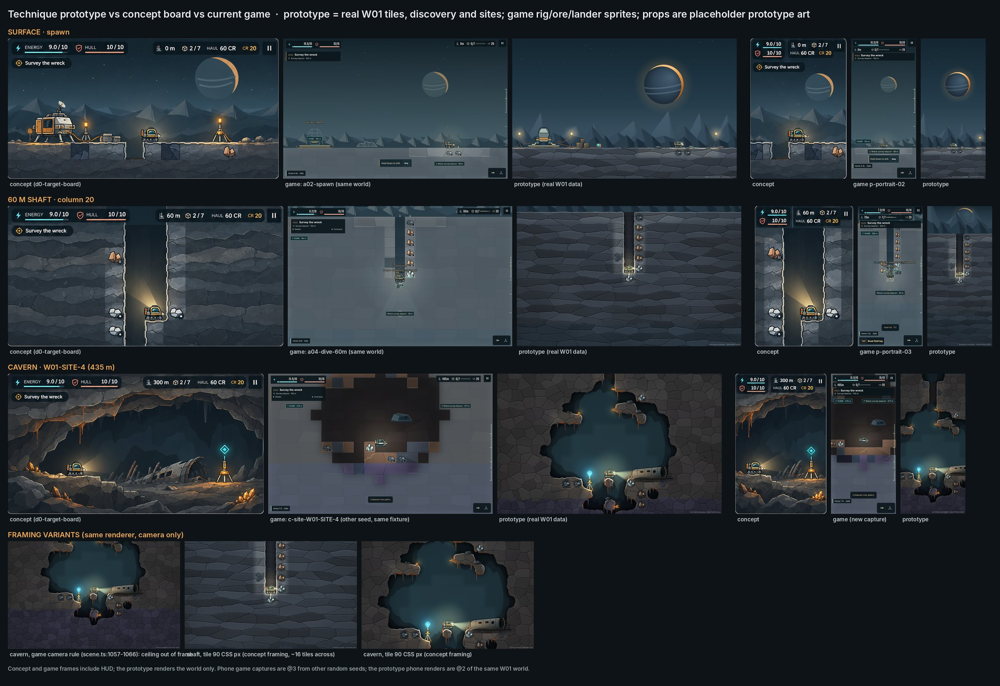
*Rows: surface, 60 m shaft and cavern. In each row: concept, today's game, and a prototype that uses the game's real world data. Wide format on the left, tall format on the right. The bottom row varies only the camera.*

**There are three root causes.**

1. **The light is upside down.**
   - Unexplored rock fills 54–84 % of every underground frame, and it is the *lightest* large area. It measures luma 84–89 at every depth (88.5 in `a04-dive-60m@2.png`), against 57 on the board.
   - Below the first band, explored rock is drawn *darker* than unexplored rock (55 against 84 at 550 m).
   - This is deliberate code (`lighting.ts:73-77`, `terrain.ts:177-181, 209-210`). It over-corrects the old "black void" under a brightness gate that only checked one side.
2. **The renderer cannot draw the concept's shapes or light.**
   - Terrain is square cells with 2 px outlines (`terrain.ts:162-164, 248-277`).
   - The light map can only *remove* darkness, and no object uses additive blending, so nothing can glow.
   - Terrain and light are built on the CPU and re-sent to the graphics card whole on every change. To keep up, the game lowers its drawing resolution and never raises it again. On a 2× laptop screen the world is drawn at half resolution and stretched (backing scale 1.0 on DPR 2, `view.ts:99-121`).
3. **The concept's content was never authored, and guidance text stands in for it.**
   - Of 21 board items, 7 are at concept level, 2 exist far below it and 12 are missing. The wreck counts as missing, because the game draws a generic wedge.
   - Every prop is a few flat polygons typed into a JavaScript generator. None of the 270 sprite SVGs uses a gradient.
   - One wedge serves six of the eight landmark kinds, and the spawn lander is a dashed wireframe.
   - Guidance chips, labels and badges make up **85 % of the strong edges** in the 60 m playfield. The concept has no text in the world.

**What the prototype proves.** The prototype is a standalone renderer that uses the game's own W01 tiles, discovery rules, sites and atlas. Technique alone closed four measured gaps, two in the 60 m shaft and two in the SITE-4 cavern:

| Gap | Prototype | Concept | Game today |
|---|---|---|---|
| Unknown rock, luma (shaft, 60 m) | 52.8 | 57 | 84–89 |
| Natural-cave boundary, share that is axis-aligned (cavern) | 26 % | 18 % | 65 % |
| Headlamp core, L\* / b\* (prototype: cavern, 0.35 tile from the lamp; game: shaft) | 83.5 / +17.6 | 75 / +26 at the lamp | +7.8 lift / −4.8 |
| Edge density (shaft) | 0.085 | 0.077 | 0.028 |
| **Not closed:** cave air vs unknown rock, luma (cavern) | 46.2 vs 46.7, **no step** | 33.9 vs 52–57, air **18–23 darker** | air far darker, but the fog around it is too light |

**What the prototype does not prove.**
- **The cavern's value order.** In the prototype cavern, cave air is as light as unexplored rock. The board's dark hollow inside lit rock is still missing. Fixing it needs a dark back-wall base (`#17242e`) and its own check (§9).
- **The shaft's light.** In the 1-tile shaft the prototype's beam hits rock after 0.1 tile, so the warm fan that lights the board's shaft does not appear. Its dug shaft walls are also 69 % axis-aligned against the board's 40 %; they are straight by design, and T2's boundary gate covers natural caves only. The shaft needs D2 and the bore spill light (§4.1).
- **Two of the board's three scenes, as drawn.** The game cannot produce the board's wide shaft, and has no beacon at the wreck. The tall panels are also not phone-shaped. §4 explains each case, and Phase 0 item F0 re-cuts the targets before anything is gated on them.
- **Motion.** Only stills were judged. The new renderer adds walls that reshape when dug, caves that open on reveal, light edges that can shimmer, and decorations that appear. Motion gets its own gate (§9.3).
- **Props.** The prototype's props are placeholders.

**Hidden information.** Randomising every undiscovered tile (and the stored pristine copy) changed **0 pixels**, so the technique can keep hidden things hidden. The plan adds new places where hidden data could leak, though: back walls rebuilt from the seed, decoration rules, prop snapping and cave framing. So the renderer must only ever receive a known-world view, and the test must compare full frames (F7).

**Gameplay.** This is mostly a rendering change, but five items touch play: camera zoom, on-demand labels, smaller tier marks, cave framing and the shaft's visual widening. Each has a playtest metric in §9.4.

**What it costs.**
- **Vertical slice:** W01 surface, 60 m shaft and the SITE-4 cavern, on desktop and phone, plus the frames a player crosses to reach them. About **9–11 calendar weeks** with two engineers and one artist. That includes about 1.5 weeks of owner reviews and slack. A failed renderer spike adds about 2 weeks.
- **Whole programme:** W01, W02 and menus. About **100–135 engineer-days and 95–107 artist-days**, or about **20–22 calendar weeks** with that team. Committing only to the slice and the W01 rollout takes 14–16 weeks.
- **Biggest quick win:** the value re-key (F4), 1.5–2 days. It ships in week 1, measured with `scripts/improvement-pixels.py` and the prototype's `metrics.py`, which are already in the repository.
- **Owner decisions:** the artist commission (D5) before week 1; then, in week 1, camera framing, shaft composition, overlay policy, band colours, crystal colour, lander size and the beacon at the wreck (§8).

**Start here: the first two weeks.**
1. **Before week 1 (owner).** Decide D5: commission the artist and name the art-direction owner. The schedule holds only if the artist starts in week 1 (§5.7). Order the reference phone (Pixel 6a or Galaxy A54 class).
2. **Days 1–2 (owner, half a day).** Hold the workshop on D1, D2, D3, D6, D8, D12 and D14, using the concept-zoom renders (F0).
3. **Week 1, engineer 1.** F1 (resolution policy), then F3 (visual harness).
4. **Week 1, engineer 2.** F4 (value re-key), F5 (camera whip) and F6 (overlay cuts). These are the first changes you will see.
5. **Weeks 1–2, artist.** F0 (re-cut targets and 9:19 extensions) and A1 (style guide, swatch cards for bands A–C).
6. **Week 2 onward.** Engineer 1: F7, then the 3-day T2 spike on the reference phone; decide D4 before it starts. Engineer 2: T13a first, so the artist can see art in the game, then F2, F8a and F9. Artist: start A2, the lander.
7. **End of week 2: G0 review (owner).** Approve the six re-cut panels and the three 9:19 extensions, and check F1 and F4 against their acceptance columns (§5.2).

---

## 2. Scorecard

**Scale.**
- **0:** absent.
- **1:** present, but reads as a different game.
- **2:** right idea, far from the concept.
- **3:** same family, with clear gaps.
- **4:** close; differences show only side by side.
- **5:** matches the concept at matched scale.

Each panel is compared with the matching crop of the game frame at the board's tile scale (§4.3, §4.4). W02 is scored against a provisional target that the owner has not approved yet (decision D13).

| Dimension | Surface wide | Surface tall | Shaft wide | Shaft tall | Cavern wide | Cavern tall | W02 |
|---|---|---|---|---|---|---|---|
| Terrain | 1 | 1 | 1 | 1 | 1 | 1 | 1 |
| Lighting and colour | 2 | 2 | 1 | 1 | 1 | 1 | 1 |
| Assets and props | 1 | 1 | 3 | 3 | 1 | 1 | 1 |
| Overlays and clutter | 1 | 1 | 1 | 0 | 1 | 1 | 1 |
| Technical sharpness | 2 | 2 | 2 | 2 | 2 | 2 | 2 |
| **Mean** | 1.4 | 1.4 | 1.6 | 1.4 | 1.2 | 1.2 | 1.2 |

For comparison, the technique prototype reaches about 3–4 on terrain in the shaft but about 2 in the cavern, where its air is as light as its rock and its rock reads as "crazy paving". It reaches about 3 on lighting, and 2–3 on assets with placeholder props. It renders the world only, so overlays and sharpness were not judged.

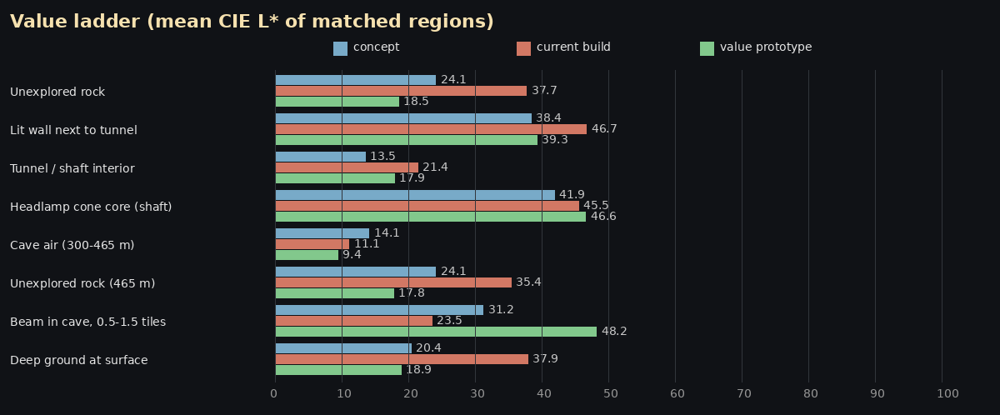
*Mean L\* of matched regions. The current build (red) draws unexplored rock at L\* 37.7, as light as the board's lit walls (38.4); the board's unexplored rock is 24.1.*

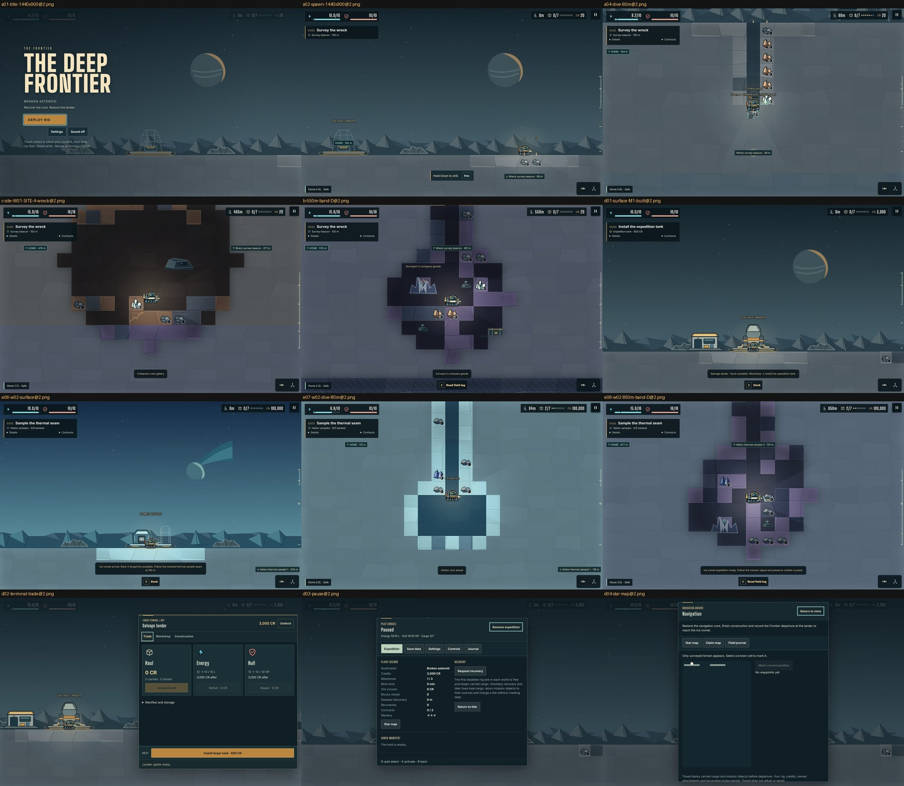
*The current game: title, spawn, 60 m, SITE-4, 550 m, surface after milestone 1, W02 surface, 80 m and 850 m, and menus.*

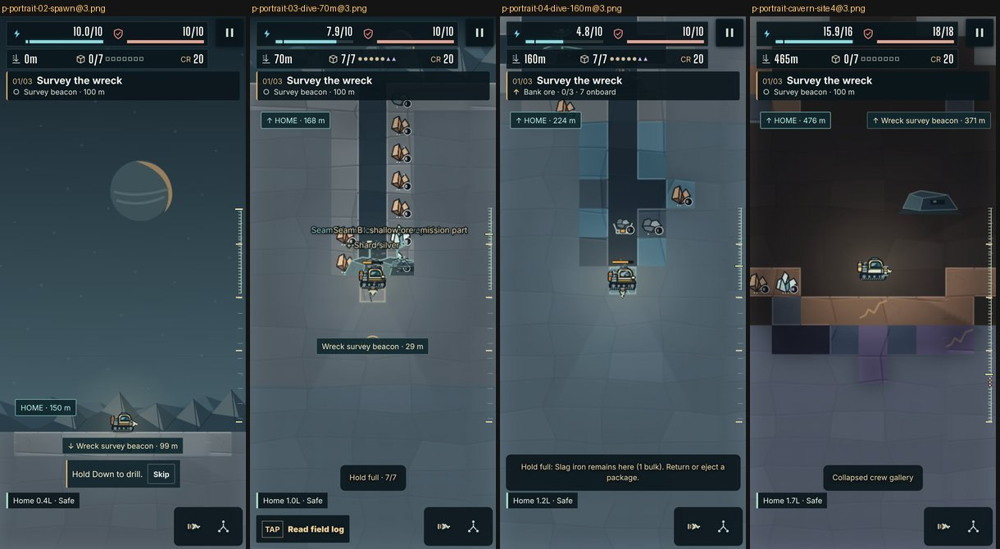
*Phone portrait at 393×851: spawn, 70 m, 160 m and SITE-4. Note the colliding labels at 70 m and the three notice boxes at the bottom.*

### Surface: `a02-spawn-1440x900@2.png`, `a01-title-1440x900@2.png`, `p-portrait-02-spawn@3.png`

| Dimension | What 5 looks like | Evidence today |
|---|---|---|
| Terrain | Dark strata ground at luma 60; hard rock as square, cracked, darker bevelled blocks; bright bevelled hole lips | Ground is the brightest large area (luma 88–120), in 2×1-tile bricks (`01-terrain.md` §2.3) |
| Lighting and colour | Sky `#1d313d`→`#2d4451`. Three ridge layers peaking at about 31 % of frame height. Amber crescent `#d79a61`. Warm accents 2.5 % | Horizon L\* 35.5 (concept 28.3). Two ridges at about 11 %. Crescent `#987E5B`. Warm accents 0.25 % |
| Assets and props | Detailed lander about 2.5 tiles wide, three lamps, cables, crates, tools, rocks | The stage-0 lander is a dashed wireframe, 3.9×2.0 tiles. The lamp dots sit under the pad and give 0 warm pixels (image below) |
| Overlays | HUD plus one objective pill | Nameplate, HOME and target chips, A/B letters, coach, reserve chip, rail. On phones three boxes fill the bottom 30 % |
| Sharpness | Device resolution | World at backing 1.0 on DPR 2 (rig sharpness keep@2 0.96, against 0.69 when pinned at 2). Stars magnified 4× |

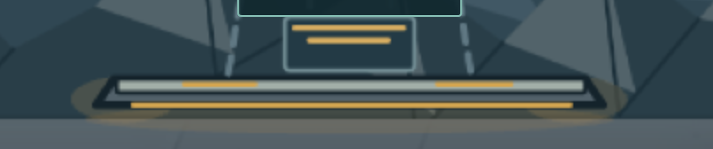
*The spawn's lamp dots draw at depth 11 under the depth-15 pad (`scene.ts:1325-1332`, `1360-1370`).*

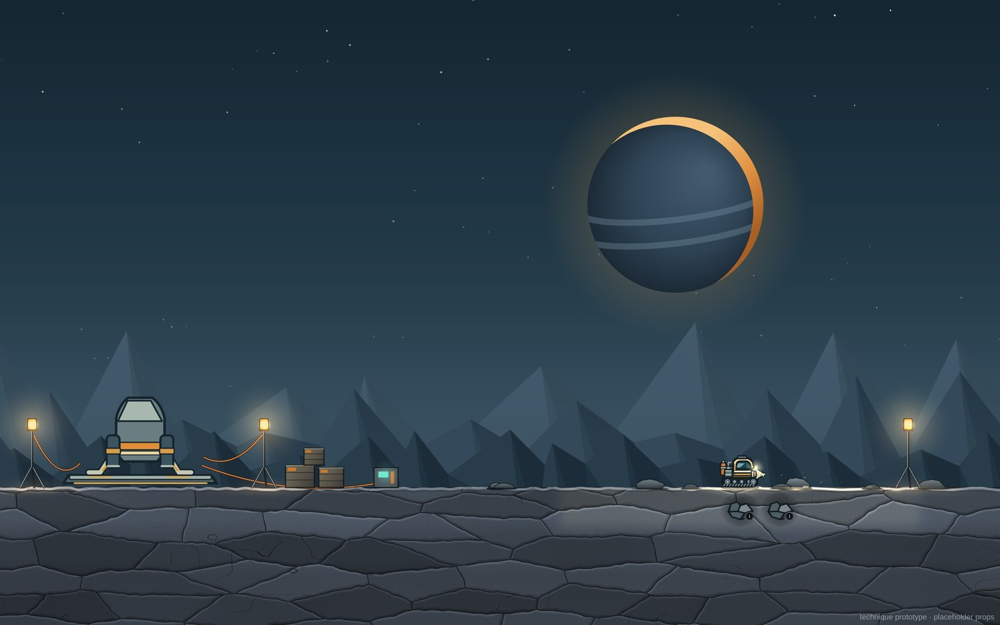
*Prototype surface from the real W01 data at the game's camera: darker strata ground, layered ridges, warm lamp posts, cables and crates. The props are placeholders, and the rig is small because the camera is unchanged.*

### 60 m shaft: `a04-dive-60m@2.png`, `a05-dive-150m@2.png`, `p-portrait-03-dive-70m@3.png`

| Dimension | What 5 looks like | Evidence today |
|---|---|---|
| Terrain | Slate strata. Unknown L\* 24, lit wall 38, near-white lip 88–92 with a dark undercut | Unknown L\* 37.7 (sd 0.7). Wall profile 111→138→50, against the concept's 90→177→35→50. The 0.96-tile rig fills the 1-tile shaft and hides both lips (§4.1) |
| Lighting and colour | 36 % of pixels within ±3 L\* of the mode. p98 L\* about 58. Warm cone at L\* 75, b\* +26 at the lamp | 82 % of pixels at one value. p98 48. The cone adds +7.8 L\* and is cool (b\* −4.8) |
| Assets and props | Rig, embedded ores, small tier marks | Rig and ore match. Ores look like stickers with large white-ringed badges (0.32 of the ore frame) |
| Overlays | None in the playfield | 85 % of strong edges are overlays. 9 text items. Phone labels collide ("SeamSeam B…") |
| Sharpness | Strong-edge share 0.051 | 0.024 as shipped. Terrain raster capped at 1.5 (`terrain.ts:41`) |

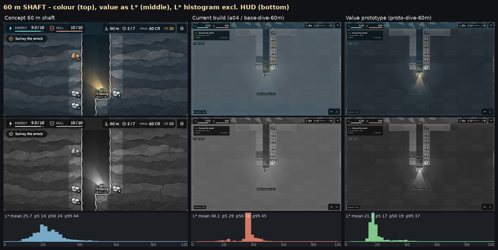
*Colour, L\* and L\* histogram, HUD excluded. The third column is the value-only patch of the game (`02-lighting.md` §2.6), not the technique prototype.*

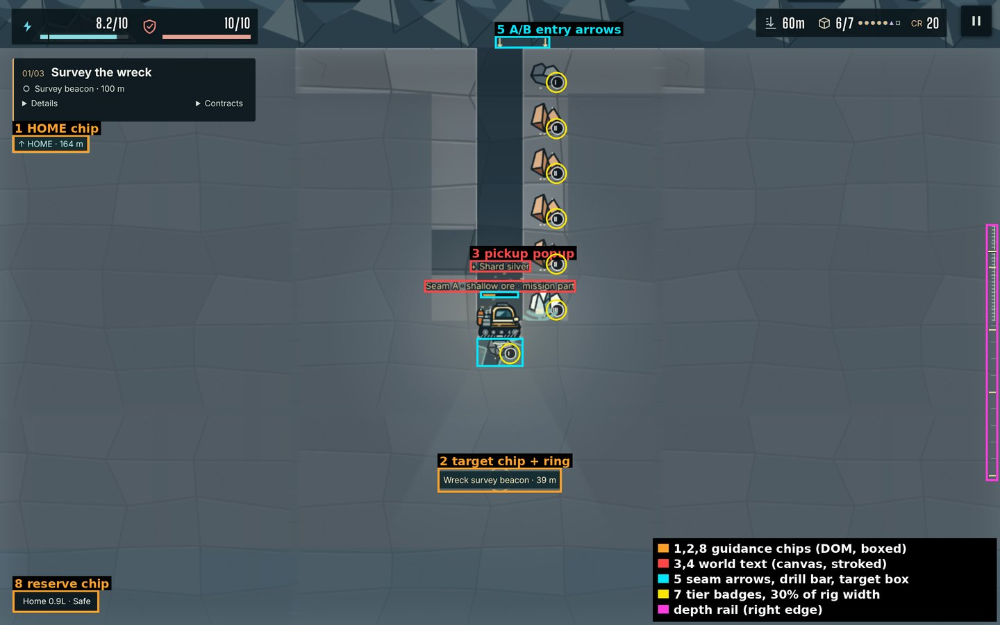
*17 items that read as "UI in the playfield" at 60 m.*

### 300 m cavern: `c-site-W01-SITE-4-wreck@2.png`, `b-550m-band-D@2.png`, `p-portrait-cavern-site4@3.png`

| Dimension | What 5 looks like | Evidence today |
|---|---|---|
| Terrain | Arched vault (18 % of the boundary axis-aligned). Teal back wall `#17242e` with silhouettes. Stalactites | Stepped square pocket (65 % axis-aligned). Brown and purple per-tile checkerboard. Flat back wall (sd 1.1–3.9) |
| Lighting and colour | Cave air L\* 14 with chroma, 18–23 luma below the rock. Warm lamp pool, cyan beacon, amber glow. Warm accents 3.9 % | Explored cave at L\* 10–11 sits inside lighter fog at L\* 35.6. Warm accents 1.3 %, all from brown soil |
| Assets and props | Wreck about 7 tiles wide including ribs, beacon tripod, crystals, drips, boulders | A 2.0×0.74-tile wedge floating 1.85 tiles above the floor. No tripod (the game has no beacon here, §4.2). No dressing |
| Overlays | Waypoint is a glowing object | "HOME · 476 m"; "Wreck survey beacon · 371 m" pointing up; toast, chip, rail, 5 badges |
| Sharpness | — | Sites, POI frames and hazards are cut into cell squares by one known-cell GeometryMask (`scene.ts:208-209`, applied at `680` and five more call sites). Backing 1.0 |

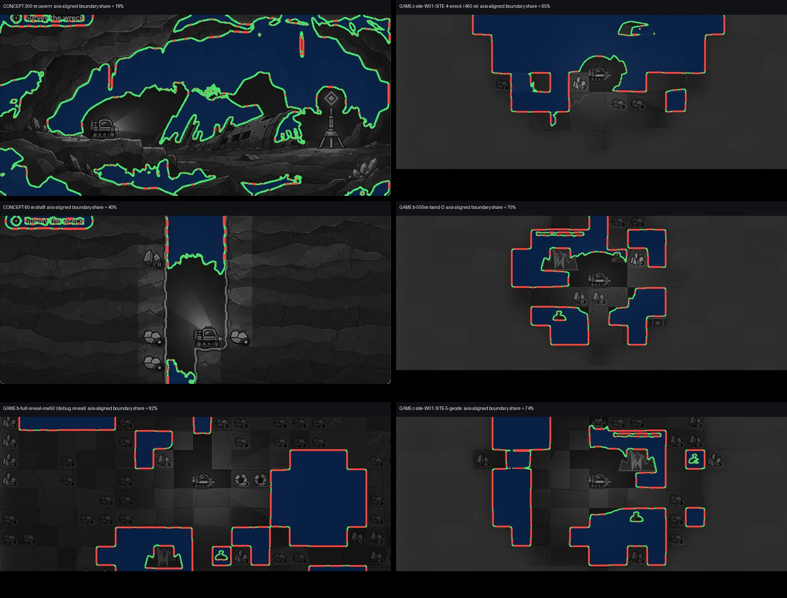
*Red: boundary within ±5° of horizontal or vertical. Concept cavern 18 % and shaft 40 % axis-aligned; four game captures 65–82 %. The prototype's 25.9 % is in §9.2.*

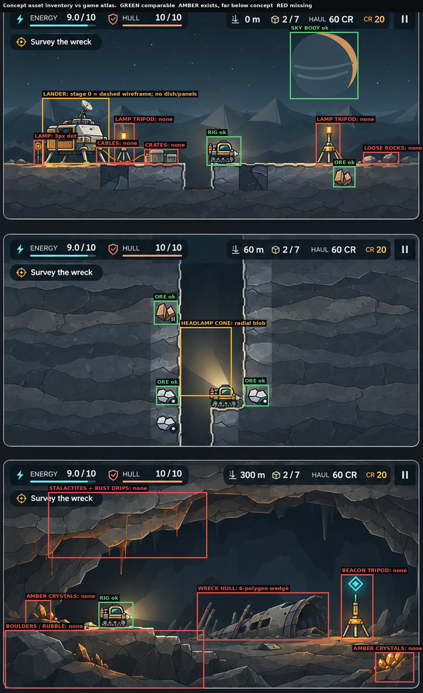
*7 items are comparable (green), 2 exist far below the concept (amber) and 12 are missing (red).*

### W02 comet: `e06-w02-surface@2.png`, `e07-w02-dive-80m@2.png`, `e08-w02-dive-180m@2.png`, `e09-w02-*-band-B/C/D@2.png`

The board does not show W02. The provisional target applies the same rules with an icier key, and needs owner approval before any W02 art is made (D13):
- **Unexplored ice-rock:** L\* 27–32 (luma 64–75). That is one step paler than W01, but still at least 15 luma below lit walls.
- **Cave air:** blue-teal, L\* 14–18, at least 10 luma below unknown rock.
- **Headlamp:** warm, with the same core gate as W01 (L\* ≥70, b\* +15 to +30). It is the comet's main warm figure, so warm share should be ≥0.5 %.
- **Cyan:** reserved for emitters.

| Dimension | Score | Evidence today |
|---|---|---|
| Terrain | 1 | Pale teal unknown rock, about RGB 82,112,123. 74 % of pixels sit within ±3 L\* of one value at 80 m |
| Lighting | 1 | Frame L\* 49.1, the palest frame in the set. Warm share 0.02–0.04 % in every W02 capture. Cyan share up to 38 % (`e06`), because the ground itself is cyan |
| Assets | 1 | Dashed refuge module at spawn (`e06`). No ice dressing |
| Overlays | 1 | "+ Frost iron" popup, HOME chip, target chip, toast, reserve chip, depth rail |
| Sharpness | 2 | Same renderer and resolution ratchet as W01 |

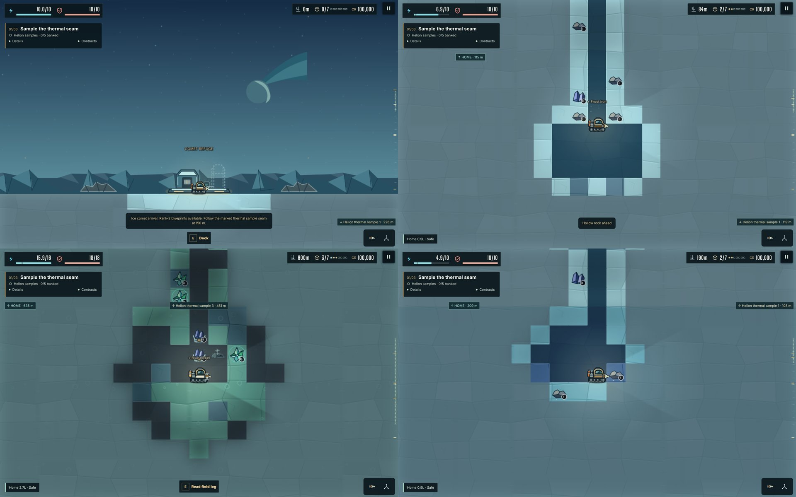
*W02 surface, 84 m, 600 m and 190 m.*

---

## 3. What was implemented, and what still falls short

**In plain words.** The implementer built what the documents say, and the tests pass. But graphics items were closed when the code existed, not when the frame looked like the board. The plan's key visual gates ("histograms within tolerance of D0", "headlamp and rig hold the brightest pixels") were never measured. The one darkness gate that was measured pointed the wrong way.

Claim IDs marked "Plan" are item IDs from [`IMPROVEMENT_PLAN.md`](IMPROVEMENT_PLAN.md). D1–D14 elsewhere in this document are the owner decisions in §8.

| Claim | Where | What the pixels and code show | Verdict |
|---|---|---|---|
| Dark pixels 89.5 % → 5.4 % | `IMPROVEMENT_PROGRESS.md` | True, but the concept has 10–42 %. Unknown rock now sits at the concept's *lit-wall* value (L\* 37.7 vs 24.1) | Gate met, wrong target |
| Plan D4: blurred darkness, headlamp erasure, glint brushes | `IMPROVEMENT_COVERAGE.md:58` | Built to an erase-only spec: a 16-luma veil. The cone is *darker* with light on (L\* 38.4 vs 42.2, image below). At 465 m explored space is darker than fog | Delivered; cannot produce the concept |
| Plan D6: seamless 8×8 pages, all rim masks, back walls | `IMPROVEMENT_COVERAGE.md:60` | 24 pages share one plate layout (overlap 0.95–0.98). Strata hidden under plates (`render-sources.mjs:36-45` vs `:51-61`). Seam strip every 8 tiles. Rims are 2 px strokes; the 46 edge-mask SVGs are packed but not referenced by `src`. Wall pages halved (`art.ts:88-101`) | In name only |
| Plan D7: surface props and lander/base lights | `IMPROVEMENT_COVERAGE.md:61` | Lamp dots at depth 11 under the depth-15 pad: 0 warm pixels. One 2-primitive salvage heap | Not visible |
| Plan D8: sites use generated atlas frames | `IMPROVEMENT_COVERAGE.md:62` | True. But 6 of 8 kinds use one wedge (IoU 0.90–1.00 with the wreck, `render-sources.mjs:12-28`). The wreck floats 1.85 tiles above the floor, because the site y is the ellipse centre (`world.ts:260-273`) | Moved, not redesigned |
| Plan D5: baked tier badges | `IMPROVEMENT_COVERAGE.md:59` | Badge diameter 0.32 of the ore frame with a white ring (concept about 0.17, no ring). Tier encoded three times, 7–11 per frame. ΔE measured on badge edges, not ore fill | Readable, costs the look |
| Plan D3b: native @2x/@3x sprite pages | `IMPROVEMENT_COVERAGE.md:57` | A one-way ratchet (`view.ts:103-121`) leaves the world at backing 1.0 on DPR 2 and 1.5 on DPR 3. Phones never load @3x (`scene.ts:833-837`, `art.ts:144`). Phone terrain magnified 2.28× | Not shown at their resolution |
| Zero stationary terrain uploads | `IMPROVEMENT_PROGRESS.md` | True for terrain. Two label textures re-upload every frame (`scene.ts:648-649` vs `710-714`). Moving frames average 1.88 MiB | Incomplete |
| Plan C2: debris, sparks, icy particles | `IMPROVEMENT_COVERAGE.md:38` | One rectangle `Chip` type flying upward (`scene.ts:763-768`, `vy = −random × 2.3`). No spark or dust code in `src/campaign` | Not as described |
| Plan C7b: exhaust and thrust respond to motion | `IMPROVEMENT_COVERAGE.md:45` | Thrust is a sprite. No exhaust code. Landing squash is centre-anchored | Partial |
| Plan C3: surface 0.88 and deep 1.05 zoom | `IMPROVEMENT_COVERAGE.md:39` | True. At renderY 0.2 the rig whips 346 CSS px and zoom jumps 13.6 % in 120 ms | Visible defect |
| Plan D1: gradient sky, ridges, one sky body | `IMPROVEMENT_COVERAGE.md:54` | Seamless, but only 2 low ridges, a bright horizon and a desaturated crescent | Quality short |
| Plan D0: board used by the implementation | `IMPROVEMENT_COVERAGE.md:53` | No capture was ever scored against it, and no sign-off is recorded | Never a gate |
| Hidden air and rock pixel-identical | `IMPROVEMENT_PROGRESS.md` | Confirmed. The prototype keeps it (0 px changed under scramble) | Keep |
| Compact HUD, local fonts (Plan E1, E4) | `IMPROVEMENT_COVERAGE.md:69-73` | The layer closest to the board, but not equal. The objective is a card of about 349×91 CSS px with "01/03", a sub-goal, Details and Contracts; the board's pill is about 312×46. Bars show no ENERGY/HULL labels: they exist (`ui/shell.ts:8-9`), but the same rule that hides the HAUL readout (`ui/shell.ts:14`) hides them at every width (`style.css:3459-3463`) | Partly delivered |

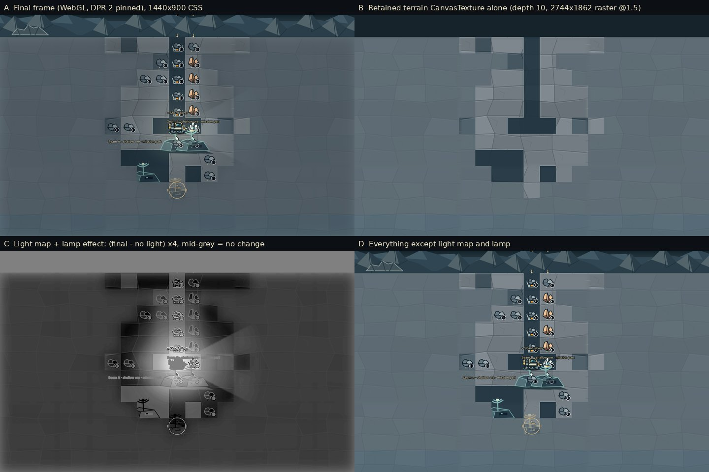
*The 60 m frame split into its layers. The headlamp cone is darker with the light layer on than off.*

**Against the baseline** (`improvement-plan/baseline-contact-sheet.webp`), the game moved from too dark to too light, from a system-font logo to a wordmark, from two planets to one, and from one slab tile to banded colour pages. The structure did not change: square cells, subtractive light, flat props.

---

## 4. Where the board and the game disagree

**In plain words.** Two of the board's three scenes show things the game never does, and the "portrait" panels are not phone-shaped. If we gate on the board as drawn, we will either fail forever or stage fake screenshots. So the first step (F0) is to agree targets the game can actually reach, and the owner approves them before art is made against them.

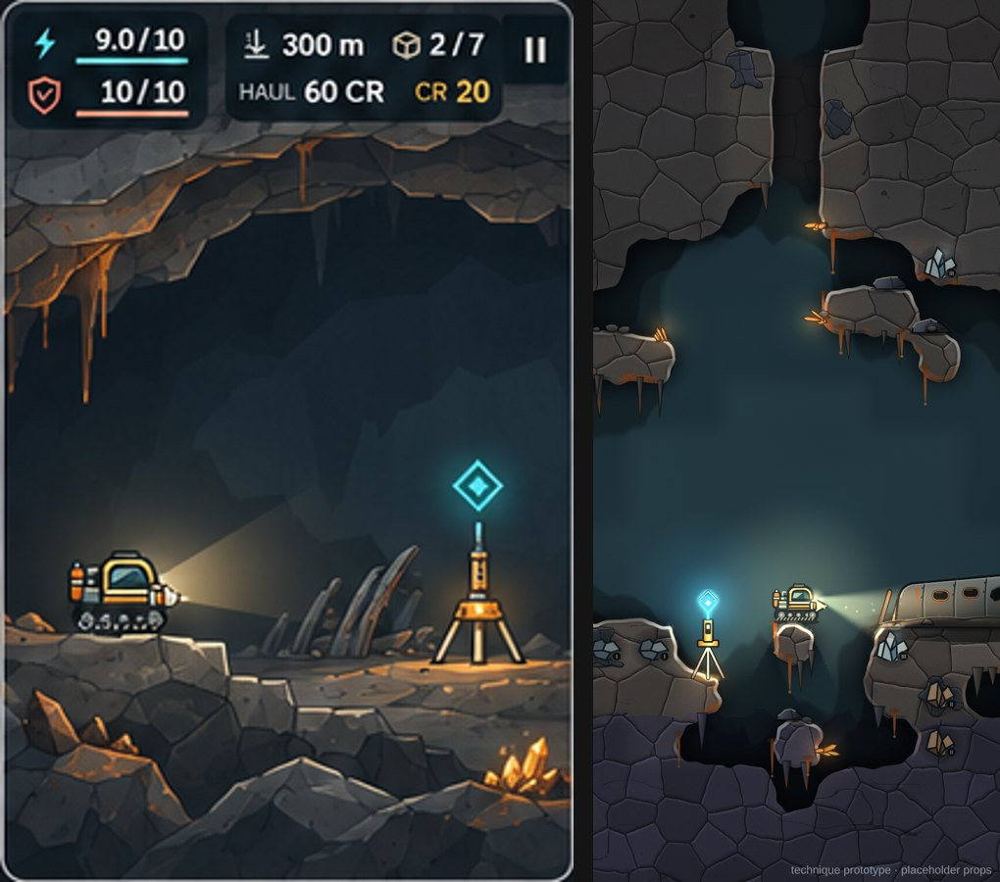
*Left: the board's tall cavern panel (0.65:1). Right: the prototype at 393×851 (0.46:1). The phone shows about 40 % more height. The prototype's cave air is also as light as its rock.*

### 4.1 The 60 m shaft

- **Board.** The shaft is about 2.3 tiles wide: rims at x 518 and 627 on the board, tile about 44–47 px. The rig stands on a ledge against the right wall, facing it, with open shaft on its left. Its warm beam does not point where the rig faces: it fans up and to the left from the cab for about 2 tiles and lights the shaft air above the rig. The walls stay cool.
- **Game.** The game digs 1-tile shafts. The rig hull is 0.96 tile wide: 92 px on a 96 px tile in `rig-body-0`, and about 125 px outline to outline (112 saturated px) on a 130.9 px tile in `a04-dive-60m@2.png`. With the side drill it is 1.15 tiles. So the rig *is* the shaft, and it hides both lips exactly where the player looks. While drilling down, the headlamp points into rock: the prototype's cone hits the wall after 0.1 tile, and its concept-zoom shaft shows no cone at all.

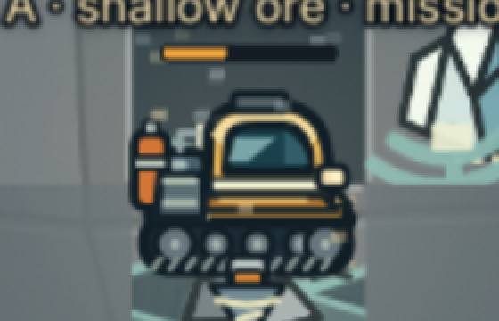
*`a04-dive-60m@2.png`: the hull spans the shaft from wall to wall.*

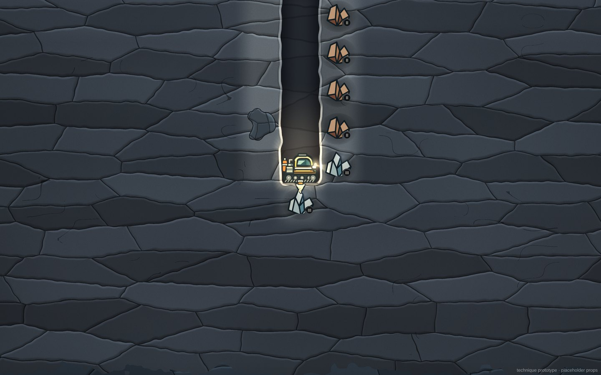
*Prototype at the board's tile scale: correct rock and lips, but a 1-tile shaft with no visible cone.*

**Recommendation (decision D2).**
- **Option (a), recommended:** a render-only over-carve of **0.20 tile per side** into *known* solid on dug vertical runs. The visual shaft becomes 1.4 tiles. That leaves 0.22 tile of air beside the hull in the down pose and 0.125 tile in the side pose, inside the 0.3-tile limit for walls (§9). Ore lumps in the wall column may protrude into the carved strip; the board draws them that way.
- **Option (b):** a 2-wide bore. This changes drill time and energy, so it is a gameplay change.
- **Either way:** add a **bore spill light** to T1. While drilling down, a warm pool lights about 2 tiles of shaft wall above and below the rig.
- **Re-cut target:** "a 1.4-tile shaft, the rig stopped against a wall, the beam tilted up the shaft as on the board". A horizontal beam would travel only 0.125–0.22 tile before it meets rock, so it would show as a bright patch on the wall, not as the board's fan. As part of D2, the owner chooses between a tilted beam (or a roof work-light) and that patch, and approves the panel in F0.

### 4.2 The 300 m cavern

- **Board.** A beacon tripod with a cyan diamond stands beside the wreck. It is the board's only cool light.
- **Game.** The "Wreck survey beacon" is at (20.5, 9.5), about 95 m down inside the route column (`poi.ts:236-246`, `config.ts:367`). SITE-4, the wreck ("Collapsed crew gallery"), is at (15.5, 43.5), about 435 m down, with no beacon. The prototype placed a beacon there as "not a game object at site 4".
- **Depth.** The board says 300 m. In the game, 300 m is the plate layer (rows 30–31, §5.3 T14). The only cave large enough for the board's cavern is the SITE-4 gallery (`world.ts:186-188`). In `fresh-w01` it is 11 cells wide and 5 rows tall (rows 41–45), with a 4-cell flat floor at row 46, columns 15–18. So the slice cavern is SITE-4 at about 435 m.
- **Staging.** The current cavern capture is a teleport with a radius-6 reveal (manifest note on `c-site-W01-SITE-4-wreck@2.png`). It is not a state reached by playing.

**Recommendation (decision D14).** Choose one:
- **(i) Content, my lean:** add a dormant crew beacon to the SITE-4 set piece. It lights when the site is discovered and is not a waypoint. The playtest must show that no player navigates to it instead of the objective.
- **(ii) No content change:** remove the beacon from the cavern target, and give asset 15 a wall-mounted variant for the real beacon cell at 95 m, which has 1-tile clearance.

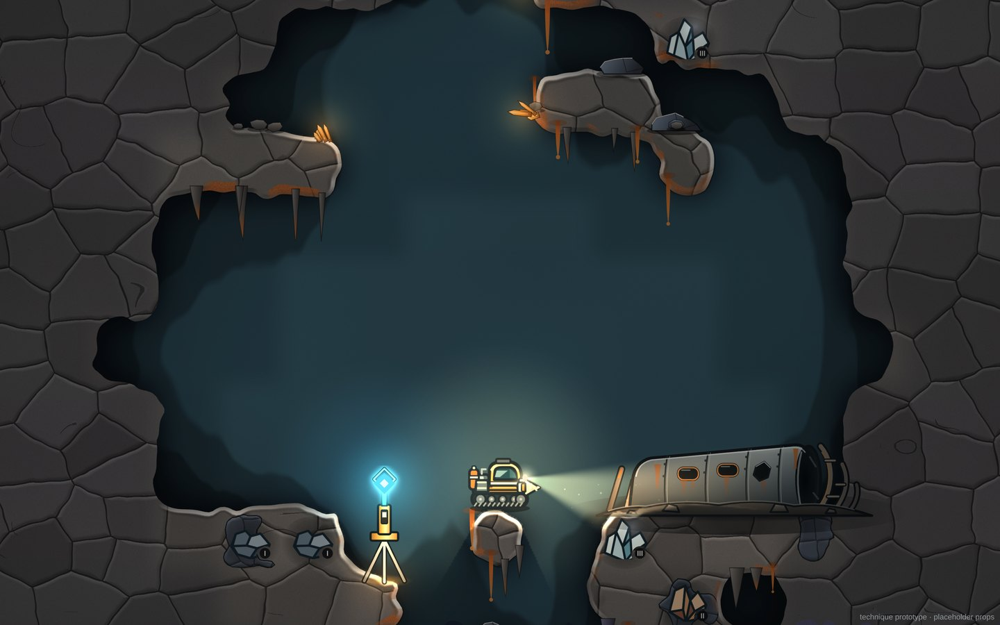
*Prototype at the board's tile scale: organic boundary and dressing slots, but the air is as light as the rock and the beacon is a stand-in.*

### 4.3 Panel shapes

- The board's panels measure 693×358 (1.94:1) and 246×358 (0.69:1) in the surface and shaft rows, and 693×381 (1.82:1) and 246×381 (0.65:1) in the cavern row. They are not 16:9 (1.78) or 9:19 (0.47).
- A 393×851 phone (0.46) shows about 50 % more height per unit of width than the tall panel (about 40 % more than the cavern's).

**Fix.**
- Score the wide format on a **1440×743 band** (1.94:1; **1440×792** for the cavern) and the tall format on a **393×572 window** (0.69:1; **393×608** for the cavern). Crop each around the rig at the board's anchor point.
- Separately, review the full 393×851 frame against an owner-approved **9:19 extension** of each tall panel, painted over the prototype render in F0.

### 4.4 Camera scale

- **Board.** The wide surface panel shows about 15.7 tiles across (tile about 44 px in a 693 px panel). The tall panel shows about 5.6 tiles, and the rig is 21 % of the panel width.
- **Game today.** The desktop tile is 65.5 CSS px at 1440 wide (`max(48, width/22)`), so the frame shows 22 tiles down to 120 m, 21 below it (zoom 1.05), and 25 at the surface, where zoom is 0.88 (`scene.ts:788-796`). Phones use 44 CSS px: 8.9 tiles, 8.5 below 120 m, or 10.2 at the surface.
- **Consequence.** The board's scale needs about 92 CSS px per tile on desktop (183 device px at backing 2) and about 70 on a phone (210 device px at DPR 3). Both exceed the @3x pages (144 px per tile), and phones never load @3x today (`scene.ts:833-837`, `art.ts:144`). So the camera decision (D1) fixes texel density, asset priority and how far ahead the player can see. It comes first (§8).

---

## 5. The plan to reach concept quality

**In plain words.** First, fix the order of light and dark (week 1) and agree targets the game can reach. Then replace the renderer's square cells and erase-only light with a GPU terrain shader and real additive light, while one artist paints the lander, lamps, wreck and cave dressing. Prove all of it on one slice (surface, 60 m, the SITE-4 cavern and the frames in between) before rolling it out to every W01 band, then to the comet and the menus.

### 5.1 Principles

1. **Gate on the board, as re-cut by F0, and on motion.** Every gate uses side-by-side capture sheets, a motion run and the §9 checks. Nothing closes on "code exists".
2. **Technique first, art second.** Values, edges, light and placement come from code. Art then fills slots the renderer has.
3. **Hidden information is structural.** The renderer receives only a known-world view (F7). Unknown cells are drawn from position and band only. Decoration and props never consult hidden data.
4. **Slice before scale, including the way there.** Reach concept quality for the W01 surface, the 60 m shaft (band A) and the SITE-4 cavern (band C, about 435 m), and also for the frames every player crosses to reach them: the title, band B at 150 m, and the plate layer at 300 m. Get owner sign-off before rolling out.
5. **Decide first.** Decisions that fix texel density, composition and colour are taken in a week-1 workshop, before the art they affect.
6. **Every animated term runs on the scene clock.** It freezes under the test clock and turns off in reduced-motion mode.
7. **Two tracks.** T items are rendering technique (code). A items are art production (assets).

### 5.2 Phase 0: foundations and quick wins (weeks 1–2)

| ID | Change and technique | Effort | Deps | Acceptance |
|---|---|---|---|---|
| F0 | **Reachable targets.** Re-cut the shaft (D2) and cavern (D14) panels; paint 9:19 extensions of the three tall panels over prototype renders. Run the week-1 decision workshop (D1, D2, D3, D6, D8, D12, D14) with the concept-zoom renders. Arrange one physical reference phone | 2–3 d art direction, 0.5 d owner | — | Owner-approved targets for six panels plus three 9:19 extensions, stored in `docs/art-direction/` |
| F1 | **Resolution policy.** In `RenderScaleBudget` (`view.ts:99-121`): a floor per quality tier (High 2.0, Medium 1.5, Low 1.0); upward recovery after 10 s below 12 ms; ignore loading and resize windows. Keep the three levels that `input.ts:120` and `render-adaptive.mjs:68-80` expect. Add a debug pin and report the backing scale in debug output | 1–1.5 d | — | Backing returns to 2.0 within 60 s on desktop; rig sharpness keep@2 ≤0.75; `render-adaptive` still passes |
| F2 | **Zero steady uploads.** Guard `setWordWrapWidth` (`scene.ts:710-714`) | 0.5 d | — | 0 uploads in stationary frames |
| F3 | **Visual harness.** Extend the existing `render-probe.mjs`, `render-acceptance.mjs` and `improvement-smoke.mjs` rather than adding a new probe. Add `?overlays=0`, `__campaignDebug.lightTexture()`, pinned DPR, HUD-free snapshots and a scene-clock freeze. Port the audit's metric code into `scripts/`: the frame, boundary and gradient measures in `docs/art-audit/prototype/metrics.py`, and an overlay edge-share measure (strong edges with and without overlays, `04-overlays.md` §6). Run fixtures at backing 1 in the existing `verify` job, and the full @2 sheets in a new schedule-only job with its own timeout (`checks.yml:6-7` already has a schedule; `verify` is capped at 30 minutes for PRs and nightly runs alike, `checks.yml:19`) | 3–4 d | F1 | The §9 sheet and table are produced nightly; the per-PR job stays under 30 minutes |
| F4 | **Value re-key (quick win).** Darkness ordered unknown > remembered > visible, set per band (`lighting.ts:73-77`). Unknown base `#30383f` (W01) and `#2f4250` (W02), drawn with the band rock page at 0.4–0.5 alpha (`terrain.ts:177-181, 209-210`). Cave air base `#17242e` before light. Delete the cream normal-blend lamp (`scene.ts:244-261, 1177`). Floor high-contrast unknown at L\* 18. Measured with the existing `scripts/improvement-pixels.py` and the frame statistics in `docs/art-audit/prototype/metrics.py`, so it does not wait for F3 | 1.5–2 d | — | Unknown luma 45–65; lit known ≥ unknown +15 at every depth; unknown − cave air ≥ +10; frame L\* within ±4 of the concept; the existing dark-share check (`improvement-smoke.mjs:1025-1031`, ≤60 % below luma 40) still passes |
| F5 | **Camera whip fix.** Smoothstep blend of zoom, targetY and home pull over renderY −0.4 to 1.6; critically damped follow of about 110 ms (`scene.ts:788-795, 1056-1098`) | 1 d | — | ≤40 CSS px per 50 ms; zoom change ≤3 % per 100 ms |
| F6 | **Overlay quick cuts.** Delete the nameplate (`scene.ts:1371-1384`). Show A/B only during the coach. Drop " · mission part" (`scene.ts:1508-1514`). Show the rail on hover or pause | 1 d | — | ≤4 text items at 60 m (today 9) |
| F7 | **Hidden-information contract.** The renderer receives only a `KnownWorldView`: per cell, `known`; for known cells only, `type`, `natural`, deposit tier and site id; known hazards only. Unknown cells read as "solid, band(row)". The renderer never gets `world.tiles` or the pristine array. The scramble test randomises `world.tiles` for unknown cells, injects a scrambled pristine array through a debug hook, and moves every hidden deposit, undiscovered site, shelf, cold pocket, vent and pressure seam. Keep the two existing inset-crop checks (`improvement-smoke.mjs:804-877`, `render-acceptance.mjs:163-171, 236`) as smoke tests | 2–3 d | F3 | 0 differing pixels on **full frames** for the surface, 60 m, the 150 m side tunnel, SITE-4 and a 393×851 phone; Scan off and on; cave framing on; WebGL and Canvas |
| F8a | **Duplicate atlas.** Unload the 2× atlas once the 3× page is resident (`art.ts:149-182`) | 1 d | — | Desktop W02 ≤58.5 MiB (today 63.52) |
| F9 | **Freeze the generators.** Hash tests of `tiles` and `packages` for seeds 0–19 per world, for generator versions 1 and 2. T4 rebuilds back walls of existing saves from the seed, which is only correct if these never drift | 0.5–1 d | — | Tests pass and fail on a deliberate generator change |
| T13a | **Minimal asset path.** A PNG listed in `frames.json` shows in a fixture, so the artist can review in context from week 2 | 1 d | — | A test PNG appears in the 60 m fixture |

F4, F5 and F6 are the week-1 changes the owner will see: a darker, calmer frame with the right value order. It will still look flat until Phase 1.

**Gate G0 (foundations, end of week 2).** Every Phase 0 acceptance column passes, the F0 targets are owner-approved, the week-1 decisions are recorded, and the reference phone is on hand.

### 5.3 Phase 1: vertical slice (weeks 2–11; G1 at the end of week 9–11)

**Layer stack.** Today the light layer is at depth 17 (`lighting.ts:19`) and the rig at 18–23 (`rig.ts`). The draft plan put the front mound at depth 24, above the light, so foreground boulders and wreck mounds would show at full brightness in a dark cave. Phaser's Canvas renderer cannot tint sprites, so tinting cannot fix that on Canvas. The stack is therefore:

1. Sky and ridges (surface), or back wall and back-wall strips (underground).
2. Back props: the wreck's back layer, tripod legs, set pieces.
3. Solid terrain. Unknown cells are opaque solid, so anything in layers 1–2 is hidden there without any mask.
4. Front props and decals: the front mound, boulders, stalactites. Each is drawn only where its whole footprint is known, and fades in on reveal.
5. The light composite over layers 1–4: the quarter-resolution light texture drawn once with a 2× modulate blend (`renderer.addBlendMode([gl.DST_COLOR, gl.SRC_COLOR], gl.FUNC_ADD)`; Phaser's `setBlendMode` always applies the stored equation), so it can both darken and lift (0–2×). It needs no full-resolution render target. The terrain shader may sample the light texture directly to save the pass.
6. The rig, emissive sprites and ADD glows; then world annotations; then the DOM HUD.

On Canvas, layer 4 sits below the darkness image.

**Rendering technique (code).** The prototype's parameters are in `06-prototype.md` §2.

| ID | Change and technique | Effort | Deps | Acceptance |
|---|---|---|---|---|
| T1 | **GPU light stack.** Quarter-resolution darkness from a 1-texel-per-cell base (replaces `ctx.filter`, `lighting.ts:86`). ADD `DynamicTexture` with headlamp, pool and the **bore spill light**, occluded by about 720 CPU rays (1–2 ms) marched on the visual field, drawn as a triangle fan. 0–2× composite, rim light from the field's lip mask, motes, ADD emissive sprites above the darkness. Every time-varying term is driven by the scene clock. Replace the `fogBlurMaximumAlphaStep` assertion (`render-acceptance.mjs:158-162`) with a probe on the new base texture | 7–10 d | F1, F4, T2 | Headlamp core L\* ≥70 with b\* +15 to +30 (board: 75 / +26 at the lamp); back to ambient by 2.5 tiles; facing a wall lifts unknown rock ≤2 L\*; in the down-drill pose, shaft walls within 1 tile of the rig ≥ unknown +15; the camera round trip (`render-acceptance.mjs:175-215`) stays byte-identical under the frozen clock |
| T2 | **Terrain field renderer (WebGL).** Field texture at 16 texels per tile (W01 640×960, 2.3 MiB), patched on dig *or* discovery. One shader quad draws iso-line, lip, undercut, AO, slab material and inclusions. Hard rock keeps square, cracked blocks with a 0.03-tile chamfer and plate fill at L\* −8. Floors (solid below, air above) get no low-frequency displacement and a jag ≤0.01 tile; 1-cell pillars get a flat top ≥0.8 tile wide. **Phaser 3.90 creates a WebGL1 context** (`WebGLRenderer.js:770`), so: RGBA8 or LUMINANCE_ALPHA textures, no `texelFetch`; patches through raw `texSubImage2D` on the texture wrapper (Phaser has no helper), with Phaser's bound-texture state restored, coalesced to at most one upload of ≤160×160 texels per frame; the textures are not powers of two, so no REPEAT or mipmaps: pad 4 wrapped columns each side, sample with clamp, and make the noise periodic over the world width; require fragment `highp` (Phaser falls back to `mediump` when it is missing, `Single-frag.js:3-7`), otherwise use the Medium tier; a `webglcontextlost`/`restored` handler rebuilds the field and relights (nothing in `src` handles this today). Starts with a **3-day spike on the reference phone** | 12–17 d | F3, F7 | Natural-cave boundary ≤30 % axis-aligned (hard rock excluded); floors: \|visual − collision\| ≤2 device px at every column the tracks can occupy; walls and ceilings ≤0.3 tile and ≤5 % of pixels; lip ≥ rock +55; undercut ≤ air −8; gradient ≥2.5; no visible seam at x = 0 (≤2 luma across it); context-loss smoke test with `WEBGL_lose_context` passes |
| T2-fallback | *Only if the spike fails by the end of week 3:* dual-grid edge tiles baked from the same field code (asset 52) | +6–9 d | T2 spike | The same image gates; G1 moves about 2 weeks |
| T3 | **Canvas fallback.** `RetainedTerrain` with F4 values plus 8-neighbour bevels, undercut and AO in air cells (`terrain.ts:141-147, 248-277`). Darkness from a 1-px-per-cell canvas upscaled with `imageSmoothingQuality = "high"`, with no `ctx.filter`. ADD becomes `lighter`. Front props draw below the darkness image | 3.5–4.5 d | F4 | Information parity, not pixel parity; scramble 0 px |
| T4 | **Natural vs dug back walls.** Pristine tiles rebuilt from the seed and `generatorVersion` (no save change), passed to the renderer only for known cells. Dug air: recessed strata. Natural air: base `#17242e`, silhouettes, painted-strip slots. Strips are tiled by world position, clipped to known natural air and faded in on reveal, so their extent never shows how far a cave goes | 2–3 d | T2, F9 | Back-wall luma 28–42, sd ≥4, cooler than rock; unknown − cave air ≥ +10; lit rock − cave air ≥ +18 |
| T5 | **Decor layer.** Hash placement on known natural faces only: stalactites, rust seams on known ceiling joints and drips in bands C/D, rubble, boulders, and crystals with no *known* deposit in the 3×3 neighbourhood. Recompute on discovery; a decal fades out over 300 ms when a neighbour reveals ore, and fades in over 300 ms. At most 40 per screen | 3.5–4.5 d | T2, T4 | 0 decals on unknown cells; ≥8 ceiling decals per 10 exposed ceiling edges at SITE-4; scramble 0 px |
| T6 | **Set-piece layer.** Snap props to the floor (`originY` 1, bottom on the floor row rather than the ellipse centre). Use the layer stack above: remove the shared `wreckMask` (`scene.ts:208-209`) and its six `setMask` calls (`scene.ts:680, 1491, 1646, 1735, 1769, 1793`: wrecks, POI frames, cold pockets, sites, field logs, pressure seams). Hazards and field logs go in layer 4 with the whole-footprint-known rule; no BitmapMask, which is a no-op on Canvas (`BitmapMask.js:148`) | 2–3 d | T1, T2 | Prop bottoms within ±2 device px of the floor; 0 stencil masks; front props no brighter than the terrain beside them under the same light |
| T7 | **Surface scene.** Three ridges at parallax 0.2/0.35/0.6. New sky gradient. The board's crescent, unflipped. Seeded surface kit outside the pad. Cables as `Rope` on WebGL and as Graphics bezier strokes on Canvas (`Rope` has no Canvas renderer). Lamp halos | 3.5–4.5 d | T1 | Horizon L\* 26–31; ridges ≥22 % of frame height; ≥4 warm emitters; warm accents 1.5–4 % |
| T8 | **One annotation system with Scan.** Merge the Phaser text pool (`scene.ts:611-655`) and the DOM beacons (`ui/world-labels.ts`) into one module with a priority solver that keeps clear of the rig. Labels show while Scan is held: gamepad L2 (button 6; L1 is already `interact`, `input.ts:62-73`), a tool-tray button (touch holds become the joystick after 180 ms, `pointer.ts:83, 96`), and Shift/F, with a toggle preference like `drillToggle`. HOME stays as an always-on edge chevron; hazards stay always on. Draws asset 28 (edge chevron, pulse ring, Scan glyph, leader tick). Rewrite `feel-smoke.mjs:149, 256`, `plan-ui-smoke.mjs:429-466` and `frontier-smoke.mjs:447-453`, which expect the DOM HOME and target labels | 5–7 d | F6 | ≤1 text item with Scan off; 0 within 1.2 tiles of the rig; 0 collisions; overlay edge share ≤20 % |
| T9 | **Tier marks and sockets.** `oreBadge()` at r=8 with no ring. Remove notches and harness squares. Add an ore socket decal. Full-size HC variant for high contrast and Scan. Update `check-render-assets.mjs:120-140` | 2 d | — | Badge ≤0.18 of the ore frame |
| T10 | **Diegetic waypoint.** Pulsing beacon emitter with a light shaft, on the scene clock. Edge chevron for off-screen targets. Distance moves into the pill ("Survey the wreck · 39 m ↓") | 3 d | T1, T8 | Time-to-beacon not worse in playtest |
| T11 | **Camera and shaft.** Zoom per the D1 table (§8). Cave-framing rule for known chambers ≥5 rows tall. The 0.20-tile over-carve (D2a) on dug vertical runs, as a field operation | 2–4 d | F5, T2 | Both shaft lips visible beside the rig in the down and side poses |
| T12 | **Drill feedback, minimum.** ADD bit glow. Chunks fly away from the bit and bounce. Dust on soil, sparks on stone. All on the scene clock | 2–3 d | T1 | ≥3 particle types; ≥40 % of chunks move down or sideways on a down-drill |
| T13b | **Asset pipeline.** Raster source path in `frames.json`. `-emissive` frame convention. Zone atlases ≤2048×1024 @3x. 4× masters. Choose pages by device px per tile, not by pointer type (`scene.ts:833-837`, `art.ts:144`) | 1–2 d | T13a, F8a | Byte-identical rebuilds; a DPR 3 phone with tiles >48 CSS px loads @3x zone pages |
| T14 | **Transit frames.** The plate layer (rows 30–31, full width, 80 plate tiles in `fresh-w01`, drawn today as diagonal stripes, `terrain.ts:236-247`) and the brittle shelf beside SITE-4 (row 46; (13.5, 46.5) in `fresh-w01`, x 8.5–14.5 by seed, `world.ts:306-310`) get the iron-shelf page (asset 38). Band B shader parameters. 2-row dithered band transitions (`bands.ts:44-51`) | 2.5–3.5 d | T2 | Greyscale ΔL\* ≥8 between plate and soil; no one-row hue cut at band boundaries; 150 m and 330 m frames score ≥3 |
| H1–H4 | **HUD parity.** H1: the objective becomes a pill (title plus distance; details on tap or hover). H2: show the HAUL value (unhide `.haul-readout`, `style.css:3459-3463`). H3: show the existing ENERGY and HULL labels (`.instrument-row > span`, `style.css:3460`) at widths ≥900 px. H4: a phone tray that turns translucent or auto-hides. The board does not show four things the plan adds: this tray, the distance in the pill (H1, T10), edge chevrons for HOME and off-screen targets (D3, T10), and always-on hazard markers (D3). The owner approves all four at the week-1 workshop | 2–3 d | — | Objective ≤320×48 CSS px at 1440 wide; one as-shipped frame per scene scores ≥4 on question 4 |
| M0 | **Motion harness.** A 20 s scripted run per scene (surface → first cut → 60 m → side tunnel → SITE-4) at 60 fps, plus the temporal checks in §9.3 | 2 d | F3 | The run is produced nightly and reviewed at G1 |
| D14-code | *If D14 (i):* place the dormant crew beacon at SITE-4 | 0.5 d | T6 | Lights on discovery; never a waypoint |

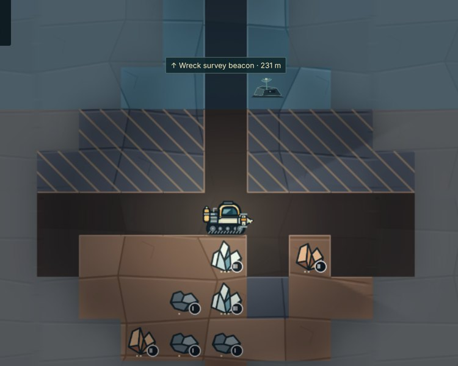
*`b-330m-plate-band-C@2.png`: the full-width plate layer as diagonal stripes, and the B→C cut from blue-grey to brown in one row.*

**Art production (assets).** Numbers refer to the asset list in §5.6. Estimates for hero props include 30 % for revision rounds.

| ID | Deliverable | Pipeline | Effort |
|---|---|---|---|
| A1 | Style guide (§6.1), swatch cards for bands A, B and C, review template (Phase 0) | Art direction | 2–3 d |
| A2 | Physical damaged lander at stage 0, at the D12 scale; dish; emissive layer (1, 3, 4) | Layered SVG | 3–3.5 d |
| A3 | Surface kit: lamps, cables, crates and power box, tools, rocks, salvage (5–11) | Layered SVG | 5.5 d |
| A4 | W01 ridge layers and sky-body recolour (12, 13) | Layered SVG | 1.5 d |
| A5 | Wreck hull with five rib arcs, back and front layers, rust (14) | SVG plus painted rust | 3.5–4.5 d |
| A6 | Beacon tripod with an emissive diamond, plus a wall-mounted variant (15) | Layered SVG | 2 d |
| A7 | Band-C dressing: rust seams and drips, stalactites, rubble, boulders, crystals (16–20) | Painted, 4× master | 5.5 d |
| A8 | Band-C back-wall strips (21) | Painted | 1 d |
| A9, A10 | Material and inclusion look for bands A and C (22, 23). Swatch cards signed off before T2's parameters freeze | Generator plus art direction | 6–8 d |
| A11 | Light and FX brushes (26, 27) | Procedural, by engineering | in T1, T12 |
| A12 | Ore sockets; restyled ore, package and HC frames (24, 25) | Generator | 1.5 d |
| A13 | Rig shading and emissive headlamp (40), needed in the slice under the recommended D1 | Generator plus hand pass | 2.5–3 d |
| A14 | Plate and shelf page with crack decals (38) | Painted | 2–3 d |
| A15 | Band B swatch and material parameters (part of 22) | Art direction | 1 d |
| — | Art direction, 0.5 d per week through the slice | Art direction | 4.5–5 d |

**Exit gate G1 (vertical slice).** The slice passes when all of these hold:
1. **Fixtures.** Every fixture is reached by native play from spawn, on two seeds: a scripted drive using the `campaign-smoke.mjs` helpers and the real `refreshVisibility` (`model.ts:579-626`), with no `discovered.fill` and no radius reveals. Pick seeds with a flat floor under SITE-4. The targets are the F0 re-cuts.
2. **Stills.** The §9 checks marked G1 pass on the 1440×743 band and the 393×572 window (1440×792 and 393×608 for the cavern). The full 393×851 frame is reviewed against the 9:19 extension.
3. **Motion.** The M0 run passes the §9.3 checks, and the owner reviews it.
4. **Owner scores.** The six slice panels score ≥4 on all four questions in §6.4. The transit frames (150 m, 330 m) and the title (`a01`) score ≥3. The title renders the live surface (`scene.ts:1073-1077`), so A2, A3 and T7 already change it.
5. **As played.** One as-shipped frame per scene, at the D1 play camera with the HUD and default overlays, after 60 s of play, is scored on all four §6.4 questions. A score below 4 on a slice scene blocks the gate, as for the matched stills.
6. **Asset coverage.** At least 18 of the 21 board items (20 if D14 removes the beacon) are judged "match" or "close", with none missing, among those the slice contains.
7. **Hidden information.** The F7 full-frame scramble passes on both renderers, with Scan on and off.
8. **Device.** On the physical reference phone arranged in week 1: p95 ≤16.7 ms at backing ≥1.5. Also checked: Firefox (`.github/workflows/firefox.yml` exists), the oldest supported iOS Safari, high contrast, reduced motion, and the context-loss test.

If T2 fell back to baked tiles, the baked tiles must pass the same gates.

### 5.4 Phase 2: all W01 bands (about 5 weeks)

| ID | Change | Code | Art | Acceptance |
|---|---|---|---|---|
| W1 | Band D, with band dressing rules: pebbles in A, fractures and cables in B, rust in C, crystal seams in D. (Band B, the transitions and the iron shelf, formerly W4, moved to T14) | 2 d | Assets 29–31, about 10 d | Adjacent-band unknown luma differs ≥4; terrain gates at 150, 330 and 550 m |
| W2 | Generator version 3: radii ±25 %, smoothing passes, no islands or pockets under 2 cells, galleries with `ry ≥3`, "flat site floor" contract. Replace the five `=== 2` / `!== 2` checks (`poi.ts:106, 129, 263`, `scene.ts:1334`, `model.ts:2348`) with capability flags or `>= 2`; extend `GeneratorVersion` (`types.ts:4`), `versions.ts:9`, `GENERATOR_VERSION` (`config.ts:7`) and the tile-range check (`model.ts:2209`); set the version in `establishWorld` (`world.ts:113`) and widen the `1 | 2` parameters and dispatch in `world.ts:573-602`; re-run `run-pacing`. Old saves keep their tiles | 6–8 d | — | 200-seed contracts pass; median natural-cave height ≥3 rows; onboarding (opening survey, route, A/B seams, volatile training) still active on v3 worlds |
| W3 | Remaining landmarks | 2 d | Assets 32–37, 6–7 d | No two scenery frames with alpha IoU >0.70 |
| W5 | Lander stages 1–3; pad, refuge and relay shading; survey stakes | 0.5 d | Assets 2, 39, 41, 4–4.5 d | Structural checks in §6.1 |
| W6 | Full feedback: crack stages 1–4; pickup arc to the hatch instead of the text popup; landing spring anchored at the tracks with dust; track dust; exhaust; idle bob; a 1–1.5 px, 70 ms camera kick on cut completion, with the shake preference split into "impact kicks" and "shake" (D10); all off in reduced motion | 6.5–8.5 d | Asset 42, 0.5 d | Pickup arc visible in 3 consecutive frames; landing dust on both sides |
| W7 | One notice lane: coach in the pill's second line; toasts in one top line | 2 d | — | No stacked notice boxes |
| W8 | CI art checks: `overlayText` and `overlayNearRig` counters; IoU, grounding and inventory checks | 2–3 d | — | Fails on deliberately bad fixtures |
| F8b | Texture compression after T2: KTX output in ASTC, ETC2 and S3TC with a PNG fallback, and the format-aware memory metric (§7). Canvas keeps PNG pages, because `terrain.ts:195-207` builds patterns from an `HTMLImageElement` | 3–5 d | T2 | Format-aware residency within the §7 budgets |

Art direction continues at 0.5 d per week (about 2.5 d). Arrange the second reference phone (the other of the Pixel 6a and Galaxy A54 classes) before G2. **Gate G2:** every W01 depth and site fixture passes the §9 checks and the motion run, on both reference phones, and the owner reviews the band sheets.

### 5.5 Phase 3: W02 (about 5–5.5 weeks, art-bound) and Phase 4: menus (about 1 week)

**Phase 3, W02.**
- **D13 first** (2–3 artist-days): paint over prototype renders to make three W02 panels (surface, 180 m, deep cavern), and get owner approval before any W02 art.
- **X1. Retune for the comet** (3–5 d): unknown rock at L\* 27–32, blue-teal cave air, cyan cryo emitters, warm headlamp.
- **X2. Parity art** (assets 43–48; about 21–22 artist-days including revisions, plus 2 d of placement code): physical refuge, cryo lamps, frost crates, ridges and comet body, frozen wreck, condenser beacon, ice dressing, materials and back walls.
- **X3. Frost mist and ice chunks** (1 d).
- **Art direction** continues at 0.5 d per week (about 2.5 d).
- **Gate G3:** the approved D13 panels and the §9 checks pass at the surface and at 80, 180, 350, 600 and 850 m.

**Phase 4, menus and presentations** (2–3 d of code, 2.5–3.5 artist-days). These inherit the new world.
- **U1. Title.** Already covered by the G1 title check; here it is only re-checked.
- **U2. Menu backdrops.** Terminal, pause and star map get a dimmed live world. The star map's known-cell view (`d04`) uses the new value ladder. The flat body icons on the navigation map (`e03`) become portraits (asset 50).
- **U3. Launch and travel** (`e02`, `e04`) use the restored lander and an exhaust plume (asset 51).
- **Gate G4:** these captures are reviewed beside the slice sheets. Dashed blueprint art is allowed only in the construction tab.

### 5.6 Complete asset production list

**Conventions.**
- **Cell size:** 1 cell = 48 px @1x, 96 px @2x and 144 px @3x. Masters are authored at 4× (192 px per cell). Under the recommended D1, the rig, ore and hero props also get a @4x desktop page.
- **Pipeline:** B is layered SVG; C is painted raster at a 4× master; A is the existing generator; P is procedural.
- **Priority:** P0 is the slice, P1 the W01 rollout, P2 W02, P3 menus.

| # | Asset | Cells | @1x | @2x | @3x | States / frames | Pri | Pipe |
|---|---|---|---|---|---|---|---|---|
| 1 | Lander, physical damaged stage 0, at the D12 scale (board about 2.5×1.65 tiles, 2.3 tall with the dish) | 4×3 canvas | 192×144 | 384×288 | 576×432 | 1 | P0 | B |
| 2 | Lander stages 1–3 | 4×3 | 192×144 | 384×288 | 576×432 | 3 | P1 | B |
| 3 | Lander dish | 0.6×0.7 | 32×36 | 64×72 | 96×108 | 6-frame scan | P0 | B |
| 4 | Lander emissive: windows, lamps, sparks (trimmed) | 4×3 | 192×144 | 384×288 | 576×432 | 2 flicker + 2 spark, ADD | P0 | B |
| 5 | Pole lamp, ADD head | 0.35×1.2 | 17×58 | 34×116 | 51×174 | on/off | P0 | B |
| 6 | Tripod lamp, head, ground pool | 0.8×1.5 (+2×0.4) | 39×72 (+96×19) | 78×144 (+192×38) | 117×216 (+288×58) | on/off | P0 | B |
| 7 | Cable strip and plug ends | — | 32×5, 10×10 | 64×10, 20×20 | 96×15, 30×30 | Rope texture; bezier on Canvas | P0 | B |
| 8 | Crates ×3; power box with ADD screen | 0.5–1.0 | ≤48×36 | ≤96×72 | ≤144×108 | screen ×2 | P0 | B |
| 9 | Cable spool, tool rack, jerry can | 0.5–0.8 | ≤40² | ≤80² | ≤120² | 3 | P0 | B |
| 10 | Regolith rocks | 0.2–0.8 | ≤40×24 | ≤80×48 | ≤120×72 | 8 | P0 | B/C |
| 11 | Salvage heaps (replace `surface-salvage`) | 2.5×1.25 | 120×60 | 240×120 | 360×180 | 3 | P0 | B |
| 12 | W01 ridges far, mid, near (tiling; far and mid ship at @2x density) | 10.7×4 | 512×192 | 1024×384 | 1536×576 (near only) | 3 | P0 | B |
| 13 | Sky-body recolour, W01 (keep the board's crescent) | existing | — | — | — | 1 | P0 | B |
| 14 | Wreck hull with five rib arcs: back, front mound, rust | 7×2 | 336×96 | 672×192 | 1008×288 | sealed / surveyed | P0 | B+C |
| 15 | Beacon tripod, ADD diamond and pool; wall-mounted variant | 0.9×2.4; 1×1 | 56×116; 48² | 112×232; 96² | 168×348; 144² | 3 states; 8-frame pulse | P0 | B |
| 16 | Stalactites | 1×1 (6); 2×1.2 (3) | 48², 96×58 | 96², 192×116 | 144², 288×174 | 9 | P0 | C |
| 17 | Rust seams along ceiling and wall joints, rust drips hanging from them, drip particle (seams as decal strips or a band-C inclusion in T2, sized in A1) | 1×1, 1×2 | 48², 48×96 | 96², 96×192 | 144², 144×288 | 4 + 6 frames, plus seam strips | P0 | C |
| 18 | Floor rubble | 0.5–1 | ≤48×32 | ≤96×64 | ≤144×96 | 6 | P0 | C |
| 19 | Foreground boulders (layer 4, darkened by the light composite) | 1, 2, 3 | ≤144×72 | ≤288×144 | ≤432×216 | 3 | P0 | C |
| 20 | Amber crystals, ADD sparkle (hue per D8) | 0.5–1.2 | ≤58² | ≤116² | ≤174² | 3 sizes × floor/wall | P0 | C |
| 21 | Back-wall silhouette strips, band C (ship at @2x density; tiled by world position) | 10.7×4 | 512×192 | 1024×384 | — | 2 | P0 | C |
| 22 | Material look, bands A, B and C (shader parameters; Canvas and Medium-tier pages) | 8×8 | 384² | 768² | 1152² | 2–3 variants each | P0 | A/C |
| 23 | Hard-rock plate fill and cracks (square blocks, 0.03-tile chamfer), A and C | 1×1 | 48² | 96² | 144² | 6 per band | P0 | P/C |
| 24 | Ore sockets | 1×1 | 48² | 96² | 144² | 4 tiers × 2 | P0 | A |
| 25 | Ore and package frames with a small mark, plus HC | 1×1 | 48² | 96² | 144² | 8 + 8 + 8 HC per world | P0 | A |
| 26 | Light brushes: cone, halo, flare, glint, mote | — | cone 256×128 | — | — | 5 | P0 | P |
| 27 | Drill FX: chunks, dust, spark, bit glow, cracks 1–4 | ≤1 | ≤16², 48² | ≤32², 96² | ≤48², 144² | about 20 | P0/P1 | P |
| 28 | Edge chevron (HOME and off-screen targets), pulse ring, Scan glyph, leader tick | UI | 22 px SVG | — | — | 4 | P0 | B |
| 38 | Plate and shelf page (one) plus crack decals | 8×8; 2×2 | 384²; 96² | 768²; 192² | 1152²; 288² | 1 page + 3 crack decals | P0 | C |
| 40 | Rig shading, emissive headlamp (P0 under the recommended D1; @4x desktop page) | 1.33 canvas | 64² | 128² | 192² | 8 body + cabin + modules | P0 | A |
| 29 | Material and inclusions, band D | as 22–23 | | | | as 22–23 | P1 | A/C |
| 30 | Back-wall strips, bands A, B, D (@2x density) | 10.7×4 | 512×192 | 1024×384 | — | 6 | P1 | C |
| 31 | Band dressing: pebbles, fractures, cables, crystal seams, wall cracks | ≤1×1 | 48² | 96² | 144² | about 16 | P1 | C |
| 32 | Survey mast site | 2×2.4 | 96×116 | 192×232 | 288×348 | 2 states; back/front | P1 | B |
| 33 | Lander valve store | 2.5×1.6 | 120×77 | 240×154 | 360×231 | sealed / opened | P1 | B |
| 34 | Antenna workshop | 2.8×2 | 134×96 | 268×192 | 402×288 | sealed / opened | P1 | B |
| 35 | Thermal service locker | 1.5×1.1 | 72×53 | 144×106 | 216×159 | closed / open; ADD LED | P1 | B |
| 36 | Amber geode centrepiece | 2×1.6 | 96×77 | 192×154 | 288×231 | 2 | P1 | C |
| 37 | Field-log data pad | 0.5×0.4 | 24×20 | 48×40 | 72×60 | LED ×2 | P1 | B |
| 39 | Survey stake with lamp | 0.2×1.0 | 10×48 | 20×96 | 30×144 | on/off | P1 | B |
| 41 | Pad, refuge, relay shading | existing | — | — | — | existing | P1 | A |
| 42 | Smoke and exhaust puff; cabin indicator | ≤0.3 | ≤16² | ≤32² | ≤48² | 2 | P1 | P |
| 43 | W02 physical refuge, stages 0–3 | 4×3 | 192×144 | 384×288 | 576×432 | 4 | P2 | B |
| 44–46 | Cryo lamps, frost crates, rocks; W02 ridges, comet body; frozen wreck, condenser beacon | as 5–15 | | | | as W01 | P2 | B/C |
| 47–48 | Ice stalactites, frost lips, bubbles; W02 materials, inclusions, back walls | as 16–23 | | | | about 14; 4 bands; 24; 8 | P2 | A/C |
| 49 | Frost mist, ice chunks | ≤0.3 | ≤16² | ≤32² | ≤48² | 4 | P2 | P |
| 50 | Navigation-map body portraits ×4 | 2×2 | 96² | 192² | 288² | known / locked | P3 | B |
| 51 | Launch and travel exhaust plume, ADD | 2×3 | 96×144 | 192×288 | 288×432 | 6 | P3 | B |
| 52 | *Only if the T2 spike fails:* dual-grid edge tiles, 16 cases × 4 variants × 5 materials | 1×1 | 48² | 96² | 144² | 320 | P0 cond. | A |

**Size.** Decoded at @3x and untrimmed, the big rows alone come to about 182 MiB: material pages 121.5, back-wall strips 27.0, iron shelf (as three full pages) 15.2, ridges 10.1, lander 7.8. That is why the list ships strips and far ridges at @2x density, makes the shelf one page plus crack decals, keeps one lander stage resident, and drops material pages on the WebGL High tier. With those measures the new art is about 10 MiB in the surface zone and about 30 MiB in the cave zone (§7; computed by [`budget.py`](art-audit/data/budget.py)).

### 5.7 Effort and schedule

| Phase | Engineering | Art | Calendar (2 engineers + 1 artist) |
|---|---|---|---|
| 0 Foundations | 12.5–16 d | 4–6 d (F0, A1) | weeks 1–2 |
| 1 Vertical slice | 55.5–76.5 d | 39.5–45 d | weeks 2–11; G1 at the end of week 9–11 |
| 2 W01 rollout | 24–31 d | 23–24.5 d | about 5 weeks (art-bound) |
| 3 W02 | 6–8 d | 25.5–27.5 d | about 5–5.5 weeks (art-bound) |
| 4 Menus | 2–3 d | 2.5–3.5 d | about 1 week: code overlaps Phase 3; the 2.5–3.5 artist-days follow X2 |
| **Total** | **about 100–135 d (20–27 engineer-weeks)** | **about 95–107 d** | **about 20–22 weeks** |

**Critical path to G1.** F1 (1–1.5 d) → F3 (3–4) → F7 (2–3) → the T2 spike and T2 (12–17) → T1 (7–10) → T5 or T10 (3–4.5) → integration and two owner review rounds (about 5). That is **33–45 engineer-days on one person**, who then takes the other of T5 and T10 (about 36.5–48 days in all). The second engineer carries F2, F4–F6, F8a, F9, T13a, T3, T4, T6–T9, T11–T14, H1–H4, M0 and D14-code, about 36.5–49.5 days. The artist's slice work (43.5–51 days) fits the same window only because the decisions and the minimal asset path land in week 1.

**What changed from the draft estimate.** The draft's 7–8 weeks had no slack. Its quick win depended on 4–5 days of earlier work. It missed that T1 and T11 depend on T2. It also had no slot for the asset path, the decisions or a failed spike. This plan adds F0, F9, T13a, T14, H1–H4, M0, the WebGL1 work in T2 and the rewritten Scan (T8). On the art side it adds 30 % revisions on hero props, 6–8 days for the material look, the rig, the shelf page and art direction.

**How these totals relate to the audits' estimates.**
- The prototype's 6–8 engineer-weeks covers only the W01 technique subset.
- The asset audit's 40–45 artist-days covers props only.
- Hand-painting all 24 material pages, instead of generating them, would add about 25 artist-days.

---

## 6. Art pipeline recommendation

**In plain words.** The board's look comes from a few rules: dark slate rock in strata and blocks, a bright lip on every edge, a warm headlamp, a few glowing lamps and crystals, and props drawn as flat-shaded vector shapes with one dark outline. §6.1 writes those rules down with colours sampled from the board. §6.2 says which tool makes which asset. §6.3 recommends engineering for terrain and light plus one commissioned artist for props and dressing, and §6.4 sets the weekly review.

### 6.1 Style guide derived from the board

Colours were sampled from `d0-target-board.png` by the audit's working script `palette.py`, which is not committed. The sampling rectangles and mode for each colour are in [`palette.json`](art-audit/data/palette.json). Treat each value as a target within ±3 L\*.

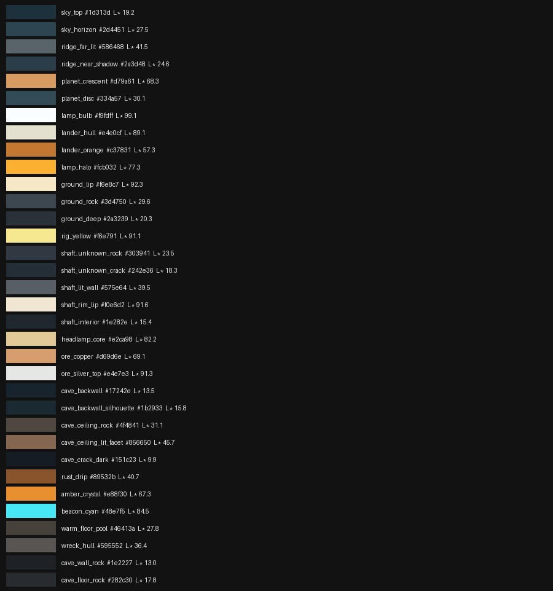

| Role | Hex | L\* | Game today |
|---|---|---|---|
| Sky top / horizon | `#1d313d` / `#2d4451` | 19 / 28 | `#14232b` / `#48616b` |
| Ridge lit / shadow facet | `#586468` / `#2a3d48` | 42 / 25 | 2 layers near horizon value |
| Planet crescent / disc | `#d79a61` / `#334a57` | 68 / 30 | crescent `#987E5B` |
| Ground rock / deep / lip | `#3d4750` / `#2a3239` / `#f6e8c7` | 30 / 20 / 92 | deep ground L\* 37.9 |
| Unexplored rock / crack | `#303941` / `#242e36` | 24 / 18 | `#596771` base, L\* 37.7 on screen |
| Lit wall beside shaft | `#575e64` | 40 | L\* 46.7 |
| Rim lip | `#f0e6d2` | 92 | L\* 58 |
| Shaft interior | `#1e282e` | 15 | L\* 21.4 |
| Headlamp core, brightest patch (b\* +28) | `#e2ca98` | 82 | cool, b\* −4.8 |
| Cave back wall / silhouette | `#17242e` / `#1b2933` | 14 / 16 | `#1d1b1d` |
| Cave rock, ceiling / lit ceiling facet | `#4f4841` / `#856650` | 31 / 46 | brown soil, luma 82–96 |
| Cave rock in deep shadow / foreground boulders | `#1e2227` / `#282c30` | 13 / 18 | — |
| Rust drip / amber crystal | `#89532b` / `#e88f30` | 41 / 67 | none |
| Beacon diamond | `#48e7f5` | 85 | none |
| Lamp halo / bulb core | `#fcb032` / `#f9fdff` | 77 / 99 | hidden 3 px dots |
| Lander hull / orange panel | `#e4e0cf` / `#c37831` | 89 / 57 | dashed outline |
| Rig yellow; copper; silver top | `#f6e791`; `#d69d6e`; `#e4e7e3` | 91; 69; 91 | already close |
| Outline (keep) | `#14232b` | — | same (`create-w01-sources.mjs:14`) |

Only the shadowed panel edge and the foreground boulders are as dark as the cave air. Lit rock that frames the cave air stays at least 18 luma above the back wall (T4, §9.2).

**Band and world variants.** Derive bands B and D by shifting hue by up to 15° while holding the L\* steps: unknown about 24, lit wall about 40, lip about 90, interior about 15, cave air about 14. W02 uses its own provisional key from §2 (unknown L\* 27–32, cave air L\* 14–18) until D13 approves it.

**Line weight.** Props use one `#14232b` outline at about 4.4 % of a cell (4–5 px @2x, 6–7 px @3x), as today. Terrain has no outlines: a 0.085–0.1-tile lip at about rock +80 luma, a 0.03-tile undercut at air −15, and 0.3–0.4 tile of occlusion into the air.

**Medium.** The board's header sets three implementation targets: flat side-view 2D, vector, no perspective. Props are vector (layered SVG, pipeline B). The cave dressing, back walls and iron shelf (assets 16–21 and 38) are planned as painted raster (pipeline C) because they are organic. Painted or not, they must read as vector: flat 2–3-tone facets with hard edges, the prop outline where the board draws one, and no visible brush texture or airbrush. If the owner wants "vector" taken literally, these assets move to pipeline B, and A7, A8 and A14 are re-estimated. Decide this with D5.

**Shapes.** Natural cave boundaries are organic. Hard rock stays as the board draws it, in both formats: square, cracked, darker bevelled blocks on the grid (image below). The prototype's rounded boulder inclusions are not the target. The rock mass has two patterns. In the surface ground and the shaft (band A) it is horizontal strata: bands about 0.7–1.2 tiles tall, broken into slabs 2–4 tiles long, each slab in 2–3 facet tones, separated by dark cracks. Around the cavern (band C) it is chunky angular blocks about 1–2 tiles across, each with a lighter top facet, as in the board's ceiling and floor. Neither is an even mesh of rounded cells.

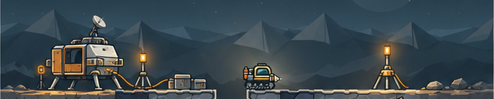
*Board surface at 2×: hard-rock blocks keep the grid; the lander is about 2.5 tiles wide, twice the rig.*

**Shading model.**
- Flat facets in 2–3 tones, a top-lit bevel (top edge about +44 %, bottom −30 %) and dark crack gaps. Props add soft gradients for curvature.
- Hero props are checked structurally, not by colour count. Any gradient passes a colour count once anti-aliased, and the board's counts come from a resampled image. The checks are: at least 3 shading tiers per material zone; alpha IoU ≥0.7 with the board's silhouette at matched scale; and the owner score.

**Light direction.**
- Materials and props are top-lit.
- Surface ridges are lit from the upper left; the board's lit faces point left.
- Underground, the headlamp is the key light, and rims glint warm only near it.
- The board lights the planet's crescent from the right. Keep it as drawn: it is part of the board the owner likes, and no player compares a planet's light with the far ridges.

**Hierarchy.** At every depth: lamp core, rims, lit walls, unexplored rock, then tunnel interior and cave air. The brightest and warmest pixels are emitters, never UI.

**Composition.**
- One sky body, and three ridge layers rising to 25–35 % of the sky.
- No world text except hazards.
- Tier marks are small dark discs with light bars, overlapping the ore by about 30 %.
- Props touch the floor, and large ones get a front layer, darkened like the terrain around them.

**Swatch cards.** Each band gets a card (unknown, lit, lip, crack, back wall, cave air, accent, and a 4×4-tile @2x sample) that both art and code are checked against. Cards for A, B and C are signed off before T2's parameters freeze.

### 6.2 Source formats and tooling

| Family | Source | Tooling and output |
|---|---|---|
| Ore tiers, tier marks, icons, edge masks | `.mjs` generator with new `linear()`, `radial()` and `rim()` helpers | Existing Chromium rasterizer and packer |
| Mechanical props: lander, lamps, crates, beacon, wreck, sites | Hand-authored layered SVG in `assets/campaign/source/` | Inkscape, Affinity or Figma (gradients, masks, `feTurbulence` grain), then the same rasterizer |
| Organic dressing, back walls, iron shelf | Painted raster at a 4× master (192 px per cell); `.kra` or `.psd` kept beside the PNG | Krita or Photoshop; Lanczos down-sampling; `"source": "raster"` in `frames.json` (T13a/T13b) |
| Terrain material and edges | Shader parameters plus the prototype's field code | Field texture and shader; Canvas and Medium-tier pages |
| Glow | `-emissive` sibling frames | Drawn ADD above the darkness |
| Provenance | One record per asset at `assets/campaign/source/provenance/<asset>.json`: source, reference used, hand-painted share, reviewer | Kept separate from the build manifest `assets/campaign/generated/provenance.json`, which states "no board pixels included" |

### 6.3 Sourcing options

| Option | Quality | Consistency | Cost and speed | Main risk |
|---|---|---|---|---|
| 1. Procedural technique plus in-house decoration | High for terrain and light; medium for props | High | Lowest cash; slow props | "Programmer art" props |
| 2. Commissioned 2D game artist, to §6.1 and §5.6 | High; can reach the board | High with this guide | About 95–107 artist-days at your rate; parallel | Needs a brief, fast reviews and an art-direction owner |
| 3. Generated imagery cleaned up by hand (our board as style reference; flattened, palette-clamped, painted over) | Medium-high after paint-over; low if shipped raw | Low between batches | About 30 % less dressing time | Perspective errors, alpha fringes, drift; per-asset provenance required |
| 4. Licensed asset packs | Medium at best for this specific style | Low | Cheapest up front | Non-exclusive art, repaint cost, licence terms; only for neutral grain and noise |

**Recommendation: options 1 and 2 together, with option 3 only as an underlay.**
- **Engineering** owns terrain, light, placement and FX (the T items), where most of the gap closes.
- **One commissioned artist** owns props and painted dressing (the A items), starting with F0, A1 and the P0 rows in week 1.
- **Art direction** has a named owner for the whole programme, at about 0.5 day per week.
- **Generated images** are used only as cleaned underlays, each with its provenance record.
- **Packs** are not used for any visible art.

### 6.4 Review loop

1. **Weekly capture sheet.** The F3 harness renders each fixture at pinned DPR beside its F0 target at matched tile scale, with an L\* map, a histogram and the §9 table. The M0 motion run is attached.
2. **Asset review.** Art is delivered into a fixture (T13a), never reviewed in isolation. Hero props are checked at 100 % and at phone scale. The W8 checks reject reused silhouettes (IoU >0.70) and floating props; hero frames are checked structurally (§6.1).
3. **Owner scores.** At each gate the owner scores each panel from 1 to 5 on four questions:
   - Same rock and darkness order?
   - Same edges and cave shape?
   - Same light, with lamps and beacon the brightest things?
   - Same props, with no UI in the world? (Scored on the HUD-free frame and on the as-shipped frame.)

   The as-shipped frame at the play camera is scored on all four questions (G1 item 5). A score below 4 on a slice panel blocks the gate (below 3 on a transit frame), and every comment becomes a tracked item.

---

## 7. Performance, memory and device budgets

**In plain words.** The look is affordable on phones only on the GPU. On the CPU, the prototype's light map alone takes 16–26 ms per frame, and its terrain bake takes 3–5 s. The GPU route also frees memory, because today's largest texture is the CPU terrain buffer. New art still has to be budgeted per zone, because the full asset list would not fit.

| Budget | Today | Slice projection, GPU route (to verify) | How to hold it |
|---|---|---|---|
| Draw calls ≤12 desktop / ≤10 phone | 7 / 4 | 6–10 | Batched layers; remove the stencil mask and its 6 uses (T6); one modulate pass |
| Overdraw ≤3.0 screens | 2.09 | about 2.7 | One terrain pass; decals ≤0.35; light sampled in the terrain shader where possible |
| Uploads | 2 per stationary frame; 1.88 MiB per moving frame | 0 when still; while moving or digging, at most one coalesced upload of ≤160×160 texels per frame | F2; light as GPU draws; patch coalescing (T2); measured with the probe's `textureSubUploads` |
| Desktop textures ≤64 MiB | 55.77 W01 / 63.52 W02 (0.48 MiB headroom) | W01 cave zone about 53 on the High tier | See the breakdown below |
| Phone textures ≤20 MiB boot / ≤40 MiB active | 19.43 boot / 29.55 in W01 (30.68 peak) | about 36 active on High; about 41 on Medium without compression, over the 40 MiB budget until F8b (from the 29.55 W01 fixture; about 1 MiB more from the peak) | Most new art at @2x on phones; only rig and ore at @3x; F8b compression for Medium |
| p95 frame time | 54.9 ms moving (phone viewport, 4× throttle, emulated) | Unmeasured; about 12 taps and 9 Worley seeds per pixel; rays 1–2 ms on CPU | Gate: ≤16.7 ms on a physical phone (G1 one device, G2 both). Stretch: ≤12 ms in the emulated run |
| Backing scale | Ratchets down to 1.0 | 2.0 desktop; per-tier floors | F1 |

**Desktop W01 cave zone, High tier** (projection; `budget.py`): 55.77 MiB today; −19.5 for the CPU terrain buffer, +2.3 for the field texture; −5.5 for the duplicate atlas (F8a); about −20 for band pages, which the High tier no longer needs; +1.2 for the quarter-resolution light texture; +29.7 for new cave-zone art; about +9 for @4x hero pages under D1. That gives **about 53 MiB**. Two notes:
- **Keep the band pages and it fails.** Without the band-page drop the total is about 73 MiB, over budget.
- **No full-frame render target.** One full-frame target at backing 2 is 2880×1800×4 B = 19.8 MiB, which would cancel the terrain-buffer saving. The light composite must use the modulate blend or the terrain shader instead.

**The memory metric must change.** Today it counts only TextureManager entries at 4 bytes per pixel (`scene.ts:2028-2038`). It cannot see compression, so F8b would never register. It also misses raw GL textures (the T2 field) and render targets. As part of F3/F8b, make `render-memory.mjs` format-aware and include raw textures and render targets. Replace the single total with resident budgets per zone: the surface zone, and the cave zone for the current band plus its neighbours (`art.ts:63-70` loads index ±1).

**Quality tiers.** Chosen at boot and adjusted by F1:

| Tier | Terrain | Light | Decals | Backing floor |
|---|---|---|---|---|
| High (desktop and recent phones with fragment `highp`) | Field shader | Quarter-resolution ADD light, 720 rays, motes | Full budget | 2.0 |
| Medium (mid-range phones, or no fragment `highp`) | Material from baked periodic band pages, not per-pixel Worley | One-eighth resolution, 360 rays, no motes | ≤30 | 1.5 |
| Low (Canvas) | `RetainedTerrain` with F4 values and T3 bevels | `lighter` at one-eighth resolution, no rim light, no `ctx.filter` | ≤20 | 1.0 |

**Device gates.** One physical reference phone (Pixel 6a or Galaxy A54 class) at G1, both at G2. Firefox and the oldest supported iOS Safari at every gate, for shader precision and blend behaviour. High contrast, reduced motion and the context-loss test at every gate.

**CI time.** A full-screen shader at 2880×1800 under SwiftShader is slow: one full-screen copy takes 145 ms, and the prototype's composites took 0.84–0.97 s, which measures the software rasteriser, not the technique. Per-PR fixtures therefore run at backing 1, and the @2 sheets and motion runs run nightly in their own job (F3).

---

## 8. Owner decisions needed

**In plain words.** Thirteen choices are yours (D9 is withdrawn). Each row gives my recommendation, and accepting it is a valid answer. One must be made before work starts (D5, the artist). Seven are made in a workshop in the first days of week 1, because the first art and code depend on them. The rest come later.

**Before week 1:** D5. **Week-1 workshop:** D1, D2, D3, D6, D8, D12, D14. **Before the T2 spike (week 2):** D4. **Before Phase 2:** D7. **Before Phase 3:** D13. **At G1:** D10, D11.

| # | Decision | Recommendation |
|---|---|---|
| D1 | **Camera framing.** It fixes texel density, asset priority and look-ahead (table below) | Option B for play, with the board's scale (option C) as the cave-framing zoom inside known chambers ≥5 rows tall (T11). G1 stills are captured at the board's scale for matching; the gate also scores one frame per scene at the play camera (G1 item 5). Choose atlas pages by device px per tile. Move the rig (asset 40) to P0 and add @4x desktop pages for rig, ore and hero props |
| D2 | **Shaft composition** (§4.1) | (a) a render-only 0.20-tile over-carve per side into known solid, plus the bore spill light; not a 2-wide bore |
| D3 | **Overlay policy** | Labels on demand with Scan (L2, a tool-tray button, Shift/F, with a toggle option). HOME stays as an always-on edge chevron, because its distance drives the return-home decision. Hazards stay always on |
| D4 | **Renderer route** | WebGL shader as the primary renderer, with a lower-quality Canvas fallback. Replace Canvas pixel parity (already failing, with maxima of 63) by information parity |
| D5 | **Art sourcing and budget** | Commission one artist for about 95–107 days, with a named art-direction owner. The 95–107 days include about 15–17 days of art direction (F0, A1, A15 and 0.5 d per week); if someone else does that part, the commission is about 78–93 days. Allow generated underlays only with per-asset provenance |
| D6 | **Band identity.** Keep strong brown (C) and violet (D) bands, or move to a neutral slate base | A slate base with band accents (rust, crystals). The board's cavern is slate, and per-tile colour swaps read as a checkerboard |
| D7 | **Generator version 3** for vaulted caves, new worlds only | Approve for Phase 2, after F9 and with the version checks replaced (W2). The slice does not need it: the SITE-4 gallery already has a flat 4-cell floor |
| D8 | **Crystal colour.** The board's decoration crystals are amber (`#e88f30`), close to copper ore (`#d69d6e`), so players may take them for ore | Keep amber as drawn, and place crystals only where no known deposit is in the 3×3 neighbourhood (T5). Run a 5-player recognition test on the prototype renders before A7's crystals are painted. If players confuse them with ore, the owner picks a hue that no ore uses |
| D9 | *(Withdrawn.)* Flipping the planet's crescent | Keep the board's crescent as drawn |
| D10 | **Impact kicks** (≤1.5 px) on by default, with shake staying off | Yes, off in reduced-motion mode, after accessibility sign-off |
| D11 | **Sign-off panel** | The owner plus three reviewers who have not seen the work |
| D12 | **Lander scale.** The board's lander is about 2.5×1.65 tiles (2.3 tiles tall with the dish; 2.0× the rig's width); `dock-stage-0` is 3.9×2.0 tiles (3.4×) | Match the board, about 2.5×1.65 tiles, and keep the dock interaction zone unchanged |
| D13 | **W02 target.** The board shows only W01 | Approve three painted W02 panels (surface, 180 m, deep cavern) before any W02 art |
| D14 | **Beacon at the wreck** (§4.2) | (i) a dormant crew beacon in the SITE-4 set piece, lit on discovery and never a waypoint; otherwise (ii) drop it from the target and make a wall-mounted variant for the 95 m beacon |

**D1 options.** Tile sizes are CSS px. The 900 px desktop height is shown in rows; the HUD takes some of each frame.

| State | A: today | B: recommended | C: board scale |
|---|---|---|---|
| Desktop, ≤120 m | 65.5 px: 22 tiles, 13.7 rows | 80–85 px: 17–18 tiles, 10.6–11.3 rows | 92 px: 15.7 tiles, 9.8 rows |
| Desktop, surface and dock | ×0.88: 25 tiles | ×0.95 at most: ≤18.9 tiles | 15.7 tiles |
| Desktop, deep and inspection | ×1.05 / ×1.08: 21 / 20.4 tiles | ×1.0, easing to C inside known chambers | 15.7 tiles |
| Phone portrait 393×851 | 44 px: 8.9 tiles (10.2 at the surface) | 56 px: 7.0 tiles | 70 px: 5.6 tiles |
| Phone landscape 844×390 | 44 px: 19.2 tiles | 48 px: 17.6 tiles | — |
| Device px per tile (desktop backing 2 / phone DPR 3) | 131 / 132 | 160–170 / 168 | 183 / 210 |
| Pages needed | @3x desktop, @2x phone | @4x hero pages on desktop; @3x on phones at a 1.17× upscale | @4x everywhere, including phones |
| Look-ahead risk | — | Moderate; playtest | High: about 2.8 tiles each side of the rig on a phone |

---

## 9. Acceptance protocol

**In plain words.** Each gate is passed by pictures and numbers together: side-by-side sheets against the approved targets, a short motion run, a table of measured checks, owner and fresh-reviewer scores, and playtests for anything that touches play. A gate never closes because the code exists.

**Gates:** G0 foundations (§5.2), G1 vertical slice (§5.3), G2 all W01 depths and sites (§5.4), G3 W02 and G4 menus and presentations (§5.5).

### 9.1 Capture sheet at each gate

Per fixture: the F0 target (or the D13 panel for W02), the game frame at matched tile scale, the prototype until superseded, an L\* map and a histogram.
- **Desktop:** captured at 1440×900@2 and scored on the 1440×743 band (1440×792 for the cavern).
- **Phone:** captured at 393×851@3 and scored on the 393×572 window (393×608 for the cavern), with the full frame reviewed against the 9:19 extension.
- **Conditions:** pinned DPR, `?overlays=0`, fixtures reached by native play on two seeds. Add one as-shipped frame per scene at the D1 play camera, with the HUD and default overlays, after 60 s of play (G1 item 5).
- **Concept crops:** inset at least 5 px from the panel border, so the border line does not enter the statistics.
- **Storage:** sheets are kept in `docs/art-direction/` as the regression baseline.

### 9.2 Measurable checks (stills)

✓ means the prototype already passes; ✗ means it does not.

| Check | Today | Concept | Prototype | Target (gate) |
|---|---|---|---|---|
| Unknown rock luma (sd) | 84–89 (1.5–1.7) | 57 (10.6) | 52.8 (12.0) ✓ | 45–65, sd ≥7; W02 64–75 (G1) |
| Known lit minus unknown | +22 to −29 | +34 | +32 shaft / +16 cavern ✓ | ≥+15 near the lamp; ≥+5 everywhere (G1) |
| Unknown rock minus cave air | about +54 (fog too light) | about +18 to +23 | +0.5 ✗ | ≥+10 (G1) |
| Lit rock minus cave air | — | +18 to +23 | +16.7 ✗ | ≥+18 (G1) |
| Brightness order: lamp > rims > walls > unknown > interior and cave air | fails at 465 m | holds | holds in the shaft, **fails in the cavern** ✗ | holds at every depth (G1) |
| Rock sd within 3 tiles of a light | — | 22–23 | 8–10 ✗ | ≥15 (G1; needs art) |
| Frame L\* mean, shaft / cavern | 38.1 / 28.2 | 25.9 / 21.0 | 22.8 / 19.8 ✓ | within ±4 (G1) |
| Share within ±3 L\* of the mode, shaft | 0.82 | 0.36 | 0.41 ✓ | ≤0.45 (G1) |
| p2–p98 / p98 L\*, shaft | 26.6 / 48 | about 47 / 58 (panel border excluded) | 32.5 / 41 ✗ | ≥40 / ≥54 (G1; needs art) |
| Edge density, shaft / cavern | 0.028 / 0.025 | 0.077 / 0.113 | 0.085 / 0.076 ✓ | ≥0.06 (G1) |
| Natural-cave boundary, axis-aligned share (cavern; hard rock excluded) | 64.9 % | 17.9 % | 25.9 % ✓ | ≤30 % (G1) |
| Floor contact: \|visual − collision\| | 0 | — | about 30 % of the floor wobble kept ✗ | ≤2 device px at every column the tracks can occupy (G1) |
| Walls and ceilings: visual vs collision air | 0 | — | 1.8 % ✓ | ≤5 % of pixels and ≤0.3 tile (G1) |
| Wall profile (rock → lip → undercut → air) | 111→138→50 | 90→177→35→50 | 62→226→36→50 ✓ | lip ≥ rock +55; undercut ≤ air −8 (G1) |
| Tile-normalised mean gradient | 0.93 | 3.5–3.75 | 2.47 ✗ | ≥2.5 (G1) |
| Playfield within 10 luma of one value | 61–86 % | — | 49–67 % ✗ | ≤25 % (G2; needs painted back walls) |
| Headlamp core L\* / b\* | +7.8 lift / −4.8 | 75 / +26 at the lamp (40 / +11 at about 1 tile) | 83.5 / +17.6 ✓ (cavern) | ≥70 / +15 to +30; occlusion test; bore spill in the down pose (G1) |
| Warm-accent share, surface / cavern | 0.25 % / 1.26 % | 2.46 % / 3.86 % | 0.62 % / 0.62 % ✗ | 1.5–4 % / 2–5 % from emitters and props (G1) |
| Overlay edge share; text items; items near the rig | 85 %; 9; 2 | 0; 0; 0 | — | ≤20 %; ≤1 with Scan off; 0 (G1) |
| Objective size; HAUL; bar labels | 349×91 card; hidden; none | about 312×46 pill; shown; labelled | — | ≤320×48 CSS px at 1440; shown; labelled at ≥900 px (G1) |
| Tier badge diameter relative to the ore frame | 0.32 | about 0.17 | small mark ✓ | ≤0.18, no white ring (G1) |
| Board inventory | 7 of 21 comparable | 21 | placeholders | ≥18 match or close, 0 missing (G1 slice items; G2 all) |
| Prop grounding | wreck 1.85 tiles (255 device px) off the floor | 0 | snapped ✓ | ±2 device px (G1) |
| Hero props, structural | lander: flat, dashed, 3.9 tiles wide | — | stand-in | ≥3 shading tiers per material zone; silhouette IoU ≥0.7 with the board at matched scale; owner score (G1) |
| Framing, tiles across (desktop / phone portrait) | 22 (25 at the surface) / 8.9 | about 15.7 / 5.6 | game camera | per D1 (G1) |
| p95 on a physical phone | 54.9 ms (emulated only) | — | — | ≤16.7 ms (G1 one device; G2 both) |
| Hidden information under full-frame scramble | passes the inset crops | — | 0 px ✓ (tiles and pristine scrambled) | 0 px on both renderers, Scan off and on, covering tiles, pristine data, deposits, sites and hazards; added light lifts unknown ≤2 L\* (every gate) |

### 9.3 Motion checks (G1-motion, every gate from G1)

The M0 run, 20 s per scene at 60 fps, is reviewed by the owner and must pass:

| Check | Target |
|---|---|
| Revealed cells | Cross-fade from unknown over 250 ms |
| Field patch on dig | Lerps over 120 ms; pixels farther than 1.2 tiles from the dug cell change ≤2 luma |
| Static pixels with the rig parked | Per-frame change ≤1 luma (no light shimmer) |
| Decals | Fade in over 300 ms; fade out over 300 ms when ore is revealed next to them |
| Flicker (lamps, beacon) | Amplitude ≤8 luma, period ≥0.4 s, off in reduced motion |

### 9.4 Human checks at every gate

1. **Owner scores.** At least 4 on all four §6.4 questions for every slice panel; at least 3 for transit frames and the title.
2. **Fresh reviewers.** Three reviewers who have not seen the work:
   - circle anything that reads as "UI in the playfield", with a median of ≤2 per frame (today `annot-a04-60m` marks 17);
   - rate mood match, with a median of ≥4.
3. **Playtests for the items that touch play.** None may make the first session slower or harder:

   | Change | Risk | Playtest metric |
   |---|---|---|
   | D1 zoom (fewer tiles visible) | Less look-ahead | Time to beacon and hazard hits per run, not worse |
   | T8 Scan (labels hidden by default) | Lost navigation information | Time to first bank not worse; HOME found without Scan |
   | T9 smaller tier marks (about 7–8 CSS px on phones) | Tier recognition | ≥95 % correct tier at 393×851; greyscale ΔL\* ≥8 for tiers and hard rock |
   | T11 cave framing | Disorientation | Hazard hits not worse |
   | D2 over-carve | Visual and collision disagree | No "stuck" reports; floor contact ±2 device px |
   | D8 crystals | Mistaken for ore | 5-player recognition test |
   | D14 (i) crew beacon | Mistaken for the objective | No player navigates to it instead of the waypoint |
   | T10 diegetic waypoint | Harder to find | Time to beacon not worse |

4. **Smoke tests.** `feel-smoke`, `poi-smoke`, `frontier-smoke` and `plan-ui-smoke` pass with Scan off and on, after `feel-smoke.mjs:149, 256`, `plan-ui-smoke.mjs:429-466` and `frontier-smoke.mjs:447-453` are rewritten to the new label contract.

---

## Appendix A. How the review's issues were handled

The review [`07-critique.md`](art-audit/07-critique.md) raised 31 issues. I re-checked the disputed ones against the code and the captures. All 31 were applied; three were refined (marked ✱).

| # | Issue | Where applied |
|---|---|---|
| 1 | Shaft, cavern beacon and panel shapes are not reachable | §4, F0, D2, D14, G1 fixtures |
| 2 | Scramble test cannot see new leak paths | Principle 3, F7 (`KnownWorldView`, full frames), T4, T5 |
| 3 | CI breaks on T1; F3 duplicates harnesses | F3, T1 (scene clock, new probe) |
| 4 | Prototype cavern air as light as rock | §1, §2, F4, T4, §9.2 (new rows; order fails in the cavern) |
| 5 | Motion never reviewed | M0, §9.3, G1 item 3 |
| 6 | Floor tolerance too loose | T2 floors, §9.2 floor-contact row |
| 7 | D1 incomplete | §4.4, D1 table, T13b, asset 40 to P0 |
| 8 | Front props would be unlit | §5.3 layer stack, T3, T6 |
| 9 | Slice skips transit | Principle 4, T14, asset 38 to P0, G1 item 4 |
| 10 ✱ | HUD only partly matches | H1–H4, §3, §9.2. Refined: the HAUL readout exists (`ui/shell.ts:14`) but CSS hides it (`style.css:3459-3463`) |
| 11 ✱ | WebGL1 and Canvas gaps | T2, T3, T6, T7, §7 tiers. Refined: Phaser's shaders use `highp` when available and fall back to `mediump` (`Single-frag.js:3-7`), so the field shader must detect precision |
| 12 | Memory understated | §5.6 size note, §7 breakdown, metric fix, [`budget.py`](art-audit/data/budget.py) |
| 13 | Schedule has no slack | §5.7, F4 without F3, T1/T11 depend on T2, T13a, workshop, spike branch |
| 14 | Art effort underestimated | A2, A5, A6, A9/A10, A13–A15, art direction; §5.7 |
| 15 | Scan clashes with input and tests | T8, D3 |
| 16 ✱ | Generator v3 disables onboarding | F9, W2, D7. Refined: the SITE-4 floor is 4 flat cells (row 46, columns 15–18), not 5 |
| 17 | Hard rock stays square | §6.1 shapes, T2, asset 23 |
| 18 | Lander scale and wreck ribs | D12, assets 1 and 14 |
| 19 | Rig is 0.96 tile, not 1.28 | §2, §4.1, D2 (also confirmed in `a04`: about 125 px outline to outline, 112 saturated px, on a 130.9 px tile) |
| 20 | Five contradictions | 2 L\* (T1, §9.2); three reviewers (D11, §9.4); 16.7 ms on a device, 12 ms emulated (§7); badge relative to the ore frame (§3, §9.2); cavern order (§9.2) |
| 21 | Colour counts can be gamed | §6.1 structural checks, §9.2 |
| 22 | D9 not worth a decision | D9 withdrawn; §6.1 keeps the crescent |
| 23 | F1 floor conflicts with tiers | F1 per-tier floors, §7 tiers |
| 24 | Split F8 | F8a (Phase 0), F8b (Phase 2) |
| 25 | Provenance file clash | §6.2 per-asset records |
| 26 | Title improves for free | G1 item 4, U1 reduced to a check |
| 27 | W02 target invented | D13, Phase 3 |
| 28 | Back-wall strips by world position | T4 |
| 29 | "Safe for gameplay" unsupported | §1, §9.4 playtest table |
| 30 | CI time under software rendering | F3, §7 CI time |
| 31 | Uploads while moving | T2, §7 uploads row |

## Appendix B. What is in `docs/art-audit`

Everything this document links to is committed under [`art-audit/`](art-audit/README.md). Its README says how to run the prototype and lists what was left out.

| Path | Contents |
|---|---|
| [`01-terrain.md`](art-audit/01-terrain.md) to [`05-tech.md`](art-audit/05-tech.md) | The five dimension audits |
| [`06-prototype.md`](art-audit/06-prototype.md) | The technique prototype and its measurements |
| [`07-critique.md`](art-audit/07-critique.md) | Review of the draft. Its § numbers refer to the draft: draft §4 is §5 here, §5 is §6, §6 is §7, §7 is §8 and §8 is §9 |
| `art-audit/images/` | The 16 figures embedded above |
| `art-audit/prototype/` | Renderer (`index.html`, `proto.js`), runner (`render.mjs`), `metrics.py` and `compare.py`, inputs in `assets/`, the three embedded renders, and recorded results in `out/` |
| `art-audit/data/` | `palette.json` (§6.1), `measure.json` (the review's measurements), and `budget.py` with `budget.txt` (§5.6, §7) |

**Not committed:** the session captures, the capture script, the full-resolution prototype outputs, the draft of this document, and the working files the reports name under `work/`, `synth/` and `critique/`.

## Appendix C. Terms

- **Luma:** a pixel's brightness as stored, from 0 (black) to 255 (white), with Rec. 709 weights.
- **L\*:** brightness as the eye judges it, from 0 (black) to 100 (white). Steps of 1–2 are hard to see; the tolerances here are ±3 or more.
- **b\*:** warm or cool. Positive is yellow-orange; negative is blue.
- **sd:** standard deviation, how much values vary. Low means a flat, even area.
- **p2, p98:** the values that 2 % and 98 % of pixels fall below. p98 is where the brightest 2 % start.
- **Mode share (±3 L\*):** the share of pixels within 3 L\* of the most common value. High means flat.
- **Edge density:** the share of pixels with a visible light–dark step (an L\* gradient above 6 per pixel at 690 px wide). Used in §1, §9.2 and `06-prototype.md`.
- **Strong-edge share:** a stricter edge count at a 43 px tile (Sobel above 20, `05-tech.md`). Used in §2's sharpness rows. Its numbers are not comparable with edge density.
- **Overlay edge share:** the share of strong edges in the playfield that come from text, chips and badges (`04-overlays.md` §6).
- **CSS px:** layout pixels. A 1440×900 window is 1440 CSS px wide on any screen.
- **DPR:** device pixel ratio, the screen pixels per CSS px: 2 on most laptops, 3 on most phones.
- **@2x, @3x:** art or captures at 2 or 3 device pixels per CSS px. A 1440×900 window captured @2x is 2880×1800.
- **Backing scale:** the resolution the game really draws the world at. Backing 1.0 on a DPR 2 screen is half resolution, stretched.
- **keep@2:** a sharpness score: how much detail survives halving a crop and enlarging it again. About 0.95 or more means the image was already stretched; lower is sharper.
- **Texel density:** texture pixels per tile on screen.
- **ADD:** additive blending. It can only brighten; glows use it.
- **Modulate (2×):** the light layer multiplies the picture, so it can darken or brighten up to 2×.
- **Field texture, iso-line:** a small image of where rock and air are, 16 samples per tile. The shader draws the rock outline along a smoothed contour of it, which turns square cells into natural shapes.
- **Lip, undercut, AO:** the bright line along a rock edge; the thin dark line in the air just below it; soft shadow (ambient occlusion) where rock meets air.
- **IoU:** intersection over union, how much two silhouettes overlap, from 0 to 1. Above 0.7 reads as the same shape.
- **ΔE:** colour difference. About 2 is just visible.
- **Fixture:** a saved game state that the harness loads to capture the same frame every time.
- **Spike:** a short trial build that shows whether an approach works.
- **P0–P3:** asset priority: the slice, the W01 rollout, W02, menus.
- **Item IDs:** F foundations, T rendering technique, A art, H HUD, M0 motion harness, W W01 rollout, X W02, U menus, D owner decisions (§8), G gates. In §3, "Plan" IDs are items of the earlier improvement plan.
