# Improvement plan: supporting material

This folder holds the evidence behind the [improvement plan](../IMPROVEMENT_PLAN.md). It contains seven audit reports, the UI mocks that the plan asks the owner to approve, a baseline contact sheet, and the scripts and raw results behind the measurements. Everything was produced against commit `dbf0b1a` on 2026-11-02.

Where a report and the plan disagree, the plan wins: its figures were re-checked after the reports were written (for example, the relic-absence rate and the fee sweep).

Nothing here is part of the game. The build, `npm test`, `npm run format:check`, Docker and the Pages deploy all ignore this folder.

## Contents

| Path | Contents |
| --- | --- |
| `analysis/01-progression.md` | Economy, pacing and upgrade value, measured with a pacing simulator that runs on the real campaign model (PROG-F/P) |
| `analysis/02-first-session.md` | Scripted first-session playtests with keyboard, mouse and touch (FTUE-F/P) |
| `analysis/03-feel.md` | Motion, drilling, camera, input latency and audio measurements (FEEL-F/P) |
| `analysis/04-graphics.md` | World rendering, art direction, HiDPI and performance (GFX-F/P) |
| `analysis/05-hud.md` | HUD contrast, sizes, coverage and message behaviour, with wireframes (HUD-F/P) |
| `analysis/06-menus.md` | Title, pause menu, lander terminal, saves and gamepad, with wireframes (MENU-F/P) |
| `analysis/07-world.md` | World generation, discovery and content variety over 200 seeds (WORLD-F/P) |
| `baseline-contact-sheet.webp` | Twelve captures of the game at `dbf0b1a` |
| `work/hud/shots/mock-*.webp` | HUD mocks: desktop, portrait and landscape, each normal and critical |
| `work/menus/shots/mock-*.webp` | Mocks of the title, workshop terminal, pause menu, sale sheet and star map |
| `work/<audit>/` | Scripts and raw results for each audit (`progression`, `first-session`, `feel`, `graphics`, `hud`, `menus`, `world`) and for the plan critiques (`critique-*`, `final`) |
| `work/baseline/` | The capture and contact-sheet scripts behind `shots/` and the baseline sheet |
| `shots/checkpoint-*.json` | Checkpoint fixtures: a native W01 run and a W02 arrival |

## Baseline

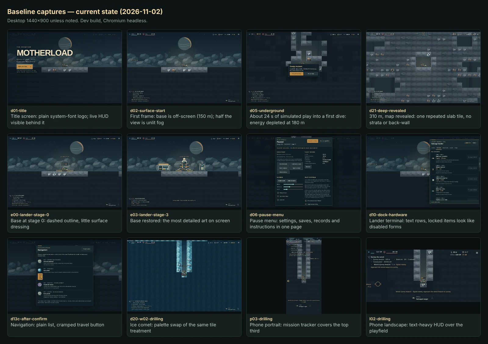

## UI mocks for sign-off

The plan's Phase 0 exit gate includes owner approval of these mocks (OD8). They are proposals, not shipped screens. Their prices and labels show today's values.

| HUD, desktop | HUD, desktop, critical |
| --- | --- |
| 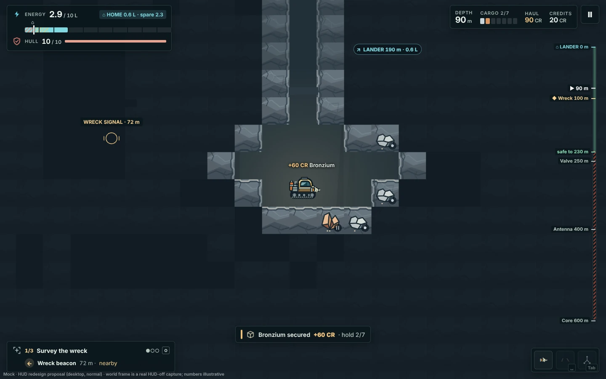 | 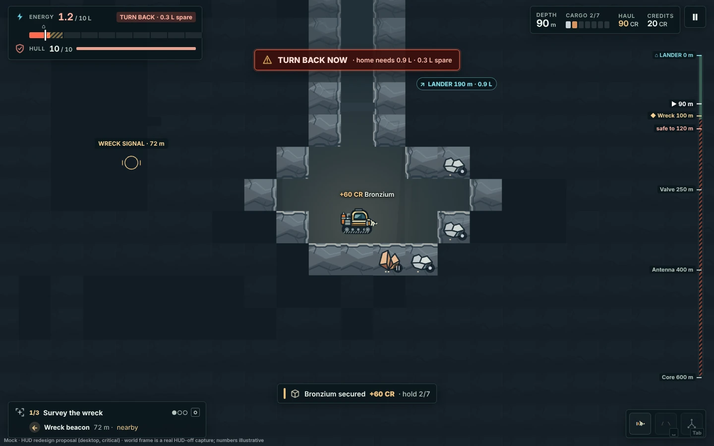 |

| HUD, portrait | HUD, portrait, critical | HUD, landscape | HUD, landscape, critical |
| --- | --- | --- | --- |
| 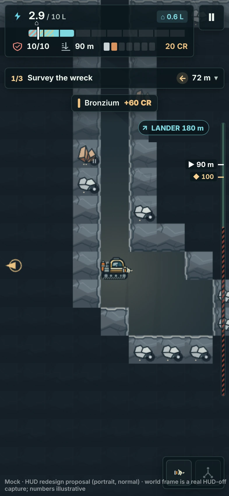 | 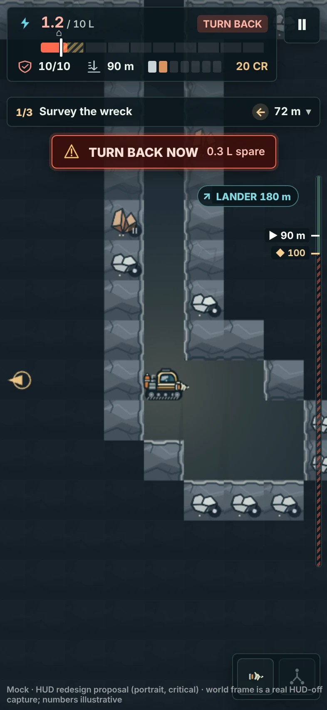 | 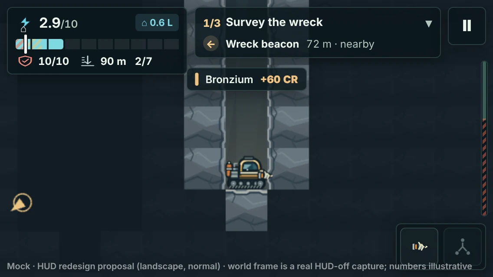 | 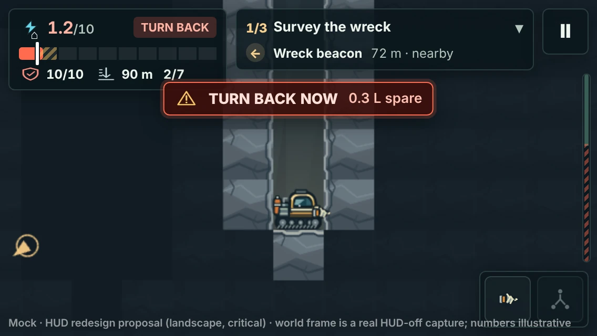 |

| Title | Workshop terminal |
| --- | --- |
| 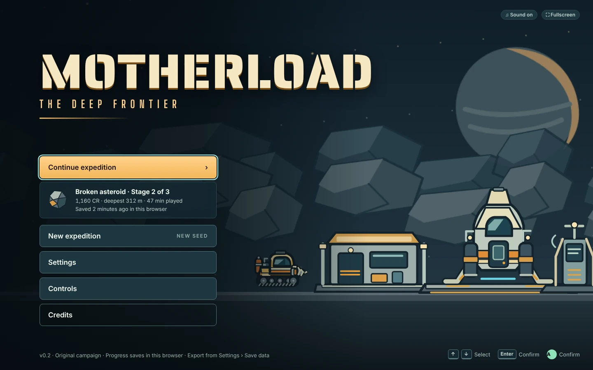 | 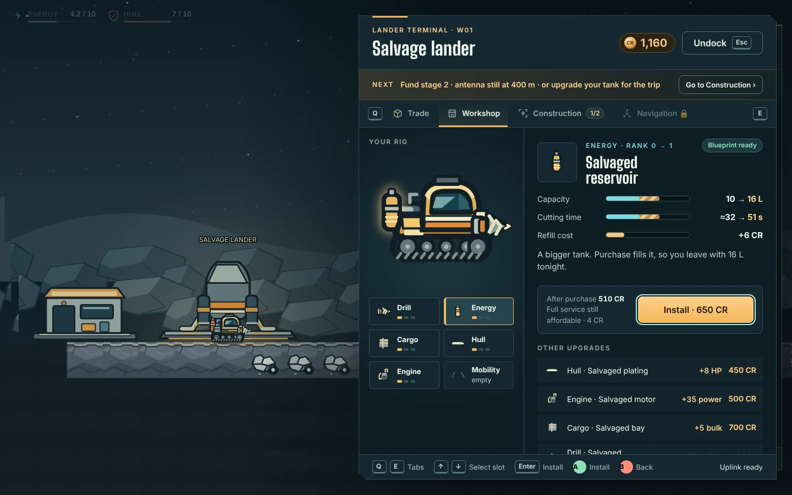 |

| Pause menu | Sale sheet | Star map |
| --- | --- | --- |
| 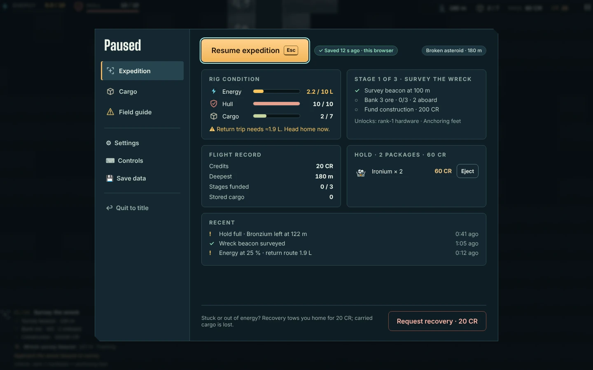 | 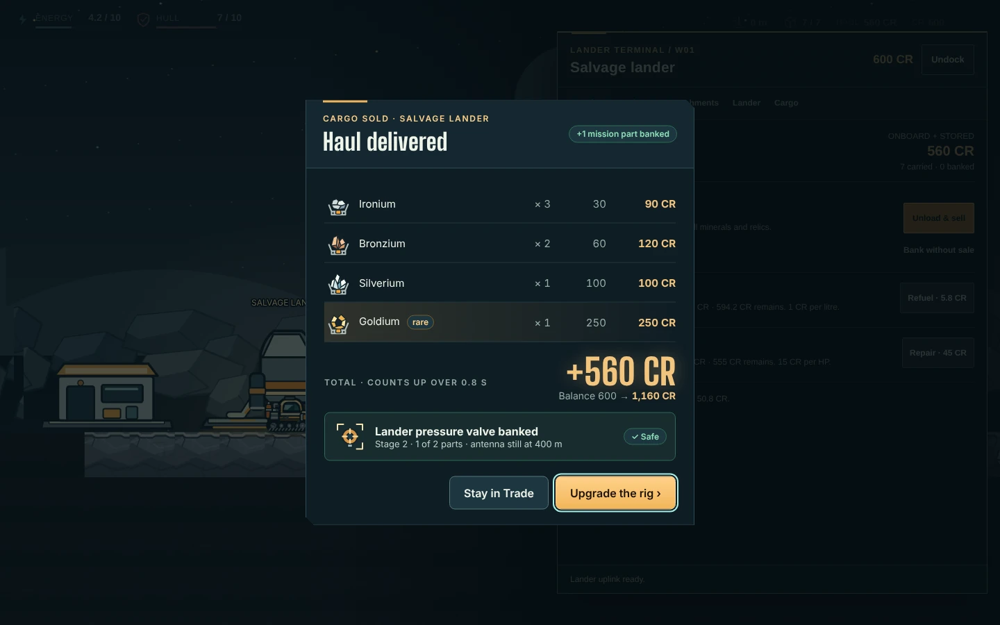 | 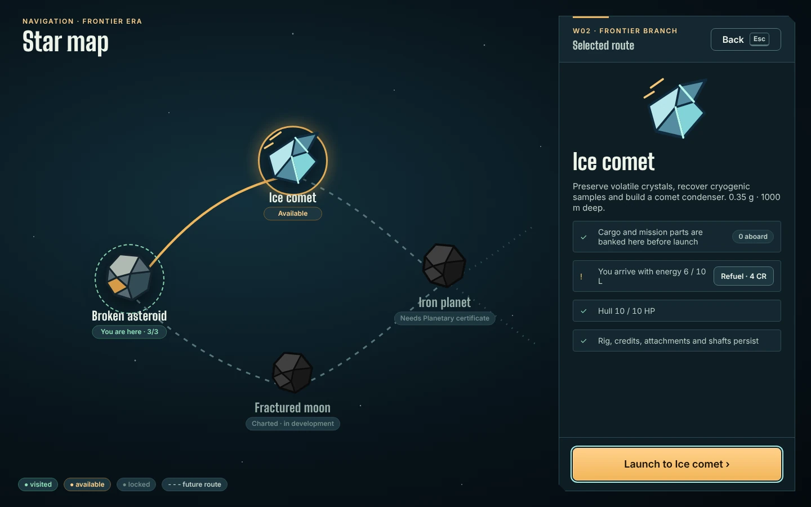 |

The mock sources are `work/hud/mock/mock.html` and `work/menus/mock/index.html` (tokens in `work/menus/mock/tokens.css`). The `render*.mjs` scripts in the same folders turn them into PNG files.

## Running the measurements

The scripts are archived as they were used. Their paths are absolute and assume that the repository lives at `/home/user/Motherload`, as it does in a Claude Code cloud session. On any other machine, rewrite that prefix first by running this from the repository root:

```bash
grep -rlZ /home/user/Motherload docs/improvement-plan/work | xargs -0 sed -i "s#/home/user/Motherload#$PWD#g"
```

- **Headless measurements** are vitest files named `*.audit.ts`. They were renamed from `*.test.ts` so that `npm test` never collects them. To run one, pass part of its file name from the repository root, for example `npx vitest run --config docs/improvement-plan/vitest.audit.config.mjs progression/one`. Each writes its results next to itself (for example `work/progression/out/`), overwriting the archived copy. The simulations are deterministic per seed, so only wall-clock fields change. Some runs take many minutes.
- **Browser scripts** (`*.mjs`) drive the game through `playwright-core`. Start the dev server first with `npm run dev -- --port 5173 --strictPort`. Most scripts expect port 5173, and some accept `BASE` (or `HUD_URL` for the HUD scripts). The exceptions are `work/menus/menus-lib.mjs` (5186), `work/graphics/gfx-bedrock.mjs` (5184) and `work/world/world-capture.mjs` (5197, or a base URL as its second argument). They launch Chromium from `/opt/pw-browsers/chromium`; change `executablePath` to use another browser.
- **Python scripts** measure contrast and colour and render maps. They need Pillow and NumPy.

Plan items H0 and H1 turn this archive into maintained tooling: committed fixtures and capture scripts, a pacing harness in `tests/pacing` and pull-request CI. Until then, treat the folder as a reference archive.

## Not included

- **Screenshots and recordings** that the reports cite (about 90 MB of review captures). Re-create them at `dbf0b1a` with `work/baseline/capture.mjs` and the capture scripts in each audit folder.
- **The mock fonts:** Inter, Big Shoulders Display and Saira Stencil One, all under the SIL Open Font License. `work/menus/mock/tokens.css` loads them as `fonts/Inter-latin.woff2`, `fonts/BigShouldersDisplay-latin.woff2` and `fonts/SairaStencilOne-latin.woff2`. Download the Latin subsets from Google Fonts into `work/menus/mock/fonts/` before re-rendering.
- **One-off scripts** that only edited the plan's own text.
