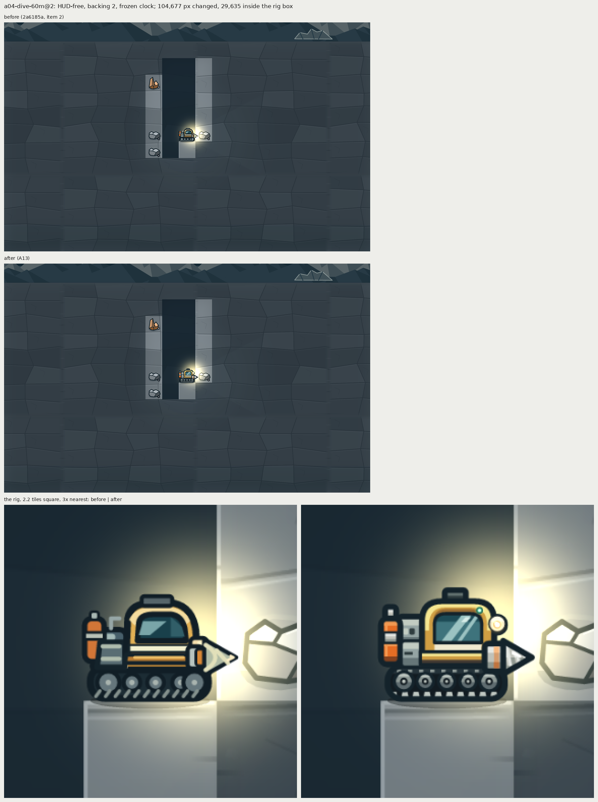
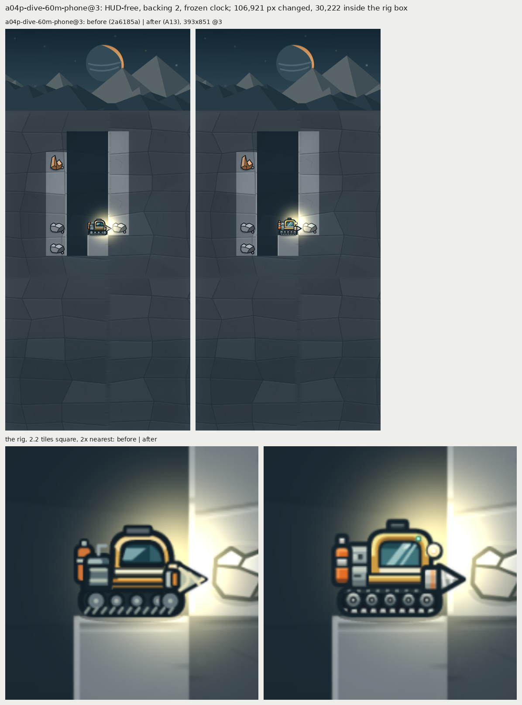
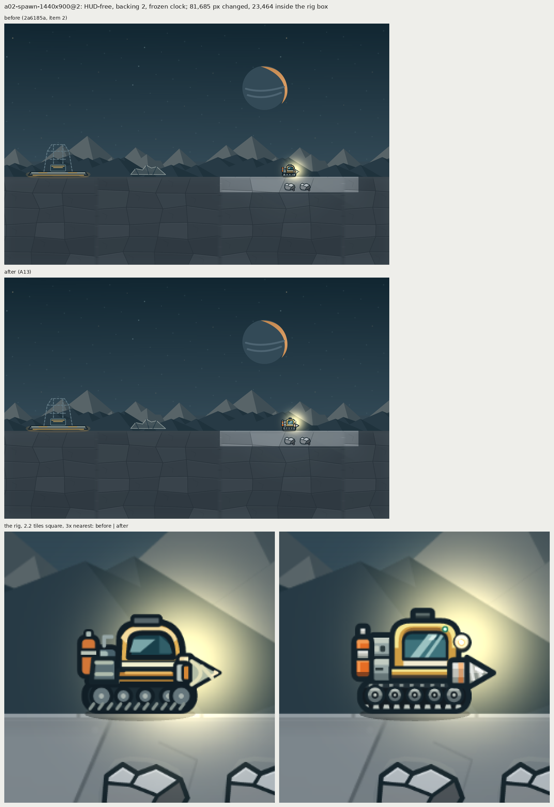
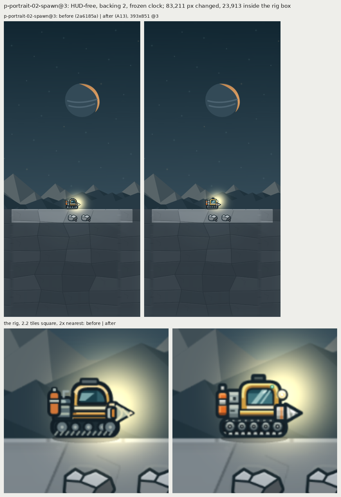
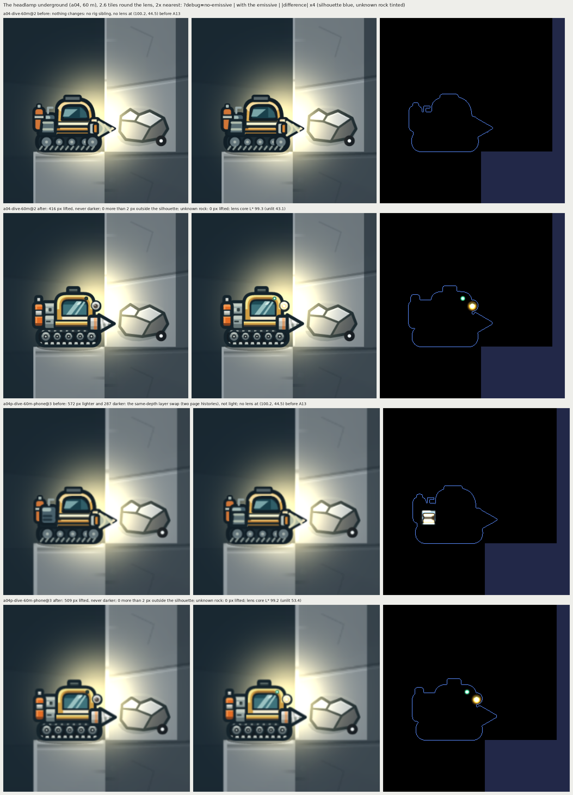
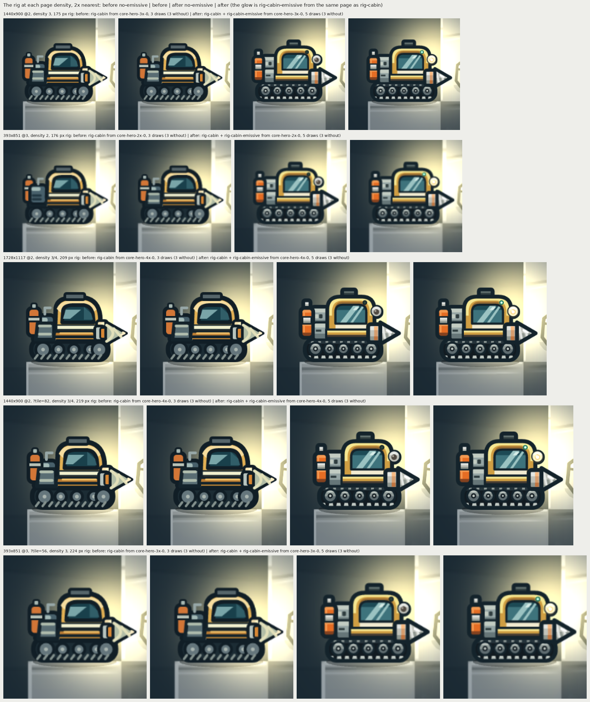
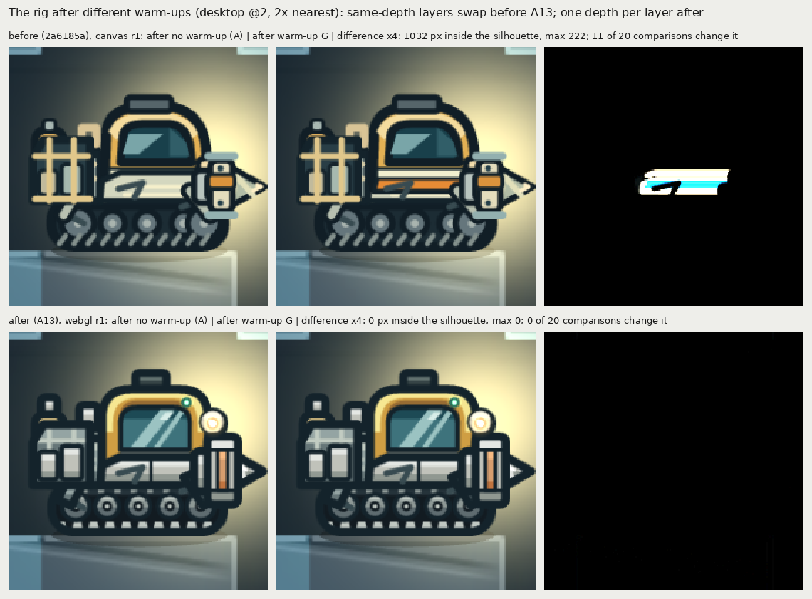

# A13: rig shading with an emissive headlamp

Evidence for art item A13, asset 40 (`docs/ART_QUALITY_AUDIT.md` §5.3 row A13 and §5.6 row 40, "Rig shading, emissive headlamp (P0 under the recommended D1; @4x desktop page)"), with §6.1 (the outline), §9.2 (no lift over 2 L\* on unknown rock; the headlamp core), `docs/art-direction/asset-tracker.md` row 40 and `docs/art-direction/decisions.md` (entry "A13"). The item is the third of three stacked branches: it is built on item 2 (T13b, PR #18, tip `2a6185a`), which is built on item 1 (A12, PR #17). They merge in that order. "Before" in this folder is `2a6185a`; "after" is this item. Status: in review; the facets variant ships until the director picks.

| commit | what it does |
|---|---|
| `9369ec2` | The rig art, the headlamp sibling, one depth per rig layer, the T1-lite lens move, the structural tier check and the review driver. |
| `e97e1d7` | This folder (review sheets, captures, F3 tables, resident bytes, the layer-order proof and their scripts), the docs, and the review driver's default `--before` (now `2a6185a`, so a run compares A13 with the rig before it). |
| this commit | Review fixes: the drill bit's tip stops inside the frame (its outline was cut flat by the frame edge), the halo ends half a unit inside its mount, `icon-energy` keeps its pre-A13 drawing, the tests tie T1-lite's lens to the art and refuse gradient fills, the review driver fails loudly and measures more (tiers at @3 and @2, the halo over front layers, W02's third tool), item 2's emissive-runtime script accepts the rig's sibling, and every number below re-measured on this tree. |

**Files also touched by other open PRs.** None. `src/campaign/scene.ts` and `src/campaign/render/lighting.ts`, which PR #14 (ground light) touches or names, are not changed by this item: the rig's depths live in `render/rig.ts`, `render/rig-layers.json`/`.ts` and `render/emissive.ts`, and `scene.ts` already calls the emissive pass since item 2. PR #14's ground light draws at depth 17.4, below the rig band (18 to 23.9). PR #16's files (`scripts/campaign-smoke.mjs`, `tests/campaign-poi-art.test.ts`, `src/campaign/poi.ts` and others) are not touched either.

## What changed

- **Rig art** (`assets/campaign/source/w01-rig.mjs`, side-effect free; `create-w01-sources.mjs` saves what it returns). Every W01 `rig-*` and `thrust-*` frame is redrawn as flat, top-lit tier facets per material zone (W02's level-2 parts are not: "Out of scope" below), each zone in a `data-zone` group, closed by one `#14232b` outline at `outlineWidth(96)` = 4.22 units with round joins (§6.1); parts lying on another part take a thinner seam. The zones and their anchors:
  - **hull** (yellow): lit `#f6e791` (`rig_yellow`) on the arch's outer and top faces, body L\* 68 toward the board's gold `#c79135`, shadow L\* 49 on the lip under the arch's top, deep L\* 25 on the band's bottom line; the cream identity stripe `#f1ead0` under the window;
  - **paint**: the energy canister in the board's orange (`#e56d24` body, `#f39a52` lit, `#84421f` shadow);
  - **copper**: the metal fittings (drill-mount ring, collar band), body `#d69d6e` (`ore_copper`) with a lit and a deeper shadow tier;
  - **silver**: drill bit, mount, collar, canister band and cap, lamp bezel, roof hatch, rank-1 plates, lit `#e4e7e3` (`ore_silver_top`); the bit's flute grooves are one tier darker than the face they cut; the bit's tip stops at x 125.1, so its round outline join (half of 4.22) ends 0.8 units inside the 128-unit frame, and its glint ends 7.8 units short of the tip;
  - **steel** (rear modules, rack, feet), **tracks** (a dark belt, light cleats, smaller grey wheels), **glass** (teal with a reflection), and **light** (the lens and indicator, unlit; emitters, not a shaded material).
- **Three variants** share one silhouette and every anchor; `RIG_VARIANT` picks the one that ships: `facets` (shipped), `bevel` (the same tiers softened by short gradients and bevel strips), `rim` (facets plus a rim light on top edges).
- **The headlamp** sits on the cabin's front shoulder at (100.2, 44.5) of the 128-unit frame (before: (100, 58), now covered by the collars), with the cabin indicator at (87.4, 34.2): `rig-cabin` draws them unlit (dark glass in a chrome bezel of radius 6; a dark LED), and `rig-cabin-emissive` (the kit's `emissivePair`) holds them lit: the halo `#fcb032` (`lamp_halo`, radius 7.3, fading to alpha 0), the bulb core `#f9fdff` (`lamp_bulb`), a ring authored as the lit colour minus the unlit lens so only the core reaches white after ADD, and the indicator `#3fe08f` with a `#c8ffe2` core. A dark mount disc (radius 7.8) behind the arch keeps the halo on the silhouette, with half a unit to spare (`HALO_R = MOUNT_R − 0.5`) so even the halo's filtered outer ring lands on the rig. No glow is baked into the base.
- **Pages.** The sibling lands beside `rig-cabin` on `campaign-w01-core-hero-{2,3,4}x-0` at the same source size (128, 192, 256) and pivot (0.5, 0.5); item 2's sibling gates pass.
- **Depths.** Each rig layer has its own depth, in one table read by the game and the review driver (`src/campaign/render/rig-layers.json`): thrust 18, body 20, engine 21, energy 21.1, bay 21.2, cabin 22, hull 22.1, damage 22.5, feet 23, rack 23.1, `tool-thermal` 23.2, `tool-condenser` 23.3, `tool-preservation` 23.4, drill 23.5, collar 23.6. Every rig sibling draws at 23.9, above the whole rig and below the effects (24), in one ADD run. This fixes the layer swap item 2 found ("Layer depths" below).
- **T1-lite** follows the lens: `T1_LITE_HEADLAMP_LENS` = {36.2/128, −19.5/128}; `tests/art-rig.test.mjs` requires it to equal `(HEADLAMP_LENS − 64) / 128`, so the core moves if the lamp does, and its own test pins the values and expects the harness probe 0.39 to 0.41 tile from the lens.
- **Kit.** Gradient stops in `kit/svg.mjs` take an optional opacity, so the halo fades to transparent.
- **HUD icons.** Only `icon-feet` (and its alias `w01-r2-icon`) follows the rework, as the brief asks; `icon-drill`, `-energy`, `-cargo`, `-hull`, `-engine` and `-rack` keep their pre-A13 drawings (`create-w01-sources.mjs`, the `frozen*` functions), so their PNGs, and the alias `core-1-energy-icon`, are byte-identical to item 2's.
- **Checks.** `tests/art-rig.test.mjs` (CI) rebuilds every rig source byte for byte from the module and checks, from the committed SVGs: every fill inside a zone, at least 3 fills and 3 L\* tiers (fills within 3 L\* count as one) per zone in every frame, each zone's tones ordered lit > body > shadow > deep, each part's full-width bands darkening downward (two named exceptions that must exist: the rank-1 canister's painted stripes and the rack's rails), the §6.1 outline width, the anchors (`#f6e791`, `#d69d6e`, `#e4e7e3`), facets as the shipped variant, no gradient, pattern or `url(…)` fill in a base frame (so the count sees every fill), the halo inside the mount, T1-lite's lens on the art's, and the bit's tip inside the frame. `tests/campaign-rig-layers.test.ts` runs `renderRig` with five equipment setups and asserts distinct depths that match the table.
- **Out of scope: W02's level-2 parts.** `rig-engine-2`, `rig-energy-2`, `rig-bay-2`, `rig-hull-2`, `rig-drill-collar-{right,down,left}-2`, `tool-thermal`, `tool-condenser` and `tool-preservation` (`assets/campaign/w02/create-sources.mjs`) are unchanged: W02's flat style, a `#102B3D` stroke 2 to 3 units wide, three or four fills per frame, no material zones, outside the tier test. In W02 at rank 2 they cover most of the rear modules, the armour and the drill mount, so two shading languages show side by side over the new cab (`sheet-poses.png`, the rank-2 rows) until a W02 art item redraws them (tracker row 40, decisions.md "A13").

## Review sheets and the default

The driver composites the rig as the game layers it (the depth order of `rig-layers.json`, the base flipped when facing left, directional drill and collar frames never) in ten poses (the rank-2 poses carry all three W02 tools), for the rig before A13 and each variant, and rasterizes every frame and pose with resvg; the sheet builder measures them beside the board's rig (`rig_box` in `docs/art-direction/d0-target-panels.json`) at the board's tile scale (128 units = 58.85 px). Every number in this section is in [`sheet.json`](sheet.json).

- [`sheet-board.png`](sheet-board.png): the six board panels' rig, 4× nearest, beside the rig before A13 and each variant at the matched scale, with IoU and the hue statistics.
- [`sheet-tiers.png`](sheet-tiers.png): the idle composite of each set with its on-screen zone map and the tiers per zone (swatches with L\* and share), and per variant the frames short of 3 visible tiers at @4, @3 and @2.
- [`sheet-emissive.png`](sheet-emissive.png): the lamp and indicator unlit and lit, `rig-cabin-emissive` alone, and the rig plus the emissive (ADD) on a dark cave and on the lit surface, at the a04 desktop, phone and board scales, idle and flipped; the other variants' lamps.
- [`sheet-poses.png`](sheet-poses.png): the ten poses of each set at @3.
- [`sheet-scales.png`](sheet-scales.png): `rig-body-0`, `rig-cabin` and `rig-cabin-emissive` at @2, @3 and @4 with the tread-row check.
- [`sheet-drill.png`](sheet-drill.png): the drill's eight frames, right and down, per set.
- [`sheet-icons.png`](sheet-icons.png): the HUD icons at 25, 50, 64 and 128 px, before, as shipped and each variant's rework.
- [`contact-facets.png`](contact-facets.png): every rig and thrust frame of the shipped variant at @2.

**Default: facets.** It is the board's cel look: flat tiers with hard edges. None of its 58 frames is short of 3 visible tiers at @4 (rim: 0 too; bevel: 38, its gradients hiding a fill, mostly in the silver, hull and steel zones), and it draws no edge the board does not (rim adds rim lines along top edges). The three share the silhouette, so IoU, tread rows, drill motion and the lamp are the same for all. Bevel and rim stay selectable (`RIG_VARIANT`) for the director.

### Silhouette IoU against the board

Alpha IoU of the idle composite at the board's scale against each panel's board silhouette, aligned bottom-centre / bbox-centre (bevel and rim equal facets; the flipped pose gives the same numbers):

| Panel | Board `rig_box` | Before (`2a6185a`) | Facets (ships), bevel, rim |
|---|---|---|---|
| surface-wide | 54 × 37 | 0.921 / 0.909 | **0.937 / 0.910** |
| shaft-wide | 53 × 38 | 0.872 / 0.873 | **0.914 / 0.914** |
| cavern-wide | 54 × 38 | 0.848 / 0.847 | **0.898 / 0.898** |
| surface-tall | 51 × 36 | 0.939 / 0.914 | **0.907 / 0.869** |
| shaft-tall | 55 × 37 | 0.893 / 0.882 | **0.905 / 0.884** |
| cavern-tall | 51 × 36 | 0.848 / 0.848 | **0.846 / 0.832** |
| minimum | | 0.847 | **0.832** (target ≥ 0.7) |

The rig measures 52 × 38 px at the board's scale (before 52 × 36).

### Shading tiers per material zone

Idle composite. **Structural**: distinct L\* tiers among the zone's fills in the composite's sources. **On screen @4 / @2**: `scripts/art_tiers.py`'s pixel reading inside each zone's visible mask (occlusion applied, outline excluded), flat pixels only, a tier needing 3 % of the zone's flat pixels. **By fill @2**: pixels within 2.5 ΔE of a zone fill, flat or not.

| Zone | Structural: facets / bevel / rim | On screen @4: facets / bevel / rim | Facets by fill @2 | Facets flat @2 | Before, on screen @4 |
|---|---|---|---|---|---|
| hull | 4 / 4 / 4 | 4 / 3 / 4 | 4 | 2 | 3 |
| paint | 3 / 4 / 3 | 3 / 3 / 3 | 3 | 3 | (no zone) |
| copper | 3 / 3 / 3 | 3 / 3 / 3 | 3 | 3 | 4 |
| silver | 6 / 9 / 6 | 5 / 5 / 5 | 6 | 3 | 2 |
| steel | 4 / 5 / 4 | 4 / 4 / 4 | 4 | 3 | (no zone) |
| tracks | 5 / 5 / 5 | 5 / 5 / 5 | 5 | 2 | (no zone) |
| glass | 4 / 4 / 4 | 3 / 3 / 3 | 3 | 3 | 3 |

**Per frame, honestly** (`art_tiers.visible_svg_tiers`: each frame alone at @4, a tier counting only if at least 8 flat pixels of its fill reach the screen inside the zone's mask): frames with a zone under 3 visible tiers or a hidden fill: facets 0 of 58, rim 0, bevel 38. In CI, `tests/art-rig.test.mjs` checks every frame structurally (3 tiers per zone). At @2 with flat pixels only, the hull and the tracks of the idle composite read 2 tiers: their bands are under 4 px there, so their pixels are anti-aliased blends; by fill colour they read 4 and 5.

**The honest count holds at @4 only** (`frames_short_x3`, `frames_short_x2` in `sheet.json`: the same reading at the other page densities, the 8-pixel minimum scaled by area to 4.5 at @3 and 2 at @2). @4 is what players get at 1728 × 1117 @2 or `?tile=82`; the default desktop density is @3 and the phone's @2.
- **@3, facets:** 13 zone-frames in 13 frames show fewer than 3 tiers, and 22 more keep 3 but hide one fill. Three of the 13 are drawn in the idle pose: `rig-hull-0` hull 2 (its lit `#f6e791` band has no flat pixel at @3), `rig-energy-0` silver 0 and `rig-cabin` silver 1. The others: both rank-1 collars facing right and left (silver 2), five down-drill frames (silver 2), `rig-energy-1` (silver 0), `rig-feet-stowed` (steel 2) and `rig-feet-deployed` (pads 2). Rim: 25 zone-frames under 3; bevel: 26.
- **@2, facets:** 70 zone-frames in 47 frames show fewer than 3 tiers; most small zones read 0 to 2 flat tiers, while by fill colour the idle composite keeps 3 to 6 per zone.
- This is an accepted deviation for review ("Open points"); widening the lit bands that lose it (the hull plate's, the canister's silver bands) would be an art change for the director's round.

### Colour, motion, tread, lamp

- **Hues at the board's scale** (yellow: C\* > 25, hue 65–100; orange: C\* > 35, hue 35–65): facets yellow 133 px, mean L\* 72.1, p25 58.5, p75 86.5; orange C\* 56.4 over 39 px. Board: yellow 126–144 px, mean 67.5–68.6, p25 49.0–56.0, p75 80.4–84.0; orange C\* 56.7–63.3. Before A13: yellow 82 px, mean 71.1; orange C\* 55.2 over 23 px. Bevel 159 px, 67.8; rim 132 px, 72.3.
- **Drill**, pixels changing by more than 24 levels per animation step (16 fps): at @2, right 73–86 and down 71–79 (before 121–313 and 123–313, unevenly); at @3 180–198 / 158–170; at @4 326–352 / 296–310. The flutes move three pitches a loop (2.4 units a frame). The review fix that pulled the tip inside the frame shortened the bit by 1.5 units, which cost 7 to 10 % of that motion (79–93 / 79–88 at @2 before the fix); the down bit's grooves went from 3 to 3.4 units wide so its shadow tier keeps 8 flat pixels at @4 in every frame.
- **Tread**: the lowest opaque row of `rig-body-0` is 100 / 150 / 200 at @2 / @3 / @4, as `check-campaign-assets.mjs` requires.
- **Lamp coverage**: the lens and the indicator are fully visible (share 1.0) in all ten poses, including the rank-1 and rank-2 collars, all three W02 tools, thrust and damage.
- **The halo over front layers** (`halo_over_front_layers_x4`: pixels where the sibling has alpha, `rig-cabin` is opaque and the composite differs from it, so a layer drawn in front of the cabin lies there and the glow adds over it): 0 px in eight poses; 13 px at @4 over the rank-1 collar's top edge (sibling alpha up to 67 of 255) and 45 px over W02's rank-2 collar (alpha ≤ 24). That is the halo's faint lower ring falling on the part below the lamp, accepted as lamp light; the lens and the indicator themselves are never covered.
- **The sibling, offline** (facets, @4, ADD over the cave background): extent x 84–107.5, y 30.5–52 units (alpha > 32: 84.5–105.5 × 31–49.5); lens core L\* 100 within 3.16 units; halo ΔL\* 39.5 / 10.1 / 1.8 / 0 at 3 / 5 / 7 / 9 units; 0 ΔL\* outside the rig's silhouette.
- **Icons** (`sheet-icons.png`): as shipped, drill, energy, cargo, hull, engine and rack are the pre-A13 drawings (IoU 1.0 against before); only feet changes (IoU 0.677, mean L\* 39.2 → 29.6).

**Reproducible.** The driver run twice into fresh folders wrote 3,866 files with identical SHA-256, and the sheet builder's 9 files in a scratch folder equal the ones here ([`reproducibility.json`](reproducibility.json)).

## In the game

All browser runs below were made from private copies of each tree, served with Vite, in Chrome 156 (`/opt/pw-browsers/chromium-1248`), WebGL unless stated, frozen scene clock, HUD-free frames. [`capture.mjs`](capture.mjs) makes the captures and probes, [`evidence.py`](evidence.py) the sheets and [`captures/captures.json`](captures/captures.json) the measures.

### Captures, before and after

`scripts/art-captures.mjs` at `ART_BACKING=2`: `a04-dive-60m@2` (1440 × 900 @2), its 60 m phone twin `a04p-dive-60m-phone@3` (393 × 851 @3), `a02-spawn-1440x900@2`, and `p-portrait-02-spawn@3`, which is a02's checkpoint (`fresh-w01.json`) on the 393 × 851 @3 phone. That capture already exists as a §9 frame, so no a02 phone twin was added to `art-captures.mjs` and the nightly visual-sheets job keeps its columns. Each sheet shows the full frames and the rig 2.2 tiles square, magnified with nearest-neighbour sampling.

| Capture | Changed px | Inside the rig box | Outside it (by more than 8 levels; max) |
|---|---|---|---|
| `a04-dive-60m@2` | 104,677 | 29,635 | 75,042 (22,068; 49) |
| `a04p-dive-60m-phone@3` | 106,921 | 30,222 | 76,699 (22,468; 49) |
| `a02-spawn-1440x900@2` | 81,685 | 23,464 | 58,221 (17,287; 50) |
| `p-portrait-02-spawn@3` | 83,211 | 23,913 | 59,298 (17,440; 50) |

Outside the rig box, the change is T1-lite's warm core, which moved 13.5 units (0.14 tile) up with the lens. Both runs framed every scene the same way (`evidence.py` asserts it).









### The headlamp glow underground, through the sibling

The same a04 and a04p frames with `?debug=no-emissive` (every base, no sibling), with the emissive, and the absolute difference ×4, 2.6 tiles round the lens; in the difference the rig's silhouette is outlined and the unknown rock (undiscovered cells, from the exported checkpoint) is tinted where nothing changed.



- **After:** the sibling lifts 416 px (a04) and 509 px (a04p), never darkens a pixel, and lifts nothing more than 2 device px outside the silhouette (on desktop nothing past 1 px; on the phone 2 px lie between 1 and 2 px out). The lens core (the device pixels within 1.5 units of the lens centre) reads L\* 99.3 (a04) and 99.2 (a04p) lit against 43.1 and 53.4 unlit.
- **Before:** the a04 frames are identical; a04p's two runs differ by 572 lighter and 287 darker px in the rear module (x 24–47, y 58–77 units): the same-depth layer swap between two page histories, not light (item 2's tree has no rig sibling).

### Pages, density and the @4x proof

The a04 scene in five forms, each with and without `?debug=no-emissive` (probes in `capture.mjs`; [`captures/density-proof.png`](captures/density-proof.png)). `rig-cabin` and every rig layer, and `rig-cabin-emissive` with them, come from one page per form (`__campaignDebug.drawnFrames()` and `emissives()`; the sibling's depth 23.9, blend ADD, base `rig-cabin` at 22):

| Form | Tile (CSS px) → rig (device px) | `data-atlas-density` (rest/hero), guard | Rig page | WebGL draws, with / without the sibling | Resident at W01 row 6, before → after (MiB) |
|---|---|---|---|---|---|
| 1440 × 900 @2 | 65.45 → 175 | 3, none | `campaign-w01-core-hero-3x-0` | 5 / 3 (before 3 / 3) | 39.96 → 40.05 |
| 393 × 851 @3 | 44 → 176 | 2, none | `campaign-w01-core-hero-2x-0` | 5 / 3 (before 3 / 3) | 21.90 → 21.84 |
| 1728 × 1117 @2 | 78.55 → 209 | 3/4, none | `campaign-w01-core-hero-4x-0` | 5 / 3 (before 3 / 3) | 52.82 → 52.82 |
| 1440 × 900 @2, `?tile=82` | 82 → 219 | 3/4, none | `campaign-w01-core-hero-4x-0` | 5 / 3 (before 3 / 3) | 44.16 → 44.16 |
| 393 × 851 @3, `?tile=56` | 56 → 224 | 3, surface (before) → surface, core (after) | `campaign-w01-core-hero-3x-0` | 5 / 3 (before 3 / 3) | 24.85 → 24.32 |



The two CI probes are pixel-identical to the art captures of the same scene after A13; before, the phone probe differs from the a04p capture by 332 px, the layer swap again. No form reports a frame miss.

**Core hero pages** ([`pages.json`](pages.json), from the committed manifests with [`pages.py`](pages.py)):

| Page | Before | After |
|---|---|---|
| `w01-core-hero-2x-0` | 256 × 960, 0.94 MiB decoded, 74 frames, 56,491 B PNG | 512 × 448, **0.88 MiB**, 75 frames, 53,296 B |
| `w01-core-hero-3x-0` | 512 × 960, 1.88 MiB, 84,564 B | 576 × 896, **1.97 MiB**, 84,354 B |
| `w01-core-hero-4x-0` | 832 × 1024, 3.25 MiB, 109,535 B | 832 × 1024, **3.25 MiB**, 111,671 B |

`rig-cabin-emissive` trims to 23 × 21 / 35 × 32 / 47 × 43 px at @2x / @3x / @4x (source 128 / 192 / 256, pivot 0.5, 0.5, as `rig-cabin`). All W01 zone pages: 23 pages, 21.44 → 21.47 MiB decoded at every density, 100 → 101 frames.

### F3 table

`scripts/art-sheets.py --table-only` on the HUD-free captures above: [`table-before.md`](table-before.md), [`table-after.md`](table-after.md) (and their JSON), plus [`table-after-no-emissive.md`](table-after-no-emissive.md) on the `?debug=no-emissive` frames. The metric is unchanged: the headlamp core samples 13 × 13 px patches 0.35, 0.8 and 1.5 tile along a 14° ray from (rig.x + 0.40, rig.y − 0.13), the audit's prototype lamp.

| Row | Target | a04 @2, before → after | a04p @3, before → after |
|---|---|---|---|
| Unknown rock luma (sd) | 45–65, sd ≥ 7 | 61.7 (3.4) → 61.7 (3.3) ✗ | 62.9 (3.8) → 62.8 (3.5) ✗ |
| Known lit − unknown: near (cells) / all | ≥ +15 / ≥ +5 | +60.3 (4) / +61.9 → +60.6 (4) / +62.1 ✓ | +59.1 (4) / +60.7 → +59.4 (4) / +60.9 ✓ |
| Unknown − cave air | ≥ +10 | +23.1 → +22.4 ✓ | +24.4 → +23.5 ✓ |
| Lit rock − cave air | ≥ +18 | +85.0 → +84.5 ✓ | +85.1 → +84.4 ✓ |
| Rock sd within 3 tiles of a light | ≥ 15 | 9.4 → 9.7 ✗ | 9.5 → 9.7 ✗ |
| Frame L\* mean (concept) | ±4 | 26.8 → 26.8 (25.9) ✓ | 27.6 → 27.6 (30.1) ✓ |
| Share within ±3 L\* of the mode | ≤ 0.45 | 0.792 → 0.792 ✗ | 0.487 → 0.487 ✗ |
| p2–p98 / p98 L\* | ≥ 40 / ≥ 54 | 37.4 / 52.7 → 37.4 / 52.7 ✗ | 42.8 / 57.3 → 43.2 / 57.7 ✓ |
| Edge density | ≥ 0.06 | 0.020 → 0.020 ✗ | 0.021 → 0.022 ✗ |
| Warm-accent share, % | (cavern and surface only) | 0.09 → 0.10 | 0.35 → 0.38 |
| Wall profile | lip ≥ rock + 55; undercut ≤ air − 8 | 109→139→36→37 unchanged ✗ | 109→153→36→37 unchanged ✗ |
| Tile-normalised mean gradient | ≥ 2.5 | 1.01 → 1.03 ✗ | — |
| Playfield within 10 luma | ≤ 25 % | 87.4 % → 87.5 % ✗ | — |
| **Headlamp core L\* / b\* (0.35 tile)** | ≥ 70 / +15 to +30 | **88.5 / +17.6 → 86.3 / +18.3** ✓ | **89.2 / +17.6 → 87.2 / +18.2** ✓ |
| Overlay edge share | ≤ 20 % | 42 % → 42 % ✗ | 48 % → 47 % ✗ |
| Text items | ≤ 1 | 5 → 5 ✗ | 5 → 5 ✗ |

**What moved and why.**
- *The headlamp core* (−2.2 L\*, +0.7 b\* on a04; −2.0, +0.6 on a04p): T1-lite's core moved with the lens, 0.14 tile up, so the fixed probe now lies 0.40 tile from the core's centre instead of about 0.37, further out on its warm falloff. It stays in target with 16.3 L\* and 3.3 b\* of margin at a04.
- *Unknown − cave air and lit rock − cave air* (−0.5 to −0.9): the core now sits higher, over the shaft's air above the rig, which reads a little lighter; unknown rock is unchanged within 0.1.
- *Rock sd, known lit − unknown* (+0.2 to +0.3): the core lights the wall cells beside the rig at a slightly different height.
- *Gradient, edge density, warm share, the phone's p2–p98 and overlay share* (all small): the rig's new facets and canister add edges, light and warm pixels inside the frame; on the phone the extra art edges lower the overlay share by a point.
- *Nothing else moved.* Every row that passed before passes after, on both forms, and every failing row was already failing (they wait for T1, T2 and the H items).
- *The sibling changes no gated F3 row.* With `?debug=no-emissive` every row reads the same, except a04's mean gradient (1.02 without the sibling, 1.03 with it), the phone's p98 (57.6 / 57.7) and its warm share (0.39 / 0.38): the sibling lies inside the rig, and the headlamp probe lies in front of it.

The per-PR harness (`IMPROVEMENT_CHECKS=harness`, backing 1, all 8 §9 frames) reads a04's headlamp core at 87.1 / +18.0 ([`checks.txt`](checks.txt)).

### Resident bytes and draw calls

`docs/qa/t13b-asset-pipeline/zone-runtime.mjs resident` in each tree, the same forms and stages as item 2 ([`resident-before.json`](resident-before.json), [`resident-after.json`](resident-after.json); `resident-table.py` in item 2's folder prints the per-group tables). "Before" reproduces item 2's published `resident-after.json` in all 20 samples: the same resident bytes, groups, pages, guard and draw counts (the files differ only in the base URL, the random keys of Phaser's 1 × 1 textures and, in three cave samples, the readout's hold note, "at ceiling" against "held 0.3 s"). "After" was measured again on this tree after the review fixes: the same bytes as before the fixes (the page sizes did not change). MiB, boot / W01 row 18 / W01 row 43 (cave) / W02 row 26:

| Form | Before | After | §7 |
|---|---|---|---|
| desktop 1440 × 900 @2 (hero and rest @3x) | 34.89 / 45.57 / 38.77 / 45.03 | **34.99 / 45.66 / 38.86 / 45.13** | 64 |
| phone 393 × 851 @3 (@2x) | 16.84 / 27.19 / 22.10 / 27.01 | **16.77 / 27.13 / 22.04 / 26.94** | 20 boot / 40 |
| desktop 1728 × 1117 @2 (hero @4x) | 47.76 / 58.43 / 50.56 / 58.42 | **47.76 / 58.43 / 50.56 / 58.42** | 64 |
| desktop 1440 × 900 @2, `?tile=82` (hero @4x) | 39.09 / 49.77 / 41.89 / 49.75 | **39.09 / 49.77 / 41.89 / 49.75** | 64 |
| phone 393 × 851 @3, `?tile=56` (@3x) | 19.79 / 30.46 / 24.57 / 30.83, guard surface | **19.25 / 29.93 / 24.04 / 30.93**, guard surface, core | 20 boot / 40 |

- **Why.** Only W01's core hero page changed: +0.094 MiB at @3x (512 × 960 → 576 × 896), −0.063 MiB at @2x (256 × 960 → 512 × 448), the same at @4x. The new trims overflow a 512 px wide page at @3x, so the packer took a wider, shorter one.
- **Every stage stays within §7.** The largest is 58.43 MiB (desktop 1728 × 1117, W01 row 18) against 64; the phone's boot is 16.77 against 20.
- **The guard steps more often in one debug layout.** With `?tile=56` on the phone (D1 option B, no shipping layout), the guard's dock projection with the surface stepped was just under the 20 MiB boot budget before A13 (19.79 MiB resident); the @3x core hero page's +0.094 MiB takes it over, so the guard now steps the core zone's non-hero page to @2x as well as the surface's, from boot, and its ratchet keeps that page at @2x for the whole W01 session, even where about 10 MiB of headroom opens in play (19.25 MiB at boot instead of 19.79). The frames on that page (cracks, mission markers, the warning shelf, cold pocket, site markers, surface salvage) draw at @2x on a @3x layout. Undoing it needs the @3x core hero page back at 512 px wide (a narrower trim) or a packer that prefers the old shape; neither is in this item, and the drill fix did not change the page (still 576 × 896). The rig's hero page keeps @3x (probe table above). In W02 the guard does not act, and the larger core page adds 0.10 MiB (30.83 → 30.93). On the CI forms and the @4x forms the guard does not act, as before.
- **Draw calls** with the rig's sibling on screen: 5 at W01 row 6 and row 18 and 4 at the dock, the cave and W02 (before: 3 everywhere), on every form (`drawCalls` in the resident samples and the probes): the sibling's single ADD run costs +1 or +2, as item 2 predicted. The limits are 12 desktop and 10 phone. `npm run test:render`'s own view reads 5 (W01) and 4 (W02).
- **The worst case, with item 2's beacon also on screen** (`docs/qa/t13b-asset-pipeline/emissive-runtime.mjs`, now expecting the rig's sibling beside the beacon's; [`emissive-runtime.json`](emissive-runtime.json)): WebGL draws read 6 with the bases alone, 8 with the lit beacon and 10 with the masked beacon, on desktop and phone, high contrast off and on (item 2 measured 6 / 6 / 8 before the rig had a sibling). **The phone is at its limit of 10**: any further sibling or masked ADD run on the phone needs a budget decision first. Every run passes the script's assertions (each sibling copies its base; the beacon's ADD at 17.6, masked only in the masked scene; the rig's ADD at 23.9, never masked), and the masked scene's unknown cell is pixel-identical with and without the pass on both renderers, both forms and both contrasts.

### Hidden information

- **Unknown rock.** In every probe form the sibling lifts **0 px** of unknown rock (cells not discovered, outside the silhouette grown 1 px), with 21,693 to 35,915 unknown-rock device px within 1.5 tiles of the lens, max |ΔL\*| 0.00 (§9.2: no lift over 2 L\*). The headlamp sheet shows that rock beside the lamp.
- **The silhouette.** The sibling lifts no pixel more than 2 device px outside the rig's silhouette (the union of the drawn rig frames' sources at the rig box). Just outside its edge, over known cells: 1 px by 1 level (ΔL\* 0.39) at 1440 × 900 @2, none at 1728 × 1117 or `?tile=82`; 17 px by up to 7 levels (ΔL\* 2.58) on the phone, where the browser scales the backing-2 canvas 1.5× to DPR 3, and 17 px by up to 4 levels (ΔL\* 1.35) with `?tile=56`. Before the review fix (halo radius 8, 0.2 units past the mount) those were 11 px by up to ΔL\* 2.09 on desktop and 44 px by up to ΔL\* 4.39 on the phone. Offline at @4 the halo lifts 0 px outside the silhouette (`sheet.json`).
- **Fog check and hidden-geology crops.** `IMPROVEMENT_CHECKS=fog` passes ("Both worlds hide caves identically to solid rock"), and `npm run test:render`'s hidden-geology crops are identical on Canvas and WebGL in both worlds ([`checks.txt`](checks.txt)). The full-frame scramble is F7 and does not exist yet; the inset-crop checks cannot see the sibling, which is drawn only with its base.

### Layer depths

Before A13, `render/rig.ts` drew engine, energy and bay at depth 21, cabin and hull at 22, and feet, rack, tools, drill and collar at 23. Phaser 3.90's stable depth sort keeps the previous frame's order among equal depths, so the order depended on which pooled sprites had drawn what before the rig (`docs/qa/t13b-asset-pipeline/captures/rig-layer-order.png`). After A13 every layer has its own depth.

**The proof** ([`determinism.mjs`](determinism.mjs), [`determinism.py`](determinism.py); [`determinism.json`](determinism.json), raw runs in `determinism-before.json` and `determinism-after.json`). Desktop 1440 × 900 @2, WebGL and Canvas, two targets: a04 (W01 row 6, hardware 0) and r1 (W01 row 18, rank-1 hardware, feet, rack, collar and wear, so every W01 layer that overlaps another is drawn). Each target is reached on a fresh page after six warm-ups (none; the spawn and the cave; the spawn; a04 and the spawn; the cave; r1, the spawn and a04), and each warm-up's rig is compared with the first's inside the silhouette shrunk 2 px (10,472 and 12,200 px before, 11,377 and 13,204 after).

| Tree | Comparisons with silhouette pixels changed | Largest change | Outside the silhouette (grown 2 px) |
|---|---|---|---|
| before (`2a6185a`) | **11 of 20** | 1,032 px, 222 levels | at most 2 levels (stars, seams) |
| after (A13) | **0 of 20** | 0 | at most 2 levels |



`?debug=no-emissive` against the first run: 416 / 412 px (a04, WebGL / Canvas) and 460 / 451 px (r1) change, all never brighter without the sibling, max 200 levels, none outside the silhouette grown 1 px.

## Checks run

On this tree (`9369ec2`, `e97e1d7` and the review fixes), from private copies for every browser check ([`checks.txt`](checks.txt) holds the result lines):

| Check | Result |
|---|---|
| `PYTHON=python3 npm run assets:rebuild`, twice | byte-identical: every file under `assets/campaign` has the same SHA-256 after both rebuilds, and `git status --porcelain --untracked-files=all -- assets/campaign` is empty on the committed tree (CI's check); a third rebuild under CI's toolchain (Pillow 12.0.0, numpy 2.5.3, Node 24) is identical too |
| `npm run assets:check` | pass (zone pages, tread baseline and pivots at @2/@3/@4, the emissive sibling gates, the frontier and render-asset gates) |
| `npm test -- --maxWorkers=2` | pass (394 tests) |
| `npm run format:check` | pass |
| `npm run build` | pass |
| `npm run test:render` | pass: hidden geology identical on Canvas and WebGL in both worlds; WebGL draws W01 5, W02 4 (limit 12) |
| `IMPROVEMENT_CHECKS=visual,fog,harness npm run test:improvements` | pass; in the harness table a04 reads 87.1 / +18.0, and a05 (150 m) fails the b\* floor at 99.0 / +6.5, as it has since T1-lite landed (+3.9 then, `docs/qa/t1-lite-headlamp`) |
| `npm run test:render:memory` | pass: every stage within §7 (the same MiB as before the fixes) |
| `npm run test:feel`, `npm run test:hud:surface` | pass |
| `docs/qa/t13b-asset-pipeline/emissive-runtime.mjs` (both siblings) | pass in all 32 runs ([`emissive-runtime.json`](emissive-runtime.json)) |
| Review driver and sheet builder, twice | identical (`reproducibility.json`) |
| Captures, probes, layer-order proof, resident bytes | above; "after" measured on this tree, "before" kept from `2a6185a` |

`npm run test:campaign:browser` is not part of CI and was not run: it stops at the stale "300 CR" expectation that PR #16 refreshes, the same on items 1 and 2.

## Acceptance

| Line | Status | Evidence |
|---|---|---|
| ≥ 3 shading tiers per material zone (yellow hull, copper, silver top, tracks; also paint, steel, glass), §6.1 outline, top-lit | met (structurally and at @4; see the @3/@2 deviation) | Structural in CI (`tests/art-rig.test.mjs`): every frame, every zone ≥ 3 fills and ≥ 3 L\* tiers, tones ordered, bands darkening downward, outline 4.22. Honest pixels: facets 0 of 58 frames short at @4; idle on screen at @4 hull 4, paint 3, copper 3, silver 5, steel 4, tracks 5, glass 3. At @3, 13 zone-frames show fewer than 3 flat tiers (3 in the idle pose), and at @2 the idle composite's hull and tracks read 2 flat tiers (by fill 4 and 5): an accepted deviation ("Open points") |
| `-emissive` sibling with the headlamp (halo `#fcb032`, bulb core `#f9fdff`) and a cabin indicator | met | `rig-cabin-emissive`, drawn ADD at 23.9 from the rig's own page on every form; lens core L\* 98.5 to 100 in game |
| A @4x page under item 2's convention | met | `campaign-w01-core-hero-4x-0` (832 × 1024) carries `rig-cabin` and its sibling at source 256, pivot 0.5; drawn at 1728 × 1117 @2 and `?tile=82` |
| Three variants on a review sheet beside the board's rig at matched scale, with IoU and tier counts; default picked with a reason | met | `sheet-board.png`, `sheet-tiers.png`, `sheet.json`; facets ("Review sheets and the default") |
| Picked variant IoU ≥ 0.7 | met | facets minimum 0.832 (cavern-tall, bbox-centre); every panel ≥ 0.832 in both alignments |
| Byte-identical rebuild | met | two rebuilds, identical (and a third under CI's toolchain); the review driver and sheets too |
| Asset checks, render-acceptance, fog check, scramble | met (scramble: inset crops) | `assets:check`, `test:render`, `test:improvements` fog pass; the full-frame scramble is F7, not built yet, and the inset-crop checks pass |
| a04 and a02 captures before and after at @2 and phone scale, headlamp glow visible underground through the sibling | met | `captures/a04-`, `a04p-phone-`, `a02-`, `a02p-phone-before-after.png`; `headlamp-emissive.png` with `?debug=no-emissive` |
| F3 headlamp core ≥ L\* 70 at a04 | met | 86.3 / +18.3 at backing 2 (b\* in +15 to +30); 87.2 / +18.2 on the phone twin; 87.1 / +18.0 in the harness at backing 1 |
| §9.2: no lift > 2 L\* on unknown rock | met | 0 px of unknown rock lifted in every form; nothing beyond 2 px of the silhouette (at most ΔL\* 0.39 just past it on desktop, 2.58 on the phone, over known cells) |
| Overlapping rig layers at distinct depths (item 2's open bug) | met | `rig-layers.json`; 0 of 20 comparisons change the rig after A13, 11 of 20 before |

## Open points for review

- **Yellow** reads mean L\* 72.1 at the board's scale (board 67.5–68.6): the band's lit row is 2 units tall so its tier stays visible; a thinner one fails the honest-tier count. The arch's top corners are also boxier than the board's domed canopy.
- **Tiers at the shipping densities.** The honest 3-tier count holds per frame at @4 only (1728 × 1117 @2, `?tile=82`); at @3, the default desktop density, 13 zone-frames fall short, three of them in the idle pose (`rig-hull-0` hull, `rig-energy-0` and `rig-cabin` silver), and at @2 most small zones read 0–2 flat tiers ("Shading tiers per material zone"). Widening those lit bands is an art change for the director's round.
- **The lamp.** The board draws no lamp disc: its beam starts at the front shoulder, about (102–109, 52–55). The lens sits about 9 units higher, at (100.2, 44.5), because the collars cover y ≥ 50 in the rank-1 and rank-2 poses, and its bezel (radius 6, larger than a critic's 4.2–4.5, since a 1-unit ring never reaches 8 flat pixels at @4) bulges out of the cab's top-right silhouette. Lit, it reads as a cream disc with a peach ring round a white core; at the board's scale it is a 4–5 px bright disc where the board shows nothing; unlit (debug only) the ring, dark lens and glint can read like an eye. A smaller bezel or a lens set into the arch would remove the bump.
- **The drill** reads smaller and darker at game scale than before: it changes fewer pixels per step (73–86 against 121–313 at @2), evenly; the bit is white-silver where the board's is cream, the 4.22-unit outline is most of the small cone (its right edge reads dark at the board's scale), and the review fix that keeps its tip inside the frame made it 1.5 units shorter. The lighter bit with grooves one tier darker is the board's look.
- **The halo over the collars.** The halo's faint lower ring adds over the rank-1 collar's top edge (13 px at @4, alpha ≤ 67) and W02's rank-2 collar (45 px, alpha ≤ 24); the lens and indicator are never covered.
- **Phone `?tile=56`**: the guard now steps the core zone too, for the whole W01 session (above). A packer change or a narrower trim that keeps the @3x core hero page at its old size would undo that; neither is in this item.
- **W02's level-2 parts** keep W02's flat style beside the new rig ("Out of scope"); a W02 art item should redraw them.
- **Draw calls on the phone**: with the beacon masked and the rig on screen the phone reads 10 WebGL draws, its limit; a further sibling or masked ADD run needs a budget decision.
- The decisions log records these as accepted deviations for review (`decisions.md`, "A13").

## Reproduce

`2a6185a` is item 2's tip (T13b, PR #18), which A13 is built on. After a squash merge a fresh clone may not have it: fetch it (`git fetch origin pull/18/head`) or pass the commit A13 is built on; `art-review-a13.mjs` and `pages.py` stop with that hint when the revision does not resolve.

Browser scripts run from the root of a private copy of the tree they measure (for "before": `git archive 2a6185a` into another folder, plus `node_modules`), served with `npx vite --host 127.0.0.1 --port P --strictPort`, with `CHROMIUM_PATH` set to Chrome 156. Vite reloads pages when files change, so never run them from a checkout that is being edited. The scripts in this folder are run by path from the copy's root.

```bash
# review sheets (no browser), twice, then compare (--before defaults to 2a6185a)
node scripts/art-review-a13.mjs OUT --before 2a6185a
python3 scripts/art-review-a13.py OUT/review.json docs/qa/a13-rig-shading

# captures and probes (each tree), the sheets and measures, the F3 tables
PREVIEW_URL=http://127.0.0.1:P/ node <repo>/docs/qa/a13-rig-shading/capture.mjs OUT 2
python3 docs/qa/a13-rig-shading/evidence.py BEFORE AFTER docs/qa/a13-rig-shading/captures
python3 scripts/art-sheets.py --captures OUT/art --out OUT/f3 --table-only
python3 scripts/art-sheets.py --captures OUT/art-no-emissive --out OUT/f3-no-emissive --table-only

# layer order (each tree), then the comparison
PREVIEW_URL=http://127.0.0.1:P/ node <repo>/docs/qa/a13-rig-shading/determinism.mjs OUT
python3 docs/qa/a13-rig-shading/determinism.py BEFORE AFTER docs/qa/a13-rig-shading

# resident bytes (each tree) and the pages
PREVIEW_URL=http://127.0.0.1:P/ node docs/qa/t13b-asset-pipeline/zone-runtime.mjs resident OUT
python3 docs/qa/t13b-asset-pipeline/resident-table.py BEFORE/results.json AFTER/results.json
python3 docs/qa/a13-rig-shading/pages.py 2a6185a HEAD > docs/qa/a13-rig-shading/pages.json

# the beacon and the rig's sibling together (draws, assertions, the unknown cell)
PREVIEW_URL=http://127.0.0.1:P/ node docs/qa/t13b-asset-pipeline/emissive-runtime.mjs OUT

# the gates
PYTHON=python3 npm run assets:rebuild && git status --porcelain --untracked-files=all -- assets/campaign
npm run assets:check && npm test -- --maxWorkers=2 && npm run format:check
PREVIEW_URL=http://127.0.0.1:P/ npm run test:render
PREVIEW_URL=http://127.0.0.1:P/ IMPROVEMENT_CHECKS=visual,fog,harness npm run test:improvements
PREVIEW_URL=http://127.0.0.1:P/ npm run test:render:memory
```
