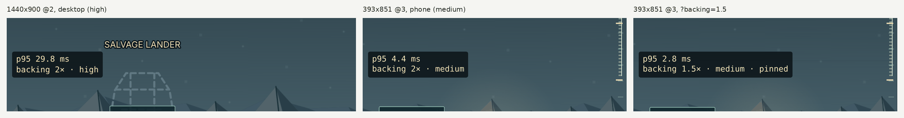
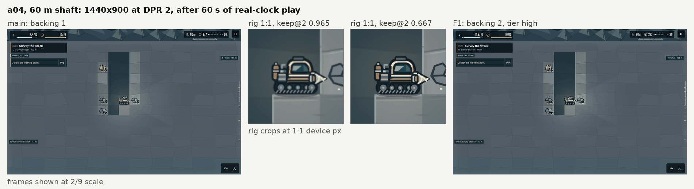
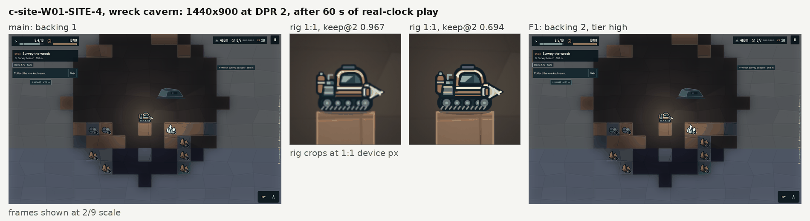

# F1 resolution policy

Evidence for F1 in `docs/ART_QUALITY_AUDIT.md` (§5.2, Phase 0, and R1 in `docs/art-audit/05-tech.md` §5.2): the backing-scale policy in `RenderScaleBudget` (`src/campaign/view.ts`), the debug pin, and the on-screen frame-time readout.

## Problem

Any 3 s window with a frame p95 above 18 ms stepped the backing ceiling down, 2 to 1.5 to 1, and nothing ever raised it again. In this environment a 1440×900 DPR 2 desktop settled at backing 1.0 within the first minute, so every capture showed the world at half resolution, stretched 2×. The audit measured the rig at keep@2 0.96 as shipped against 0.69 when pinned at 2 (`05-tech.md` §2.5).

## Policy

| Tier | Chosen at boot when | Backing floor |
|---|---|---|
| High | WebGL, fragment `highp`, fine pointer (desktop) | 2.0 |
| Medium | WebGL on a coarse pointer (phones and tablets), or without fragment `highp` | 1.5 |
| Low | Canvas renderer | 1.0 |

- Floors never exceed what the device and the Render quality setting allow: the ceiling is still min(`devicePixelRatio`, setting, 2).
- **Step down** one level when a 3 s window's p95 exceeds 18 ms, as before, but never below the floor.
- **Recover** one level after 10 s of whole 1 s slices whose p95 is below 12 ms (R1: "Step back up after 10 s at p95 below 12 ms").
- **Back-off.** A raise that the next two windows undo (within 8 s) doubles the wait before the next raise to that level, up to 160 s. A raise that holds for 60 s resets that level's wait to 10 s. Without it, a device that is cheap at one level and expensive at the next flipped resolution every 15 s for as long as it ran.
- **Not measured by the policy:** 1 s after boot, after every backing resize, and while assets load or the destination art is not ready. Each of these starts the policy's windows and recovery count again.
- **Clock:** the scene clock. Frame dt is clamped to 50 ms as the scene clamps its own, so the windows freeze under the test clock and one long frame counts as one short step.
- Levels stay 1, 1.5 and 2, the values `src/campaign/input.ts` accepts and `scripts/render-adaptive.mjs` asserts.

Phones start in Medium, not High. The audit's table puts "recent phones with fragment `highp`" in High, but every current phone reports `highp`, and nothing available at boot tells a recent phone from a mid-range one. A phone that can afford 2.0 reaches it by recovery 10 s after its frames are cheap. With a High floor, the emulated phone in `render-adaptive.mjs` would never lower its scale, and its "Sustained full-frame load lowers render scale" assertion would fail.

## Debug output

- `?backing=1`, `?backing=1.5` or `?backing=2` pins the backing scale. Other values are ignored. The pin is a test tool and is not limited by the device.
- `?debug=frametime` shows a two-line readout on the left edge at mid-height, inside the safe area, updated every 0.5 s of scene time: the p95 frame time over the last 10 s, then the backing scale, the tier, and "pinned" when pinned. Mid-height is playfield in the desktop, portrait, landscape and small layouts; on phones the bottom corners hold the Dock button and the tool block.
- `#campaign-game` reports `data-backing-scale`, named as the audit names it, plus `data-quality-tier`, `data-backing-pinned` and `data-frame-p95`. `data-render-scale` and `data-view-dpr`, which carry the same value, are unchanged for existing scripts.

The p95 counts every frame of the last 10 s of scene time, including the loading and resize frames that the policy skips. Each frame's cost is the measure the budget uses and that `render-adaptive.mjs` prints as `frameMs`: main-thread time from Phaser's pre-step to post-render. GPU and compositor time between frames is not in it, so a GPU-bound phone can show a low p95 while it drops frames.



## Trade-offs

- **Desktops never lower their resolution.** On a High-tier desktop at DPR 2 the floor equals the ceiling, so the budget holds 2.0 however slow the frames are. That includes WebGL with a software renderer: this container has no GPU and still reports High. The Render quality setting is now the only way down on such a machine. The desktop acceptance line holds because of the floor, not because of recovery; the phone run below is the evidence that recovery works.
- **Phones start in Medium**, which departs from the audit's table (see Policy).
- **The back-off stretches the owner's 10 s.** A level whose raises keep failing waits 20, 40, 80 and then 160 s. A Medium or Low device that flapped can take well over 60 s to reach 2.0 again. Its first recovery, and every recovery to a level that has not failed, still takes 10 s.
- **Below 20 fps the windows stretch.** They run on the scene clock, which counts at most 50 ms per frame. At 20 fps and above the only difference from `main` is the 1 s holds. With 100 ms frames a Low device reaches backing 1.0 after 16.2 s (`main`: 6.0 s) and a Medium device reaches 1.5 after 8.1 s (`main`: 3.0 s). With 200 ms frames, after 32.4 s and 16.2 s. The readout's 10 s are scene time too.

## Acceptance

| Line | Result | Evidence |
|---|---|---|
| Backing returns to 2.0 within 60 s on desktop | Met. A High-tier desktop never drops below 2.0, through 15 s of 4× CPU throttle and the 60 s after; `main` sits at 1.0 throughout | `backing-recovery.mjs`, below |
| Rig sharpness keep@2 ≤ 0.75 | Met. a04 0.667, SITE-4 0.694 at backing 2.0 after 60 s of play. `main`: 0.965 and 0.967 at backing 1.0 | `scripts/art-captures.mjs`, `keepAt2` in `scripts/render-probe.mjs` |
| `node scripts/render-adaptive.mjs` passes | Met. The emulated 393×851 @3 phone under a 4× throttle steps from 2.0 to 1.5 and no lower (`main`: 1.5, then 1.0) | its `results.json`, in the PR |
| `npm test` and `npm run format:check` pass | Met | the full `verify` job, run locally |

## Before and after

As shipped: each capture restores its fixture, plays 60 s on the real clock, then freezes and settles before the screenshot. `main` is 07be4c4.





### keep@2 at each pinned backing scale

| Capture | Backing 1 | Backing 1.5 | Backing 2 |
|---|---|---|---|
| `a04-dive-60m@2` | 0.965 | 0.911 | 0.667 |
| `c-site-W01-SITE-4-wreck@2` | 0.967 | 0.920 | 0.694 |
| Audit, `05-tech.md` §2.5 (rig, a04) | 0.96 | — | 0.69 |

Only backing 2.0 meets ≤0.75 on a DPR 2 desktop, so the High floor is what keeps desktop captures sharp. The keep@2 of a crop rises toward 1 the more it was upscaled. `keepAt2` uses Pillow's Lanczos-3 coefficients and forward-difference energy. That is the reading that reproduces the audit's anchors. Box-down and bilinear-up gives 0.61 at backing 1. Sobel or central-difference energy gives 0.99 or more at backing 1.

The phone capture `p-portrait-03-dive-70m@3` measures 0.921 at backing 2. A DPR 3 screen at backing 2 is still a 1.5× upscale, and the cap of 2 is unchanged. The acceptance line applies to desktop captures (`05-tech.md` §5.2 R1 and §6 T2).

## Recovery

`backing-recovery.mjs` clicks Start, holds Down under a 4× CPU throttle for 15 s, then releases and idles unthrottled for 60 s, reading the backing scale once a second. All figures on this page come from commit ff4abfe.

| Form | Branch | Tier | Lowest under stress | Back at 2.0 | Held to 60 s |
|---|---|---|---|---|---|
| 1440×900 @2 desktop | `main` 07be4c4 | — | 1.0 | never | — |
| 1440×900 @2 desktop | this branch | High | 2.0 | never left 2.0 | yes |
| 393×851 @3 phone | `main` 07be4c4 | — | 1.0 | never | — |
| 393×851 @3 phone | this branch | Medium | 1.5 | 9 s after the stress | yes |

On `main` the desktop is already at 1.0 when the stress starts: two expensive windows during start-up stepped it down from 2.0, and nothing raises it again.

## Reproduce

```bash
npm run dev -- --port 5173 --strictPort &
ART_CAPTURES=a04,c-site ART_PLAY_SECONDS=60 node scripts/art-captures.mjs
ART_CAPTURES=a04,c-site ART_BACKING=2 node scripts/art-captures.mjs
node docs/qa/f1-resolution-policy/backing-recovery.mjs http://127.0.0.1:5173/ desktop recovery-desktop.json
node scripts/render-adaptive.mjs
```

Captures and `manifest.json` go to `artifacts/art-captures/`. Set `CHROMIUM_PATH` if Playwright's Chromium is not on the default path.
