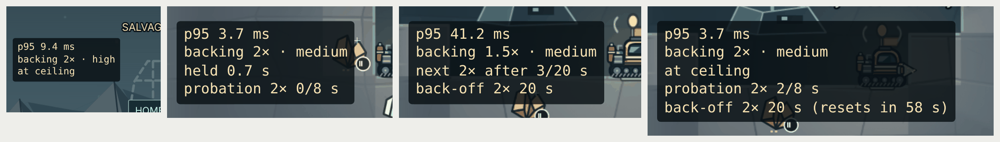
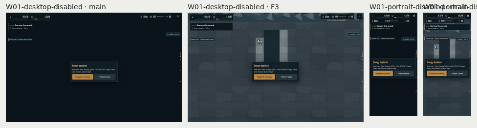
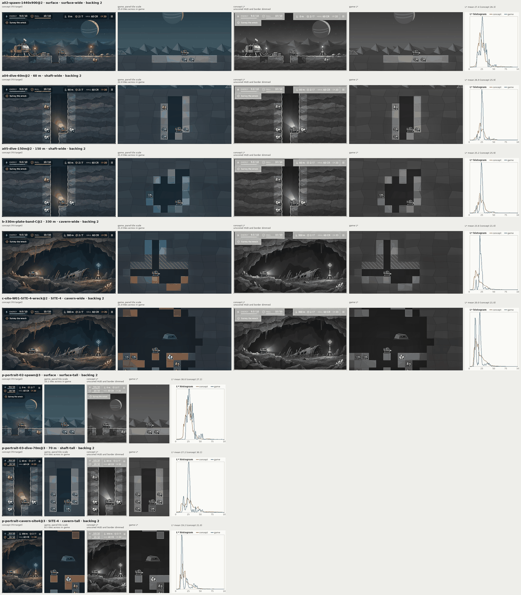

# F3 visual harness

Evidence for F3 in `docs/ART_QUALITY_AUDIT.md` (§5.2, Phase 0): the hooks, captures and measures that produce the §9.1 sheets and the §9.2 table. F3's acceptance line: "The §9 sheet and table are produced nightly; the per-PR job stays under 30 minutes."

## What it adds

### In the game, for tests and debugging only

- **`?overlays=0`** starts with every annotation hidden. `__campaignDebug.overlays(false)` does the same at run time.
  - DOM: everything in `.campaign-shell` except the canvas, the frame-time readout and the hit flash go to opacity 0. They stay laid out and clickable, so safe-area boxes can still be measured.
  - Canvas: world labels, the `screen` layer (rings, arrows, the alarm border, bars), the drill target box, the shelf warning bar, the hit outline around the rig, and the cold-warning, warning-shelf and field-log markers.
  - Tier badges are baked into the ore frames, so they stay. The measures count them as art.
- **`window.__campaignDebug`** (`src/campaign/debug.ts`):
  - `lightTexture()` returns the light map as drawn: a PNG data URL, its size, scale, blur and sky crop. `render-acceptance.mjs` checks it against the canvas the probe reads, with 0 alpha difference in all four renderer and world cases.
  - `overlays(visible?)` toggles the annotations described above.
  - `sceneClock.freeze(seconds?)`, `resume()` and `read()` control the scene clock. That clock drives the looping animation: the alarm border, rig frames, glints, bobbing and pulses. Gameplay keeps its own clock. The one-shot effects (landing squash, hit outline, install and construction pulses) run on frame or wall time.
  - `fade()` reports the camera fade: running, complete, direction and progress.
  - `backing()` returns F1's budget state. Under a `?backing=` pin it reports the pinned scale, with no floor or ceiling, because the policy never runs then.
- **The F1 back-off state in the `?debug=frametime` readout.** Below the p95 and the backing scale, the readout now shows:
  - the next step, as "next 2× after 4/20 s", "at ceiling", "held 0.4 s" or "policy off (pinned)";
  - a raise still on probation, where a step down within 8 s doubles that level's wait;
  - each doubled wait, with the time a holding raise still needs to reset it.

  Tests read the same state through `__campaignDebug.backing()`. Below, an emulated 393×851 phone goes through a full cycle. It is throttled, recovers to 1.5×, and raises to 2× on probation (0/8 s). It is throttled again, so the raise fails and 2× now waits 20 s. It then raises once more, with that wait resetting after 60 s. On the left, the desktop at its ceiling.



### Captures

- **`ready()`** (`scripts/campaign-smoke.mjs`) takes `{ freezeSceneClock: true }`. It then freezes the scene clock at 0 after the art is ready and before Start, so the alarm border and the rig frames have the same phase in every run. The fog check, the visual check and `art-captures.mjs` use it. The 12 visual dark shares over four runs on each side:

  | Capture | `main`, b2796fa (dark %) | F3 (dark %) |
  |---|---|---|
  | `W01-desktop-danger` | 8.001 / 8.021 | 8.023 |
  | `W01-portrait-danger` | 22.030 / 22.035 | 22.030 |
  | `W01-landscape-danger` | 25.493 / 25.502 / 25.511 | 25.581 / 25.599 |
  | `W02-landscape-danger` | 20.871 | 20.669 |
  | `W01-landscape-shaft` | 24.806 / 24.815 | 24.806 / 24.815 |
  | `W02-landscape-shaft` | 21.778 | 21.778 / 21.787 |
  | the other six | one value each | the same value each |

  The danger captures carry the alarm border, whose alpha follows the scene clock. Frozen at phase 0, its alpha is 0.45, so those captures no longer vary.
  - On `main` the border lands wherever the clock is at capture time. That also moves the two landscape danger captures off `main`'s values, by 0.09 and 0.20 percentage points.
  - Every pixel that differs from `main` in the danger captures lies within 8 px of the frame edge, where the border is drawn. The one exception is the rig strip below.
  - The thresholds are unchanged and every capture stays far inside them. The minimum HUD contrast is 8.326 on both sides.

  One source remains, and it also occurs on `main`: in about one run in four, a 21×4 px strip of the rig body samples differently in one of the DPR 1 forms.
  - The cause is the rig's resting position at sub-pixel level. The settle check compares it to 4 decimals, and the scene clock does not drive it.
  - It moves a dark share by at most 0.018 percentage points.
  - It is not fixed here.
- **`scripts/art-captures.mjs`** captures the §9 fixtures. Each one has a scene and the concept panel it is scored against (`docs/art-direction/d0-target-panels.json`):
  - surface spawn, 60 m, 150 m, 330 m and SITE-4 at 1440×900@2;
  - surface, 70 m and SITE-4 at 393×851@3.

  The backing scale is pinned through F1's `?backing=`, and the DPR by the browser context, which the script checks against the page's `devicePixelRatio`. Every capture is taken after the view settles and the import fade has ended, and the script throws if the fade is still running. For each frame it writes:
  - the frame with all annotations;
  - its HUD-free twin;
  - the light map;
  - the exported campaign, for the cell-based measures;
  - the camera, the rig and the HUD boxes, in the manifest.

  Since `CAPTURES` now also holds the §9 frames, F4's `docs/qa/f4-value-rekey/measure-capture.mjs` keeps measuring its five audit captures when no names are given.
- **The fog check** keeps both comparisons and their thresholds. The hidden-cave crops must still match pixel for pixel. The normal-edges frame for the high-contrast comparison is now taken after the view settles:

  | | Normal-edges frame at the fade colour | Compared crop changed by high contrast |
  |---|---|---|
  | `main` | 96–97 % (taken one frame after the import) | all of it, but only because one side is the fade |
  | F3 | 0.7 % | 84–94 % of its pixels, both sides settled |

  On `main` that comparison passed whatever high contrast did. It now passes because high contrast changes the canvas.
- **The disabled captures** in the visual check used to be taken one frame after the import, which is the first frame of the 180 ms fade. They now settle like the other captures, assert that the fade has ended, and are measured with `improvement-pixels.py`: dark share and text contrast, including the recovery card. They go to `disabled-pixels.json`, outside the 12-capture thresholds, which are unchanged.

| Capture | `main`: dark % | `main`: pixels at the fade colour | F3: dark % | F3: pixels at the fade colour | F3: minimum text contrast |
|---|---|---|---|---|---|
| `W01-desktop-disabled` | 96.97 | 91.5 % | 9.18 | 0.6 % | 5.509 |
| `W01-portrait-disabled` | 89.21 | 69.7 % | 25.66 | 3.1 % | 5.509 |
| `W01-landscape-disabled` | 81.82 | 52.5 % | 29.08 | 4.5 % | 5.509 |
| `W02-desktop-disabled` | 96.70 | 91.0 % | 7.90 | 0.7 % | 5.509 |
| `W02-portrait-disabled` | 88.90 | 68.7 % | 21.28 | 1.3 % | 5.509 |
| `W02-landscape-disabled` | 81.02 | 50.9 % | 26.43 | 3.2 % | 5.509 |

"The fade colour" means within 3 of (12, 20, 27) in every channel.
- `main` is b2796fa, which includes F4. Its values match c72df44 exactly, because the fade covers the frame.
- On F3, which asserts the fade has ended before each capture, the few pixels near that colour are scene pixels: F4's dark unknown rock and cave air.



### Measures

`scripts/art_metrics.py` is metrics.py as an importable module. metrics.py runs its whole analysis on import, so it cannot be imported itself.

- **Verbatim:** `lstar`, `luma`, `hsv`, `edge_density`, `frame_stats` (L\* and luma mean and sd, share within ±3 L\* of the mode, p2 and p98, edge density, warm share), `gblur`, `axis_share`, `rescale`, `sobel_l` and `lab`. `scripts/art-metrics-check.py` compiles metrics.py's own definitions and checks that every one of them, plus `mean_grad_and_flat`, gives the same result on the concept crops, two synthetic frames and the captures. One synthetic frame is 2880×1800, so `mean_grad_and_flat` is always compared.
- **Adapted to game frames:** the tile-normalised mean gradient and flat share, the wall profile and the headlamp core.
- **New:**
  - the overlay edge share (`04-overlays.md` §6.1);
  - cell regions from the exported campaign;
  - the §9.2 region rows;
  - the natural-cave air mask;
  - the concept crop (the panel interior, at least 5 px inside the border, minus the panel's HUD rectangles);
  - the §4.3 scoring window (cropped so the rig sits at the panel's `rig_anchor_fraction`, clamped to the frame);
  - the window at matched tile scale.

`scripts/art-sheets.py` builds:

- one §9.1 sheet per frame: the concept crop, the game frame at the panels' tile scale, both L\* maps (the concept's with the unscored HUD and border dimmed) and the two histograms;
- the §9.2 table (`table.md`, `table.json`);
- the dark-share spread across nightly runs.

## Where it runs

| Job | When | What | Time |
|---|---|---|---|
| `verify`, `harness` section | pull requests and manual runs | the 8 §9 frames at backing 1. Checks: the pin, the frozen scene clock, the light map, the HUD-free twin dropping overlay edges, finite measures, the fidelity check, and the table (`artifacts/improvement/harness/`). No §9 target is asserted: those are gates for later phases | 55 s locally |
| `visual-sheets`, new | schedule and manual runs, after `verify`, `timeout-minutes: 45` | all 9 captures at backing 2, the fidelity check, the 8 sheets, the table and the dark-share spread. The step summary carries the table and the spread; the `visual-sheets` artifact carries the rest | captures 70–80 s and sheets 25–50 s locally |

The nightly `verify` keeps `behavior,visual,fog,sky,perf`. Pull requests that change only docs still skip `verify`, but some harness inputs are docs: the concept panels and `d0-target-panels.json`, `metrics.py`, and `fresh-w01.json`. The nightly job reads all of them and repeats the fidelity check, so a docs-only change that breaks one fails within a day. `IMPROVEMENT_BASELINE=1` runs, which measure builds older than these hooks, skip the freeze. The spread step reads `improvement/pixels.json` from the `improvement-evidence` artifact of the newest scheduled runs, up to seven. The four scheduled runs so far (Nov 3–6, on fb89c60) stopped inside `test:improvements` before the visual section, so none has `pixels.json`. The spread therefore starts with the first nightly run after this lands, and fills to seven runs over a week. Every nightly from now on builds `main` with F4. The report names each run's commit, and says when the runs span more than one: a value change merged inside the window shows as spread until it ages out.

Verify time: the `verify` job's steps took 707 s (11.8 min) locally, with `test:improvements` at 290 s including the harness section. The CI time is in the PR.

## First sheets and table

Generated with the job's commands at backing 2, from b2796fa (`main` with F4) plus this change.

```bash
ART_BACKING=2 ART_CAPTURES_DIR=artifacts/visual-sheets/captures node scripts/art-captures.mjs
```

```bash
python3 scripts/art-sheets.py --captures artifacts/visual-sheets/captures --out artifacts/visual-sheets
```



The table is in [`table.md`](table.md), and every value is in [`table.json`](table.json).

## What could not be ported faithfully

Comparisons with the audit's "Today" column use c72df44, the code the audit measured. The values on the merged code (with F4) follow them.

- **Region masks.** metrics.py read its renderer's region buffer (`debug-regions-*.png`: unknown, known solid, known air, sky). The game has no such buffer. Regions come from the exported campaign's tiles and discovered flags, using the middle 20–80 % of each cell, with ore cells and the rig box left out. Unknown-rock sd is therefore an interior sd: 3.0–5.1 on c72df44, against 1.5–1.7 in the audit's "Today" column, and 2.7–4.1 on the merged code.
- **Region rows.** 06-prototype.md §3 subtracted all known solid for both "known lit minus unknown" and "lit rock minus cave air". The port does the same for "lit rock minus cave air" and for the "≥ +5 everywhere" clause. The "≥ +15 near the lamp" clause uses known solid within 2.5 tiles of the rig, and is left blank under 3 cells. "Rock" means solid of every kind, so the rock-sd row pools soil and hard rock.
- **Edge density of the tall panels.** metrics.py resampled everything to 690 px wide before measuring edge density: the wide panels, the desktop frames and its own phone renders. The port does the same for every game frame. It never scored the tall concept panels, and at 690 px they would be upsampled 2.8×, which halves their density. The port therefore measures them at the wide panels' px per tile, 245 px wide.
- **Natural-cave boundary.** metrics.py ran `axis_share` on the prototype's smooth field. The game draws cells as squares, so a mask built from known cells is axis-aligned by construction: 93 % at SITE-4. The audit's 64.9 % came from a step that is not committed.
- **Wall profile.** metrics.py probed rows 2.5 and 4.5 at x = 20 of the prototype shaft. The port finds the left shaft wall 3 and 1 rows above the rig, and skips a row whose wall cell holds ore, which the probe would otherwise read as rock. On c72df44 the 60 m frame gave 106→138→54→57, against the audit's 111→138→50. On the merged code, with F4's darker cave air, it gives 109→139→36→37.
- **Headlamp core.** The port keeps the prototype's lamp geometry: 0.40 tile ahead and 0.13 up from the rig, along a ray 14° below horizontal. It reports absolute L\* and b\* at 0.35 tile, as the target row does. The audit's "Today" value (+7.8 lift, −4.8) is a different quantity. SITE-4 gave 27.9 / +5.6 on c72df44, and gives 15.0 / −5.2 on the merged code, since F4 deleted the cream lamp.
- **Mean gradient.** metrics.py scored the as-shipped frame, overlays included, at a fixed tile of 130.9 device px, which is the game's tile at 60 m. The port follows §9.1 and scores the HUD-free frame, at each frame's own tile. It scores desktop frames only, because metrics.py's box is a 2880×1800 box. At 60 m on c72df44 that gave 0.71, or 0.84 with overlays, against the audit's 0.93. On the merged code it gives 1.00.
- **Overlay edge share.** The audit's `edge-share.py` is not committed. The port follows `04-overlays.md` §6.1, with the unnormalised Sobel magnitude (8 × `sobel_l`) above 80. That puts the game's art edges near 1 % of pixels, against the audit's 0.7 %. Canvas overlays are hidden by the game rather than masked by hand. Tier badges count as art, because they are baked into the ore frames; the audit counted them as overlays (36 % of its 85 % at 60 m was canvas badges and labels). Each HUD box is grown by 3 CSS px, so the masked elements' own outlines do not count. The share at 60 m is 41 % on c72df44 and 43 % on the merged code.
