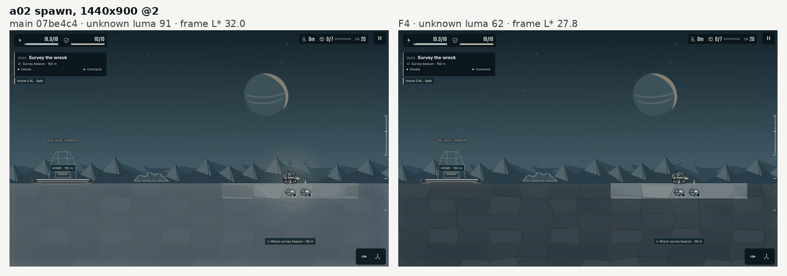
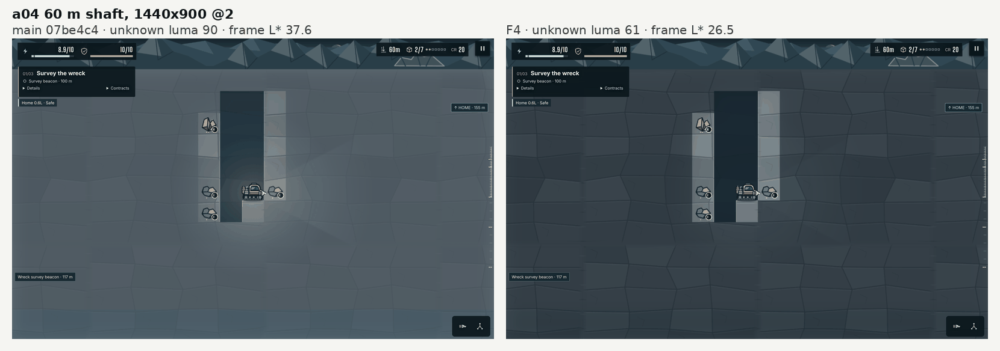
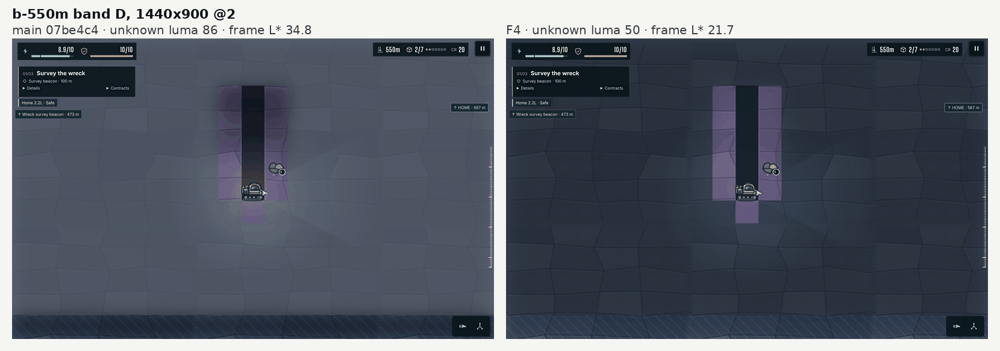
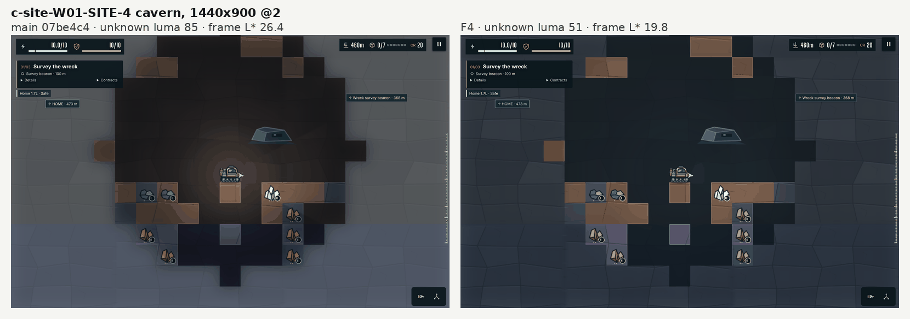
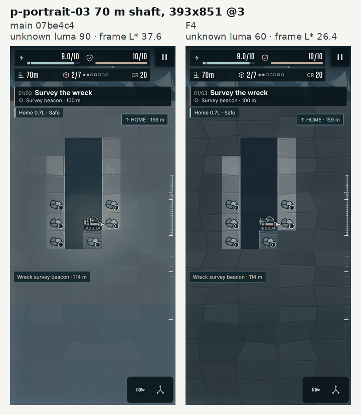

# F4 value re-key

Evidence for F4 in `docs/ART_QUALITY_AUDIT.md` (§5.2, Phase 0): the darkness order, the unknown-rock and cave-air bases, the deleted cream lamp, and the high-contrast floor. All figures come from commit 3b4a451 against `main` at 07be4c4.

## Changes

- **Darkness order.** In `src/campaign/render/bands.ts`, drawn by `render/lighting.ts`, the light map's darkness for each cell state is set per band from a table. It is ordered unknown > remembered > visible in every band, in normal and high-contrast mode, the order `docs/art-audit/01-terrain.md` asks for. On `main`, unknown rock had 0.16 everywhere while known space reached 0.52, so below band A revealed rock was darker than unrevealed rock. `fogDarkness()` is the one function both the light map and the tests use.

  | Band | `main`: unknown / remembered / visible | F4: unknown / remembered / visible |
  |---|---|---|
  | W01 A | 0.16 / 0.25 / 0.11 | 0.13 / 0.08 / 0.04 |
  | W01 B | 0.16 / 0.38 / 0.24 | 0.18 / 0.13 / 0.08 |
  | W01 C | 0.16 / 0.52 / 0.39 | 0.25 / 0.19 / 0.14 |
  | W01 D | 0.16 / 0.52 / 0.52 | 0.30 / 0.24 / 0.18 |
  | W02 A | 0.16 / 0.25 / 0.11 | 0.40 / 0.08 / 0.04 |
  | W02 B | 0.16 / 0.39 / 0.25 | 0.27 / 0.14 / 0.09 |
  | W02 C | 0.16 / 0.52 / 0.40 | 0.31 / 0.20 / 0.14 |
  | W02 D | 0.16 / 0.52 / 0.52 | 0.31 / 0.24 / 0.18 |

  Unknown rock now gets most of its value from its dark base and rock page. Its darkness only trims it into luma 45–65, so remembered and visible darkness have to sit below it. W02's rock pages are much lighter than W01's in bands A–C (mean luma 100–124, against 77–83), so its unknown darkness is higher there.
- **Unknown rock** (`render/terrain.ts`). The base is `#30383f` on W01 and `#2f4250` on W02, under the band's rock page at 0.5 alpha. On `main` it was `#596771` or `#5d7782` under the soil page at 0.23. The page is chosen by the row's band alone, and unknown cells keep the `"unknown"` signature, so no hidden tile data is read.
- **Cave air** (`render/terrain.ts`). Known air, both caves and tunnels, starts from `#17242e` before light instead of the band's back-wall colour. The wall page over it drops from 0.55 to 0.25 alpha, so cave air before light stays near its base, at L\* about 14–17. At 0.55 the page lifted W02 cave air to L\* 20–23.
- **Cream lamp** (`scene.ts`). The 256 px cream radial image drawn with normal blending around the rig is deleted.
- **High contrast.** It keeps its ×0.65 multiplier, and unknown darkness has a backstop cap of 0.36. That cap keeps unknown rock at or above L\* 18 on its darkest band, W02 D, which is about luma 64 before darkness. At these values the cap never takes effect, because high contrast only lightens. The tests check the floor itself.
- **Tests.** `tests/campaign-render-values.test.ts` covers the order in every band of both worlds and both modes, the high-contrast floor, and W01's darkening of every state with depth.

No geometry, light-map structure, overlay or asset changes. `RenderBand.wall` and `RenderBand.ambient` are no longer read by the renderer; they stay as band data.

## Acceptance

The table covers the five audit captures at 1440×900 @2 and 393×851 @3, frozen after the view settles. It also includes two W01 frames with hard rock beside the shaft (bands C and D) and W02 shafts in all four bands. Neither `main` nor this branch has F1, so desktop frames render at backing 1.0 and the phone at 1.5.

| Line | Target | `main` | F4 | |
|---|---|---|---|---|
| Unknown rock luma, W01 | 45–65 | 84.6–90.7 | 50.3–62.0 | met |
| Unknown rock luma, W02 | 45–65 | 99.7–116.9 | 48.1–64.2 | met |
| Unknown rock sd | ≥ 7 | 2.7–6.3 | 2.8–4.7 on cell interiors (W02 70 m: 7.1 and 8.3, from the lamp's falloff); 3.4–6.7 on whole cells | **not met** |
| Lit soil − unknown, every depth | ≥ +15 | −7.4 to +77.2 | +40.5 to +131.8 | met |
| Lit hard rock − unknown, W01 C and D | ≥ +15 | +3.3, −4.3 | +24.0, +25.8 | met |
| Lit hard rock − unknown, W02 B and D | ≥ +15 | −16.4, −33.3 | +27.6, **+9.2** | **not met in W02 D** |
| Unknown − cave air | ≥ +10 | +34.0 to +54.7 | +11.4 to +25.1 | met |
| Frame L\*, shaft (a04) | 25.9 ± 4 | 37.6 | 26.5 | met |
| Frame L\*, cavern (c-site-W01-SITE-4) | 21.0 ± 4 | 26.4 | 19.8 | met |
| Dark share below luma 40 in the `improvement-smoke.mjs` visual check | ≤ 60 % | desktop 5.1 / 5.2 % | desktop 8.1 / 6.4 % | met |
| Fog check and hidden-geology inset crops | pass | pass | pass | met |
| `npm test`, `format:check` | pass | — | 249 passed, 5 skipped; clean | met |

The concept values come from the panel crops at their interiors in `docs/art-direction/d0-target-panels.json`, minus `hud_mask`: shaft-wide 25.8 and cavern-wide 20.9. The audit gives 25.9 and 21.0.

Per frame, `main` → F4:

| Frame | Unknown luma / sd | Lit soil − unknown | Lit hard rock − unknown | Unknown − cave air | Frame L\* | Dark share |
|---|---|---|---|---|---|---|
| a02 spawn | 90.7 / 3.3 → 62.0 / 3.3 | +38.7 → +66.7 | — | — | 32.0 → 27.8 | 10.9 % → 10.9 % |
| a04 60 m | 90.5 / 3.6 → 61.3 / 3.2 | +30.2 → +58.5 | — | +34.5 → +23.5 | 37.6 → 26.5 | 5.9 % → 9.1 % |
| b-550m band D | 85.6 / 4.0 → 50.3 / 3.8 | +7.2 → +43.2 | — | +54.7 → +19.5 | 34.8 → 21.7 | 7.2 % → 7.2 % |
| c-site-W01-SITE-4 | 84.6 / 2.7 → 51.3 / 2.8 | +19.6 → +44.8 | — | +53.4 → +19.2 | 26.4 → 19.8 | 31.5 % → 36.0 % |
| p-portrait-03 70 m | 90.5 / 4.6 → 60.1 / 4.3 | +23.1 → +56.5 | — | +34.0 → +22.0 | 37.6 → 26.4 | 14.9 % → 20.9 % |
| W01 band C, hard rock, 380 m | 86.9 / 3.5 → 54.1 / 3.3 | +3.5 → +40.5 | +3.3 → +24.0 | +40.1 → +11.4 | 36.4 → 23.2 | 5.9 % → 6.9 % |
| W01 band D, hard rock, 530 m | 85.8 / 3.7 → 50.4 / 3.7 | −7.4 → +41.7 | −4.3 → +25.8 | +50.2 → +12.4 | 35.8 → 21.6 | 6.1 % → 7.1 % |
| W02 band A, 70 m @2 | 115.9 / 4.8 → 61.9 / 7.1 | +77.2 → +131.8 | — | +49.8 → +21.4 | 48.8 → 28.1 | 5.8 % → 7.0 % |
| W02 band A, 70 m @3 | 116.9 / 6.3 → 64.2 / 8.3 | +76.2 → +129.8 | — | +50.8 → +23.6 | 49.9 → 31.2 | 16.9 % → 20.1 % |
| W02 band B, 300 m | 108.1 / 3.9 → 62.8 / 4.1 | +50.6 → +98.0 | −16.4 → +27.6 | +46.0 → +13.9 | 44.9 → 28.5 | 5.8 % → 10.2 % |
| W02 band C, 600 m | 104.7 / 4.2 → 63.1 / 4.7 | +36.8 → +83.7 | — | +50.9 → +25.1 | 44.0 → 28.0 | 5.8 % → 7.8 % |
| W02 band D, 850 m | 99.7 / 4.0 → 48.1 / 3.6 | +22.2 → +72.3 | −33.3 → +9.2 | +51.8 → +11.4 | 41.2 → 20.9 | 6.5 % → 9.8 % |

**High contrast** (F4): unknown rock averages L\* 22.7–31.8 across these frames, and its 2nd percentile is at L\* 20.3 or above. Both clear the L\* 18 floor.

### Not met: unknown sd ≥ 7

The band rock pages have a luma sd of 9.0, or 8.6 as drawn. Over a flat base at the specified 0.4–0.5 alpha, they give unknown rock a texture sd of at most 0.5 × 8.6 ≈ 4.3 before darkness. Darkness lowers it further. The few frames above 7 on cell interiors (W02 70 m) get there from the lamp's falloff. On whole cells away from known space, every frame is 3.4–6.7. Backing scale does not change this: with F1 merged and pinned at backing 2.0, the desktop captures measure the same. Reaching sd ≥ 7 needs higher-contrast rock pages or the page at full value (the audit's T2 and art items). Both are outside F4, which allows no asset changes.

### Not met: lit hard rock in W02 band D

W02 D's stone (`#39425c` under its rock page, mean luma 65) is barely lighter than W02 D's unknown rock before darkness (luma 64). The light map's blur also carries unknown darkness into rock cells next to it. So lit hard rock there stands only +9.2 above unknown. Raising it to +15 would push unknown rock below luma 45, or would need a lighter W02 D stone colour, which is outside F4. Lit soil in the same frame stands +72.3 above unknown. W01's hard rock clears the line in bands C and D.

### Trade-offs

- **Known space is lighter, and the lamp lifts it less.** Remembered and visible darkness must sit below unknown, so known space far from the lamp is lighter than on `main`. Known rock in the cavern frame averages 86.5, against 63.7. With little darkness left to erase, the headlamp lifts known air near the rig by only +0.6 to +3.1 luma, against +10.7 to +17.0 on `main`; the deleted cream lamp added to that lift. The audit's additive headlamp (T1) is the step that brings the lamp back.
- **W02 against its provisional key.** The audit's provisional W02 key puts unknown rock at luma 64–75, and the owner's line is 45–65. W02 bands A–C sit at 62–64, inside the owner's range and just under the key; band D is at 48. The W02 key waits on D13.

## Before and after

Each pair shows `main` on the left and F4 on the right, from the measurement captures. Those use the capture definitions of `scripts/art-captures.mjs` ([#5](https://github.com/alemagnoprimero/Motherload/pull/5)) with the coach card off. Both sides of each pair render at the same backing scale. Without F1 the start-up step-down varies between runs, so plain `art-captures.mjs` runs can land the phone at different scales.











## Method

`measure-capture.mjs` restores each frame's fixture and waits for `settledView()`. It then takes the screenshot, records the camera and every painted DOM overlay rectangle, and exports the live campaign state. The overlay rectangles count background, background image, border, outline with its offset, shadow and text.

`analyse.py` classifies every cell from that state as unknown, known solid, known air or sky. It averages luma over each cell's interior (20–80 % in both axes), leaving out overlays, `CAPTURE_HUD`, the rig box and ore cells. Luma is Rec. 709 on sRGB values, as in both scripts it draws on.

| Measure | Definition |
|---|---|
| Unknown rock | every unknown cell |
| Unknown rock, whole cells | whole unknown cells whose neighbours are all unknown |
| Lit known | known solid within 2.5 tiles of the rig, by material |
| Cave air | all known air, tunnels included |
| Frame statistics | `frame_stats` from `docs/art-audit/prototype/metrics.py`, copied verbatim, masked as `metrics.py` masks them (`CAPTURE_HUD` on desktop, overlay rectangles on the phone) |
| Dark share | the measure in `scripts/improvement-pixels.py` |

```bash
npm run dev -- --port 5173 --strictPort &
node docs/qa/f4-value-rekey/measure-capture.mjs http://127.0.0.1:5173/ artifacts/f4 0
node docs/qa/f4-value-rekey/measure-capture.mjs http://127.0.0.1:5173/ artifacts/f4-high-contrast 1
python3 docs/qa/f4-value-rekey/analyse.py artifacts/f4 artifacts/f4-high-contrast
```

`measure-capture.mjs` uses `scripts/art-captures.mjs`, the `restore()` and `settledView()` exports of `scripts/improvement-smoke.mjs`, and `fixture()`'s column argument. All of these arrive with [#5](https://github.com/alemagnoprimero/Motherload/pull/5).
