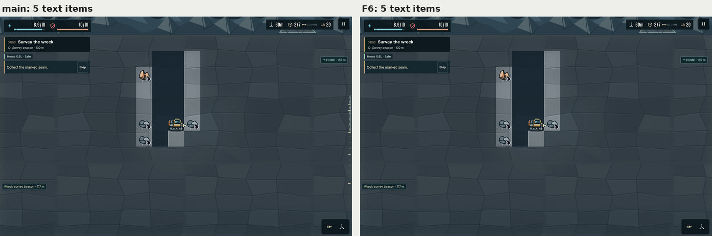
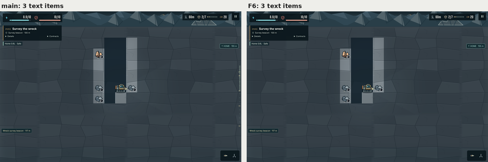
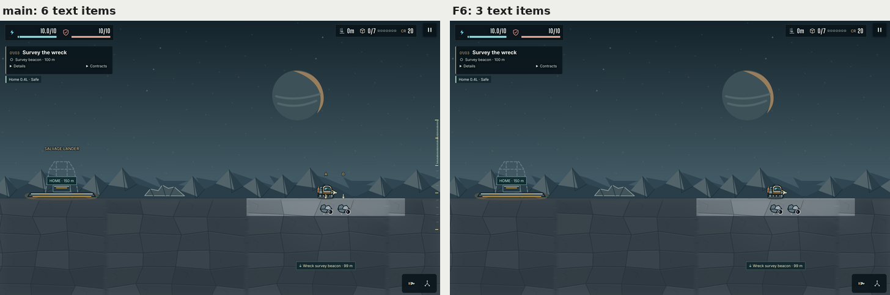

# F6: overlay quick cuts

Evidence for item 3 of the art programme: F6 in `docs/ART_QUALITY_AUDIT.md` §5.2, the overlay quick cuts, applied per D3 (labels on demand later; HOME and hazards stay always on). The four cuts:

| Cut | Where | Result |
|---|---|---|
| Delete the lander nameplate ("SALVAGE LANDER", "LANDER RESTORED", "COMET REFUGE", "CONDENSER STABILIZED") | `scene.ts` | Gone from every frame. The dock prompt ("E Dock and trade") still names the interaction. |
| Show the A and B seam markers only while the coach is active | `scene.ts` | Drawn only while `ui/guidance.ts` marks the body `campaign-coaching`. The arrow ticks go with the letters: without them they would point at nothing. |
| Drop the " · mission part" suffix | `render/poi-art.ts` | A mission part's caption is its title alone. "surveyed", "recovered", "survey signal" and "relic" stay. |
| Show the depth rail on hover or pause | `style.css` | Hidden in play. It shows while the HUD's depth readout is hovered, or while the game is paused, the pause menu included, which used to hide it. |

HOME and the hazard markers are unchanged: the HOME locator, the shelf, cold-pocket and vent warnings, and the pressure and shelf labels all draw as before.

## The count

The acceptance asks for at most 4 text items in the 60 m playfield, counted with the HUD left out. There was no counter for that, so this change adds one to the harness. The four cuts are a separate commit on top of it, so the "before" numbers come from the counter commit.

- **`art-captures.mjs`, `playfieldText`.** It counts every visible DOM text node in the view, plus every canvas world label in the view. The HUD row, menu button, objective card and toolbar are left out: the same boxes the overlay edge share masks, now `HUD_SELECTORS`. Hidden, unpainted (opacity 0) and clipped text does not count. Canvas labels come from a new read-only hook, `__campaignDebug.worldLabels()`.
- **`art-sheets.py`.** The count is a new §9.2 row, "Text items in the playfield, HUD left out", against the G1 target of at most 1 with Scan off.
- **`improvement-smoke.mjs`.** `verify`'s harness section asserts that no frame shows a nameplate or a " · mission part" suffix, and that the depth rail is hidden in play and shows on hover and in the pause menu. It logs every frame's count.
- **[`measure-text.mjs`](measure-text.mjs).** It takes spawn and 60 m on desktop and phone, with the coach active (as the fixtures load) and after Skip (steady play), and records the rail's state on desktop.

| Form | Coach | Scene | `main` | F6 | Items on F6 (removed) |
|---|---|---|---|---|---|
| desktop | active | spawn | 8 | 7 | Hold Down to drill. · Skip · Home 0.4L · Safe · HOME · 150 m · ↓ Wreck survey beacon · 99 m · A · B (removed: SALVAGE LANDER) |
| desktop | active | 60 m | 5 | 5 | Collect the marked seam. · Skip · Home 0.6L · Safe · ↑ HOME · 155 m · Wreck survey beacon · 117 m |
| desktop | skipped | spawn | 6 | 3 | Home 0.4L · Safe · HOME · 150 m · ↓ Wreck survey beacon · 99 m (removed: A, B, SALVAGE LANDER) |
| desktop | skipped | 60 m | 3 | 3 | Home 0.6L · Safe · ↑ HOME · 155 m · Wreck survey beacon · 117 m |
| phone | active | spawn | 5 | 5 | Hold Down to drill. · Skip · Home 0.4L · Safe · HOME · 150 m · ↓ Wreck survey beacon · 99 m |
| phone | active | 60 m | 5 | 5 | Collect the marked seam. · Skip · Home 0.6L · Safe · ↑ HOME · 155 m · Wreck survey beacon · 117 m |
| phone | skipped | spawn | 3 | 3 | Home 0.4L · Safe · HOME · 150 m · ↓ Wreck survey beacon · 99 m |
| phone | skipped | 60 m | 3 | 3 | Home 0.6L · Safe · ↑ HOME · 155 m · Wreck survey beacon · 117 m |

The §9 harness frames give the same counts with the coach active: 7 at spawn on desktop and 5 everywhere else.

| Depth rail (desktop, 60 m) | `main` | F6 |
|---|---|---|
| In play | shown | hidden |
| Hovering the HUD's depth readout | not hoverable (the HUD takes no pointer events) | shown |
| Pause menu open | hidden (any overlay hid it) | shown |

## Not met: at most 4 text items at 60 m with the coach active

At 60 m the playfield holds 5 text items with the coach active, before and after F6. In steady play it holds 3, before and after.

**Why F6 cannot move the 60 m count.** None of the five is an item F6 cuts:
- the coach card's line and its Skip button;
- the reserve chip ("Home 0.6L · Safe");
- the HOME locator, which D3 keeps always on;
- the wreck-beacon locator.

The items F6 removes do not reach the 60 m frame either:
- at the current camera the surface sits at the top edge, and the A/B letters and the nameplate draw above it, off screen;
- seam targets lost their caption before this change, and the remaining mission parts are not near the 60 m fixture.

**Why the audit counted 9.** Its count was taken on an older build, in a state with a pickup popup ("+ Shard silver") and a seam caption ("Seam A · shallow ore · mission part"). Neither appears in the 60 m fixture now, so `main` measures 5 there.

**What would close it.** Reaching 4 with the coach active means cutting one of the five. That is outside F6:
- the coach card moving into the objective pill (H1, the audit's R8);
- the reserve chip becoming the energy bar's notch only (the audit's R1);
- the locators becoming Scan labels and an edge chevron (T8, T10).

## Smoke tests

`feel-smoke` and `plan-ui-smoke` pass unchanged; none of their expectations asserts a removed item.

`poi-smoke` and `frontier-smoke` already fail on `main` (313a686). Neither runs in `verify`, and their failures have nothing to do with overlays:

| Run | `poi-smoke` | `frontier-smoke` |
|---|---|---|
| `main` and F6, unchanged | both fail at "Mission guidance fits": `geometry()` measures `#campaign-mission-signal` while it is `hidden`, so its box is empty | both fail at "Schema1 import preserves original packages": the import now renames ores ("Ironium" becomes "Slag iron") |
| `main` and F6, that one check relaxed in a scratch copy (not committed) | both fail next at `poi-smoke.mjs:284`: the signal target is `W01-LANDER`, the test expects `W01-VALVE` | both fail next at "The initial star map remains gated by W01 M2" |

At each point reached, F6 changes neither outcome. Their expectations predate later game changes. Updating them would mean changing what they assert about missions, saves and travel, which goes beyond updating "only where they assert a removed item", so it is left as a separate fix.

## Captures

`main` on the left, F6 on the right, with each side's count. Each frame is as captured with every annotation shown, at half the CSS size.







## Reproduce

```bash
node docs/qa/f6-overlay-cuts/measure-text.mjs http://127.0.0.1:5173/ artifacts/f6/results.json
```

```bash
python3 docs/qa/f6-overlay-cuts/pairs.py BEFORE_DIR AFTER_DIR docs/qa/f6-overlay-cuts
```

Run the first command once on the counter commit (the branch's first commit) and once on the branch, then pass both folders to the pairs script.

## Verification

The whole `verify` job of `checks.yml` passed locally before the push, every step exiting 0, in 774 s:
- `npm test` (274 passed, 5 skipped), `format:check` and `build`;
- `test:improvements` with `behavior,visual,fog,harness`: the harness now checks the F6 cuts and the rail's states;
- `test:campaign:storage`, `test:feel`, `test:audio`, `test:plan-ui`, `test:render`, `test:render:memory`, `test:camera`, `test:hud:surface`, and `test:opening:browser` on desktop and portrait.

`npm run test:poi` and `npm run test:frontier` were run on the branch and on `main`, as above. Local runs use Node 22.23.4 and Playwright's Chromium 153; CI uses Node 24 and Chromium 156.
