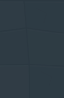
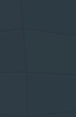
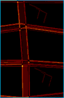

# Fog check: framing, not a leak

Evidence for the `fog` section of `scripts/improvement-smoke.mjs` ("Unknown cave differs from unknown solid rock"). It failed in every run of the `verify` job, starting with the job's first run (`main` fb89c60, CI run 41672903969, Chrome for Testing 156). It failed the same way locally on Chrome 153, with byte-identical crops.

## Root cause

The check restores two checkpoints that differ only in a hidden 2×5 block (solid rock, or a cave with exposed deposits). It crops that block, inset 3 px, from each and compares the crops pixel for pixel. The crop rectangle was computed once, from the camera 150 ms after the first restore, and reused for the second screenshot. Since b211bfe, an import starts two time-based effects:

- `contextZoom` eases from the surface framing (0.88) to the deep framing (1.05 below 120 m), at about 70 % per 50 ms frame, rounded to three decimals.
- The camera fades in over 180 ms.

So the first capture is taken mid-ease: tile 68.4000 px, zoom 1.045. The second restore starts from that zoom and lands at 68.7273 px (zoom 1.050). Since 5bbcaa0 the camera no longer snaps when the tile size changes; it lags the zoom, which widens the gap. The reused screen-space crop therefore samples a slightly moved and rescaled window of the same unknown-rock texture. Unknown rock is drawn from position and band only. The window moves 0.031 tile at b211bfe/644e222, and 0.20 tile across by 0.12 tile down on `main`. The difference's bounding box is the whole crop: 8,270 of 25,870 px differ, by at most 6 per channel. Nothing from the cave, its deposits, a POI or a site is drawn.

The fix waits for the camera to settle after each restore, as `settle()` in `scripts/render-acceptance.mjs` already does: texture bytes, tile size and scroll unchanged for four frames, then 250 ms more so the fade ends. Only frames that show the restored checkpoint (its world and rig position) count, because while destination art loads the scene keeps publishing the previous view. The fix computes the crop from the settled view and asserts that the cave capture has the same view before running the unchanged pixel-exact comparison.

## Before and after (W01)

| | hidden rock | hidden cave | difference (×40, cyan = bounding box) |
|---|---|---|---|
| Before, `main` |  |  |  bbox (0, 0, 130, 199), 8,270 / 25,870 px |
| After, this fix |  |  |  none, 0 / 26,200 px |

Enlarged, captioned versions: [`before-W01-sheet.png`](before-W01-sheet.png), [`after-W01-sheet.png`](after-W01-sheet.png) and [`after-W02-sheet.png`](after-W02-sheet.png). On `main`, W02 never ran because W01 failed first; after the fix it is also 0 / 26,200 px.

Camera state at each capture, read from `data-view-*`:

| | first capture (rock) | second capture (cave), same crop |
|---|---|---|
| `main` | tile 68.4000, scroll (1419, 754) | tile 68.7273, scroll (1445, 768) |
| 644e222 | tile 68.4000, scroll (1435, 763) | tile 68.7273, scroll (1445, 768) |
| this fix, W01 | tile 68.7273, scroll (1445, 768) | tile 68.7273, scroll (1445, 768) |

The old captures were also taken about 99 ms into the 180 ms fade-in: fade alpha 0.45 in every channel. That is why they look darker than the new ones. Both old captures were equally far into the fade, so the fade did not cause the difference.

## Bisect

Each commit was run with its own `improvement-smoke.mjs`, `IMPROVEMENT_CHECKS=fog`, on Chromium. Results were deterministic: repeated runs gave byte-identical crops.

| Commit | Change | Fog check | Differing px (W01) |
|---|---|---|---|
| 17c4931 | adds this check | pass, W01 and W02 (2/2) | 0 |
| b211bfe | adds `contextZoom` easing and the import fade (first bad commit) | fail (2/2) | 4,134 |
| 644e222 | the art audit's code baseline | fail (3/3) | 4,134 |
| 5bbcaa0 | camera no longer snaps when the tile size changes | fail (3/3) | 8,270 |
| fb89c60 (`main`) | docs only since 5bbcaa0 | fail (3/3, same bytes as CI) | 8,270 |

The audit's note that hidden air and rock are pixel-identical cites `IMPROVEMENT_PROGRESS.md`. That line was written at 17c4931. The `verify` workflow never ran on 644e222.

## Controls

- **Same checkpoint twice.** Restoring the identical rock checkpoint twice fails exactly like the real check: 4,134 px at 644e222 and 8,270 px on `main`. The second rock capture is pixel-identical to the cave capture, in the crop and across the full 1440×900 frame.
- **Planted leaks** (scratch worktree, never committed). With the fix, the check still fails, with the leak message:
  - exposed items in hidden caves drawn: 4,570 px, maximum delta 144;
  - unknown air drawn one unit bluer: 23,209 px, maximum delta 1.
- **Slow destination art.** With every W02 art request delayed by 1.5 s, the fixed check still passes. Without the restored-checkpoint condition it settled on the stale surface view, and its crop fell outside the frame.
- **POI inside an undiscovered cave** (the 5bbcaa0 question). The antenna mission was moved into the hidden cave, and the neighbouring column was marked known so its `site-wreck` scenery is drawn ([`poi-probe-sheet.png`](poi-probe-sheet.png)). The unknown block was 0 px different. The wreck shows only over the known column, clipped by the shared known-cell `wreckMask`. With the mask removed, 5,343 px of the wreck appear over the unknown block.

## Reproduce

```bash
npm run dev -- --port 5173 --strictPort &
CHROMIUM_PATH=/path/to/chromium IMPROVEMENT_CHECKS=fog npm run test:improvements
```

Crops are written to `artifacts/improvement/W0{1,2}-hidden-{solid,air}.png`.
