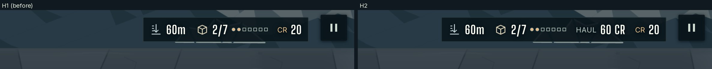
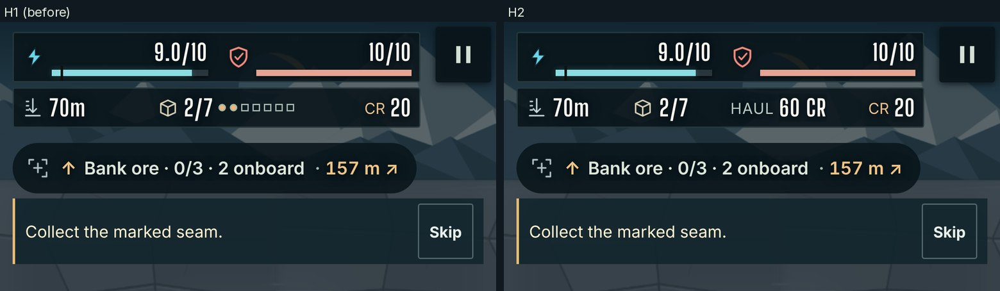
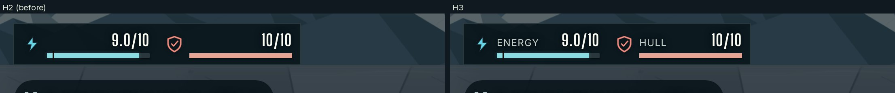
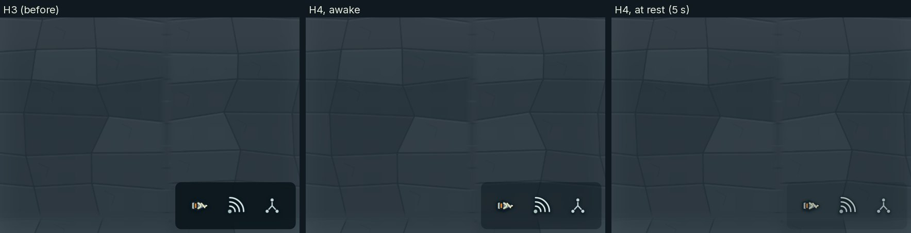
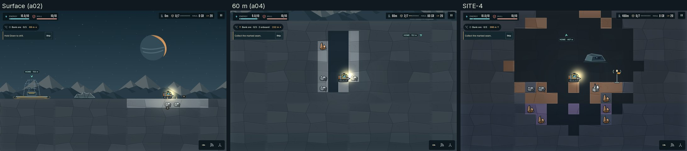
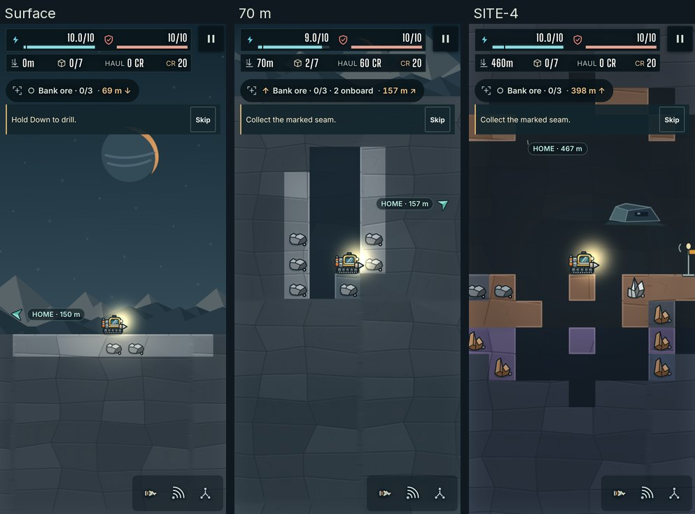

# H1 to H4: HUD parity

Evidence for items 2 to 5 of this stack: H1 to H4 in `docs/ART_QUALITY_AUDIT.md` §5.3 ("HUD parity"), all four approved at the week-1 workshop (decision D3, `docs/art-direction/decisions.md`): the objective pill with the target's distance (H1), the HAUL value (H2), the ENERGY and HULL labels at widths of 900 px and more (H3) and a phone tray that turns translucent or auto-hides (H4). The §9.2 row they answer: "Objective size; HAUL; bar labels: ≤ 320 × 48 CSS px at 1440; shown; labelled at ≥ 900 px". The row's other line, "one as-shipped frame per scene scores ≥ 4 on question 4" (§6.4: "Same props, with no UI in the world?"), is the director's score; the as-shipped frames are below.

Measured by `measure.mjs` in this folder at desktop 1440 × 900 @2 and phone 393 × 851 @3 (art-captures' forms), at spawn, 60 m (a04's fixture) and SITE-4, with the coach active (as the fixtures load) and skipped. Each item adds its section; the board's HUD is the reference (`docs/art-direction/d0-target-cavern-wide.png`, top left: "Survey the wreck" in a pill beside the ENERGY and HULL plate; the tall panels show HAUL under depth and cargo).

## H1: the objective pill

**What changed.** The objective card becomes the board's pill: the current goal and the mission signal's distance and bearing in one line ("Bank ore · 0/3 · 398 m ↑", D3's "Survey the wreck · 39 m ↓"), with the mission glyph at its left. It is 44 px tall at desktop sizes and 40 px on phones, as wide as its text and never wider than 320 px (a longer goal ends in an ellipsis; the details hold it whole). The milestone ("01/03 Prove the claim"), the other goals, the reward and the contracts moved into a panel under the pill that opens on hover (devices that hover), on keyboard focus (the panel's summaries stay in the tab order) or on a tap on the pill, which a second tap closes. Collapsed, the panel is a clipped 1 px box, as `.sr-only` is, so the HUD contrast check and the playfield counters read it as hidden.

The distance comes from the mission signal (`objectiveDistance()` in `poi.ts`, unit-tested): metres and the bearing's arrow, "here" at the target, and words for assistive technology ("152 metres, up and right"). It is the distance T8 took off the playfield when the target's label became a Scan label, so with Scan off the target's direction and distance are back on screen. One alignment rides along: HOME's label now measures to the docked rig's height, as the signal does, so the pill and the chevron give the same distance home (152 m, where T8's label read 155 m).

| Line | Result | |
|---|---|---|
| Objective ≤ 320 × 48 CSS px at 1440 wide | 232–320 × 44 in every desktop case (T8: 350 × 62 with the coach, 350 × 91 without) | met |
| The distance inside the pill (D3) | In every case: "69 m ↓" (spawn, seam A), "152 m ↗" (60 m, home), "398 m ↑" (SITE-4, seam A) | met |
| Details on tap or hover | Hidden in play; shown on hover (desktop) and on a tap (phone), closed by a second tap | met |
| One as-shipped frame per scene scores ≥ 4 on question 4 | The director's score (§6.4); the as-shipped frames of the stack's final state are in the H4 section | for the director |

| Form | Coach | Scene | T8 (before) | H1 | Pill text | Details |
|---|---|---|---|---|---|---|
| desktop | active | spawn | 350 × 62 | **232 × 44** | ○ Bank ore · 0/3 69 m ↓ | hidden; open on hover |
| desktop | active | 60 m | 350 × 62 | **320 × 44** | ↑ Bank ore · 0/3 · 2 onboard 152 m ↗ | hidden; open on hover |
| desktop | active | SITE-4 | 350 × 62 | **241 × 44** | ○ Bank ore · 0/3 398 m ↑ | hidden; open on hover |
| desktop | skipped | spawn | 350 × 91 | **232 × 44** | ○ Bank ore · 0/3 69 m ↓ | hidden; open on hover |
| desktop | skipped | 60 m | 350 × 91 | **320 × 44** | ↑ Bank ore · 0/3 · 2 onboard 152 m ↗ | hidden; open on hover |
| desktop | skipped | SITE-4 | 350 × 91 | **241 × 44** | ○ Bank ore · 0/3 398 m ↑ | hidden; open on hover |
| phone | active | spawn | 373 × 46 | **232 × 40** | ○ Bank ore · 0/3 69 m ↓ | hidden; open on a tap, closed by a second |
| phone | active | 60 m | 373 × 46 | **320 × 40** | ↑ Bank ore · 0/3 · 2 onboard 152 m ↗ | hidden; open on a tap, closed by a second |
| phone | active | SITE-4 | 373 × 46 | **241 × 40** | ○ Bank ore · 0/3 398 m ↑ | hidden; open on a tap, closed by a second |
| phone | skipped | spawn | 373 × 46 | **232 × 40** | ○ Bank ore · 0/3 69 m ↓ | hidden; open on a tap, closed by a second |
| phone | skipped | 60 m | 373 × 46 | **320 × 40** | ↑ Bank ore · 0/3 · 2 onboard 152 m ↗ | hidden; open on a tap, closed by a second |
| phone | skipped | SITE-4 | 373 × 46 | **241 × 40** | ○ Bank ore · 0/3 398 m ↑ | hidden; open on a tap, closed by a second |


Captures by `scripts/art-captures.mjs` at backing 2 (a04, SITE-4, p-portrait-03), cropped to the HUD; the details from `measure.mjs`.


## H2: the HAUL value

**What changed.** The HUD's HAUL readout ("HAUL 60 CR", the value of the cargo on board), present but hidden, shows beside depth and cargo, as on the board. On phones the right row has no room for four readouts and the seven cargo pips, so HAUL takes the pips' place, as on the board's tall panels (the count stays: "2/7"); depth, cargo and credits never shorten, and a HAUL value too long for the row ends in an ellipsis rather than slide under the menu button. Below 381 px wide or 340 px tall four readouts do not fit at all, and `main`'s row stays (no HAUL, the pips back).

| Line | Result | |
|---|---|---|
| HAUL shown (§9.2) | Shown at 1440 × 900 and 393 × 851 in every case, and at every width probed from 381 px up (portrait) and on landscape phones taller than 340 px | met |
| Nothing overflows the row or slides under the menu button | 0 px overflow at 393 × 851, 844 × 390, 1024, 1280 and 1440, with 0 CR / 20 CR and with 12,480 CR / 123,456 CR, and no value shortened. At 320 × 640 and 568 × 320 HAUL stays hidden and only 123,456 credits overflow (20 and 4 px; `main` 28 and 12) | met |

Probed by `fit.mjs` in this folder (the readouts' text set directly under the frozen clock; `main`'s row overflows 28 and 12 px at 320 × 640 and 568 × 320 with the large values):

| Viewport | HAUL | Pips | Overflow, 0 CR / 20 CR | Overflow, 12,480 CR / 123,456 CR | Values shortened (980/2,140; 3,000/20,000; 12,480/123,456) |
|---|---|---|---|---|---|
| 320x640 | hidden | shown | 0 px | 20 px | none |
| 360x740 | hidden | shown | 0 px | 0 px | none |
| 393x851 | shown | hidden | 0 px | 0 px | none |
| 568x320 | hidden | shown | 0 px | 4 px | none |
| 844x390 | shown | hidden | 0 px | 0 px | none |
| 1024x768 | shown | shown | 0 px | 0 px | — |
| 1280x720 | shown | shown | 0 px | 0 px | — |
| 1440x900 | shown | shown | 0 px | 0 px | — |





Captures by `scripts/art-captures.mjs` at backing 2 (a04, p-portrait-03), cropped to the HUD.

## H3: the bar labels

**What changed.** The ENERGY and HULL labels of the two vital bars, present but hidden, show at widths of 900 px and more, as on the board's wide panels ("ENERGY 9.0 / 10"). Short landscape phones (500 px tall or less) keep their compact row even when wider than 900 px. The labels are 12 px, letter-spaced, beside the value; nothing else in the plate moves.

| Line | Result | |
|---|---|---|
| Bar labels shown at ≥ 900 px (§9.2) | Shown at 900, 1024 (a coarse-pointer tablet), 1280 and 1440; hidden at 899, at 393 × 851 and at 915 × 412 (landscape phone); never overlapping the value, which stays inside its row | met |

Probed by `labels.mjs` in this folder; in `measure.mjs` the labels show in every desktop case and in no phone case.

| Viewport | Labels | Size | Meets the value | Value inside its row |
|---|---|---|---|---|
| 899 × 700 | hidden | 12 px | no | yes |
| 900 × 700 | shown | 12 px | no | yes |
| 1024 × 768 touch | shown | 12 px | no | yes |
| 1280 × 720 | shown | 12 px | no | yes |
| 1440 × 900 | shown | 12 px | no | yes |
| 915 × 412 touch | hidden | 12 px | no | yes |
| 393 × 851 touch | hidden | 12 px | no | yes |



Capture by `scripts/art-captures.mjs` at backing 2 (a04), cropped to the HUD. The 393 × 851 phone is unchanged (no labels below 900 px).

## H4: the phone tray

**What changed.** On phones (coarse pointer, or 760 px wide or less, or 500 px tall or less) the tool tray's plate is translucent, 45 % instead of 91 % (the board shows no tray at all), and the tray rests 4 s after its last touch when no tool is at work: the plate fades to 12 % and the icons to 75 %, still where they were and still 44 px targets. A touch on the tray, holding Scan, the shaft brace, precision extraction or an open menu wakes it. Text in the tray keeps its full colour (the HUD contrast check reads it); desktop is unchanged; reduced motion drops the fade.

| Line | Result | |
|---|---|---|
| The phone tray turns translucent or auto-hides (D3) | 393 × 851: plate 45 % on arrival; at rest (after 5 s) plate 12 %, icons 75 %; a tap on the Scan button wakes it, and it rests again 4.5 s later; buttons stay 44 × 44 throughout. Desktop: plate 91 %, icons 100 %, always | met |

Probed by `tray.mjs` in this folder:

| Viewport | State | Rest flag | Plate | Icons | Buttons |
|---|---|---|---|---|---|
| 393 × 851 touch | on arrival | no | rgba(10, 22, 28, 0.45) | 1 | 44x44, 44x44 |
| 393 × 851 touch | 5 s without a touch | yes | rgba(10, 22, 28, 0.12) | 0.75 | 44x44, 44x44 |
| 393 × 851 touch | a tap on Scan | no | rgba(10, 22, 28, 0.45) | 1 | 44x44, 44x44 |
| 393 × 851 touch | 4.5 s later | yes | rgba(10, 22, 28, 0.12) | 0.75 | 44x44, 44x44 |
| 1440 × 900 | on arrival | no | rgba(10, 22, 28, 0.91) | 1 | 44x44, 44x44 |
| 1440 × 900 | 5 s without a touch | yes | rgba(10, 22, 28, 0.91) | 1 | 44x44, 44x44 |
| 1440 × 900 | a tap on Scan | no | rgba(10, 22, 28, 0.91) | 1 | 44x44, 44x44 |
| 1440 × 900 | 4.5 s later | yes | rgba(10, 22, 28, 0.91) | 1 | 44x44, 44x44 |

The rest flag (`data-campaign-tray-rest` on the body) is set at every size; only the phone rule reads it, so desktop's plate and icons never change.



## As shipped: the stack's final state (H4)

For the row's last line ("one as-shipped frame per scene scores ≥ 4 on question 4", §6.4: "Same props, with no UI in the world?"), the director's score: T8 to H4 together, with the HUD and default annotations (Scan off), as `scripts/art-captures.mjs` captures the §9 fixtures at backing 2 (the coach is active in these fixtures, as they load).





## Reproduce

`measure.mjs` writes each case to `cases.json` in its output folder; `h1-cases.json` to `h4-cases.json` here are its runs on each item's branch.

```bash
node docs/qa/h-hud-parity/measure.mjs http://127.0.0.1:5173/ artifacts/hud
```

```bash
node docs/qa/h-hud-parity/fit.mjs http://127.0.0.1:5173/
```

```bash
node docs/qa/h-hud-parity/labels.mjs http://127.0.0.1:5173/
```

```bash
node docs/qa/h-hud-parity/tray.mjs http://127.0.0.1:5173/
```

## Verification

Before each push the whole `verify` job of `checks.yml` passed locally, every step exiting 0 (Node 22.23.4, Chromium 153): `npm test`, `format:check`, `build`, the byte-identical asset rebuild, `test:improvements` (`behavior,visual,fog,harness`, with the HUD contrast check at ≥ 4.5:1 over 12 captures), `test:campaign:storage`, `test:feel`, `test:audio`, `test:plan-ui`, `test:render`, `test:render:memory`, `test:camera`, `test:hud:surface`, and `test:opening:browser` on desktop and portrait.
