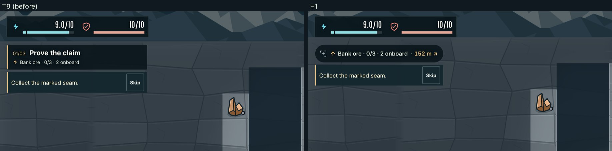
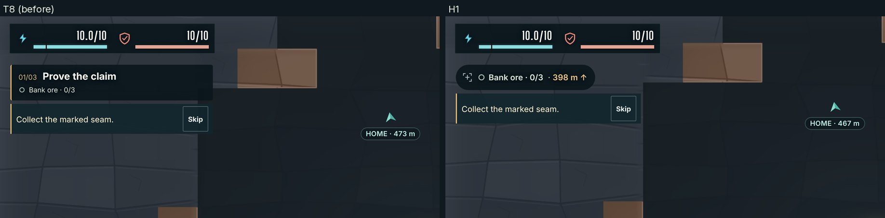
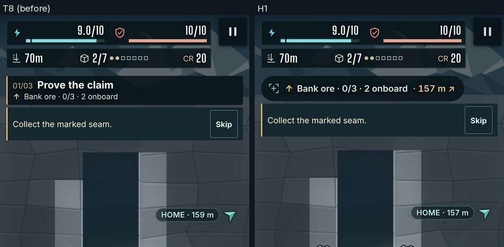
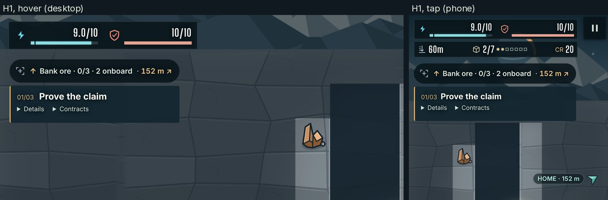

# H1 to H4: HUD parity

Evidence for items 2 to 5 of this stack: H1 to H4 in `docs/ART_QUALITY_AUDIT.md` §5.3 ("HUD parity"), all four approved at the week-1 workshop (decision D3, `docs/art-direction/decisions.md`): the objective pill with the target's distance (H1), the HAUL value (H2), the ENERGY and HULL labels at widths of 900 px and more (H3) and a phone tray that turns translucent or auto-hides (H4). The §9.2 row they answer: "Objective size; HAUL; bar labels: ≤ 320 × 48 CSS px at 1440; shown; labelled at ≥ 900 px". The row's other line, "one as-shipped frame per scene scores ≥ 4 on question 4" (§6.4: "Same props, with no UI in the world?"), is the director's score; the as-shipped frames are below.

Measured by `measure.mjs` in this folder at desktop 1440 × 900 @2 and phone 393 × 851 @3 (art-captures' forms), at spawn, 60 m (a04's fixture) and SITE-4, with the coach active (as the fixtures load) and skipped. Each item adds its section; the board's HUD is the reference (`docs/art-direction/d0-target-cavern-wide.png`, top left: "Survey the wreck" in a pill beside the ENERGY and HULL plate; the tall panels show HAUL under depth and cargo).

## H1: the objective pill

**What changed.** The objective card becomes the board's pill: the current goal and the mission signal's distance and bearing in one line ("Bank ore · 0/3 · 398 m ↑", D3's "Survey the wreck · 39 m ↓"), with the mission glyph at its left. It is 44 px tall at desktop sizes and 40 px on phones, as wide as its text and never wider than 320 px (a longer goal ends in an ellipsis; the details hold it whole). The milestone ("01/03 Prove the claim"), the other goals, the reward and the contracts moved into a panel under the pill that opens on hover (devices that hover), on keyboard focus (the panel's summaries stay in the tab order) or on a tap on the pill, which a second tap closes. Collapsed, the panel is a clipped 1 px box, as `.sr-only` is, so the HUD contrast check and the playfield counters read it as hidden.

The distance comes from the mission signal (`objectiveDistance()` in `poi.ts`, unit-tested): metres and the bearing's arrow, "here" at the target, and words for assistive technology ("152 metres, up and right"). It is the distance T8 took off the playfield when the target's label became a Scan label, so with Scan off the target's direction and distance are back on screen. One alignment rides along: HOME's label now measures to the docked rig's height, as the signal does, so the pill and the chevron give the same distance home (152 m, where T8's label read 155 m).

| Line | Result | |
|---|---|---|
| Objective ≤ 320 × 48 CSS px at 1440 wide | 232–320 × 44 in every desktop case (T8: 350 × 62 with the coach, 350 × 91 without) | met |
| The distance inside the pill (D3) | In every case: "69 m ↓" (spawn, seam A), "152 m ↗" (60 m, home), "398 m ↑" (SITE-4, seam A) | met |
| Details on tap or hover | Hidden in play; shown on hover (desktop) and on a tap (phone), closed by a second tap | met |
| One as-shipped frame per scene scores ≥ 4 on question 4 | The director's score (§6.4); the as-shipped frames of the stack's final state are in the H4 section | for the director |

| Form | Coach | Scene | T8 (before) | H1 | Pill text | Details |
|---|---|---|---|---|---|---|
| desktop | active | spawn | 350 × 62 | **232 × 44** | ○ Bank ore · 0/3 69 m ↓ | hidden; open on hover |
| desktop | active | 60 m | 350 × 62 | **320 × 44** | ↑ Bank ore · 0/3 · 2 onboard 152 m ↗ | hidden; open on hover |
| desktop | active | SITE-4 | 350 × 62 | **241 × 44** | ○ Bank ore · 0/3 398 m ↑ | hidden; open on hover |
| desktop | skipped | spawn | 350 × 91 | **232 × 44** | ○ Bank ore · 0/3 69 m ↓ | hidden; open on hover |
| desktop | skipped | 60 m | 350 × 91 | **320 × 44** | ↑ Bank ore · 0/3 · 2 onboard 152 m ↗ | hidden; open on hover |
| desktop | skipped | SITE-4 | 350 × 91 | **241 × 44** | ○ Bank ore · 0/3 398 m ↑ | hidden; open on hover |
| phone | active | spawn | 373 × 46 | **232 × 40** | ○ Bank ore · 0/3 69 m ↓ | hidden; open on a tap, closed by a second |
| phone | active | 60 m | 373 × 46 | **320 × 40** | ↑ Bank ore · 0/3 · 2 onboard 152 m ↗ | hidden; open on a tap, closed by a second |
| phone | active | SITE-4 | 373 × 46 | **241 × 40** | ○ Bank ore · 0/3 398 m ↑ | hidden; open on a tap, closed by a second |
| phone | skipped | spawn | 373 × 46 | **232 × 40** | ○ Bank ore · 0/3 69 m ↓ | hidden; open on a tap, closed by a second |
| phone | skipped | 60 m | 373 × 46 | **320 × 40** | ↑ Bank ore · 0/3 · 2 onboard 152 m ↗ | hidden; open on a tap, closed by a second |
| phone | skipped | SITE-4 | 373 × 46 | **241 × 40** | ○ Bank ore · 0/3 398 m ↑ | hidden; open on a tap, closed by a second |









Captures by `scripts/art-captures.mjs` at backing 2 (a04, SITE-4, p-portrait-03), cropped to the HUD; the details from `measure.mjs`.


## Reproduce

```bash
node docs/qa/h-hud-parity/measure.mjs http://127.0.0.1:5173/ artifacts/hud
```

## Verification

Before each push the whole `verify` job of `checks.yml` passed locally, every step exiting 0 (Node 22.23.4, Chromium 153): `npm test`, `format:check`, `build`, the byte-identical asset rebuild, `test:improvements` (`behavior,visual,fog,harness`, with the HUD contrast check at ≥ 4.5:1 over 12 captures), `test:campaign:storage`, `test:feel`, `test:audio`, `test:plan-ui`, `test:render`, `test:render:memory`, `test:camera`, `test:hud:surface`, and `test:opening:browser` on desktop and portrait.
