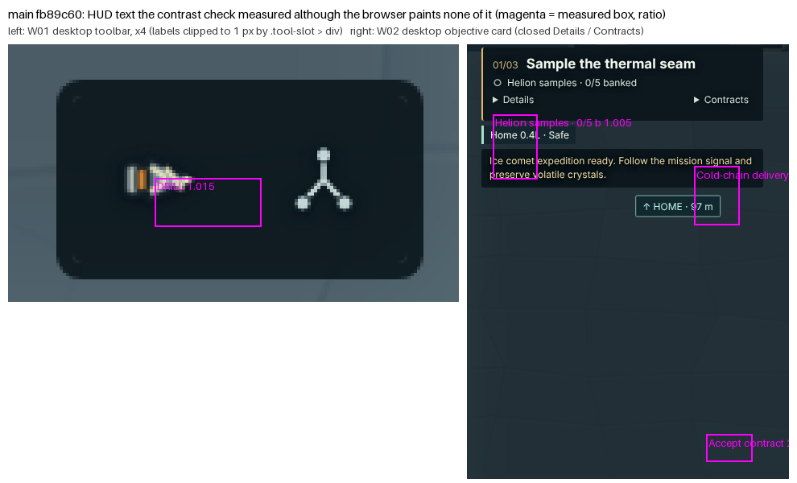

# HUD contrast check: unpainted text

With the fog check fixed ([`../fog-check-framing/`](../fog-check-framing/README.md)), `scripts/improvement-smoke.mjs` reaches its `visual` section for the first time in `verify`. On `main` that section fails in all 12 captures: `W01-desktop-shaft: HUD contrast 1.015, [{"text":"DRILL", …}]`. CI never got this far, because the fog check failed first.

## Cause

`hudTexts()` measures every text node under the HUD roots. It skips only text that is `[hidden]`, `.sr-only`, `display: none`, `visibility: hidden` or fully transparent. b211bfe added two HUD patterns that hide text in other ways:

- **Icon-only tool slots.** The `DRILL` label and the drill name sit in `.tool-slot > div`, a 1 px box with `overflow: hidden; clip-path: inset(50%)`. That is `.sr-only` without the class.
- **Collapsed disclosures.** The objective card's **Details** and **Contracts** are closed `
` elements.

The browser paints neither, but the measured boxes still overlap other pixels, such as the drill icon or the message panel. The script compares each text's CSS colour with those unrelated pixels and reports 1.005–4.4:1.

## Bisect

Each commit was run with its own script, `IMPROVEMENT_CHECKS=visual`, on Chromium.

| Commit | Visual check | Minimum HUD contrast |
|---|---|---|
| 17c4931 | pass | 6.041:1 (the figure recorded in `IMPROVEMENT_PROGRESS.md`) |
| b211bfe | fail | 1.015:1 |
| 644e222 | fail | 1.015:1 |
| 5bbcaa0 | fail | 1.005:1 |
| fb89c60 (`main`) | fail | 1.005:1 |

## Fix

`hudTexts()` now also skips:

- content of a closed `
` outside its `
`. This is the same predicate the file has used for controller navigation since b211bfe;
- text inside a box clipped to 1 px or less.

The 4.5:1 threshold is unchanged.

## Evidence

- **What is no longer measured.** Comparing the measured texts before and after on the same source: `DRILL` and `Salvaged auger` in all 12 captures, and the 14 Details and Contracts texts in the two W02 desktop captures. No other text was dropped and none was added.
- **Result.** The minimum measured HUD contrast is now 8.336:1, the same in 5 runs.
- **Planted leak.** A visible low-contrast text still fails the check: with the objective title set to `#1c2a31` on its panel, the check reports `Survey the wreck` at 1.176:1.
