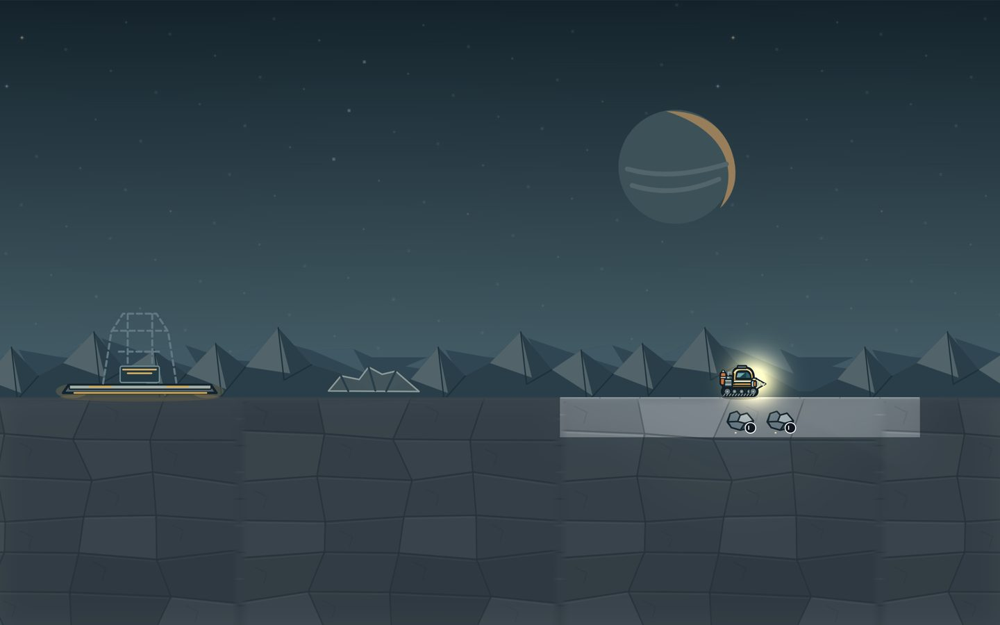
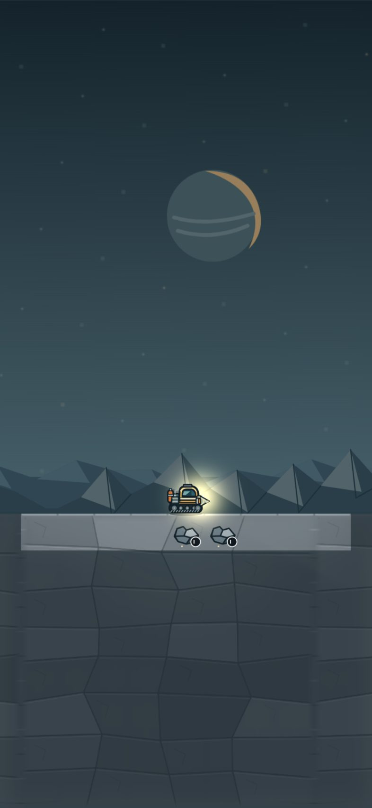
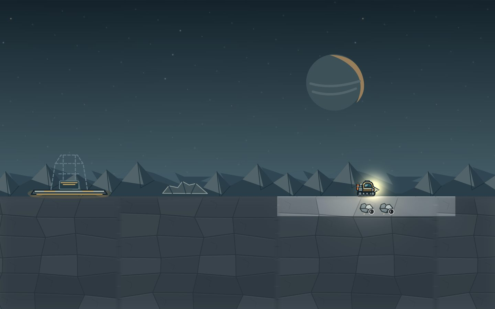
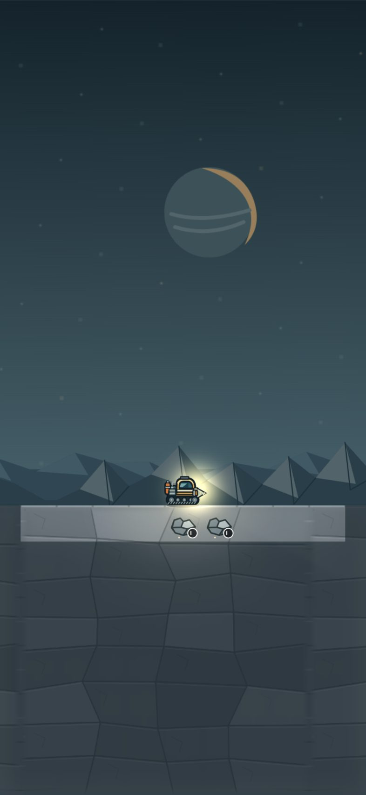
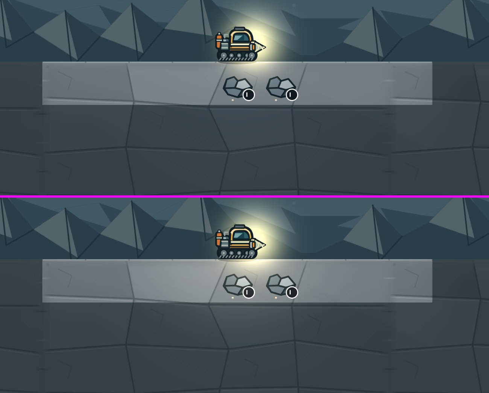
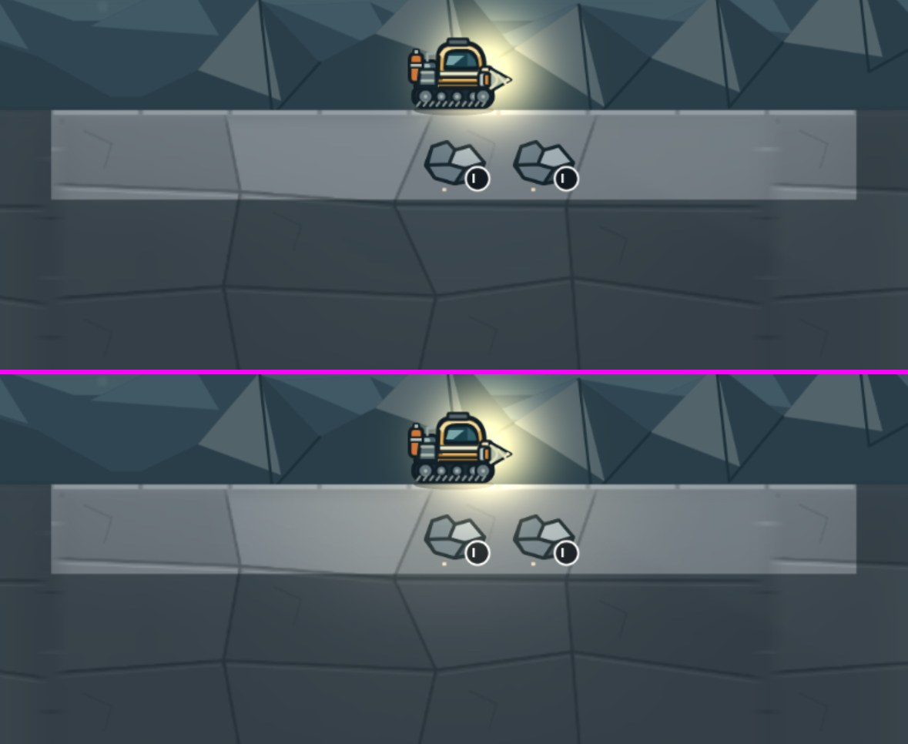

# T1-lite: interim soft ground light on the surface

Item 1 of the art programme (director's note, A4 review): on the surface every visible cell gets the same full light, so the lit ground under the rig is a flat row with square edges. This adds an additive light that falls off smoothly from the rig, drawn above the darkness. T1 absorbs it.

## What it is

- **One sprite.** `src/campaign/render/t1-lite-ground-light.ts` bakes a 128×128 radial texture once (64 KiB) and draws it with the ADD blend mode at depth 17.4: above the light map (17), below the headlamp core (17.5) and the rig (18+). Touch points in `scene.ts` are marked T1-lite.
- **Smooth.** Added levels are 30 × (1, 0.86, 0.6) × (1 − (r/R)²)², zero value and zero slope at the edge. R is 3 tiles along the ground and 2.2 tiles into it (the lit ground is two rows deep), centred on the ground line at the rig.
- **Position only.** It reads the rig's screen x, the ground line and the rig's depth. It never reads `world.tiles`, known or unknown cells, pristine tiles, deposits or sites, so it lights hidden rock exactly as much as visible rock.
- **Surface only.** Only the half below the ground line is drawn, so the sky is untouched (pixel-identical). The strength fades with the smoothstep from 1 (rig at or above row 0.25) to 0 (rig at 1.5 tiles deep), and the sprite is hidden at 0. Every underground frame is unchanged.
- **Static.** No term varies with time: nothing is on the scene clock, the frozen test clock changes nothing, reduced motion and the camera round trip are unaffected.
- **Not touched.** `lighting.ts` (cutout included) and every asset.

## Acceptance

Measured with the F3 harness at backing 2 (`art-captures.mjs`, `art-sheets.py --table-only`), `main` at 83cd9b4 against this branch; the two runs use the same fixtures. Full tables: [`table-before.md`](table-before.md), [`table-after.md`](table-after.md).

| Line                                                                                      | Target                                                                            | main                                           | after                                                                                                    |                                 |
| ----------------------------------------------------------------------------------------- | --------------------------------------------------------------------------------- | ---------------------------------------------- | -------------------------------------------------------------------------------------------------------- | ------------------------------- |
| No visible cell-edge step the light adds, a02 desktop and phone                           | added step ≤ 1 luma (below the 2-luma threshold of visibility on 130-luma ground) | no light                                       | max 0.67 luma across a cell edge, both sizes                                                             | met                             |
| Step the light adds vs the variation it adds inside cells                                 | ratio ≤ 1                                                                         | —                                              | 0.67 vs 0.67 (row 0), 0.36 vs 0.36 (row 1): the light changes by the same amount everywhere, edge or not | met                             |
| Surface horizon L\* (sky strip 0.5 to 0.1 tile above the ground)                          | 26–31                                                                             | 30.49 desktop, 30.68 phone                     | 30.49, 30.68 (every pixel above the ground line identical)                                               | met; unchanged                  |
| Ridge share of frame height                                                               | ≥ 22 %                                                                            | not a harness row; sky pixels identical        | identical                                                                                                | unchanged                       |
| Warm-accent share, surface                                                                | 1.5–4 %                                                                           | 0.26 desktop, 0.30 phone                       | 0.26, 0.30                                                                                               | **pre-existing gap**; not worse |
| Unknown rock luma, every frame                                                            | 45–65                                                                             | 62.6 desktop, 63.7 phone (52.0–62.8 elsewhere) | 62.8, 64.2 (others identical)                                                                            | met                             |
| Lit known − unknown, near the lamp / all known solid                                      | ≥ +15 / ≥ +5                                                                      | +66.2 / +58.3, +65.0 / +57.0                   | +76.2 / +62.4, +74.8 / +60.9                                                                             | met                             |
| Unknown − cave air                                                                        | ≥ +10                                                                             | +15.4 to +24.6                                 | identical (all underground)                                                                              | met                             |
| Frame L\*, within ±4 of the concept                                                       | surface not scored; shaft and cavern ±4                                           | 27.6, 30.4 surface                             | 27.7, 30.7; underground frames identical                                                                 | met                             |
| Dark share below luma 40 (improvement-smoke)                                              | ≤ 60 %                                                                            | pass                                           | pass                                                                                                     | met                             |
| Underground F3 rows (a04 60 m, a05 150 m, 330 m, 550 m, SITE-4, 70 m phone, SITE-4 phone) | no change                                                                         | —                                              | every `-hudfree` frame pixel-identical to main                                                           | met                             |
| Fog check, inset-crop scramble                                                            | pass                                                                              | pass                                           | pass                                                                                                     | met                             |
| `npm test`, `format:check`                                                                | pass                                                                              | —                                              | 286 passed, 5 skipped; pass                                                                              | met                             |

**Hidden-information row (not a gate here, §9.2 allows ≤ 2 L\*).** Unknown rock within 3 tiles of the rig (rows 2 and 3): mean lift 0.001 L\*, max 0.42 L\*, on both sizes, because the light ends 2.2 tiles into the ground. The harness's frame-wide unknown luma moves +0.2 (desktop) and +0.5 (phone), from the lit box's blurred edge and the lit/unknown boundary. Lit ground within a tile of the rig is lifted 5.6 L\* on average (max 11).

### How "no cell-edge step" is measured

[`edge-steps.py`](edge-steps.py) samples the HUD-free frame at the cell boundaries within 3 tiles of the rig. The edge step is the difference of the mean luma of two bands (0.07 to 0.17 tile either side of the boundary, 0.3 tile tall, skipping the crack line) at the mid-height of row 0 and of row 1. It is read on the composite and on the light layer alone (after minus before).

- **Light layer.** At most 0.67 luma between the two bands across any cell edge in row 0 and 0.36 in row 1, which is the same as the slope inside a cell. The threshold is 1 luma; the light has no grid edge.
- **Composite.** Row 1 edge step mean: 1.17 before, 1.76 after (desktop); 1.24 and 1.84 (phone). Row 0: 6.52 and 6.66; 6.59 and 6.72. The cell-to-cell tone differences in the composite are the terrain tiles' own (the band's two rows are drawn per cell, and row 0 also holds the rig and ore); the light neither creates nor removes them, and raises the inner variation of row 1 by the same amount (0.34 to 0.71).

### What the light cannot do

The lit box's outer edge (the boundary between visible and unknown cells, and the bottom of the second row) is the light map's cutout, which this item must not change. The additive light, kept to 30 levels so unknown rock stays within 45–65, softens the lit ground inside that box but not that boundary. T1's modulate composite is what removes it.

## Captures

`main` on top, this branch below, HUD-free frames at 1440 px and 786 px wide; then the lit ground at device pixels.

| a02 desktop 1440×900@2    | p02 phone 393×851@3       |
| ------------------------- | ------------------------- |
|  |  |
|    |    |





## Reproduce

```bash
ART_BACKING=2 ART_CAPTURES_DIR=artifacts/visual-sheets/captures node scripts/art-captures.mjs
python3 scripts/art-sheets.py --captures artifacts/visual-sheets/captures --out artifacts/visual-sheets --table-only
```

The three small scripts here (`edge-steps.py`, `unknown-lift.py`, `horizon.py`) read the before and after capture folders at the paths at their tops; edit those.
