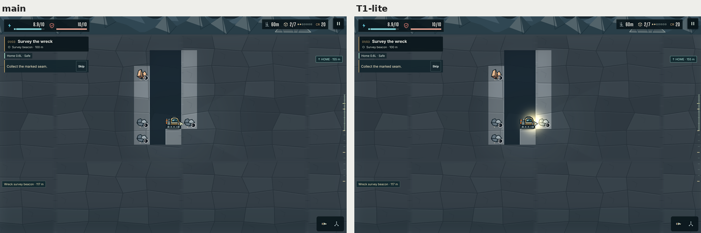
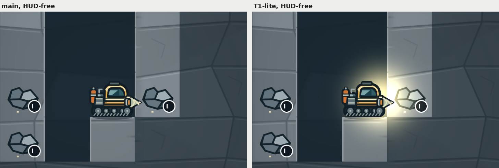
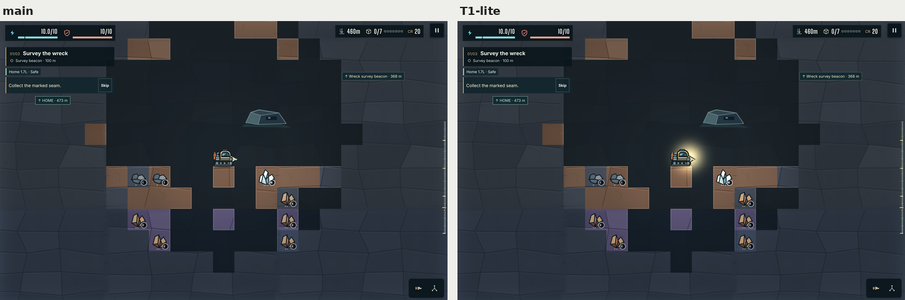
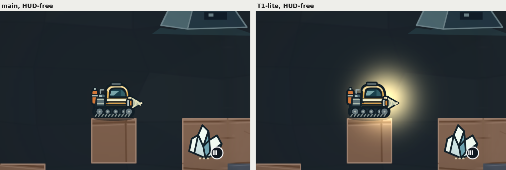

# T1-lite: interim additive headlamp core

Evidence for item 0 of the art programme: T1-lite, the first component of T1 (`docs/ART_QUALITY_AUDIT.md` §5.3) on its own. F4 (#6) deleted the cream normal-blend lamp; T1 replaces it, but T1 waits on T2. Until then, one additive sprite gives the rig a warm headlamp core.

## What it is

- **One sprite.** `src/campaign/render/t1-lite-headlamp.ts` bakes a 128×128 radial texture once (64 KiB) and draws it with Phaser's ADD blend mode. WebGL's ADD is `ONE, DST_ALPHA` and the frame is opaque, so the sprite adds its RGB; Canvas uses `lighter`, which does the same.
- **At the headlamp lens.** `rig-cabin.svg` draws the lens at (100.2, 44.5) of its 128-unit frame (art item A13 moved it from (100, 58) to the cabin's front shoulder, `HEADLAMP_LENS` in `assets/campaign/source/w01-rig.mjs`), which is (+0.377, −0.203) tile from the frame's centre; `T1_LITE_HEADLAMP_LENS` follows it, and the harness probe is now 0.40 tile from the lens (0.37 before A13). The sprite reads the cabin sprite as drawn that frame (position, flip, lean and squash), so it stays on the lens. Every fixture faces right, as the harness probe assumes.
- **Above the darkness, below the rig.** Depth 17.5: the light map is at 17 and the rig starts at 18. That is where T1's light composite sits in the §5.3 layer stack.
- **Warm and tight.** It adds peak × (1, 0.88, 0.58) × exp(−(r/0.65)²) sRGB levels, faded to 0 at 1.8 tiles, with a peak of 260 that clamps at 255 under the cabin. At the harness probe that is about (160, 141, 93) since A13 moved the lens (0.40 tile from it; (174, 153, 101) at 0.37 tile before). The colour is near the board's lamp patch, `#e2ca98`.
- **Static.** No term varies with time, so nothing flickers and there is nothing to put on the scene clock. Reduced motion and high contrast change nothing.
- **No occlusion, no light-map change.** `lighting.ts` is untouched, cutout included.
- **Marked for T1.** The module header and both call sites in `scene.ts` say T1-lite. T1's ADD light texture takes the headlamp over, and the file and call sites go.

## Harness change

`scripts/art-sheets.py` measured the headlamp core on SITE-4 only, where `metrics.py` measured the prototype. §9.2 sets the target for every underground frame, so the harness now reads it on every shaft and cavern frame, with the same probe: Lab L\* and b\* of a 13×13 device-pixel patch 0.35 tile along a ray 14° below horizontal from (0.40, −0.13). The row's target now reads "shaft and cavern". The "not measured" list drops "headlamp core outside the cavern" and adds the §9.2 headlamp clauses the harness cannot measure yet: the occlusion test and the bore spill in the down pose (T1).

## Acceptance

Measured with the F3 harness at backing 2, as the nightly `visual-sheets` job runs it: `main` at 313a686, then this branch. Both runs capture all nine frames in the same order, so each frame's camera settles the same way.

| Line | Target | `main` | T1-lite | |
|---|---|---|---|---|
| Headlamp core, a04 60 m shaft | L\* ≥ 70, b\* +15 to +30 | 25.3 / −7.5 | **84.7 / +21.0** | met |
| Headlamp core, SITE-4 desktop and phone | L\* ≥ 70, b\* +15 to +30 | 15.0 / −5.2 | 77.1 / +24.6 and 77.6 / +24.8 | met |
| Headlamp core, 330 m and 70 m phone | L\* ≥ 70, b\* +15 to +30 | 14.2 / −5.8; 25.5 / −7.5 | 76.5 / +24.3; 85.1 / +21.1 | met |
| Headlamp core, a05 150 m shaft | L\* ≥ 70, b\* +15 to +30 | 50.9 / −14.2 | 99.6 / **+3.9** | **b\* not met** (below) |
| Unknown rock luma, every frame | 45–65 | 52.0–63.7 | 52.0–63.7 | met |
| Lit known − unknown, near the lamp / all known solid | ≥ +15 / ≥ +5 | +29.3 to +66.1 / +33.0 to +60.7 | +30.3 to +66.1 / +33.4 to +61.9 | met |
| Unknown − cave air | ≥ +10 | +20.0 to +24.6 | +15.4 to +24.1 | met |
| Frame L\*, shaft and cavern frames | within ±4 of the concept | −2.9 to +2.6 | −2.4 to +2.8 | met |
| Fog check and inset-crop scramble | pass | pass | pass (local `verify`) | met |
| `npm test`, `format:check` | pass | — | pass | met |

Per frame, `main` → T1-lite (the full tables: [`table-before.md`](table-before.md), [`table-after.md`](table-after.md); every value: the two JSON files):

| Frame | Headlamp core L\* / b\* | Unknown rock luma | Lit known − unknown (near / all) | Unknown − cave air | Frame L\* (concept) |
|---|---|---|---|---|---|
| surface (desktop) | — → — | 62.6 → 62.6 | +66.1 / +58.2 → +66.1 / +58.2 | — → — | 27.4 → 27.6 (26.3) |
| 60 m (desktop) | 25.3 / −7.5 → 84.7 / +21.0 | 61.7 → 61.7 | +58.1 / +60.7 → +60.3 / +61.9 | +23.9 → +23.1 | 26.9 → 27.1 (25.9) |
| 150 m (desktop) | 50.9 / −14.2 → 99.6 / +3.9 | 59.3 → 59.3 | +41.8 / +47.3 → +56.4 / +53.6 | +23.4 → +22.9 | 25.2 → 25.4 (25.9) |
| 330 m (desktop) | 14.2 / −5.8 → 76.5 / +24.3 | 54.8 → 54.8 | +29.3 / +33.0 → +30.3 / +33.4 | +20.7 → +15.4 | 23.6 → 23.8 (21.0) |
| SITE-4 (desktop) | 15.0 / −5.2 → 77.1 / +24.6 | 52.0 → 52.0 | — / +34.4 → — / +34.6 | +20.0 → +19.1 | 20.0 → 20.3 (21.0) |
| surface (phone) | — → — | 63.7 → 63.7 | +64.9 / +56.9 → +64.9 / +56.9 | — → — | 30.0 → 30.4 (27.1) |
| 70 m (phone) | 25.5 / −7.5 → 85.1 / +21.1 | 62.7 → 62.8 | — / +57.1 → — / +57.0 | +24.6 → +24.1 | 27.2 → 27.7 (30.1) |
| SITE-4 (phone) | 15.0 / −5.2 → 77.6 / +24.8 | 54.1 → 54.1 | — / +35.9 → — / +36.2 | +21.8 → +20.7 | 19.2 → 19.7 (21.0) |

The per-PR harness in `verify` (backing 1) agrees: headlamp core 84.5 / +20.8 at 60 m, 77.8 / +24.9 and 80.1 / +25.9 at SITE-4 (desktop, phone), 76.2 / +24.2 at 330 m, 87.3 / +21.7 on the 70 m phone frame, and 99.7 / +3.4 at 150 m; unknown − cave air +15.4 to +24.2.

"Near the lamp" is blank under 3 lit cells, as in the F3 table. The `main` headlamp values on shaft frames come from the extended harness run on `main`'s captures; the committed F3 table on `main` has them on SITE-4 only (15.0 / −5.2).

## Captures

`main` on the left, T1-lite on the right. First each frame as captured, annotations on, at half the CSS size; then the HUD-free twin around the rig at device pixels.









## Not met: the core's b\* on bright band-B soil (a05, 150 m)

At 150 m the probe falls on lit band-B soil, a light blue (86, 127, 145; L\* 50.9, b\* −14.2). The core adds about (174, 153, 101), red and green clip at 255, and the patch becomes a pale cream (L\* 99.6, b\* +3.9).

An additive light cannot meet both ends with one colour and intensity:
- dark cave air (30, 39, 45) needs about +150 per channel to reach L\* 70, and a light warm enough for b\* ≥ +15 on blue soil then pushes the air above b\* +30;
- a search over peak, colour and fall-off found settings that pass all six underground frames, but with at most 0.45 of margin on any line;
- the shipped setting keeps about 5 of margin on every other frame and gives up a05's b\*.

T1 fixes this structurally: its 0–2× modulate composite multiplies the surface by the light, so blue soil stays blue-tinted under a warm lamp instead of clipping to cream. The other a05 lines pass.

## Side effects to know about

- **The wall beside the lamp washes out.** In the 1-tile shaft the lens sits 0.125 tile from the right wall, so the core lights that wall cell and the ore drawn on it towards cream (the close-up above). T1's modulate composite keeps the albedo; an additive core cannot.
- **Cave air near the rig lifts.** The 330 m rig stands in a horizontal tunnel, so the core lights much of the known air the F4 row averages: unknown − cave air goes from +20.7 to +15.4, still clear of +10. A first setting with a wider fall-off (σ 0.9 tile, out to 2 tiles) left +11.4, which is why the core is tight.
- **Two rows flip to ✓ for the wrong reason.** "Rock sd within 3 tiles of a light" passes at 150 m (39.7) and 330 m (15.4), and "p2–p98 / p98" passes on the 70 m phone frame (41.3 / 55.7). Both come from the bright core patch, not from rock texture; they say nothing about the art those rows wait for.
- **Frame L\* moves +0.2 to +0.5.** Every shaft and cavern frame stays within ±4 of its concept; the closest is 330 m at +2.8.
- **Desktop dark share drops.** The visual check's W01 desktop shaft reads 7.8 % below luma 40 (8.1 % on F4's evidence run), far under the 60 % limit; HUD contrast stays at 8.32:1.

## Reproduce

```bash
ART_BACKING=2 ART_CAPTURES_DIR=artifacts/visual-sheets/captures node scripts/art-captures.mjs
```

```bash
python3 scripts/art-sheets.py --captures artifacts/visual-sheets/captures --out artifacts/visual-sheets --table-only
```

```bash
python3 docs/qa/t1-lite-headlamp/pairs.py BEFORE/captures AFTER/captures docs/qa/t1-lite-headlamp
```

The pairs script takes two capture folders, one from `main` and one from this branch.

## Verification

The whole `verify` job of `checks.yml` passed locally before the push, every step exiting 0, in 718 s: `npm test` (277 passed, 5 skipped), `format:check`, `build`, `test:improvements` with `behavior,visual,fog,harness` (the fog check, the 12 visual captures and the harness at backing 1), `test:campaign:storage`, `test:feel`, `test:audio`, `test:plan-ui`, `test:render` (hidden geology identical on Canvas and WebGL in both worlds, and the camera round trip), `test:render:memory`, `test:camera`, `test:hud:surface`, and `test:opening:browser` on desktop and portrait. Local runs use Node 22.23.4 and Playwright's Chromium 153; CI uses Node 24 and Chromium 156.

- **Draw calls.** The ADD sprite needs its own blend state, so WebGL now submits 3 draws per frame in `render-acceptance.mjs`'s shaft fixtures, against 1 on `main`; the limit is 12.
- **Texture memory.** The core's texture adds 64 KiB everywhere: desktop W02 measures 63.33 MiB against 64, phone boot 19.24 MiB against 20.
