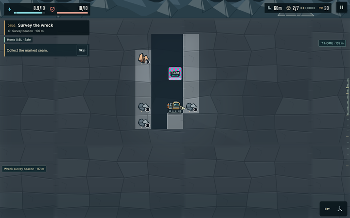
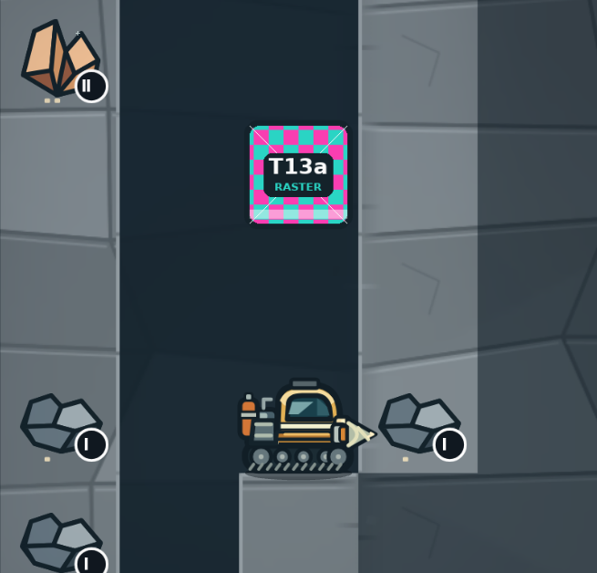

# T13a: raster source path in frames.json

Evidence for item 1 of the art programme: T13a in `docs/ART_QUALITY_AUDIT.md` §5.2, the minimal asset path. A PNG listed in `assets/campaign/source/frames.json` with `"source": "raster"` is rasterized, packed and shown in the game like any SVG frame, so art sessions can see a delivered file in context. The `-emissive` convention, zone atlases, masters and page choice by device pixels per tile are T13b and are not here.

## How it works

- **The entry.** A raster frame is listed like an SVG frame, with `"source": "raster"`, and its PNG sits beside the SVGs as `<name>.png`:

  ```json
  { "name": "test-raster", "width": 96, "height": 96, "logicalWidth": 48, "logicalHeight": 48, "category": "debug", "source": "raster" }
  ```

  The PNG may be any size at least the frame's @2x size (`width` × `height`), in the frame's proportions. Delivered at @3x (logical size × 3), the @3x pages carry it pixel for pixel.
- **`scripts/rasterize-campaign-svgs.mjs`.** Raster frames are resampled to each page's size with Pillow's Lanczos filter, which works in premultiplied alpha, so edges keep their colour. A PNG already at a page's size is copied pixel for pixel. SVG frames render in Chromium as before.
- **`scripts/build-campaign-assets.mjs` and `scripts/pack-campaign-atlas.py`.** Raster renders are packed like the SVG renders, on every @2x and @3x page, full and runtime. Their atlas entries carry `"source": "raster"`, and `generated/provenance.json` lists them as `rasterFrames`, because its `source` line describes SVG artwork.
- **`assets/campaign/source/create-w01-sources.mjs`.** It writes `frames.json`, so it now lists the raster frames too. Without that, a regeneration would drop them. Apart from the new entry, it reproduces the committed sources byte for byte.
- **Checks.**
  - `check-campaign-assets.mjs`: every raster frame's PNG exists, keeps the frame's proportions, is at least its @2x size, and appears in the atlas with its raster mark.
  - `check-render-assets.mjs`: every raster frame reaches the W01 runtime pages at @2x and @3x.
  - Each check was confirmed to fail on a missing PNG, on wrong proportions, and on a frame missing from the runtime pages.
- **The placeholder.** `test-raster` is a 144 px test card, drawn by `assets/campaign/source/create-test-raster.py`. It has a pink and teal checker, 1 px diagonals, a half-transparent band and transparent corners, so resampling and alpha show at a glance.
  - **In the game, behind a flag.** With `?debug=test-raster`, the game draws it in the 60 m scene: in the improvement fixture's W01 shaft, two tiles above the rig, at scenery depth under the light map. It is a debug aid, drawn whether or not its cell is known.
  - **Checked.** The game reports `data-test-raster="true"` when it draws it, and `art-captures.mjs` throws otherwise.
  - **In CI.** The per-PR harness in `verify` now captures it at backing 1, beside the §9 fixtures, and asserts it was drawn.

## Acceptance

| Line | Result | |
|---|---|---|
| The placeholder appears in the 60 m fixture, captured with `art-captures.mjs` | `t13a-test-raster-60m@2` at backing 2 (below), and in `verify`'s harness at backing 1; the game reports it drawn | met |
| `npm run campaign:assets` rebuilds byte-identically twice in a row | Two consecutive rebuilds give the same SHA-256 for all 282 files in `assets/campaign/generated/`, equal to the committed tree | met |
| `check-campaign-assets`, `check-render-assets` | pass: 175 W01 frames, raster sources: `test-raster`; 290 runtime sprite frames | met |
| `npm test`, `format:check` | 274 passed, 5 skipped; clean | met |





On desktop the game draws it from the @3x page, which holds the PNG unchanged; the @2x pages hold its Lanczos resample.

## What the rebuild changes

Adding a frame moves others on the page, so the atlas PNGs differ byte for byte. `compare-frames.py` rebuilds every frame's source rectangle on both sides and compares pixels:

| Page | Shared frames | Changed | Added |
|---|---|---|---|
| `w01-atlas` (@2x) | 174 | none | `test-raster` |
| `w01-runtime` (@2x) | 115 | none | `test-raster` |
| `w01-atlas-3x-0` | 174 | `ui-cooldown` (159 px), `ui-warning` (165 px) | `test-raster` |
| `w01-runtime-3x-0` | 115 | `ui-cooldown` (159 px), `ui-warning` (165 px) | `test-raster` |

The two @3x glyphs are not from this change. This environment's Chromium (153) rasterizes them differently at 1.5×, and rebuilding `main` unchanged here gives the same two differences and nothing else. The runtime pages keep their size (5.50 and 11.50 MiB decoded), so the game's texture memory does not change. The full @3x page, which the game does not load, grows by one 64 px shelf, from 15.50 to 16.00 MiB decoded.

## A race in the SVG rasterizer

While checking determinism, two builds out of sixteen came out different. One was the first build in this checkout; the other ran under heavy CPU load. In the loaded run, `dock-stage-2`, an SVG frame, differed in 44 anti-aliased pixels, by up to 23 levels. Raster frames could not cause it: Pillow's output is deterministic. The SVG path is the same as on `main`, so the race predates this change.

The rasterizer now waits two animation frames after loading each drawing, before the capture:
- the wait changes no settled output: an unloaded build gives the same 282 files;
- nine of nine builds with it matched, four of them under heavy CPU load;
- the race is intermittent, so this is evidence, not proof, that the wait removes it.

Chromium's `--run-all-compositor-stages-before-draw` made things worse (more frames differed, and loaded runs differed from each other), so it was not kept.

## Reproduce

```bash
python3 assets/campaign/source/create-test-raster.py
```

```bash
node assets/campaign/source/create-w01-sources.mjs
```

```bash
PYTHON=python3 npm run campaign:assets
```

Since T13b the build renders with resvg and needs no browser (`docs/qa/t13b-asset-pipeline/`); this item's PNGs were first rendered by Chromium with `CHROMIUM_PATH` set.

```bash
ART_BACKING=2 ART_CAPTURES=t13a ART_CAPTURES_DIR=artifacts/t13a node scripts/art-captures.mjs
```

```bash
python3 docs/qa/t13a-raster-source/crop.py artifacts/t13a docs/qa/t13a-raster-source
```

```bash
python3 docs/qa/t13a-raster-source/compare-frames.py origin/main
```

To see the placeholder in a browser, open the game with `?debug=test-raster`: it stands at W01 cell (31, 3) whenever that cell is on screen, and the 60 m fixture (`fixture("W01", 6)` in `improvement-smoke.mjs`) frames it as captured above.

## Verification

The whole `verify` job of `checks.yml` passed locally before the push, every step exiting 0, in 700 s:
- `npm test` (274 passed, 5 skipped), `format:check` and `build`; the build runs `campaign:check`, so the asset checks pass on the committed outputs;
- `test:improvements` with `behavior,visual,fog,harness`, whose harness section now also captures the placeholder;
- `test:campaign:storage`, `test:feel`, `test:audio`, `test:plan-ui`, `test:render`, `test:render:memory`, `test:camera`, `test:hud:surface`, and `test:opening:browser` on desktop and portrait.

The first run stopped in the harness section on a declaration-order bug in `art-captures.mjs`; it was fixed and the whole job run again. Local runs use Node 22.23.4 and Playwright's Chromium 153; CI uses Node 24 and Chromium 156.
