# T13b: asset pipeline

Evidence for audit item T13b: `docs/ART_QUALITY_AUDIT.md` §5.3 row T13b ("Raster source path in frames.json. -emissive frame convention. Zone atlases ≤2048×1024 @3x. 4× masters. Choose pages by device px per tile, not by pointer type"; acceptance "Byte-identical rebuilds; a DPR 3 phone with tiles >48 CSS px loads @3x zone pages"), with §5.6's conventions, §6.2 (provenance) and §7 (budgets), and `docs/art-direction/decisions.md` D1 and D5. The item is the second of three stacked branches: it is built on item 1 (A12 ore sockets, `1a0b5db`, PR #17), and item 3 (A13 rig shading) builds on it. They merge in that order. Status: in review.

| commit | part | what it does |
|---|---|---|
| `84e4005` | (d) | The resvg rasterizer, canonical PNGs and the CI rebuild check. No source or art changes. |
| `bb47b80` | (b), (c) build | Zone pages at @2x, @3x and @4x, the per-world manifests and the zone checks. Moves the rig's track edge onto the tread baseline. |
| `3929c6e` | (b), (c) runtime | The game streams zone pages by band and picks their density by device px per tile. Adds the budget guard, the F1 readout and the memory report. Removes the legacy pages. |
| `2fdae94` | (a) | `-emissive` siblings drawn ADD above the darkness, starting with the beacon's lamp. |
| `aadf312` | evidence | Resident bytes before and after, the captures, this README and the docs. |
| this commit | review fixes | The packer keeps `-emissive` siblings on their base's page when a group spills; the budget guard's boot budget (the dock only) and its ratchet; after a jump the scene waits for the zones on screen; the Canvas sky crash below 1 px; docs and nits ("Review fixes"). |

**Files also touched by other open PRs:**
- `src/campaign/scene.ts`. This item changes it in `3929c6e`, `2fdae94` and the review fixes. PR #14 (ground light) also touches it, at an import, a field, the constructor, `destroy` and the render call. None of this item's hunks are at those places, and a three-way merge of the final `scene.ts` with PR #14's own commit (`a7cbe26`, `git merge-file`) has no conflict.
- `src/campaign/render/lighting.ts`. This item does **not** touch it; `zones.ts` keeps its own copy of the light map's 0.25 scale as `LIGHT_MAP_SCALE`.
- `scripts/campaign-smoke.mjs`. PR #16 (D14 beacon) rewrites parts of it. This item changes only `ready()` and leaves the stale "300 CR" line for PR #16 to fix.
- `tests/campaign-poi-art.test.ts`. PR #16 edits it too; this item's change is two lines, to read `w01-zones.json`.
- `src/campaign/poi.ts`. PR #16 edits it. If D14 renames or redraws `mission-beacon`, `mission-beacon-emissive` must follow.

The sections below go in this order: what changed; the zones and pages; the density rule; the resident bytes; the captures; the emissive convention; the rasterizer; the review fixes; the checks run; the acceptance table; how to reproduce. "Reproducible rasterizer" keeps the first stage's evidence as it was written, and "Checks run" keeps each stage's own verification.

## What changed

### (a) Emissive siblings

- **The frames.** A frame `<base>-emissive` in `frames.json` has the same size as its base and is authored with the kit's `emissivePair`. The base draws the lit parts with the power off; the sibling holds only the light.
- **Packing.** The zone function gives a sibling its base's zone and page set, and the packer keeps it on its base's page at every density, also when a group spills onto a second page.
- **Checks.** `check-campaign-assets.mjs` fails a sibling unless its base, in the same world, is the same size, sits on the same page and has the same source size and pivot.
- **The ADD pass** (`src/campaign/render/emissive.ts`, called from `scene.ts`). After the frame's last sprite, it draws the sibling of every base drawn this frame:
  - with the ADD blend (Canvas `lighter`), from a pool of its own;
  - at the base's final position, origin, scale, flip, rotation, alpha and mask, read after the device-pixel snap;
  - at depth 17.6 for scenery, above the light map (17) and T1-lite's core (17.5), and at the base's depth + 0.05 for rig layers.
- **Hidden information.** A sibling exists only while its base is drawn, so unknown cells show nothing new. Nothing in the pass varies with time.
- **The first sibling** is the survey beacon's lamp (`mission-beacon`, `mission-beacon-emissive`).
- **T1-lite.** Its radial core (`render/t1-lite-headlamp.ts`) is untouched and stays separate until T1.
- **Cost.** +0 WebGL draws when the sibling joins T1-lite's ADD run, +2 when it must keep the wreck mask, and 0 resident bytes. Details in "Emissive convention and its cost".

### (b) Zone atlases

- **One classification.** `scripts/campaign-zones.mjs` sorts every frame for both world builds, the checks and the tests:
  - `core`: always resident;
  - `surface`: band A;
  - `shaft`: frames drawn only in bands A and B;
  - `cave`: frames drawn only in bands C and D.
- **Off the pages.** Terrain tiles, DOM-only icons and frames nothing draws stay off the pages, matched by exact regexes. The old prefix filter also dropped `ice-vent`, so the W02 vent marker was never drawn. It is drawn now (Captures).
- **The pages.** There are pages per world, zone, page set (hero frames, each lander stage, the rest) and density.
  - Each page is at most 2048 × 1024; the largest is 832 × 1024.
  - They are packed by the shelf packer, generalized: as few pages as possible, then the width with the fewest decoded bytes.
  - `generated/w01-zones.json` and `w02-zones.json` list them.
- **Loading** (`src/campaign/render/zones.ts`, `render/art.ts`).
  - The game loads W01's core always, W02's core when it is needed, and the zones of the rig's band ±1.
  - A new page loads before the page it replaces is removed.
  - Which world's atlas a frame comes from is read from the manifests, never from what is resident.
- **Removed.** The legacy pages (`w0X-runtime*`, `w0X-atlas-3x-*` and their indexes) and their build steps. The full @2x atlases stay because the checks read them.
- **Resident texture bytes** fall at every measured stage:

  | form | surface | cave |
  |---|---|---|
  | desktop 1440 × 900 @2 | 45.46 → 34.89 MiB | 55.58 → 38.77 MiB |
  | phone 393 × 851 @3 | 19.24 → 16.84 MiB | 29.37 → 22.10 MiB |

  The F1 readout breaks them down by group.

### (c) Pages by device px per tile

- **The rule.** Device px per tile = the base tile × F1's backing ceiling. Density = clamp(ceil(device px per tile / 48), 2, 4) for hero pages and clamp(…, 2, 3) for the rest.
- **Pointer type.** D1's density never reads it; the pointer-type tests are gone. The guard's budget form is F1's render tier, which reads the pointer as F1 always has ("Density rule").
- **Rendering.** Every density is rendered from source: @2x at scale 1, @3x at 1.5, and @4x at 2 for the hero set only.
- **The budget guard.** It steps non-hero zones down to @2x when the projected resident bytes would pass the form's §7 budget, only when that reaches the budget, and keeps each step for the session.
- **The honest consequence.** At today's tiles, 1440 × 900 @2 picks @3x and 393 × 851 @3 picks @2x. Both D1 paths are proven in a browser:
  - 1728 × 1117 @2 and `?tile=82` load the @4x hero pages;
  - a phone with `?tile=56` loads the @3x zone pages.

### (d) Reproducible rasterizer

- **Rendering and encoding.** resvg (`@resvg/resvg-js` 2.6.2, pinned) renders every SVG. A canonical PNG encoder (pako 2.1.0, pinned) then rewrites every PNG the builds write under `assets/campaign`. The hand-made raster source `source/test-raster.png` (T13a, written once by `create-test-raster.py`) is an input, not rebuilt, and keeps its committed encoding.
- **Rebuild.** `npm run assets:rebuild` regenerates everything.
- **CI.** A step in `verify` rebuilds and fails on any difference.
- **Test.** A golden-hash test pins the encoder.
- **Proven so far.** The rebuild is byte-identical locally under Node 22 and 24, Pillow 12.0 and 12.3, and under load. It has not yet run in CI (nothing is pushed).

### Riding along

- **Art change.** The rig's track edge moved from 99.5 to 100 units, so the tread meets the floor at every density. Only `rig-body-0..7` change.
- **Pressure seams.** They are now drawn only within a tile of the view. Off-screen seams used to ask for the cave pages from band A.
- **Canvas sky.** The sky tile sprite is drawn only when at least 1 px of sky shows; below that its canvas is 0 px high and Canvas 2D stopped the game loop. The crash predates this item ("Review fixes").
- **Debug hooks.**
  - `?tile=N` and `?debug=no-emissive`, next to `?backing=`;
  - `window.__campaignDebug.textures()`, `frameMisses()`, `drawnFrames()` and `emissives()`;
  - the dataset keys `data-resident-texture-zone`, `-groups`, `data-atlas-density`, `-guard`, `-pages` and `data-emissive-sprites`.
- **Memory report.** `scripts/render-memory.mjs` gains a cave stage and prints the bytes per group.
- **Readers updated.** `campaign-smoke.mjs` `ready()`, `surface-render-smoke.mjs`, `check-render-assets.mjs`, `tests/campaign-poi-art.test.ts`, the art-audit prototype and `docs/qa/t13a-raster-source/compare-frames.py`.
- **Found, not fixed.** The captures exposed a draw-order bug that predates this item: rig layers at the same depth swap between runs. See "Captures".

## Zones and pages

**The build side** (`bb47b80`). Both world builds write zone pages at @2x, @3x and, for the hero set, @4x, plus one manifest per world.

**The runtime side** (`3929c6e`). The game loads only zone pages. The legacy runtime pages (`w0X-runtime.png/json`, `w0X-runtime-3x-0.png/json`, `w0X-pages-runtime-{2,3}x.json`) are deleted, together with the build steps, the packer branch and the check loop that wrote and read them.

### How frames are zoned and packed

- **One classification.** New `scripts/campaign-zones.mjs` sorts every frame of a world's `frames.json`. A frame either stays off the runtime pages or belongs to exactly one zone. Both world builds use it, and so do the asset checks and the tests. The game reads only what the builds write from it, the manifest.
- **Zones.** The user's "surface, shaft bands, cave bands" map to the game's bands A to D (`src/campaign/world-content.ts`) like this:

  | zone | bands | W01 rows | W02 rows | frames |
  |---|---|---|---|---|
  | core | all | 0–59 | 0–99 | always resident. All `rig-*` and `tool-*`, `thrust-*`, `ore-*`, `package-*`, `relic`, `deposit-socket`, `tier-mark-hc-*`, `crack-*`, the `mission-*` POI markers, `ui-mission`, `warning-shelf` and `surface-salvage`, plus every frame drawn in more than one zone: `site-wreck`, `site-survey` and `site-mission` (W01 and W02, shaft and cave rows), `cold-pocket` and `cold-warning` (W02 rows 28–30 and 61–63) |
  | surface | A (drawn above row 0) | 0–10 | 0–14 | `sky-body`, `dock-stage-0..3`, `refuge-stage-1..2`, `relay-stage-1..2` (W02: `sky-body`, `dock-stage-0..3`) |
  | shaft | A, B | 0–29 | 0–44 | frames drawn only in the shaft bands: `test-raster` (W01 row 3, `?debug=test-raster`). W02 has none |
  | cave | C, D | 30–59 | 45–99 | frames drawn only in the cave bands: `site-geode` (W01 53, W02 86), `site-cache` (56, 94), `site-core` (the scenery behind the navigation core, row 59, and the catalyst, row 99), `pressure-seam` (W01 45–59, W02 75–99); W02 `ice-vent` (rows 48–50 and 83–85) |

  Shaft or cave is decided from where each frame is actually placed: `placeSites()` and `placeHazards()` in `src/campaign/world.ts`, the mission rows and the POI scenery of `src/campaign/render/poi-art.ts`. The table in `campaign-zones.mjs` (`PLACEMENT`) is checked against five generated seeds of both worlds by `tests/campaign-zones.test.mjs`. Generator v1 worlds place no sites or hazards. W02 draws W01's core and cave frames (sites, pressure seams, cold pockets, the rig), so the W01 manifest lists `worlds: ["W01", "W02"]` for those zones. W01 draws W02's core frames (`rig-*-2`, `tool-*`) once W02 hardware is owned.
- **Off the pages.** These frames stay off the runtime pages, matched by exact names:
  - Terrain, `^(soil|stone|ice|frozen-rock|bedrock)(-edge)?-\d+$`: 59 W01 and 60 W02 frames. The game draws terrain from the band pages.
  - DOM-only frames, `^(icon-|world-|ui-(?!mission$))`: 18 W01 frames and 1 W02 frame. The HUD draws them from `generated/icons`.
  - Four W01 frames the game never draws: `site-beacon` and `site-antenna` (no such site kind), `refuge-stage-0` (the refuge is drawn as `refuge-stage-min(2, stage)` from stage 1) and `relay-stage-0` (`relay-stage-min(2, stage − 1)` from stage 2). A test trips if those draws change.

  The legacy runtime filter was a prefix test, `split('-')[0] in ('soil','stone','ice','frozen','bedrock')`, which also dropped **`ice-vent`**. That is why `scene.ts`'s `this.image("ice-vent", …)` always returned false and the W02 vent marker was never drawn. The exact regex keeps it: `ice-vent` is on the W02 cave pages at @2x and @3x, so the W02 vent marker renders now ("Captures").
- **Hero set and @4x.** The hero set is all `rig-*`, `thrust-*`, `ore-*`, `package-*`, `relic`, `deposit-socket`, `tier-mark-hc-*`, `mission-beacon` (asset 15), `site-wreck` (asset 14) and the lander `dock-stage-*` (assets 1 and 2), plus the rig's mounted tools `tool-*`. The tools are drawn by `render/rig.ts` as rig layers at the rig's size, so a @3x tool on a @4x rig would look visibly softer. The hero set gets pages at @2x, @3x and @4x. Everything else stops at @3x. The raster-source frame (`test-raster`) never gets a @4x page because it has no @4x master (D5).
- **Page sets.** Inside a zone, hero frames and the rest go on separate pages. A zone drawn at @4x therefore loads its hero frames once, from the @4x page, and the rest from @3x, with no frame loaded twice. Each lander stage gets pages of its own (`surface-stage<n>`), because `scene.ts` draws one stage at a time (`dock-stage-min(3, completed milestones)`). Only the current stage needs to be resident, which is 0.70 MiB at @3x instead of 3.28 to 4.98 MiB for all four stages.
- **Densities from source.** Each density is rendered from the SVGs (D5): @2x at scale 1, @3x at 1.5 and @4x at 2. The renders go to `.cache/campaign-renders{,-3x,-4x}` and `.cache/frontier-renders{,-3x,-4x}`. Only the hero set is rendered at @4x. The full @2x atlases are packed from the same renders.
- **Packing.** `scripts/pack-campaign-atlas.py` keeps its shelf packer, now a function, and adds a `zones` mode. The world build (`scripts/build-zone-pages.mjs`) writes a plan from `pageGroups()`. The packer packs each (zone, page set, density) group into pages of at most 2048 × 1024. It tries every page width that is a multiple of 64 and keeps the one with the fewest pages, then the fewest decoded bytes, then the narrowest width, so a group never splits while one page holds it. Several pages per group are allowed. A group that spills is packed again with each base and its `-emissive` siblings as one unit that never straddles a page break; the packer proves that path on a synthetic group before each run and stops if a sibling still lands away from its base ("Review fixes"). The page JSON keeps the Phaser JSONHash format with `meta.zone`, `meta.hero` and `meta.stage`. Before writing the manifest, the build deletes any zone page that a smaller group no longer has. `w0X-sky-runtime.png` is now written in this mode, so it survives the deletion of the legacy pages.
- **Manifest** `generated/w01-zones.json` and `w02-zones.json`. Each holds the page limit, the density → scale map, `maxDensity {hero: 4, plain: 3}`, the zones (`bands`, `rows`, `worlds`, frame count), `frames` (frame → zone for every runtime frame), `hero`, `excluded` (by reason) and `pages`. Each page entry is `{key, zone, hero, stage?, density, image, data, width, height, bytes, frames}`. Keys are `campaign-<file stem>`, such as `campaign-w01-core-hero-3x-0`. They keep the `campaign-w01` / `campaign-w02` prefix that `scripts/surface-render-smoke.mjs` needs, and none ends in `-wall` (`art.ts complete()` downsamples those). An `-emissive` sibling always takes its base's zone, page set and page (`zoneOf(emissiveOf(name) ?? name)`).
- **Removed.** `w01-atlas-3x-0.*`, `w02-atlas-3x-0.*` and `w0X-pages-3x.json` (the full @3x atlases) are removed because nothing in the game read them. Their readers move to the zone pages: the art-audit prototype (`docs/art-audit/prototype/proto.js` and `render.mjs` load the W01 @3x zone pages through `w01-zones.json`; checked by rendering two scenes in a private copy), and `docs/qa/t13a-raster-source/compare-frames.py` skips a page missing on one side. The full @2x atlases (`w01-atlas`, `w02-atlas`) stay, because the checks read them. The legacy runtime pages went with the runtime switch (`3929c6e`).
- **Tread baseline at @4x.** `check-campaign-assets` requires the lowest opaque row of every `rig-body-*` frame to end at the tread baseline, 100 × scale / 2. The track's outer edge was at 99.5 units (`rect` y 79, height 23, stroke 5, shifted −5), which lands on a pixel boundary at @4x: the check read 199 for 200. At @2x and @3x it passed only because the last row was half or a quarter covered. The fix is at the source. In `create-w01-sources.mjs` the track is 23.5 units tall, so its outer edge sits exactly on the baseline at every density, as the simulator assumes (`rigTreadBaseline 100`, `bodyHalfY 0.36`). It is the only art change of the zone-page stage (the emissive stage splits the beacon's lamp). `compare-frames.py 84e4005` reports `rig-body-0..7` and no other frame: 163–164 px changed at @2x (max 128, the bottom row going from half to full alpha and the lower corner arcs), 303–308 px at @3x (max 192), and at @4x one more full row. The tread grows by half a unit (0.5 px at @2x, 0.65 device px at 1440 × 900 @2) and now meets the floor. `tread-baseline.png` shows `rig-body-0`'s tread corner at @2x, @3x and @4x (rows), before and after (columns), magnified six times over the floor line (grey). The check keeps its threshold at every density.

### Pages

Decoded MiB = width × height × 4. PNG = committed canonical bytes. `pages-table.py` prints these tables from the manifests and the committed files (the final tree: the W01 core hero pages hold the beacon's `-emissive` sibling).

| page (key `campaign-<page>`) | zone | set | density | size | decoded MiB | PNG KiB | frames |
|---|---|---|---|---|---|---|---|
| `w01-core-hero-2x-0` | core | hero | @2x | 256 × 960 | 0.938 | 55.2 | 74 |
| `w01-core-hero-3x-0` | core | hero | @3x | 512 × 960 | 1.875 | 82.6 | 74 |
| `w01-core-hero-4x-0` | core | hero | @4x | 832 × 1024 | 3.250 | 107.0 | 74 |
| `w01-core-2x-0` | core | rest | @2x | 512 × 256 | 0.500 | 19.3 | 12 |
| `w01-core-3x-0` | core | rest | @3x | 768 × 384 | 1.125 | 30.4 | 12 |
| `w01-surface-stage0-2x-0` | surface | lander stage 0 | @2x | 384 × 256 | 0.375 | 4.4 | 1 |
| `w01-surface-stage0-3x-0` | surface | lander stage 0 | @3x | 576 × 320 | 0.703 | 7.6 | 1 |
| `w01-surface-stage0-4x-0` | surface | lander stage 0 | @4x | 768 × 448 | 1.313 | 9.5 | 1 |
| `w01-surface-stage1-2x-0` | surface | lander stage 1 | @2x | 384 × 256 | 0.375 | 5.3 | 1 |
| `w01-surface-stage1-3x-0` | surface | lander stage 1 | @3x | 576 × 384 | 0.844 | 8.7 | 1 |
| `w01-surface-stage1-4x-0` | surface | lander stage 1 | @4x | 768 × 448 | 1.313 | 11.2 | 1 |
| `w01-surface-stage2-2x-0` | surface | lander stage 2 | @2x | 384 × 256 | 0.375 | 6.8 | 1 |
| `w01-surface-stage2-3x-0` | surface | lander stage 2 | @3x | 576 × 384 | 0.844 | 11.0 | 1 |
| `w01-surface-stage2-4x-0` | surface | lander stage 2 | @4x | 768 × 448 | 1.313 | 14.2 | 1 |
| `w01-surface-stage3-2x-0` | surface | lander stage 3 | @2x | 384 × 256 | 0.375 | 7.9 | 1 |
| `w01-surface-stage3-3x-0` | surface | lander stage 3 | @3x | 576 × 384 | 0.844 | 12.8 | 1 |
| `w01-surface-stage3-4x-0` | surface | lander stage 3 | @4x | 768 × 512 | 1.500 | 16.4 | 1 |
| `w01-surface-2x-0` | surface | rest | @2x | 1152 × 192 | 0.844 | 13.9 | 5 |
| `w01-surface-3x-0` | surface | rest | @3x | 896 × 512 | 1.750 | 21.8 | 5 |
| `w01-shaft-2x-0` | shaft | rest | @2x | 128 × 128 | 0.063 | 7.4 | 1 |
| `w01-shaft-3x-0` | shaft | rest | @3x | 192 × 192 | 0.141 | 2.7 | 1 |
| `w01-cave-2x-0` | cave | rest | @2x | 192 × 320 | 0.234 | 7.7 | 4 |
| `w01-cave-3x-0` | cave | rest | @3x | 320 × 448 | 0.547 | 11.3 | 4 |
| `w02-core-hero-2x-0` | core | hero | @2x | 192 × 512 | 0.375 | 27.3 | 23 |
| `w02-core-hero-3x-0` | core | hero | @3x | 384 × 512 | 0.750 | 41.7 | 23 |
| `w02-core-hero-4x-0` | core | hero | @4x | 384 × 896 | 1.313 | 49.5 | 23 |
| `w02-core-2x-0` | core | rest | @2x | 128 × 256 | 0.125 | 7.8 | 4 |
| `w02-core-3x-0` | core | rest | @3x | 448 × 128 | 0.219 | 12.0 | 4 |
| `w02-surface-stage0-2x-0` | surface | lander stage 0 | @2x | 384 × 192 | 0.281 | 4.7 | 1 |
| `w02-surface-stage0-3x-0` | surface | lander stage 0 | @3x | 576 × 320 | 0.703 | 8.5 | 1 |
| `w02-surface-stage0-4x-0` | surface | lander stage 0 | @4x | 768 × 384 | 1.125 | 11.0 | 1 |
| `w02-surface-stage1-2x-0` | surface | lander stage 1 | @2x | 384 × 256 | 0.375 | 4.2 | 1 |
| `w02-surface-stage1-3x-0` | surface | lander stage 1 | @3x | 576 × 320 | 0.703 | 6.5 | 1 |
| `w02-surface-stage1-4x-0` | surface | lander stage 1 | @4x | 768 × 448 | 1.313 | 8.8 | 1 |
| `w02-surface-stage2-2x-0` | surface | lander stage 2 | @2x | 384 × 256 | 0.375 | 6.0 | 1 |
| `w02-surface-stage2-3x-0` | surface | lander stage 2 | @3x | 576 × 320 | 0.703 | 9.6 | 1 |
| `w02-surface-stage2-4x-0` | surface | lander stage 2 | @4x | 768 × 448 | 1.313 | 12.9 | 1 |
| `w02-surface-stage3-2x-0` | surface | lander stage 3 | @2x | 384 × 256 | 0.375 | 7.5 | 1 |
| `w02-surface-stage3-3x-0` | surface | lander stage 3 | @3x | 576 × 320 | 0.703 | 11.7 | 1 |
| `w02-surface-stage3-4x-0` | surface | lander stage 3 | @4x | 768 × 448 | 1.313 | 15.6 | 1 |
| `w02-surface-2x-0` | surface | rest | @2x | 256 × 256 | 0.250 | 3.4 | 1 |
| `w02-surface-3x-0` | surface | rest | @3x | 384 × 320 | 0.469 | 4.8 | 1 |
| `w02-cave-2x-0` | cave | rest | @2x | 128 × 128 | 0.063 | 1.4 | 1 |
| `w02-cave-3x-0` | cave | rest | @3x | 128 × 128 | 0.063 | 1.9 | 1 |

44 pages, 732.2 KiB of PNG. The two manifests are 20.9 KiB (W01) and 12.4 KiB (W02).

Decoded MiB per (world, zone, density). Surface counts one lander stage, with all four in brackets. At @4x a zone's non-hero frames come from @3x, which this table does not add.

| world | zone | @2x | @3x | @4x (hero pages only) |
|---|---|---|---|---|
| W01 | core | 1.438 | 3.000 | 3.250 |
| W01 | surface | 1.219 (2.344) | 2.453 (4.984) | 1.313 (5.438) |
| W01 | shaft | 0.063 | 0.141 | — |
| W01 | cave | 0.234 | 0.547 | — |
| W02 | core | 0.500 | 0.969 | 1.313 |
| W02 | surface | 0.531 (1.656) | 1.172 (3.281) | 1.125 (5.063) |
| W02 | cave | 0.063 | 0.063 | — |

### Loading at run time

- **`src/campaign/render/zones.ts`** (new, pure, no Phaser) holds every decision; `render/art.ts` only loads and unloads what it decides. It imports both manifests statically (`generated/w0X-zones.json`).
- **The resident set** (`planPages`). W01's core always; W02's core while W02 is current or owned (`state.worlds.W02`, which is also what unlocks level-2 hardware), because W01 draws `rig-*-2`, `rig-drill-collar-*-2` and `tool-*` from it. Then the zone pages of the rig's band ±1 (±0 at the surface, as the band pages) that the current world draws, by each zone's `bands` and `worlds` in the manifest: W02's cave bands draw W01's cave frames, W01 draws no W02 zone page. Surface pages hold the current lander stage and the next one. The sky and ridges belong with band A, as the surface pages do, so they unload in bands C and D. Per band (W01; W02 alike with its own rows):

  | rig in | bands resident | zones resident | the scene waits for |
  |---|---|---|---|
  | A at the surface (row ≤ 1) | A | core, surface (stage s, s+1), shaft; sky and ridges | core, surface (stage s), shaft, sky and ridges |
  | A below row 1 | A, B | the same | the same |
  | B | A, B, C | core, surface, shaft, cave; sky and ridges | core, shaft |
  | C | B, C, D | core, shaft, cave | core, cave |
  | D | C, D | core, cave | core, cave |

- **Streaming** (`art.update`, before anything is drawn). A page that becomes required is queued first. A page leaves only when nothing needs it, and a page that another density of the same pages replaces leaves only once that density is resident. Nothing leaves while the scene is waiting (`ready()` false), because the scene then keeps last frame's sprites on screen. The tile sprites of the sky and ridges keep their own copy of their texture (Phaser 3.90 `TileSprite.fillCanvas`), so while their texture is out they point at Phaser's 32 px default, which frees that copy too, and back once it is resident.
- **`art.ready()`** is now "the cores and the zones of the rig's own band resident (at any density while a swap loads), with the sky and ridges in band A" (a deviation, recorded in decisions.md). Neighbour bands and the next lander stage stream ahead without gating. The plan asked for "every required page"; the scene's wait calls `onUpdate(0)`, so gating on neighbours would pause the simulation for the frames a neighbour page takes to load each time the rig crosses into a new band. After a jump (another world, or more than 8 rows from the last drawn frame: an import, travel, a respawn; a fall is continuous and never counts) it also waits for the zones of the bands surely on screen (`ArtLayout.viewRows`: the rows `campaignCameraY` keeps on screen above and below the rig at any context zoom and look-ahead), so nothing in view pops in, while a zone that may be off screen still streams (review fixes).
- **`create()`** checks the manifests (the frames the game needs are listed in W01's, and in W02's when W02 is current) and that the core pages are resident. It no longer looks for `sky-body` or `dock-stage-*` in a texture.
- **Frame lookup** (`scene.image()`). The owner atlas comes from the manifests exactly as before: W02's only for W02 frames in W02, `tool-*` and the shared upgrades, and only when W02's manifest has the frame (`frameOwner`). Residency never decides it, so W01's lander cannot flash in W02 while W02's surface page loads. The page is the resident one at the planned density, else another resident density of the same pages. `art.textureFor(frame, worldId, quality?)` returns that key (the surface smoke uses it). A frame no resident page holds is counted (`__campaignDebug.frameMisses()`).
- **F1 readout** (`?debug=frametime`) gains a line: `tex 34.9 MiB · W01 surface (atlas 6.4 · bands 5.1 · bg 3.5 · layers 19.9 · other 0.0) · pages @3x`, with `pages @2x/@3x · guard surface @2x` when hero and other pages differ and the guard stepped, and ` · over §7` when the projection is over the form's budget even so. Groups (`zones.ts textureGroup`): atlas = zone pages, bands = band material pages, bg = the streamed sky and ridges, layers = retained terrain, light map and T1-lite, other = gradients, glints and Phaser's defaults. The zone is where the rig is: surface (band A, row ≤ 1), shaft (bands A–B) or cave (C–D).
- **Dataset**, next to `data-resident-texture-bytes`: `data-resident-texture-zone`, `data-resident-texture-groups` (JSON bytes per group), `data-atlas-density` (`3` or `3/4`: the rig zone's other pages / hero pages), `data-atlas-guard` (zones the guard stepped) and `data-atlas-pages` (the resident zone pages). `data-world-texture` keeps its `campaign-w01` / `campaign-w02` world label for `frontier-smoke.mjs`.
- **`window.__campaignDebug`** gains `textures()` (`[{key, bytes, width, height, group, zone, density, world}]`), `frameMisses(reset?)` and `drawnFrames()` (`[{frame, texture}]` this frame).
- **`scripts/render-memory.mjs`** gains a cave stage (W01 row 43, band C) and prints the bytes per group, the zone, the densities and the guard per stage; the gates are unchanged (64 MiB desktop; touch 20 boot / 40 active).
- **Readers of the old names**: `campaign-smoke.mjs` `ready()` collects W01's delivered zone pages and finds its six frames in them; `surface-render-smoke.mjs` holds the pages of its board frames (`art.hold()`, a harness hook: only the current lander stage and the next are resident, and W01's surface page only in W01) and resolves each frame's owner with `art.owner()`; `check-render-assets.mjs` drops the legacy loop; `pack-campaign-atlas.py` keeps the full @2x atlas and the zone mode only.
- **Band-page revision**: `art.ts` bumps `band-assets-revision` (which makes the retained terrain rebuild its patterns) only when band pages loaded, not after every load, so streaming a zone page does not redraw the terrain.

### Checks and tests

- **`check-campaign-assets.mjs`** gains `checkZonePages(directory, world, frames)`, run for both worlds. It reads headers and JSON only. The manifest must agree with `campaign-zones.mjs` (frame → zone, hero, excluded). Every runtime frame must be on exactly one page for each density it needs, and no excluded frame on any page. Each page must be in its own zone, page set and lander stage, with a `campaign-<world>` key that does not end in `-wall`. Its PNG size must match the manifest and be at most 2048 × 1024, with bytes = w × h × 4, and its JSON must match the manifest's frame list and density. @4x pages may hold only the hero set. An `-emissive` frame must have a base of the same size in the same world, on the same page at every density. No zone page file may sit in `generated/` unlisted. Mutation runs in a private copy failed as they should on each of these: an emissive of the wrong size, a stale page file, a page dropped from the manifest, a manifest zone edited by hand, and a page height of 2048. A stand-in `mission-beacon-emissive` frame (built in that copy) landed on `mission-beacon`'s page at @2x, @3x and @4x.
- **`check-render-assets.mjs`** checks every zone page at @2x, @3x and @4x. Each page runs through `checkCampaignAtlas`, which covers gutters, trims, source sizes and the tread baseline. It also checks `meta.scale`, the rig pivot 32 × d and baseline 50 × d, source size / logical size = d, no frame repeated within a density, the raster frame at @2x and @3x but not at @4x, and the anchor frames. The tier-mark, high-contrast and socket gates (item 1) now read the zone pages and also run at @4x, at the same thresholds. The legacy runtime pages and their loop went with the runtime switch.
- **`tests/campaign-zones.test.mjs`** (8 tests) covers these points:
  - The band rows equal `WORLD_BANDS`.
  - `PLACEMENT` equals the bands where five generated seeds of each world draw each frame.
  - Every frame has exactly one zone or one exclusion, and is on exactly one page per density it needs.
  - `-emissive` siblings share the base's zone, set and page group.
  - The hero set, and @4x pages holding only hero frames. Raster frames stop at @3x.
  - The terrain regex keeps `ice-vent`, and it is on the W02 cave pages.
  - Page caps and keys, and one lander stage per stage page.
  - The unused frames stay unreachable (a tripwire on the refuge and relay draws and the site kinds), and every frame name spelled out in `src/campaign` is on a page.
- **`tests/campaign-poi-art.test.ts`** checks POI markers and scenery against `w01-zones.json` instead of `w01-runtime.json`. That is a two-line change; PR #16 also edits this file.
- **`tests/campaign-zones-runtime.test.ts`** (51 tests in the runtime stage, 57 after the review fixes) covers:
  - D1's density cases (table in "Density rule"), and that D1 never reads the pointer;
  - the resident set per band in both worlds;
  - owner atlases;
  - the guard, and on `CampaignArt` with a stand-in scene its boot budget (the dock until the rig leaves it), its ratchet over a descent and a climb, the jump gate (a jump waits for zones on screen, not for one that may be off screen) and `release()`;
  - that `lighting.ts` still declares the 0.25 light-map scale `zones.ts` copies;
  - the projection constants against the band manifest and the PNG headers;
  - the readout groups.
- **`tests/campaign-emissive.test.mjs`** (12 tests, emissive stage) iterates every sibling in both manifests ("Emissive convention and its cost").

## Density rule

**The rule** (`src/campaign/render/zones.ts`):
- **Device px per tile** = the base tile × F1's backing ceiling.
  - The base tile is `campaignTileSize()`, or the `?tile=` debug override.
  - The backing ceiling is min(devicePixelRatio, Render quality, 2), or the `?backing=` pin when set.
- **Not the adaptive level.** The ceiling is used, not F1's adaptive level, so an F1 step never reloads pages.
- **Not the context zoom.** The 0.88–1.08 context zoom is ignored. It moves with depth, so a page swap partway down would buy at most 8 % of sharpness.
- **Density.** clamp(ceil(px / 48), 2, 4) for the hero pages and clamp(…, 2, 3) for the rest: 96 px or less → @2x, up to 144 → @3x, more than 144 → @4x.

**Pointer type.** D1's density never reads it:
- `scene.ts`'s coarse-pointer `artQuality` and `art.ts`'s `(pointer: coarse)` gate on the @3x pages are gone.
- `scene.artQuality` stays numeric: the hero density, 2, 3 or 4.
- A unit test stubs `matchMedia` to throw, and greps `zones.ts` and `art.ts`.
- The budget guard does read it, indirectly, as F1 always has: its budget form is F1's render tier (High needs a fine pointer), and its projection sizes the retained terrain as `render/terrain.ts` does, pointer included. Two devices with the same device px per tile therefore get the same D1 densities but can get different guard budgets: a coarse tablet is Medium and takes the phone's budgets.

**D1's cases.** "Measured" means read in a browser by `zone-runtime.mjs` ("Resident texture bytes"); the unit tests are in `tests/campaign-zones-runtime.test.ts`.

| case | CSS px per tile | backing ceiling | device px per tile | hero pages | other pages | source |
|---|---|---|---|---|---|---|
| desktop 1440 × 900 @2 (CI form) | 65.45 | 2 | 130.9 | @3x | @3x | measured; unit test |
| desktop 1440 × 900 @1 | 65.45 | 1 | 65.5 | @2x | @2x | unit test |
| coarse tablet 1366 × 1024 @2 (Medium tier) | 62 | 2 | 124 | @3x | @3x by D1; over the phone budgets even at @2x (17.5 MiB of retained terrain alone), so the guard holds them at @2x for the session: 30.93 MiB at boot, 41.29 at W01 row 18 | measured (review fixes); unit test |
| desktop 1728 × 1117 @2 (a real viewport) | 78.55 | 2 | 157.1 | **@4x** | @3x | measured: @4x proof |
| desktop 1440 × 900 @2, `?tile=82` (D1 option B) | 82 | 2 | 164 | **@4x** | @3x | measured: @4x proof; unit test |
| D1 option B on desktop, after T11 (80–85 CSS px) | 80–85 | 2 | 160–170 | @4x | @3x | D1's own case |
| phone 393 × 851 @3 (CI form) | 44 | 2 | 88 | @2x | @2x | measured; unit test |
| phone 393 × 851 @3, `?tile=56` (D1 option B, portrait) | 56 | 2 | 112 | **@3x** | @3x; the guard keeps the surface's at @2x from boot for the W01 session | measured: phone @3x proof; unit test |

**What this means at today's tiles** (reported, not hidden):
- **Desktop.** A 1440 × 900 @2 desktop has 130.9 device px per tile and loads @3x, not @4x. D1's "160 to 170 device px per tile" assumes T11's 80 to 85 CSS px tile. Today a desktop needs a tile of at least 72.1 CSS px at backing 2 to load @4x, as 1728 × 1117 does with its 78.5.
- **Phone.** A 393 × 851 @3 phone has a 44 CSS px tile. F1 caps the backing at 2, so that is 88 device px, and it loads @2x. The audit's T13b line is about phones whose tiles are over 48 CSS px. With a 56 CSS px tile the phone has 112 device px and loads @3x. Because of the cap, the @3x page (144 px per tile) is shown at 0.78×, not at D1's "1.17× upscale", which assumed a DPR 3 backing (recorded in decisions.md D1).

**Proofs of both paths in a real browser** (Chrome 156, the render-memory procedure, readouts below):
- **@4x on desktop at backing 2.**
  - 1728 × 1117 @2 has 78.5 CSS px tiles. It loads `campaign-w01-core-hero-4x-0` and the @4x lander stage pages (`campaign-w01-surface-stage0-4x-0` and `-stage1-4x-0`), with the other pages at @3x. In W02 it adds `campaign-w02-core-hero-4x-0` and W02's @4x stage pages. Resident: 47.76, 58.43, 50.56 and 58.42 MiB at the four stages, all under 64. Before this item the same viewport went over 64 MiB at three of the four stages: 66.00, 66.00 and 73.75.
  - The debug tile `?tile=82` at 1440 × 900 @2 loads the same pages: 39.09 to 49.77 MiB.
- **@3x zone pages on a DPR 3 phone with a tile over 48 CSS px.**
  - `?tile=56` at 393 × 851 @3 loads the @3x core hero, core and lander pages at boot. The budget guard keeps the surface's other page (sky body, refuge and relay) at @2x: 19.79 MiB against the 20 MiB boot budget, where it would be 20.69 without the guard.
  - Below the dock every other page is @3x. The guard's surface step lasts for the W01 session, so W01 row 18 holds 30.46 MiB (31.36 before the review fixes, when the page stepped back up); the cave holds 24.57 and W02 row 26 (another world, so no step) 30.83, against the 40 MiB active budget.

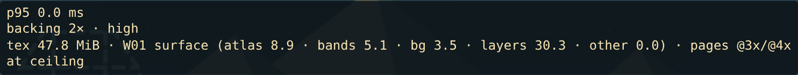

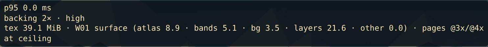

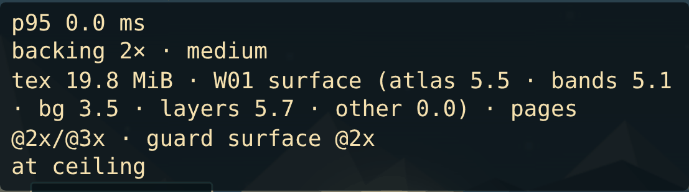

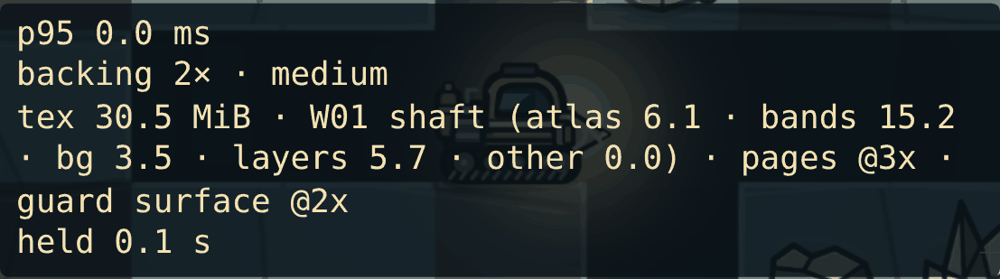

**The budget guard** (decisions.md D1, "Budget guard"; its budget and ratchet come from the review fixes):
- **What it does.** When the planned pages would take the projected resident bytes over the form's §7 budget, non-hero zones step down to @2x, the largest saving first, until they fit or none is left. Hero pages keep their D1 density. A form over its budget even then keeps those fewest bytes, and the readout adds `over §7`.
- **A ratchet.** A step lasts for the session in that world, render tier and D1 density, so densities never step back up mid-play: a descent and a climb load each page at most once per density.
- **Which budget.** The form is F1's render tier as F1 decides it (High needs a fine pointer). High has the desktop's 64 MiB. Medium and Low have the phone's 20 MiB at boot, which is at the dock until the rig first leaves it (render-memory's boot sample), and 40 MiB everywhere else, the dock included once the rig has left it.
- **What the projection counts:**
  - the retained terrain, sized exactly as `render/terrain.ts` sizes it (now one pure function, `layout.ts retainedTerrainGrid`);
  - the light map, plus 0.25 MiB for small canvases;
  - the band pages (5.06 MiB per band) and the sky and ridges (3.5 MiB) for the rig's position;
  - the planned pages.
- **When it decides.** The same way in `preload()` and in play, so boot does not load one density and then swap.
- **Where it acts in the measured forms.** Not on the CI forms (desktop 1440 × 900 @2, phone 393 × 851 @3). On the phone with `?tile=56` it holds the surface's other page at @2x from boot for the W01 session (19.79 MiB at boot, 30.46 at W01 row 18). The Canvas desktop (Low tier, so the phone's budgets) and a coarse 1366 × 1024 @2 tablet (Medium) are over those budgets even at @2x, because of their retained terrain (19.5 and 17.5 MiB), so every non-hero zone stays @2x for the session: the Canvas desktop holds 33.28 MiB at boot and 43.64 at W01 row 18 (WebGL's 34.89 and 45.57), the tablet 30.93 and 41.29, both with `over §7` in the readout at boot and in band B.

**`?tile=N`** is debug only, part of `renderDebugOptions` next to `?backing=`. It sets the base tile in CSS px (32–160) in place of `campaignTileSize()`, for the scene, the retained terrain and the page choice. It previews D1's option B before T11. Without it nothing changes.

**The build-stage projection.** It gave 5.45 MiB of atlas at the desktop surface; the game measures 6.44. The difference is the next lander stage's page (0.84 at @3x), which the runtime stage prefetches so that finishing a construction never waits for a page, and the shaft page (0.14).

## Resident texture bytes, before and after

**How they were read.** `zone-runtime.mjs resident` follows `scripts/render-memory.mjs`'s procedure:
- WebGL (`?renderer=webgl`), a frozen clock, reduced motion and Render quality 2;
- the fixtures `tests/fixtures/improvement-{w01,w02}.json`, with the rig moved to the named row and its column dug;
- `data-resident-texture-bytes` read once five samples agree.

**Before** is item 1's tip, `1a0b5db`, served from a private copy. Its readout has no `tex` line, so its bytes come from `data-resident-texture-bytes`. Its groups come from Phaser's TextureManager list, through a read-only hook on the `Phaser.Game` constructor, sorted into the readout's groups; the list adds up to the dataset value, and the script asserts that.

**After** is this item, read three ways: the F1 readout (`?debug=frametime`), `data-resident-texture-groups` and `__campaignDebug.textures()`.

**The stages:**
- boot: the surface zone, at the dock;
- W01 row 18: band B, the shaft;
- W01 row 43: band C, the cave zone;
- W02 row 26: band B.

Both runs were repeated on the evidence commit, every value equal to the runtime stage's. The "after" run was repeated again on the review-fix tree: 19 of the 20 samples are byte for byte the same, and `phone-tile56` at W01 row 18 holds 30.46 MiB instead of 31.36, because the guard's surface step from boot now lasts for the session ("Review fixes"); its readout, and the cave's, now end in `guard surface @2x`. MiB = decoded RGBA at 4 bytes per pixel. `resident-before.json` and `resident-after.json` hold every sample, with each texture's key, bytes, group, zone and density. `resident-table.py` prints the per-form tables below from them. `f1/` holds the 20 readouts.

| form | device px per tile → pages | boot (surface) | W01 row 18 | W01 row 43 (cave) | W02 row 26 | §7 gate |
|---|---|---|---|---|---|---|
| desktop 1440 × 900 @2, before | quality 3 (pointer test) | 45.46 | 55.58 | 55.58 | 63.33 | 64 |
| desktop 1440 × 900 @2, after | 130.9 → @3x | **34.89** | **45.57** | **38.77** | **45.03** | 64 |
| phone 393 × 851 @3, before | @2x (coarse pointer) | 19.24 | 29.37 | 29.37 | 31.62 | 20 / 40 |
| phone 393 × 851 @3, after | 88 → @2x | **16.84** | **27.19** | **22.10** | **27.01** | 20 / 40 |
| desktop 1728 × 1117 @2, before | quality 3 | 55.87 | 66.00 ✗ | 66.00 ✗ | 73.75 ✗ | 64 |
| desktop 1728 × 1117 @2, after | 157.1 → hero @4x, rest @3x | **47.76** | **58.43** | **50.56** | **58.42** | 64 |
| desktop 1440 × 900 @2, `?tile=82`, after | 164 → hero @4x, rest @3x | **39.09** | **49.77** | **41.89** | **49.75** | 64 |
| phone 393 × 851 @3, `?tile=56`, after | 112 → @3x; the guard keeps the surface's other page at @2x from boot for the W01 session | **19.79** (20.69 without the guard) | **30.46** | **24.57** | **30.83** | 20 / 40 |

### By group

Per form, per stage and per readout group, before → after (MiB):
- **atlas pages:** before, the legacy pages; after, the zone pages, by world, zone and density;
- **band pages:** the band material pages;
- **sky and ridges:** the streamed backgrounds;
- **layers:** the retained terrain, the light map and T1-lite;
- **other:** gradients, glints and Phaser's defaults.

The "pages after" row is `data-atlas-density` (the other pages' density / the hero pages' density) with the guard's zones. The forms with `?tile=` have no "before", because the override does not exist on `1a0b5db`.

**desktop 1440 × 900 @2**

| group | boot (surface) | W01 row 18 (shaft) | W01 row 43 (cave) | W02 row 26 (shaft) |
|---|---|---|---|---|
| atlas pages | 17.00 → **6.44** | 17.00 → **6.98** | 17.00 → **3.69** | 24.75 → **6.45** |
| atlas by world, zone and density | W01 @2x 5.50 + W01 @3x 11.50 → W01 core 3.00 @3x; W01 shaft 0.14 @3x; W01 surface 3.30 @3x | W01 @2x 5.50 + W01 @3x 11.50 → W01 cave 0.55 @3x; W01 core 3.00 @3x; W01 shaft 0.14 @3x; W01 surface 3.30 @3x | W01 @2x 5.50 + W01 @3x 11.50 → W01 cave 0.55 @3x; W01 core 3.00 @3x; W01 shaft 0.14 @3x | W01 @2x 5.50 + W01 @3x 11.50; W02 @2x 2.25 + W02 @3x 5.50 → W01 cave 0.55 @3x; W01 core 3.00 @3x; W02 cave 0.06 @3x; W02 core 0.97 @3x; W02 surface 1.88 @3x |
| band pages | 5.06 → **5.06** | 15.19 → **15.19** | 15.19 → **15.19** | 15.19 → **15.19** |
| sky and ridges | 3.50 → **3.50** | 3.50 → **3.50** | 3.50 → **0.00** | 3.50 → **3.50** |
| layers (terrain, light map, T1-lite) | 19.86 → **19.86** | 19.86 → **19.86** | 19.86 → **19.86** | 19.86 → **19.86** |
| other | 0.03 → **0.03** | 0.03 → **0.03** | 0.03 → **0.03** | 0.03 → **0.03** |
| **total** | 45.46 → **34.89** | 55.58 → **45.57** | 55.58 → **38.77** | 63.33 → **45.03** |
| §7 limit (MiB) | 64 | 64 | 64 | 64 |
| pass | pass → pass | pass → pass | pass → pass | pass → pass |
| pages after (data-atlas-density: other / hero; guard) | @3 | @3 | @3 | @3 |

**phone 393 × 851 @3 (touch)**

| group | boot (surface) | W01 row 18 (shaft) | W01 row 43 (cave) | W02 row 26 (shaft) |
|---|---|---|---|---|
| atlas pages | 5.50 → **3.09** | 5.50 → **3.33** | 5.50 → **1.73** | 7.75 → **3.14** |
| atlas by world, zone and density | W01 @2x 5.50 → W01 core 1.44 @2x; W01 shaft 0.06 @2x; W01 surface 1.59 @2x | W01 @2x 5.50 → W01 cave 0.23 @2x; W01 core 1.44 @2x; W01 shaft 0.06 @2x; W01 surface 1.59 @2x | W01 @2x 5.50 → W01 cave 0.23 @2x; W01 core 1.44 @2x; W01 shaft 0.06 @2x | W01 @2x 5.50; W02 @2x 2.25 → W01 cave 0.23 @2x; W01 core 1.44 @2x; W02 cave 0.06 @2x; W02 core 0.50 @2x; W02 surface 0.91 @2x |
| band pages | 5.06 → **5.06** | 15.19 → **15.19** | 15.19 → **15.19** | 15.19 → **15.19** |
| sky and ridges | 3.50 → **3.50** | 3.50 → **3.50** | 3.50 → **0.00** | 3.50 → **3.50** |
| layers (terrain, light map, T1-lite) | 5.15 → **5.15** | 5.15 → **5.15** | 5.15 → **5.15** | 5.15 → **5.15** |
| other | 0.03 → **0.03** | 0.03 → **0.03** | 0.03 → **0.03** | 0.03 → **0.03** |
| **total** | 19.24 → **16.84** | 29.37 → **27.19** | 29.37 → **22.10** | 31.62 → **27.01** |
| §7 limit (MiB) | 20 | 40 | 40 | 40 |
| pass | pass → pass | pass → pass | pass → pass | pass → pass |
| pages after (data-atlas-density: other / hero; guard) | @2 | @2 | @2 | @2 |

**desktop 1728 × 1117 @2 (@4x proof, real viewport)**

| group | boot (surface) | W01 row 18 (shaft) | W01 row 43 (cave) | W02 row 26 (shaft) |
|---|---|---|---|---|
| atlas pages | 17.00 → **8.89** | 17.00 → **9.44** | 17.00 → **5.06** | 24.75 → **9.42** |
| atlas by world, zone and density | W01 @2x 5.50 + W01 @3x 11.50 → W01 core 1.12 @3x + 3.25 @4x; W01 shaft 0.14 @3x; W01 surface 1.75 @3x + 2.62 @4x | W01 @2x 5.50 + W01 @3x 11.50 → W01 cave 0.55 @3x; W01 core 1.12 @3x + 3.25 @4x; W01 shaft 0.14 @3x; W01 surface 1.75 @3x + 2.62 @4x | W01 @2x 5.50 + W01 @3x 11.50 → W01 cave 0.55 @3x; W01 core 1.12 @3x + 3.25 @4x; W01 shaft 0.14 @3x | W01 @2x 5.50 + W01 @3x 11.50; W02 @2x 2.25 + W02 @3x 5.50 → W01 cave 0.55 @3x; W01 core 1.12 @3x + 3.25 @4x; W02 cave 0.06 @3x; W02 core 0.22 @3x + 1.31 @4x; W02 surface 0.47 @3x + 2.44 @4x |
| band pages | 5.06 → **5.06** | 15.19 → **15.19** | 15.19 → **15.19** | 15.19 → **15.19** |
| sky and ridges | 3.50 → **3.50** | 3.50 → **3.50** | 3.50 → **0.00** | 3.50 → **3.50** |
| layers (terrain, light map, T1-lite) | 30.28 → **30.28** | 30.28 → **30.28** | 30.28 → **30.28** | 30.28 → **30.28** |
| other | 0.03 → **0.03** | 0.03 → **0.03** | 0.03 → **0.03** | 0.03 → **0.03** |
| **total** | 55.87 → **47.76** | 66.00 → **58.43** | 66.00 → **50.56** | 73.75 → **58.42** |
| §7 limit (MiB) | 64 | 64 | 64 | 64 |
| pass | pass → pass | **over** → pass | **over** → pass | **over** → pass |
| pages after (data-atlas-density: other / hero; guard) | @3/4 | @3/4 | @3/4 | @3/4 |

**desktop 1440 × 900 @2, `?tile=82` (@4x proof, D1 option B)**

| group | boot (surface) | W01 row 18 (shaft) | W01 row 43 (cave) | W02 row 26 (shaft) |
|---|---|---|---|---|
| atlas pages | — → **8.89** | — → **9.44** | — → **5.06** | — → **9.42** |
| atlas by world, zone and density | — → W01 core 1.12 @3x + 3.25 @4x; W01 shaft 0.14 @3x; W01 surface 1.75 @3x + 2.62 @4x | — → W01 cave 0.55 @3x; W01 core 1.12 @3x + 3.25 @4x; W01 shaft 0.14 @3x; W01 surface 1.75 @3x + 2.62 @4x | — → W01 cave 0.55 @3x; W01 core 1.12 @3x + 3.25 @4x; W01 shaft 0.14 @3x | — → W01 cave 0.55 @3x; W01 core 1.12 @3x + 3.25 @4x; W02 cave 0.06 @3x; W02 core 0.22 @3x + 1.31 @4x; W02 surface 0.47 @3x + 2.44 @4x |
| band pages | — → **5.06** | — → **15.19** | — → **15.19** | — → **15.19** |
| sky and ridges | — → **3.50** | — → **3.50** | — → **0.00** | — → **3.50** |
| layers (terrain, light map, T1-lite) | — → **21.61** | — → **21.61** | — → **21.61** | — → **21.61** |
| other | — → **0.03** | — → **0.03** | — → **0.03** | — → **0.03** |
| **total** | — → **39.09** | — → **49.77** | — → **41.89** | — → **49.75** |
| §7 limit (MiB) | 64 | 64 | 64 | 64 |
| pass | — → pass | — → pass | — → pass | — → pass |
| pages after (data-atlas-density: other / hero; guard) | @3/4 | @3/4 | @3/4 | @3/4 |

**phone 393 × 851 @3, `?tile=56` (phone @3x proof, D1 option B)**

| group | boot (surface) | W01 row 18 (shaft) | W01 row 43 (cave) | W02 row 26 (shaft) |
|---|---|---|---|---|
| atlas pages | — → **5.53** | — → **6.08** | — → **3.69** | — → **6.45** |
| atlas by world, zone and density | — → W01 core 3.00 @3x; W01 shaft 0.14 @3x; W01 surface 0.84 @2x + 1.55 @3x | — → W01 cave 0.55 @3x; W01 core 3.00 @3x; W01 shaft 0.14 @3x; W01 surface 0.84 @2x + 1.55 @3x | — → W01 cave 0.55 @3x; W01 core 3.00 @3x; W01 shaft 0.14 @3x | — → W01 cave 0.55 @3x; W01 core 3.00 @3x; W02 cave 0.06 @3x; W02 core 0.97 @3x; W02 surface 1.88 @3x |
| band pages | — → **5.06** | — → **15.19** | — → **15.19** | — → **15.19** |
| sky and ridges | — → **3.50** | — → **3.50** | — → **0.00** | — → **3.50** |
| layers (terrain, light map, T1-lite) | — → **5.66** | — → **5.66** | — → **5.66** | — → **5.66** |
| other | — → **0.03** | — → **0.03** | — → **0.03** | — → **0.03** |
| **total** | — → **19.79** | — → **30.46** | — → **24.57** | — → **30.83** |
| §7 limit (MiB) | 20 | 40 | 40 | 40 |
| pass | — → pass | — → pass | — → pass | — → pass |
| pages after (data-atlas-density: other / hero; guard) | @2/3 · guard surface | @3 · guard surface | @3 · guard surface | @3 |

**Where the savings come from.** The desktop atlases fall from 17.00 MiB (24.75 in W02) to 3.69–6.98, for four reasons:
- the @2x page is no longer resident beside the @3x one;
- terrain and DOM frames are off the pages;
- the lander is resident one stage at a time, plus the next;
- the cave zone drops the surface pages and the sky and ridges (3.5 MiB).

The 1728 × 1117 desktop went over 64 MiB at three of four stages before. It now fits at all four, with the @4x hero pages. Two groups do not change at all. The band pages are not part of T13b. The layers group (the retained terrain, 19.5 MiB on desktop at backing 2) is now the largest, and T2's GPU terrain removes it (§7).

**What the metric still does not see.** This is unchanged by this item; see audit §7, "The memory metric must change". Phaser 3.90 tile sprites draw from their own power-of-two copy of their texture. So while they show, the sky and the two ridges hold about another 4.5 MiB outside the TextureManager: 512 × 256 for the sky and 1024 × 512 for each ridge. In bands C and D they now point at Phaser's 32 px default, so that copy is freed along with the textures.

### F1 readouts

`f1/<form>-<stage>.png` is the readout cropped from the screen, for every form and stage above:
- forms: `desktop`, `phone`, `desktop-1728`, `desktop-tile82`, `phone-tile56`;
- stages: `boot`, `W01`, `cave`, `W02`.

The readout's line is `tex <total> MiB · <world> <zone> (atlas · bands · bg · layers · other) · pages @<other>/@<hero>[ · guard <zones> @2x][ · over §7]`. `phone-tile56-W01` and `phone-tile56-cave` were refreshed by the review fixes; the other 18 are the evidence commit's. Its zone is where the rig is: surface (band A, row ≤ 1), shaft (bands A–B) or cave (bands C–D). The surface and cave zones on the two CI forms:

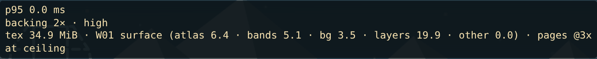

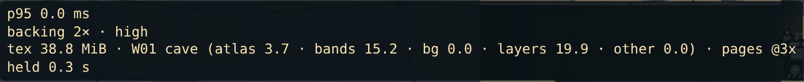

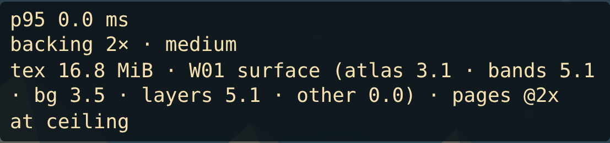

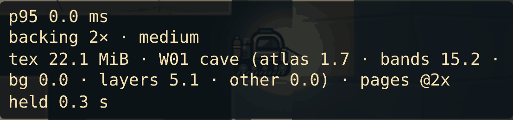

### Cross-world frames

`zone-runtime.mjs crossworld` (desktop 1440 × 900 @2, so @3x pages) imports 57 positions with every cell known and records which page drew each sprite and every `image()` miss: W01 at row 18 with W02 hardware (every upgrade at level 2, the thermal auger equipped), both surfaces, the site rows of a new generator-v2 W01 campaign (rows 8 to 59, three columns each), and the site and hazard rows of both improvement fixtures (W01 8–59, W02 12–99, two columns each). **No frame missed a page at any position.** What drew from where:

| drawn in | frames | page |
|---|---|---|
| W02 | the rig: `rig-body-*`, `rig-cabin`, `rig-drill-*`, `rig-*-0`, `rig-damage-*`; `site-wreck` | `campaign-w01-core-hero-3x-0` |
| W02 | `cold-pocket`, `surface-salvage`, `warning-shelf`, `site-survey`, `site-mission`, mission markers | `campaign-w01-core-3x-0` |
| W02 (cave bands) | `site-core`, `site-geode`, `site-cache`, `pressure-seam` | `campaign-w01-cave-3x-0` |
| W02 | `ice-vent` (never drawn before T13b: the old prefix filter dropped it) | `campaign-w02-cave-3x-0` |
| W02 | `dock-stage-0`, `sky-body` | `campaign-w02-surface-stage0-3x-0`, `campaign-w02-surface-3x-0` |
| W01 with W02 hardware | `rig-engine-2`, `rig-energy-2`, `rig-bay-2`, `rig-hull-2`, `rig-drill-collar-right-2`, `tool-thermal` | `campaign-w02-core-hero-3x-0` |
| both | `ore-*`, `package-*`, `relic` | each world's own core hero page |
| both | `deposit-socket` (W02 has none of its own) | `campaign-w01-core-hero-3x-0` |

One finding fixed on the way: `scene.ts` drew every known pressure seam each frame, on screen or not. With the old single page that cost only pooled sprites; with zone pages an off-screen seam in band D asked for the cave page while the rig was in band A. Seams now draw only within a tile of the view, like vents and sites; their warning ring and label are unchanged.

## Captures

**How they were made.** `captures.mjs` was run in a private copy of each tree: Chrome 156, `ART_BACKING=2`, a frozen scene clock and HUD-free frames.
- `a04-dive-60m@2`, its 60 m phone twin `a04p-dive-60m-phone@3` and the `a02` spawn go through `scripts/art-captures.mjs`.
- The W02 vent scene is set up by the script itself.

`captures.py` builds the sheets in `captures/` and writes the measures to `captures/captures.json`. **Before** is `1a0b5db`: Chromium renders on the legacy pages. **After** is this item: resvg renders on the zone pages. The script asserts that both runs framed every scene the same way.

| capture | form | pages after | pixels changed | by more than 8 levels (outside the rig box) | max outside the rig box | changed by 1–2 levels |
|---|---|---|---|---|---|---|
| `a04-dive-60m@2` | 1440 × 900 @2 | @3x | 537,390 (10.4 %) | 1,510 (499) | 45 | 98.3 % |
| `a04p-dive-60m-phone@3` | 393 × 851 @3 | @2x | 288,410 (9.6 %) | 1,692 (301) | 26 | 97.2 % |
| `a02-spawn-1440x900@2` | 1440 × 900 @2 | @3x | 241,414 (4.7 %) | 691 (408) | 42 | 95.8 % |

**Every frame still renders.** Each sheet stacks three panels: before, after, and the pixels that changed, drawn over the dimmed after frame (amber for 1 to 8 levels, magenta for more).
- **What changed** is anti-aliasing, as "Reproducible rasterizer" measures: the band pages' cracks and seams (their maximum seam went from 2 to 0), sprite edges, the stars, and the sky body's rim.
- **The magenta**, outside the rig, is on sprite outlines.
- **No sprite is missing or moved.** The rig's tread is up to one device pixel taller, from the baseline fix.

`captures/sprites-3x.png` puts each known deposit, the rig and a02's lander side by side, before above after, magnified with nearest-neighbour sampling.

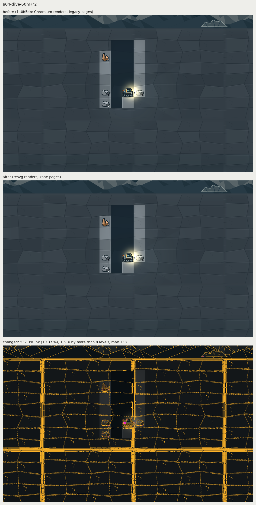

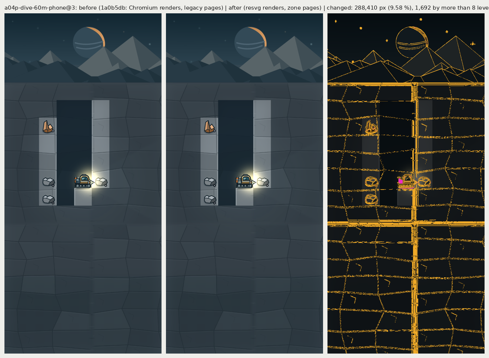

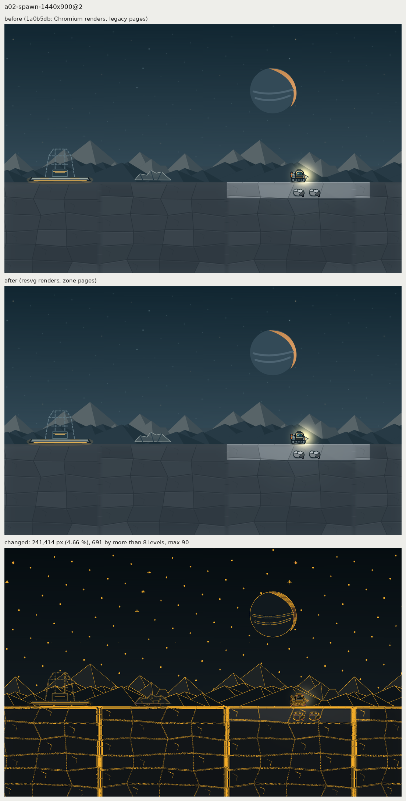

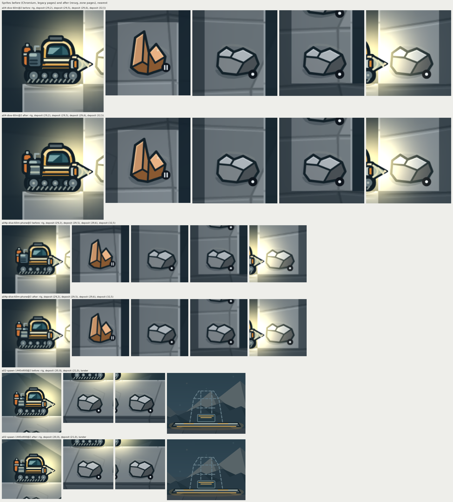

### A draw-order bug the captures found (predates this item; not fixed here)

**The symptom.** In a04 and a04p, the largest change sits on the rig's rear module. It is not an art change. The frames match within anti-aliasing: comparing the old @3x legacy page with the new core hero page, `rig-engine-0`, `rig-energy-0` and `rig-bay-0` differ by a mean of 0.012 to 0.020 levels.

**The cause.**
- `render/rig.ts` draws `rig-engine-*`, `rig-energy-*` and `rig-bay-*` at the same depth, 21; `rig-cabin` and `rig-hull-*` share 22; the tools, drill and collars share 23. The engine box and the bay box overlap.
- Phaser 3.90's `DisplayList.depthSort` runs a stable sort on the current list. So sprites at the same depth keep the previous frame's order, which depends on which pooled sprites held which depths earlier.
- So same-depth order is not call order.

**Evidence.** Both orders show up in each tree (`captures/rig-layer-order.png`):
- `1a0b5db`'s art-captures run shows the engine over the bay; a fresh page of the same tree shows the bay over the engine;
- this item's art-captures run shows the bay on top; a new page that showed a02 first shows the engine on top.
- The order can also flip in play, when the number of sprites drawn before the rig changes.

**Why it is not fixed here.**
- It predates T13b.
- It lives in `render/rig.ts`, which item 3 reworks.
- Fixing it also means choosing an art order: call order puts the bay over the engine and the hull over the cabin.

**What item 3 should do.** Give overlapping rig layers distinct depths (kit README, "Adding a rig frame at @4x, with its sibling"). Done in A13: every rig layer has its own depth (`src/campaign/render/rig-layers.json`), and `docs/qa/a13-rig-shading/determinism.json` shows the stack unchanged after six warm-ups on both renderers ("Layer depths" in that README).

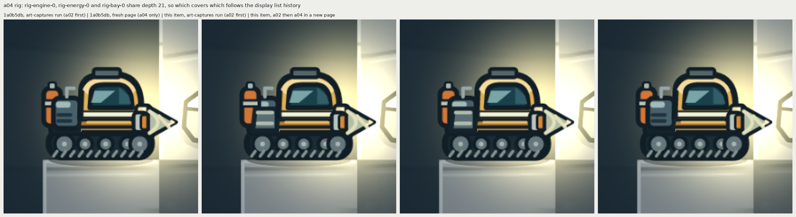

### W02 ice vent, now drawn

**The scene.** `captures.mjs` sets it up in the W02 improvement fixture:
- the vent at (8.5, 48.5), band C;
- the rig on the floor of the vent's cave three cells to its right, with its shaft dug from the surface;
- the cells round the vent known (the game draws a vent only in a known cell).

**Before**, the vent's cell shows only band rock. The legacy filter, `split('-')[0] in (…, 'ice', …)`, dropped `ice-vent` from the runtime pages, so `scene.ts`'s `this.image("ice-vent", …)` returned false.

**After**, the vent marker is drawn:
- from `campaign-w02-cave-3x-0` on desktop and `campaign-w02-cave-2x-0` on the phone (`__campaignDebug.drawnFrames()`, in `captures.json`);
- on desktop, 7,486 of the 18,769 pixels in the vent's cell change, 3,866 of them by more than 32 levels;
- on the phone, 8,799 of 19,321 change, 4,043 by more than 32 levels.

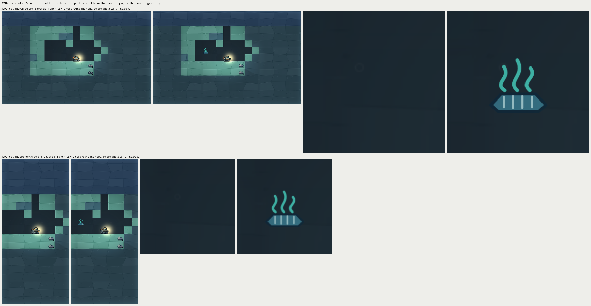

### The beacon's emissive lamp, underground

The beacon sheets in `emissive/` show the lamp drawn with the bases alone (`?debug=no-emissive`) and with the ADD pass:
- on WebGL and Canvas, desktop and phone;
- with every cell known, and with the cell above the lamp unknown.

They are in "Emissive convention and its cost" below. The beacon is at W01 row 9, underground in band A.

## Emissive convention and its cost

Part (a) of the item: a frame `<base>-emissive` holds only its base's lit parts, lit; the base draws them unlit; the game draws the sibling with ADD above the darkness at the base's place. The convention (authoring, packing, depth, blend, budget, hidden information) is written up for item 3 and every later lit prop in `assets/campaign/kit/README.md`, "Emissive siblings at runtime". T1-lite's radial headlamp core (`render/t1-lite-headlamp.ts`) stays separate until T1.

### What was built

- **The first sibling: the survey beacon's lamp** (`mission-beacon`, W01 row 9, drawn at depth 15 under the light map). `create-w01-sources.mjs` now describes the beacon with the kit's `emissivePair`: the mast and pennant, the lamp head, the signal arcs. The base draws the lamp's glass with the power off (`#4b4336`); `mission-beacon-emissive` holds only the glass inside the outline (r 6.5 of the r 8 circle with its 3-unit stroke), lit with `#f6e1af − #4b4336 = #ab9e79`. Off + lit is the old fill, so where nothing darkens it the beacon looks as before (below). Only the lamp is lit: the orange pennant is a painted flag, not a light, and the arcs are a radio symbol. The beacon was the suggested candidate and is the right one: it already draws a light source, and it is underground, where the darkness is. W02 has no beacon, so W02's pages are unchanged.
- **Pages.** The zone function already gives a sibling its base's zone, page set and page (stage 2), so the sibling sits on `campaign-w01-core-hero-{2,3,4}x-0` beside the beacon at all three densities. It fit in the pages' free space: **no page changed size**, so resident bytes are unchanged to the byte (render-memory below). The world build skips the sibling's DOM icon and draws `icons/mission-beacon-{64,128}.png` lit (nothing reads them today).
- **Runtime** (`src/campaign/render/emissive.ts`, new; `scene.ts`). `image()`, after the device-pixel snap, queues the base sprite when its manifest has `<frame>-emissive` and the resolved page holds it. After the rig (the frame's last sprites) and T1-lite, `EmissivePass.draw()` copies each queued base's final state onto a sprite from its own pool: page, position, origin, scale, flip, rotation, alpha and mask, read after the callers' `setMask(wreckMask)`. Blend ADD (WebGL `ONE, DST_ALPHA`; Canvas `lighter`). Depth 17.6 for every base below 18 (above the light map at 17 and T1-lite at 17.5, so the sibling joins T1-lite's ADD run), the base's depth + 0.05 for rig layers (18–23). The pool is hidden at the start of every frame, so a sibling exists only while its base is drawn. Nothing varies with time.
- **Masks without the stencil cost where they change nothing.** A base under the wreck mask (known cells: wrecks and POI markers) passes the mask on, unless every cell under the sibling's drawn (trimmed) box is known: there the mask would pass every pixel anyway, so the sibling draws unmasked in the ADD run. The box mirrors Phaser's batcher (`spriteBounds`: trimmed rect about the display origin, flip, scale, rotation); the cells are those the mask fills (`row < world.rows`, `isKnown`).
- **Debug.** `?debug=no-emissive` (`renderDebugOptions`, beside `?backing=`, `?tile=`) draws the bases alone, for the comparisons below; without it nothing changes. `__campaignDebug.emissives()` lists the siblings drawn this frame with the base each copied; `data-emissive-sprites` counts them.
- **Checks.** `check-campaign-assets.mjs` already failed a sibling without a same-size base in the same world on the same page at every density (stage 2, D-g); it now also fails one whose page JSON gives it another source size or pivot than its base (the runtime copies the base's scale and origin). Both breakages (source size +1, pivot changed) were made in a scratch copy and failed with the right message.
- **Tests.** New `tests/campaign-emissive.test.mjs` (12 tests): every sibling in both manifests pairs with a same-size base on the same page, with the same source size and pivot in each page JSON and lit pixels on the page; depths (17.6 above 17 and 17.5, below 18; rig + 0.05, below 24); the pass draws a sibling only for a base drawn (queued) this frame, hides it the next frame, skips a base hidden before the pass and everything when disabled; it copies the base's final state (after a later `setMask` and move) and leaves the base's blend mode and depth alone; the mask is dropped only where `maskNeeded` says so; over four frames of growing counts no pooled sprite is ever a base sprite; the scene queues after the snap (never on a miss), begins with the frame reset, draws after the rig, builds the pool from `this.add.image` and never sets a blend mode on a base. `tests/campaign-zones.test.mjs`: two stage-2 tests assumed no real sibling existed (a stand-in beacon sibling; `HERO.test(name)` on @4x pages) and now use the real one and `isHero()`. `tests/campaign-view.test.ts` gains the `emissive` debug key.

### The beacon, frame by frame

`emissive-frames.py` composites the new base and sibling as the ADD pass does in full light and compares them with the single frame of `3929c6e` (the tree before the split), premultiplied:

| density | page | differing px (of opaque) | max | mean over the frame | outside the lamp |
|---|---|---|---|---|---|
| @2x | campaign-w01-core-hero-2x-0 | 36 (1550) | 33 | 0.050 | 0 px |
| @3x | campaign-w01-core-hero-3x-0 | 58 (3455) | 43 | 0.041 | 0 px |
| @4x | campaign-w01-core-hero-4x-0 | 66 (6009) | 10 | 0.010 | 0 px |

The differing pixels are the glass's antialiased rim, where the lit disc's coverage and the outline's do not quite add up to one.

### In the game: draws, bytes and hidden information

`emissive-runtime.mjs` (frozen clock, reduced motion, Render quality 2) imports two W01 scenes with the rig two cells right of the beacon and captures each with the ADD pass and with `?debug=no-emissive`, on WebGL and Canvas, desktop 1440 × 900 @2 and phone 393 × 851 @3, high contrast off and on:

- **lit**: the beacon in an open cell, every cell under the lamp known: the sibling draws unmasked;
- **masked**: the beacon buried and the cell above it unknown: the lamp straddles that cell, so the sibling keeps the wreck mask.

It asserts in every run that the sibling copies its base's page, position, origin, size, flip, rotation and alpha, draws ADD (blend 1) at 17.6 while the base stays NORMAL (0) at 15, is masked only in the masked scene, and is absent with `?debug=no-emissive`. The same script on `3929c6e` gives the "before" column (one frame, no pass). `emissive-pairs.py` reads both runs:

| renderer | form | HC | WebGL draws, lit scene: bases alone → ADD | masked scene: bases alone → ADD | before | lamp px the pass adds (max / mean level) | vs before: lamp mean / rim px / elsewhere px | unknown cell changed by the pass |
|---|---|---|---|---|---|---|---|---|
| WebGL | desktop | off | 6 → 6 | 6 → 8 | 6 | 575 (171 / 121.6) | +3.5 / 3 / **0** | **0 px** |
| WebGL | desktop | on | 6 → 6 | 6 → 8 | | 575 (171 / 121.6) | | **0 px** |
| WebGL | phone | off | 6 → 6 | 6 → 8 | 6 | 713 (171 / 100.9) | +3.5 / 0 / **0** | **0 px** |
| WebGL | phone | on | 6 → 6 | 6 → 8 | | 712 (171 / 101.0) | | **0 px** |
| Canvas | desktop | off | | | | 553 (171 / 126.5) | +4.4 / 25 / **0** | **0 px** |
| Canvas | desktop | on | | | | 553 (171 / 126.5) | | **0 px** |
| Canvas | phone | off | | | | 691 (171 / 104.1) | +3.6 / 19 / **0** | **0 px** |
| Canvas | phone | on | | | | 691 (171 / 104.1) | | **0 px** |

- **Draw calls.** With the lamp in T1-lite's ADD run the pass costs **+0** WebGL draws (6 → 6); when it must keep the wreck mask, **+2** (the stencil pass and the masked run: 6 → 8). Limits: 12 desktop, 10 phone. The 6 itself is not new: the masked beacon marker already costs 3 draws over the 3 of an open shaft (`render-acceptance.mjs`'s fixtures, still 3: they have no sibling on screen). High contrast changes no count.
- **Look.** Outside the lamp's rim the frame is the old one, pixel for pixel, on both renderers. In the lamp the frame is now 3.5 to 4.4 levels brighter on average than before: the light map no longer darkens the lit glass (band A darkens visible cells by 0.04, so the gain is small here; it grows in deeper bands and with T1's darkness). The bases alone show the dark glass: 553 to 713 pixels, up to 171 levels, are the pass's.
- **Hidden information.** In the masked scene the unknown cell above the beacon (inset 2 CSS px) is identical with and without the pass on every renderer, form and contrast. The fog check and `render-acceptance.mjs`'s hidden-geology crops pass (Verification).
- **Bytes.** Resident texture bytes at the beacon are the same before and after (desktop WebGL 41,896,756; phone 22,961,456), and render-memory gives stage 3's numbers: the sibling fits in the core hero pages as they were.

Each sheet: before (one frame) | bases alone (`?debug=no-emissive`) | lit (ADD) | masked scene, bases alone | masked scene, lit, with the unknown cell outlined in red.

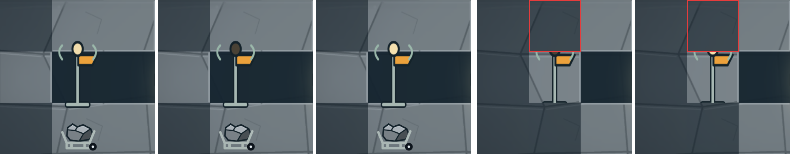

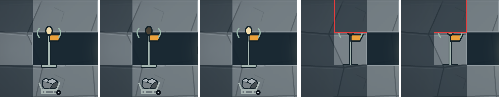

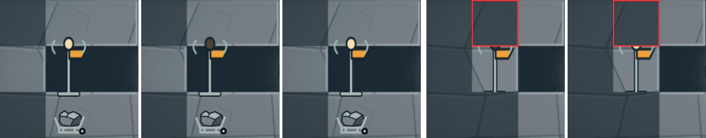

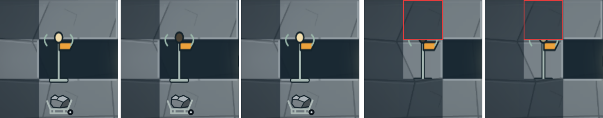

`emissive/emissive.json` holds the measures, `emissive/samples-after.json` and `samples-before.json` the runs (draws, bytes, pages, the siblings with their bases).

## Reproducible rasterizer

### What changed

- **Rasterizer.** `scripts/rasterize-campaign-svgs.mjs` renders every SVG frame with resvg (`@resvg/resvg-js`, pinned exactly at 2.6.2) instead of a Chromium screenshot. Each drawing is fitted to round(width × scale) px wide, with system fonts off (the sources draw no text), and the build stops if it does not come out round(height × scale) px tall. `rasterizeCampaignSources(source, output, manifest, scale)` keeps its signature, so both world builds, the band build, `assets/campaign/kit/review.mjs` and the A4 and A12 review drivers call it unchanged. The raster-source branch (T13a, Pillow Lanczos for `"source": "raster"` frames) stays, now saving its intermediate with fast compression. No browser is needed to build assets any more.
- **Canonical PNGs.** New `scripts/png-canonical.mjs` decodes any 8-bit PNG and writes it again in one fixed form: RGBA8, filter type 0 on every row, pako 2.1.0 (pinned exactly) deflate at level 9, windowBits 15, memLevel 8, default strategy, then IHDR, IDAT chunks of 65536 bytes and IEND, with no ancillary chunks. Each build ends by passing every PNG it wrote through it (`canonicalizePngs`, in worker threads; a file already canonical is not rewritten). The bytes therefore depend only on the pixels and on pako. They no longer depend on the machine's zlib (Pillow's bundled zlib-ng, Node 22's or Node 24's zlib), on Pillow's `optimize` pass, or on CPU-dependent SIMD paths. Pillow intermediates are saved with `compress_level=1`. All 263 generated PNGs are canonical: IHDR/IDAT/IEND only, RGBA8, filter 0 on every row, zlib header `78 da`.
- **Every writer of `assets/campaign`.** These scripts write the folder. `scripts/build-campaign-assets.mjs` writes W01's pages, icons, backgrounds, `w01-assets.json` and `provenance.json`. `scripts/build-frontier-assets.mjs` writes W02's pages, icons, backgrounds and `w02-assets.json`. `scripts/pack-campaign-atlas.py` writes the full and runtime pages at @2x and @3x, the page indexes and the runtime skies. `scripts/build-band-assets.mjs` writes the band SVGs and `bands/frames.json` (through `createBandSources()`), the 48 band pages and their manifest. `assets/campaign/source/create-w01-sources.mjs` writes W01's SVGs, `frames.json` and provenance records, and `assets/campaign/w02/create-sources.mjs` writes W02's SVGs, `frames.json` and `asset-map.json`. `assets/campaign/source/create-test-raster.py` is left out: its output is a committed source PNG, not a build product.
- **Dead writes removed.** The inline packers in both world builds wrote `w01-atlas.png/json` (2048 × 1664) and `w02-atlas.png/json`, which `pack-campaign-atlas.py` then overwrote at @2x. Nothing read them, so they are gone, along with the band build's Pillow RGBA re-save (the canonical encoder writes RGBA).
- **Provenance.** `provenance.json` and `w02-assets.json` now say `"renderer": "resvg 2.6.2 (@resvg/resvg-js)"`, and their packing strings name the canonical encoder. Both strings come from the installed packages' versions (`RASTERIZER`, `CANONICAL_PNG`).
- **`npm run assets:rebuild`** regenerates both worlds' sources, then runs the W01, W02 and band builds.
- **CI.** A new step in `checks.yml` job `verify` runs after the pinned `pip install Pillow==12.0.0 numpy==2.5.3`. It runs `npm run assets:rebuild` with `PYTHON=python3`, then fails when `git status --porcelain --untracked-files=all -- assets/campaign` is not empty. On failure it prints the changes and a diff stat and copies the changed files into `artifacts/asset-rebuild/`. The next step uploads them as the `rebuilt-campaign-assets` artifact. No browser is involved.
- **Test.** `tests/png-canonical.test.mjs` checks several things. It pins the golden SHA-256 of a fixed 3 × 2 RGBA image and of 256 × 256 seeded noise (so a pako bump fails it), and asserts that the installed pako is 2.1.0. It checks the chunk layout, and that decode(encode(px)) equals px. It checks that pixels written another way (Sub and Paeth rows, Node's zlib at level 1, split IDATs, gAMA and tEXt chunks, grey + alpha) canonicalize to the same bytes. Finally, it checks that `canonicalizePngs` rewrites only non-canonical files.
- **Packages.** `package.json` adds the devDependencies `@resvg/resvg-js` 2.6.2 and `pako` 2.1.0, both exact. `package-lock.json` adds `@resvg/resvg-js` with its 12 platform packages (each optional, with `os` and `cpu`) and `pako`. On linux x64, `npm ci` installs both the `-gnu` and `-musl` binaries, because the lock records no `libc`. The loader picks `resvgjs.linux-x64-gnu.node` on glibc (checked in `/proc/self/maps` after a fresh `npm ci`), which is the binary the local builds used (same SHA-256). The Dockerfile's `node:24-alpine` `npm ci` installs the musl binary and never runs it: the image build validates committed assets only.

### What the switch changes in the committed files

Nothing in the sources changes: every SVG, `frames.json`, `asset-map.json` and provenance record regenerates byte for byte. These outputs change:

- Every generated PNG changes in pixels (resvg anti-aliases edges one level differently) and in encoding. The exception is the raster-source frame `test-raster`, whose pixels stay identical because Pillow resamples it.
- 47 of the 856 trim rectangles on the eight atlas pages move by one pixel on one or two edges, because the packer trims on alpha > 0 and so follows the faintest anti-aliased pixel. The frames are `dock-stage-0..3` (both worlds, @2x), `ore-o1..o4`, `ui-warning`, `ui-cargo` and `ui-shop` (W01 @2x), the eight `site-*` frames (W01 @3x) and `ice-vent` (W02 @3x). No rig, thrust or tool frame moves, and every source size and pivot is unchanged.
- Page sizes do not change (2048 × 960, 2048 × 704, 2048 × 2048 and 2048 × 1472 for W01; 1024 × 1088, 1024 × 576, 2048 × 1280 and 2048 × 704 for W02), so the decoded MiB and the resident texture bytes do not change either. The two @2x page indexes list frames in a new order, because the packer sorts by trimmed size. `provenance.json` and `w02-assets.json` change only in the two provenance strings.

This commit holds only that switch, so later commits show only real art changes.

### Proofs

| # | What ran | What it covered | Result |
|---|---|---|---|
| 1 | `npm run assets:rebuild` twice in a row in the working checkout (Node 22.23.4, Pillow 12.3.0, `.cache/` deleted before each run) | SHA-256 of every file under `assets/campaign`: 610 files (generated pages, icons, band pages and manifests, provenance, every source SVG and JSON, the kit) | identical |
| 2a | The CI condition: a private copy of the tree, a fresh `npm ci` under Node 24.22.2 (npm 10.9.9), then `assets:rebuild` with `PYTHON` set to a venv holding exactly Pillow 12.0.0 (CI's pin), run through the exact CI step script extracted from `checks.yml` | that the committed bytes come back with CI's Node major, a fresh install and CI's Pillow | step exit 0; `git status --porcelain --untracked-files=all -- assets/campaign` empty |
| 2b | The same copy, the exact CI step with `PYTHON=python3` (Pillow 12.3.0) | that a newer local Pillow gives the same bytes | exit 0, empty status |
| 2c | The same copy after committing an encoding-only drift (`w01-atlas.png` re-saved by Pillow with `optimize=True`) | the step's failure branch | exit 1; prints ` M assets/campaign/generated/w01-atlas.png` and the diff stat; copies the file to `artifacts/asset-rebuild/`; `::error::` names the fix |
| 3 | Two `assets:rebuild` runs at the same time in two private copies, plus two busy-loop processes (load average 2.5 on 4 vCPU) | the T13a race: renders under load | both copies' 610 SHA-256 identical to each other and to proof 1 |
| 4 | Proof 2 again from `git archive` of the commit's tree, with a fresh `npm ci`, Node 24.22.2 and Pillow 12.0.0, then the exact CI step | that CI's rebuild equals the committed tree | exit 0 in 13.0 s; empty status |

These proofs cover one machine type (linux x64, glibc, 4-vCPU Xeon) and both Node majors and Pillow pins. Two things are not proven: that the resvg native binary on macOS or arm64 gives the same pixels as linux x64, and that another libm cannot flip a Lanczos coefficient. CI (ubuntu x64, glibc) is the arbiter. An author on another platform takes CI's bytes from the `rebuilt-campaign-assets` artifact when the step fails.

### Chromium vs resvg, frame by frame

`compare-renders.py` compares the committed PNGs with the last Chromium-built tree (item 1's tip, `1a0b5db`). Every frame of the full @2x and @3x atlas pages of both worlds is rebuilt at its source size from its trim rectangle, and every other generated PNG is compared whole: 803 items. Differences are measured on premultiplied RGBA. max is the largest channel difference (0 to 255). mean is the mean absolute channel difference over all pixels and channels. IoU is computed between the two alpha masks, at alpha ≥ 128 and at alpha > 0. Full data: `compare-renders.csv` and `compare-renders.json`.

| Set | items | identical | size mismatches | max diff | mean of means | worst mean (item) | IoU≥128 min / mean | IoU>0 min |
|---|---|---|---|---|---|---|---|---|
| W01 @2x frames | 179 | 0 | 0 | 115 | 0.159 | 1.156 (`ui-cooldown`) | 0.8418 (`bedrock-edge-4`) / 0.9760 | 0.9398 |
| W01 @2x frames (raster source) | 1 | 1 | 0 | 0 | 0.000 | 0.000 (`test-raster`) | 1.0000 / 1.0000 | 1.0000 |
| W01 @3x frames | 179 | 0 | 0 | 110 | 0.111 | 0.467 (`ui-cooldown`) | 0.9482 (`rig-damage-1`) / 0.9924 | 0.9616 |
| W01 @3x frames (raster source) | 1 | 1 | 0 | 0 | 0.000 | 0.000 (`test-raster`) | 1.0000 / 1.0000 | 1.0000 |
| W02 @2x frames | 94 | 0 | 0 | 95 | 0.196 | 0.848 (`mission-cryovein`) | 0.8418 (`bedrock-edge-4`) / 0.9681 | 0.9643 |
| W02 @3x frames | 94 | 0 | 0 | 101 | 0.138 | 0.421 (`mission-cryovein`) | 0.9652 (`frozen-rock-edge-4`) / 0.9940 | 0.9738 |
| band pages @2x | 24 | 0 | 0 | 16 | 0.095 | 0.117 (`w02-d-rock-2x`) | 1.0000 / 1.0000 | 1.0000 |
| band pages @3x | 24 | 0 | 0 | 16 | 0.080 | 0.093 (`w01-a-rock-3x`) | 1.0000 / 1.0000 | 1.0000 |
| W01 icons | 114 | 0 | 0 | 74 | 0.344 | 1.274 (`ui-cooldown-48`) | 0.9406 (`ui-cooldown-24`) / 0.9923 | 0.9464 |
| backgrounds (sky, ridges, runtime skies) | 9 | 0 | 0 | 63 | 0.015 | 0.023 (`w01-ridge-near`) | 0.0795 (`w01-sky`) / 0.7119 | 0.9916 |
| W02 icons | 84 | 0 | 0 | 210 | 0.320 | 3.381 (`w02-s3-icon-64`) | 0.9483 (`w02-s3-icon-64`) / 0.9927 | 0.9054 |

Selected frames (max / mean / IoU≥128 / IoU>0):

| frame | @2x page | @3x page |
|---|---|---|
| `ore-o1` | 47 / 0.306 / 0.9947 / 0.9940 | 63 / 0.243 / 0.9968 / 0.9958 |
| `ore-o3` | 53 / 0.512 / 0.9962 / 0.9949 | 50 / 0.309 / 0.9979 / 0.9963 |
| `package-o2` | 48 / 0.339 / 0.9758 / 0.9929 | 68 / 0.270 / 0.9970 / 0.9931 |
| `deposit-socket` (translucent) | 9 / 0.119 / 1.0000 / 0.9941 | 13 / 0.107 / 1.0000 / 0.9978 |
| `tier-mark-hc-1` | 50 / 0.101 / 0.9612 / 0.9643 | 49 / 0.067 / 0.9865 / 0.9879 |
| `rig-body-0` | 38 / 0.114 / 0.9791 / 0.9973 | 45 / 0.112 / 0.9991 / 0.9985 |
| `rig-drill-down-3` | 28 / 0.051 / 0.9764 / 0.9785 | 38 / 0.032 / 0.9962 / 0.9964 |
| `rig-cabin` | 58 / 0.105 / 0.9876 / 0.9988 | 72 / 0.075 / 0.9978 / 0.9962 |
| `ui-cooldown` | 115 / 1.156 / 0.9748 / 0.9633 | 74 / 0.467 / 0.9846 / 0.9874 |
| `sky-body` (the only W01 gradient) | 56 / 0.096 / 0.9984 / 0.9979 | 78 / 0.084 / 0.9982 / 0.9989 |
| `dock-stage-0` (dashes) | 70 / 0.092 / 0.9831 / 0.9963 | 110 / 0.091 / 0.9971 / 0.9960 |
| `stone-edge-5` (thin strip) | 43 / 0.193 / 0.9031 / 0.9964 | 41 / 0.135 / 0.9685 / 0.9928 |

`compare-worst.png` shows each set's item with the largest mean difference, one row each: Chromium, resvg, and the largest channel difference × 4. The rows, top to bottom, are `ui-cooldown` @2x and @3x, `mission-cryovein` (W02) @2x and @3x, `w01-a-rock-3x`, `w02-d-rock-2x`, `ui-cooldown-48` (icon), `w01-ridge-near` and `w02-s3-icon-64`. Every difference is a one-pixel anti-aliasing band on edges, the same finding as the scratch study before this item (identical numbers for the frames both measured). The low values have plain causes:

- `w01-sky` IoU≥128 of 0.08: its faint stars stay below alpha 128 in one renderer and cross it in the other. IoU>0 is 0.99.
- `bedrock-edge-4`, `frozen-rock-edge-4` and `stone-edge-5`: thin strips, where one pixel of edge is a large share of the mask.
- The W02 icons are cropped to their alpha bounding box before resizing, so a one-pixel bounding-box change moves the whole 64 px thumbnail by a pixel (`w02-s3-icon-64`: its top edge moved from y 18 to 17).
- The band pages tile better: `check-render-assets` reports a maximum seam of 0, against 2 on the Chromium pages.

resvg anti-aliasing is coarser, with fewer distinct edge colours, so shading tiers must be counted from SVG fills or with anti-aliased pixels excluded (as `scripts/art_tiers.py` and item 1's checks already do), never from unique colours in a render.

### Asset checks, before and after

`npm run assets:check` passes on both trees with every gate at its threshold:

| measure (gate) | Chromium (`1a0b5db`) | resvg |
|---|---|---|
| W01 material ΔE / ΔL (≥ 12 / ≥ 8) | ≥ 15.5 / ≥ 14.6 | ≥ 15.4 / ≥ 14.6 |
| W02 material ΔE / ΔL (≥ 12 / ≥ 8) | ≥ 21.3 / ≥ 19.4 | ≥ 21.2 / ≥ 19.4 |
| band pages: maximum seam (≤ 6); material ΔL (≥ 8); band ΔE (≥ 10) | 2; ≥ 9.1; ≥ 12.4 | 0; ≥ 9.1; ≥ 12.4 |
| tier mark drawn span (≤ 0.18 of the frame, + 1 px) | ≤ 0.174 | ≤ 0.177 |
| identification edge ΔE / ΔL (≥ 30 / ≥ 15) | ≥ 45.2 / ≥ 45.1 | ≥ 45.2 / ≥ 45.1 |
| high-contrast mark over copper's body (≥ 20 L\*); light share (≥ 45 %) | ≥ 27.6; ≥ 52 % | ≥ 26.0; ≥ 56 % |
| deposit socket alpha (≤ 160) | ≤ 65 | ≤ 66 |
| W01 / W02 full @2x page PNG | 384 KiB / 218 KiB | 228 KiB / 122 KiB |

### Timings, old vs new

Same 4-vCPU machine, Node 22.23.4, Pillow 12.3.0, `.cache/` deleted first, nothing else running:

| step | Chromium 156 + Pillow `optimize` | resvg + canonical encoder |
|---|---|---|
| W01 sources and W02 sources | not part of the build | 0.3 s |
| W01 build (`build-campaign-assets.mjs`) | 23.9 s | 4.3 s |
| W02 build (`build-frontier-assets.mjs`) | 13.2 s | 3.7 s |
| band pages (`build-band-assets.mjs`) | 17.8 s | 7.3 s |
| total | 54.8 s | 15.6 s step by step; 13.3 to 13.5 s as one `npm run assets:rebuild` (three runs) |

### PNG bytes, before and after

| PNGs | files | Chromium + Pillow (KiB) | resvg + canonical (KiB) | change |
|---|---|---|---|---|
| band pages (loaded at run time) | 48 | 4558.0 | 2232.9 | −51.0 % |
| runtime atlas pages and runtime skies (loaded at run time) | 6 | 1093.7 | 635.3 | −41.9 % |
| backgrounds: skies and ridges (loaded at run time) | 7 | 102.9 | 49.9 | −51.5 % |
| full atlas pages (read by the checks) | 4 | 1558.0 | 917.5 | −41.1 % |
| icons (DOM) | 198 | 778.1 | 634.2 | −18.5 % |
| all generated PNGs | 263 | 8090.6 | 4469.8 | −44.8 % |

Part of the saving comes from resvg's coarser edges (fewer distinct colours compress better), part from filter 0 at level 9. In the scratch study, filter 0 alone took the same Chromium pixels from 7.87 to 6.90 MiB.

### Verification (rasterizer stage)

| Check | Result |
|---|---|
| `npm run assets:check` | pass, numbers in "Asset checks, before and after" |
| `npm test -- --maxWorkers=2` | 305 passed, 5 skipped (item 1's 300 + 5 in `tests/png-canonical.test.mjs`) |
| `npm run format:check`, `npm run build` | pass |
| `npm run test:render` (private copy, Chrome 156, port 5211) | pass, 27 s: hidden geology identical to solid on canvas and WebGL in W01 and W02; textures 33.16 / 35.41 MiB (unchanged); WebGL draws 3 |
| `IMPROVEMENT_CHECKS=visual,fog,harness npm run test:improvements` | pass, 139 s: fog check (both worlds hide caves identically to solid rock), visual (12 captures keep HUD contrast ≥ 4.5:1), harness (8 §9 fixtures at backing 1, the T13a placeholder drawn) |
| `npm run test:hud:surface` | pass |
| `npm run test:render:memory` | pass, byte for byte what item 1 and main read: desktop boot 47,663,924, W01 58,280,756, W02 66,407,220; phone boot 20,176,176, W01 30,793,008, W02 33,152,304 |
| `npm run test:surface:render` | pass, 233 s |
| `npm run test:frontier` (not in CI) | fails at "Schema1 import preserves original packages" (`Slag iron` vs `Ironium`), the same failure on item 1's tip `1a0b5db` with the same command; it does not involve assets |
| `npm run test:campaign:browser` (not in CI) | fails at `scripts/campaign-smoke.mjs:1251` (the stale `/300/` expectation that PR #16 refreshes), as on main |
| Proof 4: `git archive HEAD`, fresh `npm ci`, Node 24.22.2, Pillow 12.0.0, the exact CI step | step exit 0 in 13.0 s; `git status --porcelain --untracked-files=all -- assets/campaign` empty. The tree was exported with `git archive` of the staged tree, which differs from the commit only in this cell |

### Reproduce (rasterizer)

```bash
# rebuild (no browser), twice, and compare every file
PYTHON=python3 npm run assets:rebuild
(find assets/campaign -type f | LC_ALL=C sort | xargs sha256sum) > /tmp/a.txt
rm -rf .cache && PYTHON=python3 npm run assets:rebuild
(find assets/campaign -type f | LC_ALL=C sort | xargs sha256sum) | cmp - /tmp/a.txt
# the frame comparison with the last Chromium-built tree (in a checkout of
# 84e4005: the zone-page stage removed the @3x full atlases it reads)
python3 docs/qa/t13b-asset-pipeline/compare-renders.py 1a0b5db docs/qa/t13b-asset-pipeline
# diagnostic only: which modified PNGs changed pixels, not just bytes
python3 scripts/art-unchanged-pngs.py
```

## Review fixes

Three reviews (a CI replica, a code review, a runtime and memory review) ran on `aadf312`. This commit fixes what they found, or says why not. The probes named here (`descent.mjs`, `bytes.mjs`, `jump.mjs`, `sky-zero.mjs`) are the runtime reviewer's scripts, kept outside the repo, rerun against a private copy of this tree (Chrome 156, port 5271) with only their paths changed and `bytes.mjs` taught to take `RENDERER` and print the densities and the guard.

| finding (severity, reviewer) | what changed | evidence |
|---|---|---|
| The packer did not keep an `-emissive` sibling on its base's page (major, code). `shelf_pack` sorts by trimmed height, so the lamp-only sibling falls to the last shelves, and the cost `(bytes, pages, width)` let a group split whenever two pages cost fewer bytes. The first group to spill would have put `mission-beacon-emissive` on another page than `mission-beacon`, and `check-campaign-assets` would have failed the build | `pack-campaign-atlas.py`: the cost is now `(pages, bytes, width)`, so a group never splits while one 2048 × 1024 page holds it. A group that spills is packed again with each base and its siblings as one unit that never straddles a page break. The packer proves that path on a synthetic group before every zones run and stops if any sibling lands away from its base. A latent bug went with it: a page closed on overflow was measured from the next shelf, so a spilled page could round up 64 px past the 1024 limit; it is now measured from its last shelf | No group spills today, so the rebuild is byte-identical to `aadf312` (683 files). On the real renders, the best two-page split of `w01-core-hero` at @2x, @3x and @4x (widths 192, 448, 640) put the lamp on the other page in every case before; `pack()` keeps them together. Pages capped at 512 px high, which forces 2 to 4 pages, keep them together too. 300 random groups × 3 widths: no sibling apart, no overlap, no page over its cap |
| The Canvas renderer stops for good when the surface line lands less than 1 CSS px into the view (major, runtime; predates this item). The sky tile sprite gets a 0-high canvas and `drawImage` throws inside the game loop | `scene.ts`: the sky tile sprite is drawn only when at least 1 px of sky shows (the gradient behind it still draws) | `sky-zero.mjs` at 1440 × 841 @2, Canvas, rig at row 7: before, `scrollY` −0.5, the throw, and the loop stuck at frame 39. After, `scrollY` −0.5 with the sky hidden, no error, and the scan runs on to 860 px |
| The budget guard took band A as boot, had no hysteresis, and stepped even when that could not meet the budget (minor, code and runtime). The phone's 20 MiB applied from row 2 to row 10 as well, so the default phone sat over it at 21.9 MiB; with `?tile=56` the core, surface and shaft pages swapped density at rows 1↔2 and 10↔11 (15 page loads per descent and climb, a 25.75 MiB peak during a swap); the Canvas desktop swapped at every B/C crossing | `zones.ts` and `art.ts`: the boot budget applies only at the dock until the rig first leaves it (render-memory's boot sample); 40 MiB applies everywhere else. A step lasts for the session in that world, render tier and D1 density (a ratchet), so densities never step back up mid-play. The F1 readout adds `over §7` when the projection is over the budget. decisions.md D1 records the rule | Descent and climb through W01 (`descent.mjs`), zone-page loads: `?tile=56` 15 → 5, Canvas desktop 11 → 5, the phone 5 → 5, with no misses and no waiting frames. `?tile=56`: 19.79 MiB at boot (unchanged), 24.85 in band A below the dock (against 40), 30.46 at W01 row 18 (was 31.36), 24.57 in the cave. The CI forms (`test:render:memory`, `test:feel`) are byte for byte unchanged |
| The reviewers also suggested leaving D1's densities alone when even every non-hero zone at @2x cannot fit | Not taken. With the ratchet, stepping no longer causes churn, and on the two forms it concerns (both over budget at @2x) leaving them would cost memory: measured, the coarse 1366 × 1024 @2 tablet would hold 32.54 MiB at boot and 43.21 at W01 row 18, above item 1's 31.60 and 41.72, and the Canvas desktop 34.89 and 44.66. The guard keeps the fewest bytes instead: tablet 30.93 and 41.29 (35.40 in the cave), Canvas desktop 33.28 and 43.64 | `bytes.mjs` on both rules, WebGL for the tablet and Canvas for the desktop |
| A jump drew frames from a neighbour zone before their page loaded (minor, runtime): W02 surface → row 44 drew a frame with `ice-vent` missing | `art.ts`: after a jump (another world, or more than 8 rows from the last drawn frame) the scene also waits for the zones of the bands surely on screen, from `ArtLayout.viewRows` (the rows `campaignCameraY` keeps on screen above and below the rig at any context zoom and look-ahead, from `scene.ts artLayout`). Zones that may be off screen still stream. A first version waited for every page of the window and failed `test:feel`: its 200 m check imports row 19.64 and expects the next frame drawn while band C's cave pages, 10 rows below and off screen, load | `jump.mjs`: frame 0 after the jump now waits (no miss), frame 1 draws the vent from `campaign-w02-cave-3x-0`; 0 frames with a miss on desktop and phone (before: 1). `test:feel` passes |
| The docs said the guard's form "never" comes from the pointer (minor, code) | Reworded in `zones.ts`, decisions.md D1 and this README: D1's density never reads the pointer; the guard's budget form is F1's tier, which does, as F1 always has, and the terrain projection does too. The coarse-tablet consequence is stated | "Density rule" |
| The "Pages" table showed the zone-page stage's numbers (minor, code) | Regenerated from the final tree by the new `pages-table.py` (74 frames on the W01 core hero pages, 732.2 KiB of PNG, manifests 20.9 and 12.4 KiB) | "Pages" |
| The Firefox leg of `surface-render-smoke.mjs` (`firefox.yml`) was not run (minor, code) | No Firefox build is installed here (`/opt/pw-browsers` holds only Chromium), so it could not be run. It first runs in CI's Firefox workflow; the PR body says so | `test:surface:render` on Chromium: 8 cases pass |
| `test:campaign:browser`'s masked-tail comparison (filed as a blocker by the CI replica) | No change: it is not a defect of this branch. The replica's own check shows that with the stale "/300/" line accepted, both `1a0b5db` and this branch fail at the same next assertion (the export menu's pointer input), in the smoke flow PR #16 rewrites. The script is not in CI | The replica's log |
| Nits | `residentTextures()` makes one pass over the TextureManager with each key's group classified once (no second walk, filter or regex per key per frame). A source-text test ties `LIGHT_MAP_SCALE` to `lighting.ts`'s `LIGHT_SCALE = 0.25` (lighting.ts stays untouched). `campaign-zones.mjs` names `tests/campaign-zones.test.mjs`. `render-memory.mjs` prints `pages @3x`, `@3x/@4x` and `(guard surface @2x)`. `art.release()` ends harness holds; `hold()` is marked harness-only. The canonical-PNG claim now says every PNG the builds write (`source/test-raster.png` is a hand-made input) | `npx vitest`, `npm run test:render:memory` |
| Nits not changed | The lock records no `libc` for the resvg packages, so `npm ci` on glibc also fetches the musl binary; resvg loads the gnu one, so output is unaffected (one extra download per CI run). The shaft zone holds only `test-raster` (`?debug=test-raster`), 0.06 / 0.14 MiB resident in bands A–C: dropping it would move every resident number in this evidence for 0.14 MiB, and it goes with the T13a placeholder. The guard's projection has no margin for the moment both densities of a page are resident during a swap: §7's figures are steady state, load-then-swap is the plan's rule (D-d), and with the ratchet a density swap happens only on a resize or tier change; the closest form, 1920 × 1200 @2 (not a CI form), sits at 63.60 of 64 MiB. `frontier-smoke.mjs`'s "Returning uses the asteroid atlas again" now checks a world label only; it fails earlier on both trees ("Schema1 import preserves original packages"), so an added assertion could not run here: when PR #16 rewrites it, it should also check that `data-atlas-pages` holds a `campaign-w01-core` page | — |

**Files also touched by other open PRs, in this commit:** `src/campaign/scene.ts` (a field after `frameMisses`, `residentTextures()`, the readout line, the sky's visibility and `artLayout()`; none at PR #14's import, field, constructor, `destroy` or render-call lines, and `git merge-file` with PR #14's commit `a7cbe26` has no conflict). `src/campaign/render/lighting.ts` is not touched.

## Checks run

### On the final tree (review fixes, this commit)

The browser checks ran in a fresh private copy of the final tree (Chrome 156, `vite` on port 5271).

| check | result |
|---|---|
| `npm test -- --maxWorkers=2` | 382 passed, 5 skipped (376 + 6 in `tests/campaign-zones-runtime.test.ts`: the guard at @2x everywhere, the light-map scale, and four `CampaignArt` tests with a stand-in scene) |
| `npm run format:check` | pass |
| `npm run build` (the asset checks, `tsc`, `vite build`) | pass. W01 has 100 runtime frames on 23 zone pages and W02 33 on 21, with only the hero set at @4x; all 44 pages pass the pixel checks; band seam 0 |
| `PYTHON=python3 npm run assets:rebuild` twice, `.cache` deleted before each run (Node 22.23.4, Pillow 12.3.0) | All 683 files under `assets/campaign` identical between the runs and to the working tree (the packer change moves no byte, since no group spills). 14.2 s and 14.4 s |
| The CI step extracted from `checks.yml`, in a snapshot of the final tree (a private copy committed to a fresh repository), with Node 24.22.2 and `python3` from a venv holding Pillow 12.0.0 and numpy 2.5.3 | Exit 0 in 15 s; `git status --porcelain --untracked-files=all` empty |
| `npm run test:render` | pass, 30 s. Hidden geology identical to solid rock on Canvas and WebGL in W01 and W02; 3 WebGL draws; textures 30.99 / 30.81 MiB |
| `IMPROVEMENT_CHECKS=behavior,visual,fog,harness npm run test:improvements` (CI's set) | pass, 356 s: the behaviour checks, the fog check ("Both worlds hide caves identically to solid rock"), the visual captures and the 8 §9 harness fixtures (the T13a placeholder drawn) |
| `npm run test:render:memory` | pass, byte for byte as before: desktop 34.89 / 45.57 / 38.77 / 45.03 MiB, phone 16.84 / 27.19 / 22.10 / 27.01 MiB |
| `npm run test:feel` | pass, 68 s: touch boot 16.84 (portrait), 16.83 (landscape), 14.96 MiB (small); desktop 34.89 on WebGL and 33.28 on Canvas, as on `aadf312` |
| `test:hud:surface`, `test:campaign:storage`, `test:audio`, `test:plan-ui`, `test:camera`, `test:opening:browser` (desktop and portrait) | pass (the rest of CI's browser block) |
| `npm run test:surface:render` (`art.hold()` and `art.owner()`) | pass, 8 cases on Chromium, with the same mean errors as on `aadf312`. The Firefox leg (`firefox.yml`) could not run: no Firefox build is installed here |
| `npm run test:campaign:browser` (not in CI) | 3 passes, then the known stale "/300/" line, as on `1a0b5db` |
| `npm run test:frontier`, `npm run test:poi` (not in CI) | Not rerun: their scripts and failures are unchanged (identical on `1a0b5db`; PR #16 rewrites both) |
| The runtime reviewer's probes | "Review fixes": descents (page loads, misses, waiting frames), the jump to the vent, the Canvas sky at 0.5 px, resident bytes on the tablet, the Canvas desktop and `?tile=56`, and the F1 line (`over §7` on the tablet and the Canvas desktop at boot) |
| `zone-runtime.mjs resident` (5 forms × 4 stages) | 19 samples byte for byte as before; `phone-tile56` W01 row 18 30.46 MiB (was 31.36). No `image()` miss |
| Three-way merge of the final `scene.ts` with PR #14's `a7cbe26` (`git merge-file`) | 0 conflicts |

### On the evidence commit (`aadf312`)

That commit added evidence, docs and the evidence scripts; the runtime and the assets were those of `2fdae94`. The browser checks ran in a private copy of the tree (Chrome 156, `vite` on port 5241). The "before" runs used `git archive 1a0b5db` on port 5242.

| check | result |
|---|---|
| `npm test -- --maxWorkers=2` | 376 passed, 5 skipped (that commit changed no test) |
| `npm run format:check` | pass. The evidence scripts `captures.mjs` and `zone-runtime.mjs` are prettier-clean too |
| `npm run build` (the asset checks, `tsc`, `vite build`) | pass. W01 has 100 runtime frames on 23 zone pages and W02 33 on 21, all ≤ 2048 × 1024, with only the hero set at @4x. All 44 zone pages at @2x, @3x and @4x pass the pixel checks. Band seam 0 |
| `PYTHON=python3 npm run assets:rebuild` twice, with `.cache` deleted before each run (Node 22.23.4, Pillow 12.3.0) | All 683 files under `assets/campaign` have identical SHA-256 between the runs and against the committed tree. 14.8 s and 14.4 s |
| The CI step extracted from `checks.yml`, run on `git archive` of that commit's tree as staged before its table was filled in (it differs only in this README), with Node 24.22.2 and `python3` from a venv holding Pillow 12.0.0 and numpy 2.5.3 (CI's pins) | Exit 0 in 13.6 s. `git status --porcelain --untracked-files=all -- assets/campaign` is empty |
| `npm run test:render` | pass, 32 s. Hidden geology is identical to solid rock on Canvas and WebGL in W01 and W02. 3 WebGL draws, 0 texture uploads per stationary frame, textures 30.99 / 30.81 MiB |
| `IMPROVEMENT_CHECKS=behavior,visual,fog,harness npm run test:improvements` (CI's set) | pass, 382 s: 6 behaviour checks, the fog check ("Both worlds hide caves identically to solid rock"), 12 visual captures and the 8 §9 harness fixtures |
| `npm run test:render:memory` | pass. Desktop 34.89 / 45.57 / 38.77 / 45.03 MiB and phone 16.84 / 27.19 / 22.10 / 27.01 MiB (boot / W01 row 18 / W01 row 43 / W02 row 26) |
| `npm run test:feel` | pass, 8 renderer and viewport forms. Touch boot is 16.84 MiB (portrait), 16.83 (landscape) and 14.96 (small); the Canvas desktop 33.28 |
| `npm run test:surface:render` | pass, 8 cases, 278 s |
| `zone-runtime.mjs resident` on both trees | The tables above. None of the 20 "after" samples has an `image()` miss |
| `captures.mjs` on both trees | The sheets above. `ice-vent` is drawn from the W02 cave pages |
| `npm run test:campaign:browser` (not in CI) | 3 passes, then the known failure: the stale `campaign-smoke.mjs` "/300/" expectation against "Construction · 200/600 CR". It fails the same way on `1a0b5db`, and PR #16 refreshes it |
| `npm run test:frontier`, `npm run test:poi` (not in CI) | Not rerun. The runtime stage found that both fail the same way on `1a0b5db`, in scripts PR #16 rewrites, and that commit changed no runtime code |

The rasterizer, zone-page, runtime and emissive stages each ran their own checks on their commits; their tables follow.

### Zone-page stage (`bb47b80`)

| measure (gate) | stage 1 (`84e4005`) | this stage |
|---|---|---|
| W01 / W02 material ΔE (≥ 12) | ≥ 15.4 / ≥ 21.2 | ≥ 15.4 / ≥ 21.2 |
| band seam (≤ 6), material ΔL (≥ 8), band ΔE (≥ 10) | 0, 9.1, 12.4 | 0, 9.1, 12.4 |
| tier mark span (≤ 0.18 + 1 px) | ≤ 0.177 (@2x, @3x) | ≤ 0.177 (@2x, @3x, @4x) |
| identification edge ΔE / ΔL (≥ 30 / ≥ 15) | ≥ 45.2 / ≥ 45.1 | ≥ 45.2 / ≥ 45.1 (@4x included) |
| HC mark over copper (≥ 20 L\*), light share (≥ 45 %) | ≥ 26.0, ≥ 56 % | ≥ 26.0, ≥ 56 % (@4x included) |
| socket alpha (≤ 160) | ≤ 66 | ≤ 66 (@4x included) |
| rig tread baseline | @2x, @3x | @2x, @3x, @4x |

| Check | Result |
|---|---|
| `npm run assets:rebuild` twice in the working checkout, the render caches deleted before each run (Node 22.23.4, Pillow 12.3.0) | SHA-256 of all 694 files under `assets/campaign` identical; 15.2 s and 14.6 s (stage 1: 13.3 to 13.5 s; the extra time is the @4x renders and the zone packing) |
| The CI condition: `git archive` of the staged tree into a private copy, then the exact CI step script extracted from `checks.yml`, under Node 24.22.2 with `PYTHON` set to a venv holding Pillow 12.0.0 (`package.json` and the lock are unchanged since stage 1, whose proof ran a fresh `npm ci`) | exit 0 in 16.6 s; `git status --porcelain --untracked-files=all -- assets/campaign` empty |
| `npm run assets:check` | pass, numbers above |
| `npm test -- --maxWorkers=2` | 313 passed, 5 skipped (stage 1's 305 + 8 in `tests/campaign-zones.test.mjs`) |
| `npm run format:check`, `npm run build` | pass |
| `npm run test:render` (private copy, Chrome 156, port 5221) | pass: hidden geology identical to solid on canvas and WebGL in W01 and W02; textures 33.16 / 35.41 MiB and 3 WebGL draws, as in stage 1 (the game still loads the legacy pages) |
| `npm run test:render:memory` (same copy) | pass, byte for byte stage 1's numbers: desktop 47,663,924 / 58,280,756 / 66,407,220; phone 20,176,176 / 30,793,008 / 33,152,304 |
| `IMPROVEMENT_CHECKS=visual,fog,harness npm run test:improvements` (same copy) | pass: fog (both worlds hide caves identically to solid rock), visual (12 captures), harness (8 §9 fixtures, the T13a placeholder drawn) |

### Runtime stage (`3929c6e`)

Browser checks ran in a private copy of the tree (Chrome 156, `vite` on port 5221); "before" runs used `git archive 1a0b5db` on port 5222.

| Check | Result |
|---|---|
| `npm test -- --maxWorkers=2` | 364 passed, 5 skipped (313 + 51 in the new `tests/campaign-zones-runtime.test.ts`: D1's cases 1440 × 900 @2 → @3x, 1728 × 1117 @2 → @4x hero / @3x rest, 393 × 851 @3 → @2x, tile 56 at backing 2 → @3x, a coarse 1366 × 1024 @2 tablet → @3x, the pointer never read; the resident set per band in both worlds; owner atlases; the guard; the projection constants against the band manifest and the PNG headers; the readout groups) |
| `npm run format:check`, `npm run build` (asset checks, `tsc`, `vite build`) | pass |
| `npm run assets:check` | pass, numbers unchanged |
| `PYTHON=python3 npm run assets:rebuild` (caches deleted) | the tree is unchanged but for the twelve deleted legacy files, which no build writes any more |
| `npm run test:render` | pass: hidden geology identical to solid on canvas and WebGL in W01 and W02; 3 WebGL draws; 0 texture uploads per stationary frame; textures 30.99 / 30.81 MiB (33.16 / 35.41 before). The camera round trip (W01 row 18 → ±6 columns, row 50, row 0, back) restores the same pixels byte for byte while the zone pages stream on the way. Against stage 2's captures (legacy pages, same renders) the world frames differ only at sprite edges from the new page geometry: at most 1 level on 19 px (WebGL) and 5 levels on 43 px (canvas) |
| `IMPROVEMENT_CHECKS=behavior,visual,fog,harness npm run test:improvements` (CI's set) | pass: the fog check (both worlds hide caves identically to solid rock), 12 visual captures, the 8 §9 harness fixtures |
| `npm run test:render:memory` | pass, with the new cave stage (table above) |
| `npm run test:feel` | pass, both renderers: touch boot 16.84 (portrait), 16.83 (landscape), 14.96 MiB (small), limit 20; at 200 m 27.19, 27.19, 25.32 MiB, limit 40. Desktop canvas (Low tier, so the phone's budget) 33.28 / 43.64 MiB against WebGL's 34.89 / 45.57: the guard holds its core and surface non-hero pages at @2x in band A |
| `npm run test:camera`, `test:hud:surface`, `test:opening:browser` (desktop and portrait), `test:plan-ui`, `test:audio`, `test:campaign:storage` | pass |
| `npm run test:surface:render` (dev server) and `node scripts/surface-render-smoke.mjs` against the compiled preview (`vite build` + `vite preview`, as the Firefox workflow) | pass, 8 cases each, no failed assets: zone pages load from hashed files and from inlined data URLs (pages under 4 KiB) |
| `zone-runtime.mjs crossworld` | pass: 57 positions, no misses (above) |
| `npm run test:campaign:browser` (not in CI) | fails only at the known stale expectation, `campaign-smoke.mjs` "/300/" against "Construction · 200/600 CR", after the same three passes; the identical failure on `1a0b5db`. Its `ready()` now reads W01's delivered zone pages and passes |
| `npm run test:frontier` (not in CI) | fails at "Schema1 import preserves original packages" ('Slag iron' vs 'Ironium'), its first assertion; the identical failure on `1a0b5db` (PR #16 rewrites this script) |
| `npm run test:poi` (not in CI) | fails at "Mission guidance fits campaign-mission-signal" (a zero box); the identical failure on `1a0b5db` (PR #16 rewrites this script) |

### Emissive stage (`2fdae94`)

Browser checks ran in a private copy of the tree (Chrome 156, `vite` on port 5231); the "before" runs used `git archive 3929c6e` on port 5232.

| Check | Result |
|---|---|
| `npm test -- --maxWorkers=2` | 376 passed, 5 skipped (364 + 12 in `tests/campaign-emissive.test.mjs`) |
| `npm run format:check`, `npm run build` | pass |
| `npm run assets:check` | pass; numbers unchanged (W01 181 frames, 100 runtime frames on 23 zone pages, the same decoded bytes) |
| `PYTHON=python3 npm run assets:rebuild`, twice, caches deleted | the 683 files under `assets/campaign` are identical by SHA-256 between the runs (16.0 s each) |
| `npm run test:render` | pass: hidden geology identical on Canvas and WebGL in W01 and W02; 3 WebGL draws; textures 30.99 / 30.81 MiB (unchanged) |
| `IMPROVEMENT_CHECKS=behavior,visual,fog,harness npm run test:improvements` | pass: the fog check, 12 visual captures, the 8 harness fixtures |
| `npm run test:render:memory` | pass, every stage byte for byte as stage 3: desktop 34.89 / 45.57 / 38.77 / 45.03 MiB, phone 16.84 / 27.19 / 22.10 / 27.01 |
| `npm run test:feel`, `test:camera`, `test:hud:surface`, `test:opening:browser` (desktop and portrait; the opening reaches and surveys the beacon), `test:plan-ui`, `test:audio`, `test:campaign:storage`, `test:surface:render` | pass |
| `emissive-runtime.mjs` (32 captures) and its assertions | pass (tables above) |

## Acceptance

| line (the user's spec for item 2 and the audit's T13b row) | status | evidence |
|---|---|---|
| (a) `<frame>-emissive` in `frames.json`, packed beside the base, drawn by the runtime with ADD above the darkness at the base frame's position, unlit in the base | met | `mission-beacon-emissive` sits on `campaign-w01-core-hero-{2,3,4}x-0` beside `mission-beacon`. The base draws the glass unlit. The pass draws the sibling ADD at 17.6 with the base's exact position, origin, scale, flip, rotation and alpha, asserted in the browser on both renderers. The gates and `tests/campaign-emissive.test.mjs` cover every sibling |
| (a) T1-lite's radial stays separate until T1 | met | `render/t1-lite-headlamp.ts` and its call sites are untouched; scenery siblings share its ADD run at 17.6, above its 17.5 |
| (b) zone atlases: pages per zone (surface, shaft bands, cave bands), ≤ 2048 × 1024, at @3x | met | 44 pages at @2x, @3x and @4x, the largest 832 × 1024. Zones map to bands A–D with stated rows ("Zones and pages"). `check-campaign-assets.mjs` enforces the limit |
| (b) loaded by zone; resident texture bytes within the §7 budgets | met | Streaming by band ±1. Every measured stage of every form is within §7, the proof forms included ("Resident texture bytes") |
| (b) bytes before and after in the surface and cave zones, via the F1 debug readout | met | Before/after tables per group. The F1 readouts in `f1/` cover desktop and phone at the surface and in the cave, plus W01 row 18, W02 row 26 and the proof forms |
| (c) pages chosen by device px per tile, not by pointer type | met | `zones.ts` `devicePxPerTile` / `pageDensity`. The pointer tests are removed, and a unit test proves D1 never reads `matchMedia`. The guard's budget form is F1's render tier, which reads the pointer as F1 always has ("Density rule") |
| (c) desktop at backing 2 loads @4x for the rig, ore and hero props | partly: by D1's rule | Loads @4x hero pages at backing 2 with tiles of at least 72.1 CSS px: 1728 × 1117 @2 (78.5 CSS px) and `?tile=82`. The 1440 × 900 @2 CI form (65.45 CSS px, 130.9 device px) loads @3x until T11's 80–85 CSS px tile |
| (c) phones at DPR 3 load @3x | partly: by D1's rule | 393 × 851 @3 has a 44 CSS px tile (88 device px) and loads @2x. With a tile over 48 CSS px (`?tile=56`) it loads the @3x zone pages, within the 20 MiB boot budget thanks to the guard, whose surface step lasts for the session |
| audit: "a DPR 3 phone with tiles > 48 CSS px loads @3x zone pages" | met (debug tile) | `phone-tile56`: hero @3x at boot, every page but the surface's other page @3x below the dock (`data-atlas-pages`, `f1/phone-tile56-*.png`) |
| (c) all densities re-render from source (D5) | met | @2x at scale 1, @3x at 1.5, @4x at 2, rendered from the SVGs by resvg. The tread, pivot and mark gates hold at @4x |
| (d) resvg (`@resvg/resvg-js`, pinned) | met | 2.6.2, exact, in `package.json` and the lock with its 12 platform packages |
| (d) CI rebuild equals the committed atlas byte for byte, enforced by a CI step that rebuilds and diffs | met (step in place; CI not yet run) | The `verify` step rebuilds and runs `git status --porcelain --untracked-files=all -- assets/campaign`, with an artifact on failure. The exact step passed on `git archive` of the tree under Node 24.22.2 and Pillow 12.0.0, and its failure branch was tested |
| byte-identical rebuild locally and in CI | partly | Locally: two rebuilds on every stage and on this commit, Node 22 and 24, Pillow 12.0 and 12.3, concurrent under load. In CI: not run yet (nothing pushed) |
| every existing frame still renders: render-acceptance, campaign-smoke, fog check, inset-crop scramble | met | Hidden-geology crops (`test:render`, 5 px inset): pass on Canvas and WebGL, both worlds. The fog check (3 px inset): passes. The full-frame scramble is F7 and does not exist yet. Captures: every frame drawn, changes are anti-aliasing. Cross-world: 57 positions, 0 misses. `ice-vent` now renders in W02. `campaign-smoke` passes `ready()` and stops only at the known stale "/300/" line, identical on `1a0b5db`; PR #16 refreshes it |
| resident bytes reported | met | "Resident texture bytes", `resident-before.json`, `resident-after.json`, `f1/` |
| D-g checks: emissive base same size, same world, same page; runtime pages ≤ 2048 × 1024; each runtime frame on exactly one zone page per density; @4x hero only; existing gates at their thresholds | met | `checkZonePages` and the sibling gates in `check-campaign-assets.mjs`, each proven by a deliberate breakage. `check-render-assets.mjs` checks every page. Every gate is at its old threshold, numbers in "Reproducible rasterizer" and "Checks run" |
| `npm test` and `format:check` pass | met | "Checks run" |

## Reproduce

Browser scripts run from the root of a private copy of the tree they measure, served with `npx vite --host 127.0.0.1 --port P --strictPort`. Vite reloads pages when files change, so never run them from a checkout that is being edited. Set `CHROMIUM_PATH` to Chrome 156 (CI's `/opt/pw-browsers/chromium-1248/chrome-linux64/chrome`). For the "before" runs, use `git archive 1a0b5db` into another folder and copy the evidence scripts into it.

```bash
# (d) rebuild everything from source, twice, and compare every file (no browser)
PYTHON=python3 npm run assets:rebuild
(find assets/campaign -type f | LC_ALL=C sort | xargs sha256sum) > /tmp/a.txt
rm -rf .cache && PYTHON=python3 npm run assets:rebuild
(find assets/campaign -type f | LC_ALL=C sort | xargs sha256sum) | cmp - /tmp/a.txt
git status --porcelain --untracked-files=all -- assets/campaign   # empty: CI's check

# (b), (c), (a): the gates and the unit tests
npm run assets:check
npx vitest run tests/png-canonical.test.mjs tests/campaign-zones.test.mjs \
  tests/campaign-zones-runtime.test.ts tests/campaign-emissive.test.mjs

# resident texture bytes and the F1 readouts (in each tree; on 1a0b5db use FORMS=desktop,phone,desktop-1728)
PREVIEW_URL=http://127.0.0.1:P/ node docs/qa/t13b-asset-pipeline/zone-runtime.mjs resident OUT
python3 docs/qa/t13b-asset-pipeline/resident-table.py BEFORE/results.json AFTER/results.json
python3 docs/qa/t13b-asset-pipeline/pages-table.py   # the "Pages" tables, from the committed pages
PREVIEW_URL=http://127.0.0.1:P/ npm run test:render:memory          # the CI gate, with the cave stage

# cross-world frames: no image() misses
PREVIEW_URL=http://127.0.0.1:P/ node docs/qa/t13b-asset-pipeline/zone-runtime.mjs crossworld OUT

# captures (in each tree), then the sheets
PREVIEW_URL=http://127.0.0.1:P/ node docs/qa/t13b-asset-pipeline/captures.mjs OUT 2
python3 docs/qa/t13b-asset-pipeline/captures.py BEFORE AFTER docs/qa/t13b-asset-pipeline/captures

# emissive: the beacon frame against 3929c6e, the in-game runs (on 3929c6e with CONTRAST=off for "before")
python3 docs/qa/t13b-asset-pipeline/emissive-frames.py
PREVIEW_URL=http://127.0.0.1:P/ node docs/qa/t13b-asset-pipeline/emissive-runtime.mjs OUT
python3 docs/qa/t13b-asset-pipeline/emissive-pairs.py BEFORE OUT docs/qa/t13b-asset-pipeline/emissive

# the frame comparison with the last Chromium-built tree (needs a checkout of 84e4005,
# because the zone-page stage removed the @3x full atlases it reads)
python3 docs/qa/t13b-asset-pipeline/compare-renders.py 1a0b5db docs/qa/t13b-asset-pipeline
python3 docs/qa/t13a-raster-source/compare-frames.py 84e4005   # from bb47b80 on: rig-body-0..7 (and mission-beacon from 2fdae94)
```
