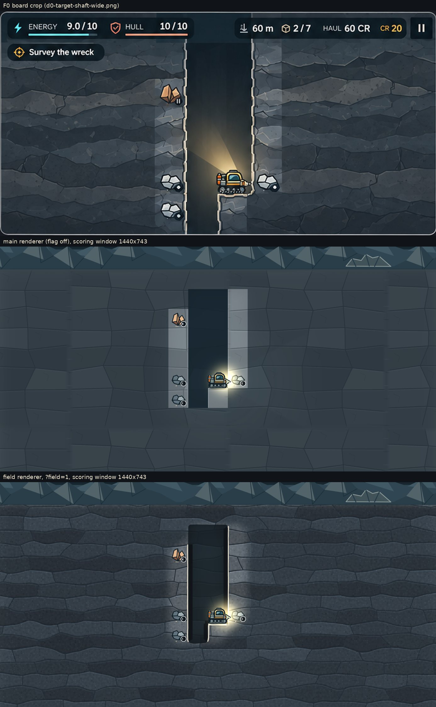
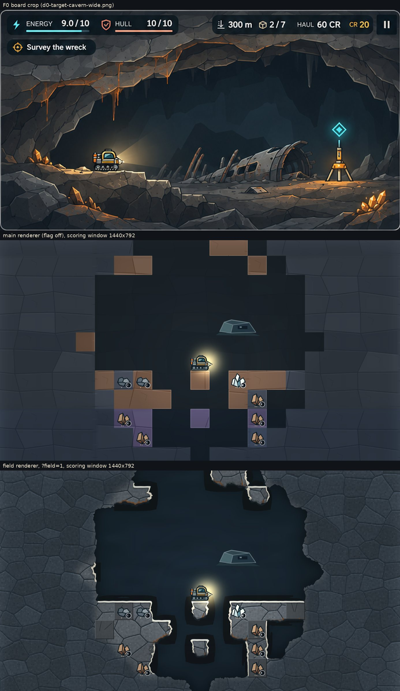

# T2 spike: the field renderer behind a flag (decides D4)

The smallest WebGL field renderer that tests the audit's route (`docs/ART_QUALITY_AUDIT.md` §5.3 T2, §7, §8 D4). It is off by default: with no flag, main's `RetainedTerrain` runs unchanged.

- **Flag.** `?field=1` turns it on (`?field=0` turns it off); a dev server started with `VITE_T2_FIELD=1` turns it on for every page, so the browser suites run with it unchanged. With `?debug=frametime` the F1 readout adds `interval p95` and `terrain field|retained (…)`.
- **Code.** `src/campaign/render/field/`: `field-data.ts` (the field texture, built on the CPU from known cells only), `known-world.ts` (the spike's stand-in for F7's `KnownWorldView`), `shader.ts` (the quad's GLSL), `field-renderer.ts` (the Phaser `Extern` that uploads and draws), `palette.ts` (the W01 swatch values), `flag.ts`, `frame-interval.ts`. Measurements: `scripts/t2-field-spike.mjs`; captures: `scripts/art-captures.mjs` with `ART_SEARCH=field=1`.

## What it draws

One RGBA8 field texture at 16 texels per tile (W01: 648 × 1008 texels, 2.5 MiB, including 4 wrapped texel columns each side and 2 sky rows), built only from known cells: unknown cells are "solid, unknown" whatever the world holds (F7). Channels: R the visual solid field (σ 0.34 tile on natural edges, 0.045 tile near dug air, hard rock, bedrock, plate and sky), G ambient occlusion (σ 0.42 tile), B a sharpness weight, A the cell's own code (constant over the cell; read unfiltered with taps snapped to texel centres, so no `texelFetch`).

One full-screen quad (one draw call) draws, per pixel: the edge as the F = 0.5 iso-line with a signed distance from the field's gradient; gradient-noise displacement on natural walls and ceilings (up to 0.28 tile measured); floors over known rock snapped to the collision line (plus a 0.01-tile jag, so 1-cell pillars keep a flat top); lip (0.085 tile, face-lit), bevel shadow, undercut (0.03 tile) and AO; slate slabs from one 3 × 3 anisotropic Worley neighbourhood (strata in bands A and B, angular slabs in C and D) with grain and speckles; known hard rock, bedrock and plate as square blocks with a 0.03-tile chamfer, cracks and a fill at about L\* −8; rust seams along ceiling joints in band C (A1 call); natural cave air against the recessed dug back wall. Colours are the W01 swatch cards' band-A roles (unknown, lit, lip, crack, back wall, cave air; rust from band C) on the D6 L\* ladder, pre-divided by the light overlay that `lighting.ts` still draws on top, so frames land on the swatch values.

**Budget (§7).** 10 texture taps per pixel (5 bilinear field taps; 4 dual-grid cell taps for the pixel's own cell and a smooth known weight; 1 cell tap 0.3 tile into the rock to keep lips off fog edges) and 9 Worley seeds, against 12 and 9. Seven noise evaluations (four gradient, three value) and three hashes are arithmetic only. `tests/campaign-render-field.test.ts` holds the shader to it.

**WebGL1 constraints.** Phaser 3.90's WebGL1 context; GLSL ES 1.00; RGBA8; no `texelFetch`; non-power-of-two texture with clamp, no mipmaps, wrapped pad columns and noise periodic over the world width. Fragment `highp` is required (the field coordinate reaches 776 texels; fp16 would quantise it to half a texel): without it, or on Canvas, or when a world does not fit `MAX_TEXTURE_SIZE`, the flag keeps `RetainedTerrain` and the readout says `terrain retained (no fragment highp)` (the audit's Medium tier, baked periodic pages, is T2 proper). Patches go through raw `texSubImage2D` on Phaser's texture wrapper inside the `Extern`'s render, between `pipelines.clear()` and `rebind()`, which restore Phaser's bound textures, program and attributes; at most one upload of at most 160 × 160 texels per frame, none in a still frame. An import or world change rebuilds the texture once inside the loading hold. `webglcontextlost`/`restored`: Phaser re-creates the texture from the CPU copy and the field rebuilds its program and quad buffer.


## Go criteria

Measured in this container: 4 shared CPUs, no GPU, Chromium's WebGL on SwiftShader (software). Frame times measured here are the software rasteriser's, not the technique's (audit §7, "CI time").

| Criterion | Target | Measured | Result |
|---|---|---|---|
| Natural-cave boundary, axis-aligned share (SITE-4, hard rock excluded), on the shader's own air mask | ≤30 % (§9.2) | **29.1 %** (main: 93.0 %); visual vs collision air 1.5 % of the frame, deviation ≤0.28 tile | pass, thin margin |
| Fog check (`improvement-smoke.mjs` "fog") with the flag on | passes | passes on W01 and W02, field drawing | pass |
| Inset-crop scramble (`render-acceptance.mjs`, `improvement-smoke.mjs`) with the flag on | 0 px | 0 px on W01 and W02 (WebGL on the field; Canvas on `RetainedTerrain`) | pass |
| Full-frame scramble, a04 and SITE-4, 1440×900@2 (extra, F7 style) | 0 px | **0 px** on both (2305 and 2274 unknown cells re-rolled, 379 and 391 hidden deposits moved); main's renderer also 0 px | pass |
| Draw calls, still frame | ≤10 | **5** at 60 m, **7** at SITE-4, desktop @2 and phone @3 (main: 3 and 6) | pass |
| Uploads | 0 when still; ≤1 of ≤160×160 per frame | 0 in still frames; digging 6 rows: 7 uploads, never more than 1 per frame, largest 160×144 | pass |
| Desktop p95 at backing 2 | well under 16.7 ms | not measurable here (no GPU). SwiftShader: F1 p95 11.7 ms CPU, frame interval p95 1660 ms | not measured; director to read |
| Phone p95 on an A54-class device at backing ≥1.5 | read by the director | instructions below | pending |
| Budget | ≤12 taps, ≤9 Worley seeds per pixel | 10 taps, 9 seeds | pass |

## Captures

The F0 board crop, then main's renderer, then the field renderer, each cut to the panel's scoring window around the rig (as `art-sheets.py` scores them). Full HUD-free frames (1440×900, half of @2) beside them.

**60 m shaft** (`a04-dive-60m@2`, band A strata, a dug 2-wide shaft): `a04-board-main-field.jpg`, `a04-main.jpg`, `a04-field.jpg`



**SITE-4 cavern** (`c-site-W01-SITE-4-wreck@2`, band C slabs, a natural cave revealed to radius 6): `site4-board-main-field.jpg`, `site4-main.jpg`, `site4-field.jpg`; on the phone at backing 1.5: `site4-phone-field.jpg`; the shader's air mask used for the boundary measure: `site4-field-air.png`



**Digging** from the 60 m fixture into a natural pocket, patched frame by frame: `dig-field.jpg`.

What still separates the field frames from the board is mostly not the terrain: the light is main's per-cell overlay (the square dark cells round the pillars are "remembered" cells), the camera is today's (22 tiles across, not 15.7), and the wreck, beacon, dressing and rust drips are T1, T5, T6 and art.

## F3 table (§9.2), flag off and on

Desktop 1440×900 @2, backing 2, from `art-captures.mjs` and `art-sheets.py`. With the flag on, the boundary is measured on the shader's own air mask (`<name>-fieldair.png`) instead of the cell grid.

| Check | Target | 60 m main | 60 m field | SITE-4 main | SITE-4 field |
|---|---|---|---|---|---|
| Natural-cave boundary, axis-aligned share (hard rock excluded) | ≤30 % | — | — | 93.0 % | **29.1 %** |
| Tile-normalised mean gradient | ≥2.5 | 1.05 | **2.59** | 1.45 | **3.20** |
| Frame L\* mean (concept 25.9 / 21.0) | ±4 | 27.1 | **24.4** | 20.3 | **21.1** |
| Unknown rock luma (sd) | 45–65, sd ≥7 | 61.7 (3.4) | 54.8 (8.0) | 52.0 (3.0) | 54.8 (6.2) |
| Wall profile rock → lip → undercut → air | lip ≥ rock +55; undercut ≤ air −8 | 109→139→36→37 | 65→214→20→34 | — | — |
| Share within ±3 L\* of the mode | ≤0.45 (shaft) | 0.791 | 0.497 | 0.510 | 0.411 |
| Edge density (concept 0.074 / 0.112) | ≥0.06 | 0.025 | 0.049 | 0.031 | 0.065 |
| Rock sd within 3 tiles of a light | ≥15 | 9.4 | 20.4 | 6.7 | 19.5 |
| Visual vs collision air (walls, ceilings) | ≤5 % and ≤0.3 tile | — | — | — | 1.5 %, 0.28 tile |

The rows that move are above; `python3 scripts/art-sheets.py --captures <dir> --out <dir> --table-only` prints the whole table. Two rows move for reasons that are not the terrain: the SITE-4 warm share drops from 5.48 % to 0.36 % because main's band-C soil is brown and the slate is not (D6, D8: the lamp, rust drips and emitters carry the warm share), and the overlay edge share falls (40 % → 15 %) because the terrain now has edges of its own, not because overlays changed.

**The boundary margin is thin.** Floors over known rock are held on the collision line (T2's floor-contact rule), so they are axis-aligned by construction: 16 % of the SITE-4 boundary. Walls and ceilings carry the rest (13 %). A seed with longer floors could cross 30 %; T2 proper should score two seeds (G1 item 1) and may need the floors' ends to round off, or rubble decals (T5) to break long floors.

## Flag-on hidden-information checks

Run against a dev server started with `VITE_T2_FIELD=1`, with `T2_FIELD=1` so each script asserts the field drew:

| Check | Result |
|---|---|
| Fog check, `IMPROVEMENT_CHECKS=fog npm run test:improvements` (W01 and W02: hidden cave against hidden solid rock on an inset crop; high contrast changes the canvas) | pass, on the field |
| `npm run test:render` (render-acceptance: the inset-crop hidden air against solid, W01 and W02; the camera-shift round trip byte-identical; draw calls ≤12; every draw accounted for) | pass: WebGL on the field (4 draw calls at backing 1, overdraw 2.05 screens as on main, 0 unaccounted draws), Canvas on `RetainedTerrain` |
| Full-frame scramble (`scripts/t2-field-spike.mjs`), a04 and SITE-4 at 1440×900@2 | 0 differing pixels on both |
| Context loss (`WEBGL_lose_context`, lose then restore at 60 m) | the field comes back and draws the same frame (0 px) |
| `tests/campaign-render-field.test.ts` | the field texture is byte-identical with every unknown cell re-rolled |

The scramble re-rolls every unknown cell more than 5.5 tiles from the rig and moves every hidden deposit there. Nearer unknown cells are left alone because the game's visibility test casts rays through them, so scrambling them would change what the game itself reveals rather than what the renderer draws. Sites, shelves, cold pockets, vents and pressure seams are not moved (the full F7 scramble needs the debug hook F7 adds); the field never reads them.

Texture memory: the harness's resident total (TextureManager entries only) drops from 33.16 to 24.59 MiB at backing 1 with the flag on, because `RetainedTerrain`'s canvas is gone; the field's own 2.5 MiB raw texture is not in that count (§7: the metric misses raw GL textures).

## Draw calls and uploads

| Frame | main | field |
|---|---|---|
| 60 m, desktop @2 / phone @3 | 3 / 3 | 5 / 5 |
| SITE-4, desktop @2 / phone @3 | 6 / 6 | 7 / 7 |
| Texture uploads in a still frame | 0 | 0 |

The field adds one draw (its quad) and splits Phaser's batch around it (the `Extern` flushes before and after). The texture is 2.5 MiB for W01 (648 × 1008 RGBA8) and 4.9 MiB for W02 (776 × 1648); `RetainedTerrain`'s canvas (19.5 MiB on desktop, §7) is not allocated with the flag on. CPU side (Node, this container): a full rebuild takes 53 ms (imports and world changes only, inside the loading hold), a still frame's change scan 0.03 ms, a patch 1.4 ms median.

## Frame times (SwiftShader, not a GPU)

SITE-4, the rig parked, real clock, 15 s, backing pinned with F1's `?backing=`. "F1 p95" is the readout's CPU cost from Phaser's pre-step to its post-render; "interval p95" is the time between frames, where a GPU-bound frame shows. The last row draws the field quad alone off screen against a one-tap copy of the same size.

| | desktop 1440×900@2, backing 2 (2880×1800) | phone 393×851@3, backing 1.5 (590×1277) |
|---|---|---|
| F1 p95, field / main | 11.7 / 28.2 ms | 8.3 / 6.8 ms |
| Interval p95, field / main | 1660 / 637 ms | 308 / 126 ms |
| Field quad / one-tap copy, per draw | 958 / 1005 ms | 95 / 96 ms |

On this rasteriser the field quad costs the same as a one-tap full-screen copy: SwiftShader's time here is fill and memory, not the shader's arithmetic, so these numbers bound nothing about a GPU. The CPU side is lower with the field than with main's canvas terrain at backing 2. A rough expectation, not a measurement: about 400 arithmetic operations and 10 taps per pixel is a few tenths of a millisecond at 2880×1800 on a desktop GPU and a few milliseconds at 590×1277 on a Mali-G68 MP5 (A54); the director's reading decides it.

**F1's policy cannot see a GPU-bound frame.** `RenderScaleBudget` lowers the backing scale on F1's CPU p95, which leaves out GPU time. If the A54 shows a high interval p95 and a low F1 p95, the tier policy must read the interval as well (T2 proper).

## D4: go or no-go

**Go, provisional on the A54 reading.** The route works inside the budget: one quad and one RGBA8 texture, built only from known cells, draw iso-line edges, lips, undercuts, AO, slate slabs, square cracked hard rock and band-C rust seams in 10 taps and 9 Worley seeds per pixel, at 5 to 7 draw calls, with no uploads in still frames and single patches of at most 160 × 160 texels while digging. The natural-cave boundary falls from 93.0 % to 29.1 % axis-aligned, the gradient and frame L\* pass at both fixtures, every hidden-information check returns 0 px with the flag on (full frames included), and the flag-off frames are pixel-identical to main's. What this container cannot show is GPU time. If the A54 reads an interval p95 of 16.7 ms or less at backing 1.5, and a desktop reads well under it at backing 2, record D4 as the audit recommends (WebGL field renderer primary, Canvas fallback with information parity). If the A54 misses, the answer is T2-fallback on the same code, not another route: dual-grid edge tiles baked from `field-data.ts` and the shader's material baked into periodic pages (the Medium tier), about 6 to 9 days. T2 proper (12 to 17 days) needs: T1's light sampled in the terrain shader instead of pre-dividing for `lighting.ts`'s overlay; F7's `KnownWorldView` in place of the spike's `DiscoveredWorldView`; the Medium tier for devices without fragment highp; a tier policy that reads the frame interval as well as F1's CPU cost and chooses by fragment highp and measured frames rather than by touch; the §9.3 reveal cross-fade (250 ms) and dig lerp (120 ms); floor contact checked at every column the tracks can occupy and the boundary scored on two seeds; bands B and D's hue turns and a W02 palette; a windowed texture for worlds taller than `MAX_TEXTURE_SIZE` / 16 rows; the x = 0 seam check; a context-loss smoke test in CI; and Firefox and iOS Safari precision runs.

**F1's touch deviation (touch devices start Medium, floor 1.5).** The spike leaves it as it is: the field draws on both tiers, and nothing measured here tells a recent phone from a mid-range one. Revisit it with the A54 numbers: if the field holds 16.7 ms there at backing 2, start every device with fragment highp at High and let the measured interval lower it.

## Phone and desktop test

**1. Get the build.** The PR's "T2 spike static build" workflow uploads the artifact **`t2-spike-dist`**: on the PR, open Checks, then "T2 spike static build", then Summary, and download `t2-spike-dist` under Artifacts. Or build it locally: `git fetch origin claude/t2-field-spike && git switch claude/t2-field-spike && npm ci && npm run build`, which writes `dist/`.

**2. Serve it at the web root on the LAN.** Unzip into an empty folder, then from inside it run `python3 -m http.server 8080 --bind 0.0.0.0` (or `npx serve -l 8080 .`). The build uses relative paths (Vite `base: "./"`), so any static server works.

**3. Phone on the same Wi-Fi.** Open `http://<computer-LAN-IP>:8080/?field=1&debug=frametime&backing=1.5` (the IP: `ipconfig getifaddr en0` on macOS, `ipconfig` on Windows, `hostname -I` on Linux). Start or continue an expedition. The readout is at mid-height on the left edge:
- `p95 … ms`: F1's CPU cost per frame over the last 10 s;
- `backing 1.5× · medium · pinned`: the pinned backing scale (`backing=1`, `1.5` or `2` is F1's debug pin; use 1.5 or 2 on the phone);
- `interval p95 … ms`: the time between frames over the last 10 s; about 16.7 at 60 Hz means the GPU keeps up, and this is the number that decides the phone gate;
- `terrain field`: the field is drawing. `retained (no fragment highp)` means the device cannot run it, and the numbers are main's renderer.

Read it after 10 s parked and again after 10 s of digging, then repeat with `field=0` (main's renderer) and with `backing=2`.

**4. The two fixtures on the phone.** Download [`site4-checkpoint.json`](https://github.com/alemagnoprimero/Motherload/raw/claude/t2-field-spike/docs/qa/t2-spike/site4-checkpoint.json) (SITE-4) or [`a04-checkpoint.json`](https://github.com/alemagnoprimero/Motherload/raw/claude/t2-field-spike/docs/qa/t2-spike/a04-checkpoint.json) (60 m) on the phone, then Menu, Save, Import, and pick the file. Importing replaces that browser's campaign.

**5. Samsung Remote Test Lab (A54 class).** The remote phone cannot reach your LAN. Expose the server with a tunnel, for example `npx localtunnel --port 8080` or `cloudflared tunnel --url http://localhost:8080`, which print an https URL; open `<tunnel URL>/?field=1&debug=frametime&backing=1.5` in the remote device's Chrome and read the readout from the stream. For the fixtures, open the raw checkpoint links above in the remote browser to download them, then import.

**6. Desktop with a GPU.** In a 1440×900 window: `http://localhost:8080/?field=1&debug=frametime&backing=2`, then `field=0`. Desktops already run at backing 2 (High tier); the pin keeps it there.

## Shared files touched

No `package.json` or lockfile change.

| File | Change |
|---|---|
| `src/campaign/scene.ts` | Imports; `terrainLayer` may be a `FieldTerrain`; `FieldTerrain` instead of `RetainedTerrain` only when the flag is on; under `?debug=frametime` a frame-interval tracker and two readout lines (`interval p95`, `terrain`), with or without the flag; dataset `terrainRenderer` |
| `scripts/art-captures.mjs` | `ART_SEARCH`; with the field drawing, `<name>-fieldair.png` and its manifest fields; `terrainRenderer` in the manifest |
| `scripts/art_metrics.py` | `cave_air_mask(…, visual=None)`; `visual_air`, `visual_vs_collision` |
| `scripts/art-sheets.py` | The boundary on the field air mask when the capture has one; `visual_vs_collision` |
| `scripts/improvement-smoke.mjs` | With `T2_FIELD=1`, the fog check asserts the field drew |
| `scripts/render-acceptance.mjs` | Records `terrainRenderer`; with `T2_FIELD=1`, asserts the field (WebGL) or `RetainedTerrain` (Canvas) |

New: `src/campaign/render/field/*`, `scripts/t2-field-spike.mjs`, `tests/campaign-render-field.test.ts`, `.github/workflows/t2-spike-build.yml`, `docs/qa/t2-spike/*`.

## Reproduce

```sh
npm ci
npm run dev -- --port 5202 --strictPort &
export PREVIEW_URL=http://127.0.0.1:5202/ CHROMIUM_PATH=/path/to/chromium
# Captures and the §9.2 table, flag off then on
ART_BACKING=2 ART_CAPTURES=a04-dive-60m,c-site-W01-SITE-4 ART_CAPTURES_DIR=artifacts/t2-off node scripts/art-captures.mjs
ART_SEARCH=field=1 ART_BACKING=2 ART_CAPTURES=a04-dive-60m,c-site-W01-SITE-4 ART_CAPTURES_DIR=artifacts/t2-on node scripts/art-captures.mjs
python3 scripts/art-sheets.py --captures artifacts/t2-on --out artifacts/t2-on-sheets --table-only
# Scramble, dig uploads, context loss, draw calls, frame times (field on and off)
node scripts/t2-field-spike.mjs
# The verify suites with the field on: restart the dev server with VITE_T2_FIELD=1, then
T2_FIELD=1 IMPROVEMENT_CHECKS=fog npm run test:improvements
T2_FIELD=1 npm run test:render
```
