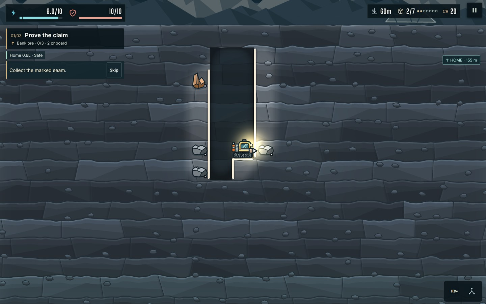
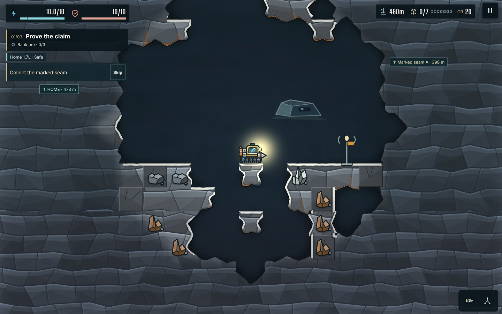
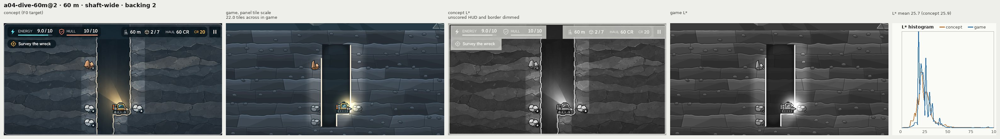
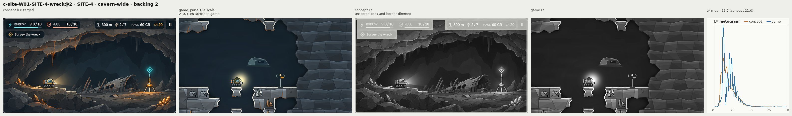
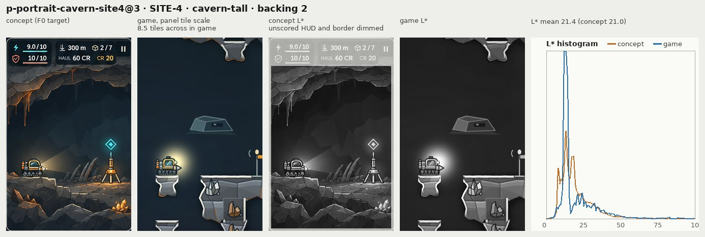

# T2: the terrain field renderer

The field renderer (`src/campaign/render/field/`) is the terrain renderer wherever it can run; main's `RetainedTerrain` is the Low tier and Canvas path. This folder exists because checks changed: `scripts/t2-field.mjs` is new, three scripts pin the field, and D4's three conditions are measured here. The spike's write-up, which decided D4, stays in [`../t2-spike/`](../t2-spike/README.md).

Everything below was measured in this container (4 shared x86 CPUs, no GPU, Chromium's WebGL on SwiftShader) unless it says otherwise. Software rasteriser frame times are not a GPU's.

## Which renderer a page gets

| Page | Terrain renderer |
|---|---|
| WebGL with fragment `highp`, any pointer type | the field shader (`terrain field`), with the measured step below |
| WebGL without fragment `highp` (the Medium tier) | `RetainedTerrain`: `retained (no fragment highp)` |
| WebGL on a software rasteriser (SwiftShader, llvmpipe; CI) | `RetainedTerrain`: `retained (software rasteriser)` |
| Canvas renderer (the Low tier) | `RetainedTerrain`: `retained (Canvas renderer)` |
| `?field=1` | the field, pinned: no software check, no measured step |
| `?field=0` | `RetainedTerrain`: `retained (?field=0)` |

`data-terrain-renderer` on `#campaign-game` and the `terrain …` line of the `?debug=frametime` readout say which one drew and why.

- **No fragment highp: the Canvas path, by measurement.** GLSL ES guarantees a mediump float 10 bits of mantissa. The field's coordinate chain (device pixel, world tile, field texel) then steps by 2.6 device px on a phone at backing 1.5 (590 px across, 84 px per tile) and by 5.1 px on a desktop at backing 2 (2880 px, 164 px per tile) over W02's 48-tile width (`coordinateStepPixels`, held by a unit test against the 2 px floor-contact limit), and the shader's hashes need more bits again. A mediump shader would need per-tile geometry and baked material pages (the audit's T2-fallback, 6 to 9 days); no device in the device plan lacks fragment highp.
- **Software rasteriser: `RetainedTerrain`, by measurement.** At 2880 × 1800 SwiftShader presents a field frame every 1.65 s against 0.38 s with `RetainedTerrain` (60 m fixture, 12 frames each). Stubbing out the slab search and the gradient noise only brings it to 1.08 s: the cost is mostly the ten bilinear taps per pixel, which a GPU does in hardware. Left on the field, CI's verify job would take three to four times as long, so the default follows the measurement and the checks that are about the field pin it.
- **The measured step (D4 condition 3).** `tier.ts` reads the frame interval, where a GPU-bound frame shows (F1's cost is CPU time and cannot see it). A 3 s window of scene time counts against the field when its interval p95 is over 25 ms: more than one frame in twenty took two 60 Hz refreshes. While the backing scale can still go down it waits four such windows in a row, so resolution goes first; at the floor or under a pin it waits two. Then the terrain goes to `RetainedTerrain` for the session (`retained (measured: interval p95 … ms at backing …)`). It never reads the pointer type. Loading holds, hidden tabs and frames on a clock that is not moving (the test clock) are not counted.
- **Open with F1b.** The backing scale's own floor still comes from F1's touch rule (`qualityTier` in `view.ts`: touch devices start Medium, floor 1.5). F1b changes that policy to read the interval; this branch does not touch `view.ts`, and takes F1b's reading in place of its own interval tracker when it merges.

## D4 condition 1: interval p95 on a mid-range phone (pending, the director's reading)

Parity with main's renderer on the same device, within about 2 ms, parked and digging, at backing 1.5. The 60 Hz readout sits at 18 to 20 ms for main too: 16.7 ms is the refresh period, not a target.

1. **Build.** Every push to the branch runs the "T2 static build" workflow; download **`t2-dist`** from its run (Actions, or the PR's Checks) and unzip it into an empty folder. Or build it: `npm ci && npm run build` writes `dist/`.
2. **Serve.** From inside that folder: `python3 -m http.server 8080 --bind 0.0.0.0` (or `npx serve -l 8080 .`). The build uses relative paths, so any static server works.
3. **Device.** A Galaxy A5x through Samsung Remote Test Lab cannot reach a LAN: run `npx localtunnel --port 8080` or `cloudflared tunnel --url http://localhost:8080` and use the https URL it prints. A phone on the same Wi-Fi uses `http://<computer-LAN-IP>:8080/`.
4. **Fixture.** Open the URL, start or continue, then Menu, Save, Import and pick [`a04-checkpoint.json`](https://github.com/alemagnoprimero/Motherload/raw/claude/t2-field-spike/docs/qa/t2-spike/a04-checkpoint.json) (60 m; open the link on the device to download it). Importing replaces that browser's campaign.
5. **Read, four times.** Load `<URL>/?debug=frametime&backing=1.5&field=1`, wait 10 s parked and note the readout (mid-height, left edge); hold Down for 10 s and note it again while still digging. Repeat with `field=0`.

| Readout line | Meaning |
|---|---|
| `p95 … ms` | CPU cost of a frame, Phaser's pre-step to post-render, over the last 10 s |
| `interval p95 … ms` | time between frames over the last 10 s: the number this condition is read on |
| `terrain field` or `retained (…)` | which renderer drew; with `field=1` it must say `field` |
| `field scan · patch · upload · draw … ms (n patches)` | the field's own CPU share, p95 over 10 s: the per-frame change scan, the patch build, the `texSubImage2D` call and the quad's GL calls |
| `tier pinned` | `field=1` holds the field; without it the line shows the last 3 s window's interval p95 |

| Device, browser | Renderer | Parked: CPU p95 / interval p95 | Digging: CPU p95 / interval p95 | Field line while digging |
|---|---|---|---|---|
| _pending_ | `field=1` | | | |
| _pending_ | `field=0` | | | — |

Passes when the two interval p95 values are within about 2 ms of each other, parked and digging.

## D4 condition 2: the digging cost

The reading that set it: an S25 Ultra at backing 1.5 read 18 ms CPU p95 and 20 ms interval while digging with the spike's field against main's 12 and 16 (parked, both 4 and 18).

**Where it goes** (`T2_CHECKS=digcost`, phone viewport 393 × 851 @3 at backing 1.5, the 60 m fixture, the rig drilling straight down for 480 frames; the game steps at 60 frames per second on the test clock and every frame's JavaScript is timed on the real clock, so the slow rasteriser does not thin the samples):

| | parked p50 / p95 | digging p50 / p95 / p99 | scan p95 | patch p50 / p95 / max | upload p95 | draw p95 |
|---|---|---|---|---|---|---|
| main (`field=0`) | 1.3 / 2.1 ms | 2.9 / 6.5 / 12.9 ms | — | — | — | — |
| this branch (`field=1`) | 1.4 / 2.2 | 3.2 / 5.2 / 9.3 | 0.1 ms | 0.1 / 0.9 / 1.0 ms | 0.2 ms | 0.1 ms |
| spike (commit `e7af6b1`, on main before #17 to #19) | 1.4 / 2.5 | 2.9 / 4.9 / 7.5 | 0.1 | 0.8 / 3.7, first call 17 | 0.2 | — |
| main, CPU slowed 4× (before #17 to #19) | 6.1 / 10.4 | 12.9 / 27.6 / 51.1 | — | — | — | — |
| this branch, 4× | 6.5 / 10.6 | 12.9 / 21.9 / 31.5 | 0.8 | 0.1 / 4.3 / 4.7 | 0.9 | — |
| spike, 4× | 6.6 / 11.3 | 12.7 / 21.7 / 32.6 | | | | |

The first two rows are this commit on main with #17 to #19, the scene clock running (so each dig also settles its transition: 22 patches in the run, the median one a 512-texel code rewrite); the others were measured before the rebase.

- Digging costs the field less than main here, before and after the trim (p95 −1.3 ms, and −5.7 ms at 4×): a dig frame is mostly work both renderers share (the light map redraw), and `RetainedTerrain`'s own cell redraw and canvas upload cost more than a field patch.
- **This container does not reproduce the S25's +6 ms.** The field's JavaScript on a dig frame is about 1 ms here (scan 0.1, patch up to 1.0, upload call 0.2, the quad's GL calls 0.1), and the spike's was about 1.5 ms. What is left on the device is either a slower patch build than this CPU predicts or time inside GL calls on a real driver, which a software rasteriser does not show. The readout's `field scan · patch · upload · draw` line is there so the director's next S25 reading says which.
- **What was trimmed, on that evidence.**
  - A reveal of solid ground no longer rebuilds the blur. An unknown cell that turns out to be soil is solid before and after and soft both times, so only its code changes: one cell's A bytes (512 texels on the 16-texel grid) instead of the 5 × 5 cells within reach (7,680). With transitions on, the median patch is 512 texels and 0.1 ms.
  - A dig recomputes only the groups that changed, a cell whose 5 × 5 neighbourhood is uniform is a constant fill, and the patch build allocates nothing (the spike allocated eight typed arrays per patch). A dig's blur patch is 0.5 ms against 0.8, and the largest patch 1.0 against 3.7 with a 17 ms first call.
  - The frame state is reused instead of rebuilt each frame.
- **If the S25 still reads more than 2 ms over main,** the field line names the part: a high `patch` means the blur build (next step: move it to a fragment pass over the patch rectangle, so a dig uploads a few bytes of cell codes); a high `upload` or `draw` means the driver (next step: upload after the quad's draw instead of before it, or keep two copies of the texture and patch the one not in flight).

**Stage 4: a GPU reading that does not meet it.** The macOS runner's WebKit (Metal; the readout table in the stage 4 section) reads the field at +7 ms CPU and +9 ms interval over main while digging on a desktop at backing 2, parity parked, and no gap at the phone viewport at backing 1.5. The cost grows with the frame's pixels and is outside the field's scan, patch, upload and draw timers, which rules out the patch build this container measured and points at the frame that follows a texture update: either the driver synchronising the update with the frame in flight, or the GPU's frame going over the refresh on dig frames and the next frame waiting for a drawable. That is not yet separated. Proposed, in order:

1. **Split it on the same runner** (two debug switches on the `frametime` check, no change to play): digging with the upload skipped, and digging with the transitions off, which takes the 42 patches of a 12 s dig down to about 8.
2. **If the update is the cost:** keep two copies of the field texture and patch the one the last frame did not draw (one more upload of the same patch a frame later, 2.5 MiB more for W01), or build the blur in a fragment pass so a dig uploads a few bytes of cell codes.
3. **If the dig frames' GPU time is the cost:** fewer frames in a transition (settle a slot's cells in one patch instead of per cell group) and the reveal's two looks drawn only inside the fading cells.
4. Until then the measured step is the guard: a window whose interval p95 is over 25 ms counts against the field, resolution goes first, then the terrain goes to `RetainedTerrain`.

**Condition 2 stays open**: met in this container and at the phone viewport on the macOS runner, not met at desktop backing 2 on that runner, and not re-read on the S25.

Limit in the check: digging p95, field minus main, at most +2 ms (`T2_DIGCOST_ASSERT=0` reports without asserting; CI runs it that way because shared runners time unevenly).

## Motion (audit §9.3)

Reveals cross-fade over 250 ms and digs ease out over 120 ms, on the scene clock: with the clock frozen (the test clock) or reduced motion on, no transition starts and cells change at once. A cell names its transition by a slot in its A byte and the shader reads the slot's progress from a uniform, so a transition costs no tap and no upload per frame; when it ends its cells are rewritten to slot 0 (one more small upload), and a parked rig uploads nothing.

`T2_CHECKS=motion` reads it on the field quad alone (`window.__campaignField.colour`, no light map and no rig) through a fixed camera at SITE-4, as the share of the change still to come:

| ms after the dig | 0 | 17 | 33 | 50 | 67 | 83 | 100 | 117 | 133 | 150 | 200 | 250 | 267 |
|---|---|---|---|---|---|---|---|---|---|---|---|---|---|
| dug cell | 0.97 | 0.73 | 0.52 | 0.35 | 0.21 | 0.11 | 0.04 | 0.00 | 0 | 0 | 0 | 0 | 0 |
| revealed cells | 0.66 | 0.65 | 0.64 | 0.63 | 0.60 | 0.58 | 0.56 | 0.53 | 0.48 | 0.42 | 0.17 | 0.01 | 0 |

- The reveal starts at 0.66 on this measure, not 1: the light map lightens over a revealed cell at once, and the fading cell's unknown look is drawn for that lighter overlay from its first frame, so the composed frame starts where it was. The field quad alone shows that as a step.
- Pixels farther than 1.2 tiles from the dug cell (and from any revealed cell) change by at most 1 luma. With the clock frozen both changes show in the first frame.
- Found on the way: the spike's "undercut" was a hard-edged dark band 0.3 tile wide whose outer edge followed the field's gradient direction, so it flickered up to 7 luma as far as 1.5 tiles from a dig. It is now the 0.03-tile line of §6.1 plus a soft occlusion from the wide blur, gone by about 0.37 tile.

## Material look and geometry (stage 2, §6.1)

The shader draws the rock as the swatch cards do (`scripts/swatch-cards.py`): courses of jointed stones, toned in tiers, with a top facet, bevels and dark joints, at the D6 ladder's colours from `docs/art-direction/swatches/w01-swatches.json`. A unit test holds `palette.ts` to that JSON for every band and `FIELD_SHAPE` to the card script's constants.

| §6.1 line | What the shader draws (`shader.ts`, `palette.ts`) |
|---|---|
| Bands A and B: horizontal strata, courses 0.7 to 1.2 tiles, slabs 2 to 4 tiles, staggered joints, 2 to 3 facet tones, dark cracks | courses 0.70 to 1.06 tiles tall with wavy tops, slabs 2.0 to 3.2 tiles long, each course's joints offset and slanted, three tone tiers (0.86 / 1 / 1.24 unknown, 0.86 / 1 / 1.18 lit) and a lighter top cap, joints 0.024 tile in the crack colour; pebbles at 0.45 per tile |
| Bands C and D: chunky angular blocks with a lighter top facet | C: blocks 0.78 to 1.0 by 1.0 to 1.6 tiles with angular tops; D: rubble 0.62 to 0.84 by 0.75 to 1.2; top facet × 1.22 |
| Hard rock: square, cracked, chamfered 0.03 tile | drawn on the cell grid from the cell codes: square blocks, two cracks each, a 0.03-tile chamfer (lighter above, darker below); fill 0.79 of the lit rock, bedrock 0.70 |
| Plate fill at L\* −8 | plate cells: fill 0.86 of the lit rock with a rust tint. The plate layer's own look is T14's; this is a holding value |
| Lips 0.085 to 0.1 tile at about rock +80 luma | 0.09 tile in the swatch's lip colour, with a 0.065-tile shade under it. **Read from the frame the lip is rock +143 at 60 m (93 → 236), above the guide's "about +80"**: the lip colour is the swatch's (`#f0e6d2` in band A), not rekeyed here. The check's limit is lip ≥ rock +55 |
| Dark ceiling edge, undercut 0.03 tile, 0.3 to 0.4 tile occlusion | ceiling edge 0.05 tile; undercut a 0.03-tile line, 15 luma down (5 on floors); occlusion from the wide blur, gone by 0.35 tile |
| Rust-seam inclusion along band-C ceiling joints (A1 rider) | band C: rust (`#89532b`) in the joints above a cave ceiling and on the ceiling edge, gated by a slow noise; band D the same at 0.6 with `#7e5924`; none in A and B |
| Hue turns for B and D | the swatch JSON's per-band colours (B and D turn from A and C) |
| W02 provisional key | the same shapes on a cool key, unknown rock held to F4's 64 to 75 band (`FIELD_PALETTES.W02`); provisional until W02 has swatches |

**Geometry.** A natural edge is the 0.5 line of the blurred cell grid moved by an angular zig-zag (2 per tile, 0.17 tile) and two slow noises, held within 0.28 tile of the cells' own boundary. Sharp edges (hard rock, plate, bedrock, dug air) and floors come from the exact distance to the four cells around the pixel, chosen by cell code: a floor under known air is flat on the collision line, and nothing is drawn above that line in the air cell over it.

`T2_CHECKS=look` captures thirteen frames at backing 1 (1440 × 900) with the field pinned and asserts the rows below on each (`scripts/t2-look.py`, `art_metrics.field_geometry`); the two SITE-4 rows are the audit fixture and a second seed (`createCampaign(20261110)`, `fresh-w01-seed2.json`).

| Frame | Unknown rock luma (sd) | Lit − unknown near the lamp | Lit hard rock − unknown | Rock sd near the lamp | Floors: off the line, jag | Walls: off collision, pixels | Pillar flat top | Axis-aligned boundary |
|---|---|---|---|---|---|---|---|---|
| W01 A, 60 m | 59.3 (11.9) | +40.2 | — | 18.3 | 0.27 px, 0.004 tile (1) | 0.01 tile, 0.0 % | — | — |
| W01 B, 150 m | 59.6 (12.3) | +42.3 | +15.4 | 45.5 | 0.09 px, 0.001 tile (4) | 0.20 tile, 0.4 % | — | — |
| W01 C, 330 m (plate) | 60.0 (11.5) | +23.9 | +17.7 | 13.9 | 0.27 px, 0.004 tile (7) | 0.18 tile, 0.1 % | — | — |
| W01 C, SITE-4 | 58.7 (10.6) | — | — | 30.6 | 0.82 px, 0.012 tile (12) | 0.21 tile, 1.6 % | 0.99 tile | 23.2 % |
| W01 C, SITE-4, seed 2 | 60.0 (12.2) | +65.3 | +23.9 | 51.3 | 0.82 px, 0.012 tile (7) | 0.23 tile, 0.6 % | 0.99 tile | 26.3 % |
| W01 D, 550 m | 59.3 (11.7) | +56.4 | — | 37.5 | 0.00 px, 0.000 tile (1) | 0.00 tile, 0.0 % | — | — |
| W01 C, 380 m, hard rock | 58.7 (10.8) | +58.3 | +93.4 | 37.6 | 0.36 px, 0.005 tile (1) | 0.00 tile, 0.0 % | — | — |
| W01 D, 530 m, hard rock | 60.2 (11.9) | +52.6 | +52.1 | 37.8 | 0.45 px, 0.007 tile (1) | 0.00 tile, 0.0 % | — | — |
| W02 A, 70 m | 71.8 (16.3) | — | — | 19.4 | 0.18 px, 0.003 tile (1) | 0.00 tile, 0.0 % | — | — |
| W02 A, 106 m, hard rock | 71.0 (16.9) | +48.9 | +23.6 | 37.4 | 0.38 px, 0.006 tile (1) | 0.00 tile, 0.0 % | — | — |
| W02 B, 300 m | 71.2 (15.5) | +50.2 | +19.2 | 39.7 | 0.18 px, 0.003 tile (4) | 0.19 tile, 0.1 % | — | — |
| W02 C, 526 m, hard rock | 71.0 (13.7) | +33.3 | +33.6 | 33.6 | 0.45 px, 0.007 tile (1) | 0.00 tile, 0.0 % | — | — |
| W02 D, 850 m | 70.2 (13.9) | +69.9 | +60.9 | 41.3 | 0.18 px, 0.003 tile (1) | 0.00 tile, 0.0 % | — | — |

| Acceptance | Target | Measured | |
|---|---|---|---|
| Unknown rock sd | ≥ 7 | 10.6 to 16.9 | met |
| Rock sd within 3 tiles of a light | ≥ 15 | 18.3 to 51.3 | met in twelve frames; **the 330 m plate frame reads 13.9** (below) |
| Lit known minus unknown near the lamp, every band, both worlds | ≥ +15 | +23.9 to +69.9; lit hard rock +15.4 to +93.4 | met; the thinnest margin is W01 band B hard rock |
| Boundary axis-aligned share, two seeds | ≤ 30 % | 23.2 % and 26.3 % | met |
| Floors flat | jag ≤ 0.01 tile, ≤ 2 px off the collision line | at most 0.82 px; jag at most 0.012 tile at backing 1 | met |
| Walls against collision | within 0.3 tile and 5 % of pixels | at most 0.23 tile and 1.6 % | met |
| 1-cell pillars, flat top | ≥ 0.8 tile | 0.99 tile | met |
| Frame L\* against the concept crops | within ± 4 | 60 m 25.7 against 25.9; SITE-4 22.7 against 21.0 | met |

At backing 2 (2880 × 1800, where §9.2's gradient is defined) the 60 m frame reads tile-normalised gradient 2.61 (≥ 2.5), edge density 0.068 (≥ 0.06), rock sd near the lamp 19.9, wall profile 93 → 236 → 14 → 31; SITE-4 reads gradient 3.41, edge density 0.084, boundary 23.6 %, floors 1.1 px with jag 0.008 tile over 12 floors, walls 1.6 % and 0.22 tile.

- **The 330 m plate frame's rock sd near the lamp is reported, not held.** The plate layer's cells are one flat fill each until T14 restyles them, and they are most of the rock near the lamp in that frame. Fallback: none needed in T2; the row is T14's to close. Its frame L\* (26.2) is read against the cavern crop (21.0) only because the harness has no plate-band panel; it is not one of the two crops this row is held on.
- **The floor jag limit at backing 1** is 0.01 tile plus one pixel of the mask (a 65 px tile cannot split 0.65 px); at backing 2 it is 0.004 to 0.008 tile.
- **Not T2's rows**, still red on the §9.2 table and unchanged by the material: p2 to p98 range and warm-accent share (T1's lights and emitters), playfield within 10 luma of one value (G2), text items (T8, PR #20).




The sheets beside the board crops are in the F3 section below.

## Draw calls

The field's quad is one draw, and where the sky is in the frame it also splits the sprite batch around it (the sky below, everything else above). T1-lite's two lights were each an ADD sprite, which ends the batch before the light and again after it. On WebGL they now carry their light in RGB with alpha 0 and draw with the normal blend (ONE, ONE_MINUS_SRC_ALPHA), which adds the same amount inside the batch (`render/additive-texture.ts`; Canvas keeps `lighter`). With `?field=0` the surface, 60 m and SITE-4 frames are pixel-identical to main's (0 differing pixels at 1440 × 900 @2, on main with #17 to #19; measured on stage 1's commit, and stage 2 changes neither `RetainedTerrain` nor the lights).

Still frames, desktop 1440 × 900 @2 and phone 393 × 851 @3 alike, on main with #17 to #19:

| Frame | #19 as merged (its README) | this branch, `?field=0` | this branch, the field |
|---|---|---|---|
| 60 m, sky in the frame | 5 | 3 | **5** |
| SITE-4, the beacon lit | 8 | 8 | **9** |
| Masked beacon (phone limit 10) | 10 | 9, by the draw list | **10, by the draw list** |
| Texture uploads in a still frame | 0 | 0 | 0 |

- The headlamp's merge takes two draws off any frame without another ADD sprite beside it (60 m: 5 to 3), and the field puts them back there; with the lit beacon, whose sibling keeps the ADD run alive, the field is one draw over #19.
- **The masked-beacon frame is not measured.** The T13b script that stages it (`docs/qa/t13b-asset-pipeline/emissive-runtime.mjs`) expects the beacon at row 9, where it stood before D14, and stops at "the beacon is on screen" on main with or without this branch. Its draw list on #19's own branch is: sprites below the mask; the mask's stencil write; the masked beacon; the light map; **the headlamp's ADD**; the stencil write again; the masked ADD sibling; the rig; the rig's ADD sibling; the top layer. On this branch the headlamp batches with the light map before it (one fewer) and the field's quad is one more, with nothing under it underground: 10. If that script is updated for D14, `T2_CHECKS=draws` should gain its frame.

The check asserts at most 12 draws on desktop and 10 on a phone, and no more than `?field=0` plus two in any measured frame.

## Hidden information, uploads, context loss

`npm run test:t2` (all of it pins `?field=1`):

| Check | Result |
|---|---|
| `tier` | the table above, on desktop and on a touch phone |
| `scramble` | full frames at 60 m and SITE-4, 1440 × 900 @2, every unknown cell beyond 5.5 tiles re-rolled and hidden deposits moved: 0 px |
| `poi` | PR #3's POI probe on the fog fixture: the antenna stands in a known column beside the hidden block, its artwork clipped at the block; the block is 0 px different with a cave behind it |
| `dig` | at most one upload of at most 160 × 160 texels per frame; none while parked |
| `motion`, `digcost`, `look`, `draws` | above |
| `context` | `WEBGL_lose_context` lose and restore at 60 m: the field draws the same frame, 0 px |

`improvement-smoke`'s fog check and §9 harness captures, and `render-acceptance`'s WebGL runs, pin `?field=1` and assert the field drew (`T2_FIELD=0` runs them on `RetainedTerrain`). With the field forced on everywhere (`VITE_T2_FIELD=1`, stage 2's code), `campaign-smoke` passes all 15 of its steps, and `improvement-smoke`'s visual, fog and harness sections and `render-acceptance` pass; on SwiftShader that campaign run took 69 minutes here against 14 to 25 on the default path (a shared machine, other runs alongside), which is why it is not CI's default. `art-captures.mjs` pins it by default (`ART_SEARCH=field=0` for main's renderer).

## Tall worlds, the x = 0 seam, context loss and other browsers (stage 3)

**Worlds taller than one texture.** The field texture is 16 texels per tile, so a world's whole texture is (rows + 3) × 16 texels tall. W01 to W03 fit whole. A world whose whole texture would be taller than 2,048 texels (`FIELD_MAX_HEIGHT`), or than the GPU's largest texture, is held as a ring of 63 cell rows around the camera (`FIELD_RING_HEIGHT`, 1,010 texels): a row lives at `row mod 63`, the shader wraps its row coordinate, rows that enter the window are built patch by patch under the same one-upload-per-frame limit, and one repeated texel row above and below keeps bilinear taps continuous across the join.

| World | Tiles × rows | Field texture | Bytes |
|---|---|---|---|
| W01 | 40 × 60 | 648 × 1,008, whole | 2.49 MiB |
| W02, W03 | 48 × 100 | 776 × 1,648, whole | 4.88 MiB |
| W04 | 48 × 600 | 776 × 1,010, ring (whole: 9,648 texels tall, 28.6 MiB) | 2.99 MiB |
| the widest (96 × 180) | 96 × 180 | 1,544 × 1,010, ring | 5.95 MiB |

- A unit test holds every world in `WORLD_CATALOG` to these rules (at most 2,048 texels each way, at most 6 MiB) and compares a ring with the whole texture texel for texel, after a window move and after a dig.
- `T2_CHECKS=ring` plays the same inputs on two pages, the whole texture and `?fieldmax=512` (a ring of 31 rows), and compares the field quad at 60 m, after 240 frames of digging down, and at SITE-4: 0 pixels differ by more than 2 levels in Chromium (1, 39 and 190 differ by a level or two, where the two textures' heights round a coordinate differently). The window follows the camera (first row 0, then 6, then 32) with at most one upload per frame and nothing left to build.
- The same check then runs W02 600 m down against `?fieldmax=1024`, which is the 63-row ring a deep world gets, at W04's width: 0 pixels beyond 2 levels, before and after a dig, with the window at row 30.
- A ring must hold every row on screen plus the blur's reach. A view taller than 57 rows (a desktop window more than about 2.6 times taller than wide) keeps `RetainedTerrain` for that world: `retained (view taller than the field's 63 rows)`.
- Not run in a browser: a world that is a ring without `?fieldmax`. The fixtures are W01 and W02, which fit whole; the code path is the same one.

**The x = 0 seam.** The texture carries four wrapped columns at each side, so a tap near the seam reads the other edge's texels. `T2_CHECKS=seam` parks the rig in a shaft 2.5 tiles right of x = 0 so the seam crosses the frame: the luma step across the seam column is 0.35 against a median of 0.71 across the frame's other cell boundaries, and the same view one world width around differs at 0 pixels by more than 4 levels.

**Context loss.** `T2_CHECKS=context` runs in CI in every leg (the "T2 field renderer checks" workflow): `WEBGL_lose_context` loses and restores the context at 60 m, the field rebuilds its program and texture from the cell data it keeps, and the frame after is the frame before, 0 px.

**Other browsers.** The workflow now runs four legs. Chromium runs everything. Firefox and Playwright's WebKit run everything but the dig cost (its CPU slowdown is a Chromium protocol call): the same GLSL through their own shader translators, on Mesa's llvmpipe on Linux. WebKit also runs on a macOS runner, where WebGL goes through Metal on the runner's GPU, as it does in Safari.

| Check | Chromium (SwiftShader) | Firefox (llvmpipe) | WebKit (llvmpipe) | WebKit on macOS (Metal), in CI |
|---|---|---|---|---|
| `tier` | software rasteriser: `RetainedTerrain` by default, the field when pinned | the same | the field by default: WebKit reports its renderer as "Apple GPU", so the software check cannot name llvmpipe | pass |
| `scramble`, 60 m and SITE-4 | 0 px | 0 px | 0 px | 0 px |
| `poi` | 0 px | 0 px | 0 px | 0 px |
| `dig` | 7 uploads in 90 frames, largest 160 × 144, one per frame at most, 0 parked | the same | the same | the same |
| `motion` | dig done at 117 ms, reveal at 267 ms; far pixels ≤ 1 luma | the same; ≤ 0.72 | the same; ≤ 0.72 | pass |
| `look` | every row holds | every row holds (boundary 26.6 % and 28.1 %) | every row holds (23.4 % and 26.6 %) | every row holds |
| `ring`, pixels beyond 2 levels (60 m, dug, SITE-4) | 0, 0, 0 (W02: 0, 0) | 0, 5, 12 | 0, 5, 12 | 0, 0, 6 (W02: 0, 2) |
| `seam` | 0.35; 0 px | 0.36; 0 px | 0.36; 0 px | 0.36; 0 px |
| `draws`, 60 m and SITE-4 | 5 and 9 | 5 and 9 | 5 and 9 | 5 and 9 |
| `context` | 0 px | 0 px | 0 px | 0 px |

- **The ring's limit is 64 pixels of a 1,440 × 900 frame, not 0.** On llvmpipe the ring and the whole texture differ by more than 2 levels at 5 and 12 pixels, each run on one pixel row: the two textures have different heights, llvmpipe's fixed-point texture coordinates round differently, and a threshold flips. A ring that mapped a row wrongly would differ over whole cells (4,225 px each).
- **Firefox needs a window.** Headless Firefox on a machine without a GPU has no WebGL ("Exhausted GL driver options"), and with WebGL the default tier is `RetainedTerrain` on a software rasteriser, so the existing "Audit Firefox surface rendering" job never draws the field. The Firefox leg runs under `xvfb-run` with `FIREFOX_HEADED=1` (`scripts/browser-launch.mjs`) and pins `?field=1`.
- **Found on the way, not T2's:** WebKit rejects `AudioContext.resume()` on a machine without an audio device ("Failed to start the audio device") and `audio.ts` does not catch it, so the capture harness saw a page error. The look check's pages run with sound off; the game code is untouched. In Firefox one capture was taken under a dialog's closing backdrop; `hudFree` now waits for the dialog.

**iOS Safari: what it still needs.** Playwright's WebKit is Safari's engine and shader translator, on OpenGL on Linux and through Metal on the macOS runner. Neither is iOS: no iPhone GPU, no iOS memory limits, no tab eviction. Nothing in this container or on GitHub's runners can run iOS Safari. It needs one reading on an iPhone (the oldest supported model, per §7's device gates), with the `t2-dist` build served over an https tunnel as in condition 1:

1. `?debug=frametime&field=1`: the readout says `terrain field` (the shader compiled through Metal and fragment `highp` is there), and the 60 m fixture looks like the capture above.
2. Without `field=1`: the readout still says `terrain field`, not `retained (…)`.
3. Dig for 10 s, then park: note `interval p95` and the `field scan · patch · upload · draw` line.
4. Context loss as iOS does it: switch to another app for a minute (or open several heavy tabs), come back, and check the terrain is drawn and the readout still says `terrain field`.
5. Rotate the phone and back: the terrain follows the new frame.

The macOS leg above covers step 1's shader translation through Metal on a Mac's GPU, in CI on every push that touches the renderer. It does not cover an iPhone's GPU, memory limits or tab eviction.

## F3 table, sheets and budgets (stage 4)

The nightly visual-sheets procedure, run here with the field on: `ART_BACKING=2 node scripts/art-captures.mjs` (the field is its default), then `scripts/art-sheets.py`. The full §9.2 table is [`f3/table.md`](f3/table.md) (data: `f3/table.json`; the same frames with `ART_SEARCH=field=0`: `f3/table-main.json`). Each sheet is the board crop, the game at the panel's scale, both in L\*, and the histogram.

| Frame | Sheet |
|---|---|
| Surface | [desktop](f3/a02-spawn-1440x900.jpg), [phone](f3/p-portrait-02-spawn.jpg) |
| 60 m | [desktop](f3/a04-dive-60m.jpg), [phone](f3/a04p-dive-60m-phone.jpg); 70 m [phone](f3/p-portrait-03-dive-70m.jpg) |
| 150 m | [desktop](f3/a05-dive-150m.jpg) |
| 330 m, the plate band | [desktop](f3/b-330m-plate-band-C.jpg) |
| SITE-4 | [desktop](f3/c-site-W01-SITE-4-wreck.jpg), [phone](f3/p-portrait-cavern-site4.jpg) |





**The rows T2 moves, main's renderer → the field**, same fixtures, backing 2:

| Frame | Unknown rock sd (≥ 7) | Rock sd near a light (≥ 15) | Edge density (≥ 0.06) | Gradient (≥ 2.5) | Frame L\* (concept, ± 4) |
|---|---|---|---|---|---|
| Surface, desktop | 3.3 → **13.3** | 8.3 → **10.3** | 0.026 → **0.045** | 1.18 → **1.92** | 25.4 → **24.9** (26.3) |
| 60 m, desktop | 3.3 → **11.9** | 9.7 → **19.9** | 0.020 → **0.068** | 1.03 → **2.61** | 26.8 → **25.7** (25.9) |
| 150 m, desktop | 3.6 → **12.4** | 39.4 → **45.4** | 0.015 → **0.068** | 0.95 → **2.60** | 25.5 → **25.5** (25.9) |
| 330 m, desktop | 4.1 → **11.9** | 15.2 → **14.8** | 0.023 → **0.082** | 1.19 → **3.16** | 23.9 → **26.2** (cavern crop 21.0) |
| SITE-4, desktop | 3.0 → **11.6** | 5.3 → **32.7** | 0.031 → **0.084** | 1.42 → **3.41** | 20.3 → **22.7** (21.0) |
| 60 m, phone | 3.5 → **11.9** | 9.7 → **18.9** | 0.022 → **0.040** | — | 27.6 → **26.6** (30.1) |
| Surface, phone | 4.1 → **14.4** | 8.3 → **9.8** | 0.014 → **0.022** | — | 27.7 → **27.2** (27.1) |
| 70 m, phone | 3.3 → **11.3** | 4.8 → **11.3** | 0.023 → **0.043** | — | 27.7 → **26.8** (30.1) |
| SITE-4, phone | 4.0 → **12.7** | 5.3 → **30.8** | 0.032 → **0.055** | — | 19.8 → **21.4** (21.0) |

Also on the field's frames: boundary axis-aligned share 23.6 % (SITE-4 desktop) and 25.1 % (phone); floors at most 1.2 px off the collision line, walls at most 0.22 tile and 2.2 %, pillars 0.98 to 1.00 tile.

Rows of that table that are under target, and whose they are:

- **Rock sd near a light on three frames besides the plate frame: surface desktop 10.3, surface phone 9.8, 70 m phone 11.3.** In each, the rock within 3 tiles of the lamp is unknown rock (one known solid cell in reach or none; the table's "lit cells" column), so the row reads unknown rock's own sd, which the D6 ladder keeps low so that lit rock stands out. Where known rock is in reach it reads 18.9 to 45.4. T2's line is held on those frames (the `look` check); raising it on all-unknown frames means more contrast in unknown rock, which is the art direction's call, not a renderer fix. The plate frame (14.8) is T14's.
- **Edge density on the phone frames: 0.040 to 0.055 against 0.06** (main: 0.022 to 0.032). The measure counts edges per pixel at a fixed 690 px width, and a phone frame is 8.5 to 10 tiles across against the desktop's 21 to 25, so the same rock gives fewer edges per pixel. The board's phone crops read 0.13 to 0.15 with their props and decals. Fallback proposed, not built: leave the rock at the swatch cards' scale and let T5's decals and the A-items' props carry the phone's density; a finer pebble and crack layer on phone-sized tiles is the alternative if T5 does not reach it.
- **Surface frames: gradient 1.92 and edge density 0.045 on desktop.** Half the frame is sky; the targets are set for shaft and cavern.
- **The 330 m frame's L\* (26.2)** is scored against the cavern crop for want of a plate-band panel.
- Not T2's rows and unchanged by it: p2 to p98 range and warm accents (T1), playfield within 10 luma (G2), overlay edge share and text items (T8, PR #20).

### Budgets

| Budget (§7) | Limit | Measured with the field | |
|---|---|---|---|
| Draw calls | ≤ 12 desktop, ≤ 10 phone | 5 at 60 m, 9 at SITE-4 with the beacon lit, on desktop and phone, in Chromium, Firefox and WebKit (main: 3 and 8). Masked beacon: 10 by its draw list (above) | pass; one frame by reasoning |
| Texture uploads while parked | 0 | 0 in every still frame (`draws`) and 0 across the parked frames after a dig (`dig`); while digging at most one of at most 160 × 144 texels per frame | pass |
| Resident textures, desktop | ≤ 64 MiB | boot 18.05, W01 shaft 28.72, W01 cave 21.93, W02 30.58 MiB (main: 35.05, 45.72, 38.92, 45.19) | pass |
| Resident textures, phone | ≤ 20 MiB boot, ≤ 40 active | boot 14.32; W01 shaft 24.68, cave 19.59, W02 26.88 MiB (main: 16.84; 27.19, 22.10, 27.01) | pass |
| Field texture | §7 projected 2.3 MiB for W01 | W01 2.49 MiB (648 × 1,008 with the wrap columns and the rows above the surface), W02 4.88, any deeper world at most 5.95 | stated |

- Resident bytes are `scripts/render-memory.mjs` against a build with the field forced on (`VITE_T2_FIELD=1`); main's column is the same script on the default path here (`RetainedTerrain`). The readout's total now counts the field's raw GL texture in its `layers` group (§7 asked for raw textures to be counted); `RetainedTerrain`'s 19.5 MiB canvas at desktop backing 2 is not allocated while the field draws.
- **Not taken: the band material pages (15.19 MiB in a shaft or cave) still load.** The field does not sample them; §7's projection drops them on the High tier. They are also what `RetainedTerrain` needs if the measured step falls back mid-session, so dropping them needs a load-on-fallback path. Proposed as its own item.

### The readout on a desktop

`T2_CHECKS=frametime` follows condition 1's procedure: the 60 m fixture, 12 s parked and 12 s holding Down on the real clock, reading the `?debug=frametime` readout.

| Machine | Renderer | Parked: CPU p95 / interval p95 | Digging: CPU p95 / interval p95 |
|---|---|---|---|
| This container, desktop 1440 × 900 at backing 2 (SwiftShader, no GPU) | field | 6.7 ms / 1,605 ms | 7.1 ms / 11,815 ms |
| | main (`field=0`) | 27.6 ms / 369 ms | 7.3 ms / 318 ms |
| This container, phone viewport at backing 1.5 | field | 4.8 ms / 263 ms | 5.9 ms / 256 ms |
| | main | 2.5 ms / 61 ms | 7.6 ms / 56 ms |
| macOS runner (GitHub's Apple-silicon VM), WebKit through Metal, desktop 1440 × 900 at backing 2, in CI | field | 3 ms / 20 ms | **20 ms / 34 ms** |
| | main | 3 ms / 21 ms | 13 ms / 25 ms |
| The same runner, phone viewport at backing 1.5 | field | 2 ms / 23 ms | 4 ms / 21 ms |
| | main | 2 ms / 20 ms | 10 ms / 21 ms |

- The CPU column is the game's JavaScript and GL calls per frame, and it is what this container can measure: the field's digging p95 is at or under main's on both forms. Main's 27.6 ms parked on the desktop was not chased; its window is the first seconds after an import.
- **The macOS runner is the first GPU this branch was read on, and at desktop backing 2 it does not meet condition 2.** Digging with the field reads 20 ms CPU p95 and 34 ms interval p95 against main's 13 and 25: +7 and +9, the S25 Ultra's pattern (18 and 20 against 12 and 16). Parked is at parity (20 against 21), and at the phone viewport at backing 1.5 on the same runner the field digs at 4 ms CPU against main's 10 with the interval level at 21. The field's own line while digging there reads `scan 1 · patch 4 · upload 0 · draw 0 ms (42 patches)`, so about 15 ms of a dig frame at 2880 × 1800 is outside the four parts the readout times, and is not there at 590 × 1277. WebKit's clock has 1 ms steps, the runner is a virtual machine with a 20 ms frame, and this is one run: a pointer, not a device reading. See condition 2 above for what follows from it.
- The interval column in this container is SwiftShader rasterising ten taps per pixel on four shared CPU cores: 1.6 s a frame at 2880 × 1800. It says nothing about a GPU, which is why software rasterisers start on `RetainedTerrain` and why **condition 1 stays pending on a device reading**.

### For the director's reading

- **`t2-dist`**: the "T2 static build" workflow uploads it on every push to this branch; the run's summary has the serving steps. Condition 1's procedure and its table are near the top of this file; the rows are empty until the reading.
- **Condition 2** needs the same S25 Ultra re-read, digging, with the `field scan · patch · upload · draw` line noted. The macOS runner's desktop reading says to expect a gap that grows with backing scale.
- **iOS Safari**: the five steps in the section above.

## Reproduce

```bash
npm ci
npm run dev -- --port 5173 --strictPort &
export PREVIEW_URL=http://127.0.0.1:5173/ CHROMIUM_PATH=/path/to/chromium
npm run test:t2                                   # every check, field and main
T2_CHECKS=digcost T2_THROTTLE=4 npm run test:t2   # the dig cost at a 4× CPU slowdown
T2_CHECKS=frametime npm run test:t2               # the readout after real-clock play (SwiftShader here)
# Firefox (a window under xvfb) and Playwright's WebKit: everything but the dig cost
BROWSER=firefox FIREFOX_HEADED=1 T2_CHECKS=tier,scramble,poi,dig,motion,look,ring,seam,draws,context xvfb-run -a -s "-screen 0 1920x1200x24" npm run test:t2
BROWSER=webkit T2_CHECKS=tier,scramble,poi,dig,motion,look,ring,seam,draws,context npm run test:t2
```
