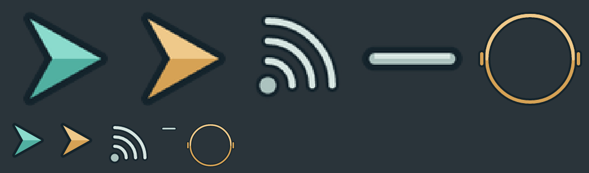
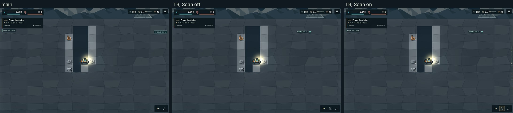
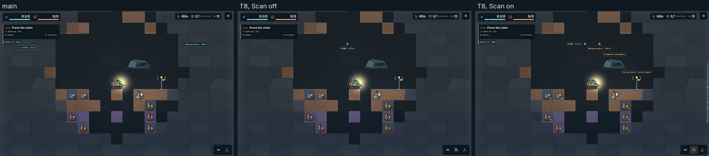
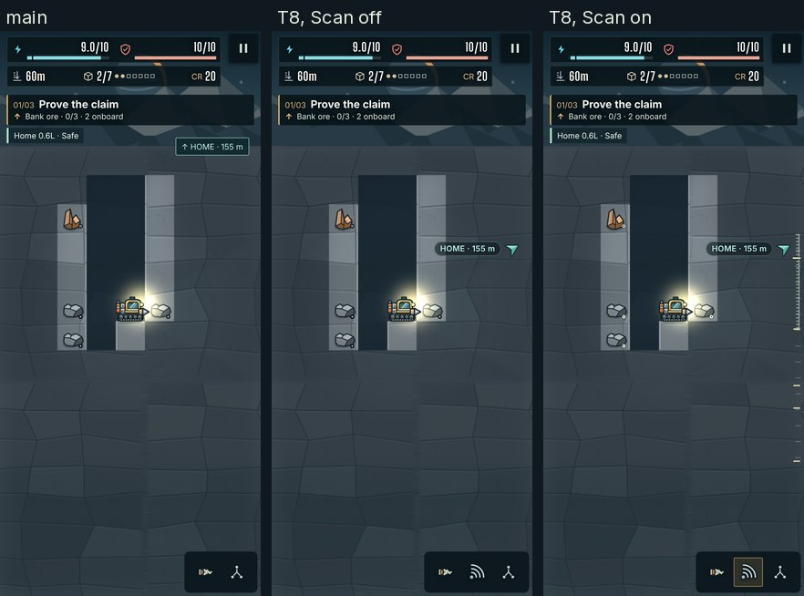
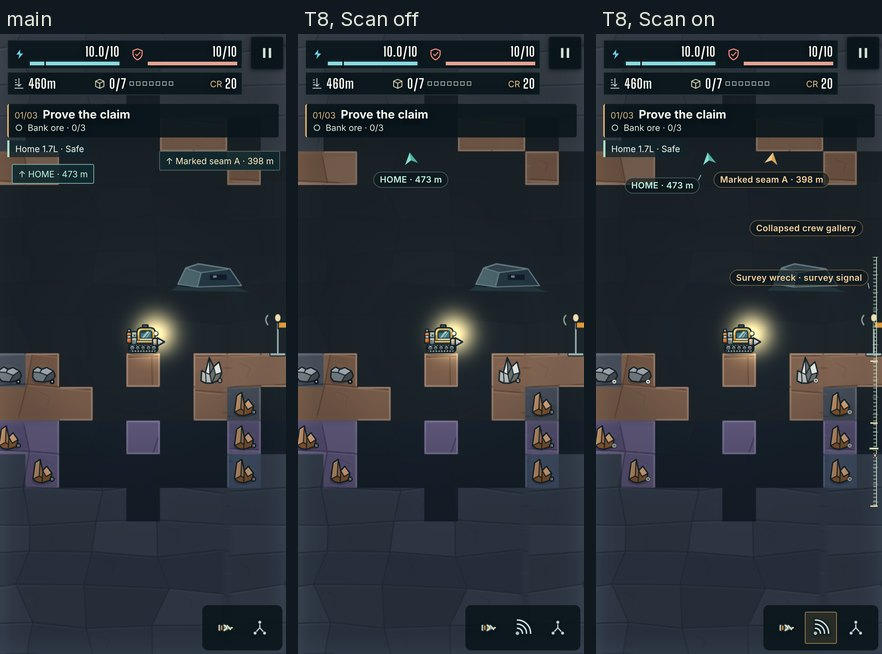
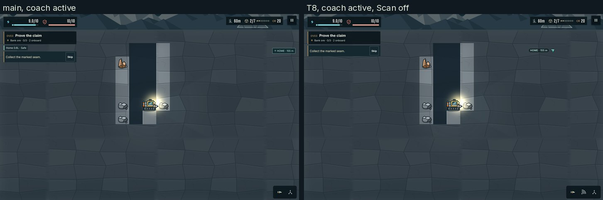
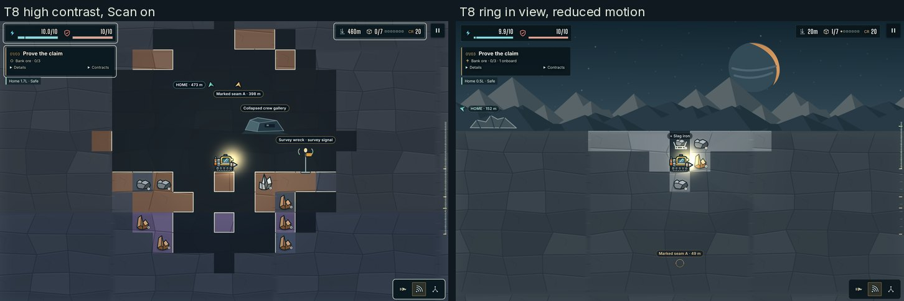

# T8: one annotation system with Scan

Evidence for item 1 of this stack: T8 in `docs/ART_QUALITY_AUDIT.md` §5.3 ("One annotation system with Scan"), under decision D3 (`docs/art-direction/decisions.md`): labels on demand with Scan; HOME stays an always-on edge chevron with its distance; hazard markers stay always on; everything else shows on Scan. Asset 28 (§5.6) is drawn here. The waypoint emitter and its light shaft are T10's, not here. Status: in review.

## What changed

- **One module.** `src/campaign/render/annotations.ts` replaces the scene's Phaser text pool (`label()`, `missionLabel()`) and the DOM HOME and target beacons (`ui/world-labels.ts` keeps only the camera's safe area). The scene asks for annotations while it draws (`annotate()`), and at the end of the frame one solver places them all, then the layer writes them.
- **The solver** (`solveAnnotations`, unit-tested in `tests/campaign-annotations.test.ts`). Most important first: hazards (0), prompts the player triggered (1), navigation (2), information (3), then nearest the rig. A label never enters the square of the rig's centre ± 1.2 tiles, never crosses another label, marker or DOM advisory (the coach, reserve chip, toasts, danger and extraction cards, the dock button, the toolbar and HUD), and stays in the playfield; one that cannot fit is dropped, never overlapped. A label pushed off its anchor gets asset 28's leader tick, pointing back. Placement reads only the screen positions of things the scene already draws for known cells (or the mission radio target, as before), so it cannot reveal hidden cells.
- **DOM, not canvas.** Labels, chevrons, the pulse ring and leader ticks are DOM in `#campaign-world-labels`, positioned by the scene every frame with transforms (no 60 ms lag, as the DOM beacons had), and a still frame writes nothing. They cost no WebGL draw (the phone is at its limit of 10 since A13), no texture upload (F2) and stay sharp at any backing scale. `render-acceptance.mjs` captures the canvas alone, so they do not reach its pixel checks; the fog check sees them (it screenshots the page).
- **Scan** (`src/campaign/input.ts`). A new pilot action, `scan`: Shift or F, gamepad L2 (button 6; L1 is interact, R1 the map), and a tool-tray button (`#campaign-scan-button`, asset 28's glyph; a canvas hold becomes the joystick after 180 ms, so touch needs the button). It shows the labels while held; the new preference **Toggle Scan labels** (`scanToggle`, beside the drill and brace toggles) latches it instead. It is remappable like every action; a saved layout that already uses Shift, F or L2 keeps them, and Scan takes what is free (L2, then R2, 10 or 11). Scan is never a campaign control and is off while a menu or dialog blocks play. `?scan=1` (or `0`) holds it for the harness and the smoke suites; `__campaignDebug.scan(true | false | null)` forces it from a test.
- **What shows.**

  | Annotation | Scan off | Scan on |
  |---|---|---|
  | HOME | **On** (Return guidance): an edge chevron pointing at the nearest wrapped copy of the lander, with "HOME · N m" (the old beacon's distance); a chevron over the lander while it is in view; hidden while docked; amber when the reserve says turn back | On |
  | Hazard markers (cold pocket, vent, pressure seam, shelf) | **On**, unchanged (canvas) | On |
  | Hazard sentence ("Pressure · move away", "UNSText items and overlay edge share per case, `main` beside T8 (both with the fixed mask). 0 items within 1.2 tiles of the rig and 0 overlaps in every T8 case.

| Form | Coach | Scene | `main`: text items · overlay edges | T8, Scan off | T8, Scan on |
|---|---|---|---|---|---|
| desktop | active | spawn | 7 · 22 % | **5 · 15 %** | 7 · 27 % |
| desktop | active | 60 m | 4 · 33 % | **3 · 27 %** | 4 · 36 % |
| desktop | active | SITE-4 | 5 · 21 % | **3 · 12 %** | 7 · 32 % |
| desktop | skipped | spawn | 3 · 15 % | **1 · 6 %** | 3 · 21 % |
| desktop | skipped | 60 m | 2 · 17 % | **1 · 8 %** | 2 · 21 % |
| desktop | skipped | SITE-4 | 3 · 15 % | **1 · 4 %** | 5 · 27 % |
| phone | active | spawn | 5 · 47 % | **3 · 30 %** | 5 · 51 % |
| phone | active | 60 m | 4 · 36 % | **3 · 32 %** | 4 · 40 % |
| phone | active | SITE-4 | 5 · 32 % | **3 · 15 %** | 7 · 46 % |
| phone | skipped | spawn | 3 · 40 % | **1 · 16 %** | 3 · 45 % |
| phone | skipped | 60 m | 2 · 23 % | **1 · 14 %** | 2 · 28 % |
| phone | skipped | SITE-4 | 3 · 21 % | **1 · 8 %** | 5 · 42 % |

Every T8 case, with its text items (`measure.py`):

| Form | Coach | Scene | Scan | Text items | Near the rig | Overlaps | Overlay edge share |
|---|---|---|---|---|---|---|---|
| desktop | active | spawn | off | 5: Hold Down to drill. · Skip · HOME · 150 m · A · B | 0 | 0 | 15 % |
| desktop | active | spawn | on | 7: Hold Down to drill. · Skip · Home 0.4L · Safe · HOME · 150 m · Marked seam A · 69 m · A · B | 0 | 0 | 27 % |
| desktop | active | 60m | off | 3: Collect the marked seam. · Skip · HOME · 155 m | 0 | 0 | 27 % |
| desktop | active | 60m | on | 4: Collect the marked seam. · Skip · Home 0.6L · Safe · HOME · 155 m | 0 | 0 | 36 % |
| desktop | active | site4 | off | 3: Collect the marked seam. · Skip · HOME · 473 m | 0 | 0 | 12 % |
| desktop | active | site4 | on | 7: Collect the marked seam. · Skip · Home 1.7L · Safe · HOME · 473 m · Marked seam A · 398 m · Survey wreck · survey signal · Collapsed crew gallery | 0 | 0 | 32 % |
| desktop | skipped | spawn | off | 1: HOME · 150 m | 0 | 0 | 6 % |
| desktop | skipped | spawn | on | 3: Home 0.4L · Safe · HOME · 150 m · Marked seam A · 69 m | 0 | 0 | 21 % |
| desktop | skipped | 60m | off | 1: HOME · 155 m | 0 | 0 | 8 % |
| desktop | skipped | 60m | on | 2: Home 0.6L · Safe · HOME · 155 m | 0 | 0 | 21 % |
| desktop | skipped | site4 | off | 1: HOME · 473 m | 0 | 0 | 4 % |
| desktop | skipped | site4 | on | 5: Home 1.7L · Safe · HOME · 473 m · Marked seam A · 398 m · Survey wreck · survey signal · Collapsed crew gallery | 0 | 0 | 27 % |
| phone | active | spawn | off | 3: Hold Down to drill. · Skip · HOME · 150 m | 0 | 0 | 30 % |
| phone | active | spawn | on | 5: Hold Down to drill. · Skip · Home 0.4L · Safe · HOME · 150 m · Marked seam A · 69 m | 0 | 0 | 51 % |
| phone | active | 60m | off | 3: Collect the marked seam. · Skip · HOME · 155 m | 0 | 0 | 32 % |
| phone | active | 60m | on | 4: Collect the marked seam. · Skip · Home 0.6L · Safe · HOME · 155 m | 0 | 0 | 40 % |
| phone | active | site4 | off | 3: Collect the marked seam. · Skip · HOME · 473 m | 0 | 0 | 15 % |
| phone | active | site4 | on | 7: Collect the marked seam. · Skip · Home 1.7L · Safe · HOME · 473 m · Marked seam A · 398 m · Survey wreck · survey signal · Collapsed crew gallery | 0 | 0 | 46 % |
| phone | skipped | spawn | off | 1: HOME · 150 m | 0 | 0 | 16 % |
| phone | skipped | spawn | on | 3: Home 0.4L · Safe · HOME · 150 m · Marked seam A · 69 m | 0 | 0 | 45 % |
| phone | skipped | 60m | off | 1: HOME · 155 m | 0 | 0 | 14 % |
| phone | skipped | 60m | on | 2: Home 0.6L · Safe · HOME · 155 m | 0 | 0 | 28 % |
| phone | skipped | site4 | off | 1: HOME · 473 m | 0 | 0 | 8 % |
| phone | skipped | site4 | on | 5: Home 1.7L · Safe · HOME · 473 m · Marked seam A · 398 m · Survey wreck · survey signal · Collapsed crew gallery | 0 | 0 | 42 % | SHELF", cold mist, vent) | **On** while its warning runs, one at a time (the nearest) | All, and the names of known hazards in view |
  | Rig cue ("Move clear", "Release drilling", "Need firm footing") | **On**, placed clear of the rig with a leader tick | On |
  | Inspection callout (the player tapped a mineral) | **On** | On |
  | Coach letters A and B (F6: only while the coach runs) | **On** during the coach | On |
  | Target: label "Name · N m", pulse ring in view, edge chevron off screen | Off (T10 adds the off-screen chevron and the emitter) | On, at any range (the canvas pin needed 8 cells) |
  | Mission-object captions, site names | Off | On, anywhere in view (they needed 3.8 and 2.5 tiles) |
  | Pickup name ("+ Shard silver") | Off (the cargo pips stay) | On |
  | Reserve chip "Home 0.6L · Safe" | Off while safe; **on** for "Plan return", "Turn back", "Cannot reach home"; the energy bar's notch always shows it | On |
  | Depth rail (F6: hover or pause) | Off | On |
  | Light tier marks (T9's high-contrast variant) | With high contrast | On |

- **Asset 28** (`assets/campaign/source/annotation-sources.mjs`, the kit's `svg.mjs`, `palette.mjs` and `records.mjs`; provenance `provenance/w01-annotations.json`). Five glyphs, two flat tiers each and the #14232b outline, kept below emitter value (style guide §6.1: the brightest and warmest pixels are emitters, never UI): `ui-chevron-home` (teal, L\* 82 / 66), `ui-chevron-target` (amber, 83 / 70), `ui-pulse-ring`, `ui-scan` and `ui-leader-tick` (grey-teal, 90 / 77). They go through frames.json and the build like every glyph (T13a), as DOM icons only (`generated/icons`, at each frame's new `iconSizes`: 72 px for a 24 px chevron at DPR 3, 192 px for the ring), so no runtime atlas page grows and the resident texture budget does not move. The rebuild is byte-identical (run twice); `check-campaign-assets.mjs` requires the frames and their icon sizes.

  

- **Style.** One label style (04-overlays.md R1): a 60 % `#0b161c` pill with a 1 px hairline in the tone's colour, 12 px Inter 600 (14 px with Larger text, scaled with Interface size). High contrast: an opaque pill, a 2 px border, white text, and a dark keyline round the markers. The pulse ring scales on the scene clock (0.8 Hz, 6 %), so it freezes under the test clock and stays still under reduced motion; nothing else moves.

## Acceptance

Measured by `measure.mjs` and `measure.py` in this folder (results in `results.json`, `results-main.json` and `motion.json`): desktop 1440 × 900 @2 and phone 393 × 851 @3 (art-captures' forms), at spawn, 60 m (a04's fixture) and SITE-4, with the coach active (as the fixtures load) and skipped (steady play), Scan off and on. `main` is 465e348.

| Line | Result | |
|---|---|---|
| At most 1 text item with Scan off at 60 m | Steady play: **1** (HOME · 155 m) on desktop and phone (`main`: 2, the reserve chip and HOME; F6's table had 3 with the wreck locator). With the coach active: **3** (the coach's line, Skip, HOME; `main` 4) | met in steady play; not with the coach |
| 0 within 1.2 tiles of the rig | 0 in all 24 cases, Scan off and on (a text box crossing the square of the rig's centre ± 1.2 tiles); also asserted for every §9 frame in `verify` | met |
| 0 collisions | 0 crossing text boxes and 0 crossing annotations (labels and markers) in all 24 cases | met |
| Overlay edge share ≤ 20 % | Steady play, Scan off: desktop 6 / 8 / 4 % (spawn, 60 m, SITE-4), phone 16 / 14 / 8 % (`main` 15 / 17 / 15 % and 40 / 23 / 21 %). With the coach active: desktop 15 / 27 / 12 %, phone 30 / 32 / 15 % (the coach card) | met in steady play; not with the coach |
| F6's counts not regressed | Every F6 case is lower or equal: desktop spawn 7 → 5 (coach) and 3 → 1 (steady), 60 m 5 → 3 and 3 → 1; phone spawn 5 → 3 and 3 → 1, 60 m 5 → 3 and 3 → 1 | met |
| High contrast, reduced motion | High contrast: opaque pills, white text, keylined markers, and Scan shows T9's light tier marks. Reduced motion: the ring's pulse is off; the ring, chevrons and labels are static (captures below) | met |
| Fog check and inset-crop scramble at 0 px | `improvement-smoke`'s fog check (W01 and W02) now also runs with Scan on; `render-acceptance`'s hidden-geology crops too, on both renderers: 0 differing pixels | met |
| Smoke suites with the new contract, Scan off and on | `feel-smoke`, `poi-smoke`, `frontier-smoke` and `plan-ui-smoke` pass with `PREVIEW_URL` plain and with `?scan=1` | met |

The overlay edge share uses `art_metrics.overlay_edge_share` with the HUD row, menu button, objective card and toolbar masked. **A measurement fix rides along:** the mask grew each HUD box by 3 px, so the toolbar plate's 5-px box-shadow ring counted as overlay edges (on the phone at 60 m, 828 of the 2,306 counted). `art-captures.mjs` now grows each HUD box by its box-shadow spread. The numbers above use the fixed mask for both `main` and T8.

### The full table

Text items and overlay edge share per case, `main` beside T8 (both with the fixed mask). 0 items within 1.2 tiles of the rig and 0 overlaps in every T8 case.

| Form | Coach | Scene | `main`: text items · overlay edges | T8, Scan off | T8, Scan on |
|---|---|---|---|---|---|
| desktop | active | spawn | 7 · 22 % | **5 · 15 %** | 7 · 27 % |
| desktop | active | 60 m | 4 · 33 % | **3 · 27 %** | 4 · 36 % |
| desktop | active | SITE-4 | 5 · 21 % | **3 · 12 %** | 7 · 32 % |
| desktop | skipped | spawn | 3 · 15 % | **1 · 6 %** | 3 · 21 % |
| desktop | skipped | 60 m | 2 · 17 % | **1 · 8 %** | 2 · 21 % |
| desktop | skipped | SITE-4 | 3 · 15 % | **1 · 4 %** | 5 · 27 % |
| phone | active | spawn | 5 · 47 % | **3 · 30 %** | 5 · 51 % |
| phone | active | 60 m | 4 · 36 % | **3 · 32 %** | 4 · 40 % |
| phone | active | SITE-4 | 5 · 32 % | **3 · 15 %** | 7 · 46 % |
| phone | skipped | spawn | 3 · 40 % | **1 · 16 %** | 3 · 45 % |
| phone | skipped | 60 m | 2 · 23 % | **1 · 14 %** | 2 · 28 % |
| phone | skipped | SITE-4 | 3 · 21 % | **1 · 8 %** | 5 · 42 % |

Every T8 case, with its text items (`measure.py`):

| Form | Coach | Scene | Scan | Text items | Near the rig | Overlaps | Overlay edge share |
|---|---|---|---|---|---|---|---|
| desktop | active | spawn | off | 5: Hold Down to drill. · Skip · HOME · 150 m · A · B | 0 | 0 | 15 % |
| desktop | active | spawn | on | 7: Hold Down to drill. · Skip · Home 0.4L · Safe · HOME · 150 m · Marked seam A · 69 m · A · B | 0 | 0 | 27 % |
| desktop | active | 60m | off | 3: Collect the marked seam. · Skip · HOME · 155 m | 0 | 0 | 27 % |
| desktop | active | 60m | on | 4: Collect the marked seam. · Skip · Home 0.6L · Safe · HOME · 155 m | 0 | 0 | 36 % |
| desktop | active | site4 | off | 3: Collect the marked seam. · Skip · HOME · 473 m | 0 | 0 | 12 % |
| desktop | active | site4 | on | 7: Collect the marked seam. · Skip · Home 1.7L · Safe · HOME · 473 m · Marked seam A · 398 m · Survey wreck · survey signal · Collapsed crew gallery | 0 | 0 | 32 % |
| desktop | skipped | spawn | off | 1: HOME · 150 m | 0 | 0 | 6 % |
| desktop | skipped | spawn | on | 3: Home 0.4L · Safe · HOME · 150 m · Marked seam A · 69 m | 0 | 0 | 21 % |
| desktop | skipped | 60m | off | 1: HOME · 155 m | 0 | 0 | 8 % |
| desktop | skipped | 60m | on | 2: Home 0.6L · Safe · HOME · 155 m | 0 | 0 | 21 % |
| desktop | skipped | site4 | off | 1: HOME · 473 m | 0 | 0 | 4 % |
| desktop | skipped | site4 | on | 5: Home 1.7L · Safe · HOME · 473 m · Marked seam A · 398 m · Survey wreck · survey signal · Collapsed crew gallery | 0 | 0 | 27 % |
| phone | active | spawn | off | 3: Hold Down to drill. · Skip · HOME · 150 m | 0 | 0 | 30 % |
| phone | active | spawn | on | 5: Hold Down to drill. · Skip · Home 0.4L · Safe · HOME · 150 m · Marked seam A · 69 m | 0 | 0 | 51 % |
| phone | active | 60m | off | 3: Collect the marked seam. · Skip · HOME · 155 m | 0 | 0 | 32 % |
| phone | active | 60m | on | 4: Collect the marked seam. · Skip · Home 0.6L · Safe · HOME · 155 m | 0 | 0 | 40 % |
| phone | active | site4 | off | 3: Collect the marked seam. · Skip · HOME · 473 m | 0 | 0 | 15 % |
| phone | active | site4 | on | 7: Collect the marked seam. · Skip · Home 1.7L · Safe · HOME · 473 m · Marked seam A · 398 m · Survey wreck · survey signal · Collapsed crew gallery | 0 | 0 | 46 % |
| phone | skipped | spawn | off | 1: HOME · 150 m | 0 | 0 | 16 % |
| phone | skipped | spawn | on | 3: Home 0.4L · Safe · HOME · 150 m · Marked seam A · 69 m | 0 | 0 | 45 % |
| phone | skipped | 60m | off | 1: HOME · 155 m | 0 | 0 | 14 % |
| phone | skipped | 60m | on | 2: Home 0.6L · Safe · HOME · 155 m | 0 | 0 | 28 % |
| phone | skipped | site4 | off | 1: HOME · 473 m | 0 | 0 | 8 % |
| phone | skipped | site4 | on | 5: Home 1.7L · Safe · HOME · 473 m · Marked seam A · 398 m · Survey wreck · survey signal · Collapsed crew gallery | 0 | 0 | 42 % |

## Not met, and why

- **With the coach active, 3 text items and 27–32 % overlay edges at 60 m.** The coach card ("Collect the marked seam." and its Skip button) is a notice, not an annotation; D3 keeps F6's coach. The audit's own text budget is set for steady play (`docs/art-audit/04-overlays.md` §6 item 2: "≤ 1 in steady play after the coach"). Moving the coach into the objective pill is W7 (§5.4, "coach in the pill's second line"), not in this stack; it is an open point for the director.
- **The phone spawn, coach active, 30 %**: the same coach card on a mostly empty sky.

## Overlaps with open work

- **Session A, F2** (zero steady uploads): F2's guard on `setWordWrapWidth` lived in the Phaser label pool, which T8 removes; the annotations are DOM and upload nothing.
- **Session A, F7** (hidden-information contract): annotations read screen positions of known things and the mission radio target only; `__campaignDebug.scan()` and `?scan=1` give F7's full-frame scramble its "Scan on" case.
- **PR #15 (T2 spike):** no shared hunk in `scene.ts` (its imports, terrain layer, readout and dataset lines are untouched); `scripts/art-captures.mjs`, `improvement-smoke.mjs` and `render-acceptance.mjs` change in other places.

## Captures

`main` (465e348) on the left; T8 with Scan off and on. Steady play (coach skipped), as `measure.mjs` captured them (desktop 1440 × 900 @2, phone 393 × 851 @3).









With the coach active, as the fixtures load: the coach card stays (see "Not met").



High contrast with Scan on (opaque pills, white text, keylined markers, the light tier marks), and a target in view with reduced motion (the ring does not pulse: its transform reads `translate(705px, 763.5px)` 0.3 s apart, against `scale(1.0289)` then `scale(1.0543)` with motion on).



## Reproduce

```bash
node docs/qa/t8-scan-annotations/measure.mjs http://127.0.0.1:5173/ artifacts/t8
```

```bash
python3 docs/qa/t8-scan-annotations/measure.py artifacts/t8
```

```bash
PYTHON=python3 npm run assets:rebuild
```

## Verification

The whole `verify` job of `checks.yml` passed locally before the push, every step exiting 0, in 917 s (Node 22.23.4, Chromium 153; CI runs Node 24 and Chromium 156):
- `npm test` (418 passed, 5 skipped; `main` 402: 16 new cases in `campaign-annotations.test.ts`, `campaign-input.test.ts` and `campaign-view.test.ts`), `format:check` and `build`;
- `assets:rebuild` with Pillow 12.0.0, then no change under `assets/campaign` (the rebuild CI runs);
- `test:improvements` with `behavior,visual,fog,harness`: the harness now asserts T8's rig clearance and collisions in every §9 frame, the 60 m steady-play budget and the Shift and tray paths, and the fog check runs with Scan on as well;
- `test:campaign:storage`, `test:feel`, `test:audio`, `test:plan-ui`, `test:render` (its hidden-geology crops with Scan on as well), `test:render:memory`, `test:camera`, `test:hud:surface`, and `test:opening:browser` on desktop and portrait.

Outside `verify`, `npm run test:poi`, `test:frontier`, `test:feel` and `test:plan-ui` passed with `PREVIEW_URL` plain and with `?scan=1` (§9.4 item 4: Scan off and on).
