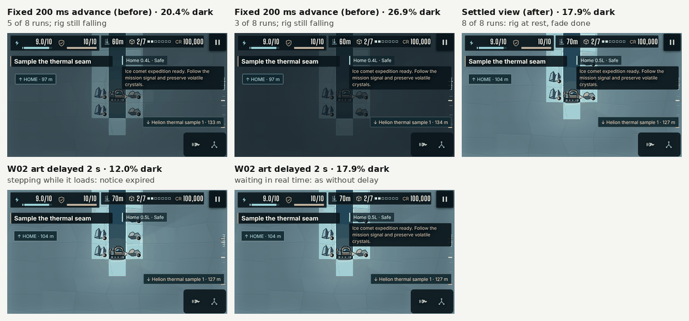

# Visual check: capture settled views

Evidence for the `visual` section of `scripts/improvement-smoke.mjs`: 12 captures, W01 and W02 × desktop, portrait and landscape × shaft and danger. It builds on [`../fog-check-framing/`](../fog-check-framing/README.md), which added `settledView()`.

## Problem

Each capture was taken a fixed 200 ms (four 50 ms frames) after `restore()`, which runs one frame itself. In each browser context the first W02 restore switches worlds, and W02 art loads on demand. Until its atlas and sky arrive, `update()` in `src/campaign/scene.ts` returns early and the scene keeps publishing the previous view. When they arrive, the import's 180 ms fade-in starts. The capture showed whichever frame was current.

In a traced run, the W02 requests finished before `restore()`'s frame, but that frame still showed W01 because the textures were not ready yet. W02 appeared on the next frame, and the capture came three frames after that: 150 ms into the 180 ms fade, with the camera still moving. A later arrival leaves more of the fade. An arrival just before the last frame gives the solid fade colour (12, 20, 27).

The W02 rig was also falling. In the W02 fixture, column 12 is already open through row 6, and row 7 is its floor. `fixture("W02", 6)` therefore restored the rig in mid-air at y 5.64, and it fell to 6.64 over about 25 frames. That is also why `settledView()` alone cannot settle these captures: the rig never comes to rest within 0.5 tile of the checkpoint. W01's column is solid at row 6.

Before this change, in 8 local runs (Chromium 153, `npm run dev`), `W02-landscape-shaft` was 20.4 % dark in 5 runs and 26.9 % in 3, and `W02-portrait-shaft` was 18.2 % in 7 and 16.1 % in 1.



## Changes

1. Each capture waits for `settledView()` instead of a fixed 200 ms.
2. The W02 rig is restored on its floor (row 7), where it came to rest anyway.
3. While the scene still shows the previous view, `settledView()` waits 250 ms in real time before the next frame. HUD notices expire on the game clock. The W02 arrival notice ("Ice comet expedition ready…") lasts 2 s. With every W02 art request delayed by 2 s, the loop stepped through 15–32 loading frames (0.75–1.6 s). By the time `W02-landscape-shaft` was captured, the notice had expired: 12.0 % instead of 17.9 %. With the wait it takes 6–8 loading frames, and every W02 capture has the same dark share as without the delay.
4. Before each danger restore, the visual section advances until the arrival notice has expired. The camera keeps the rig clear of the HUD, whose height it measures and caches for 150 ms of game time. Depending on load timing, the first W02 frame still used the W01 height (a 154 px safe area rather than 183 px on desktop), and the camera then eased for three more frames. That put the W02 desktop danger capture 1.9 or 2.05 s after the notice appeared, either side of its 2 s lifetime. The notice was in 4 of 5 plain runs and in none of 5 traced runs. Danger captures now never show it, like W01's, which have no arrival notice. Shaft captures still show it.

Thresholds, lighting, overlays and assets are unchanged.

## Result

| Capture | Dark % before (8 runs) | Dark % after (8 runs) | Minimum HUD contrast before | Minimum HUD contrast after |
|---|---|---|---|---|
| `W01-desktop-danger` | 4.81 | 4.78 / 4.80 | 8.627 | 8.627 |
| `W01-desktop-shaft` | 5.07 | 5.06 | 8.627 | 8.627 |
| `W01-landscape-danger` | 19.55 / 19.57 | 19.55 / 19.57 | 9.817 | 9.817 |
| `W01-landscape-shaft` | 18.36 / 18.39 | 18.38 / 18.39 | 10.398 | 10.398 |
| `W01-portrait-danger` | 16.23 / 16.30 / 16.43 / 16.44 | 16.14 / 16.15 | 8.559 | 8.559 |
| `W01-portrait-shaft` | 17.37 | 17.38 | 8.559 | 8.559 |
| `W02-desktop-danger` | 5.72 | 4.90 | 8.383 | 8.383 |
| `W02-desktop-shaft` | 6.45 | 5.24 | 8.727 | 8.383 |
| `W02-landscape-danger` | 21.41 / 21.42 | 15.53 | 8.336 | 8.450 |
| `W02-landscape-shaft` | 20.40 / 20.41 / 26.93 | 17.90 | 10.518 / 10.810 | 10.088 |
| `W02-portrait-danger` | 17.39 | 13.65 | 8.741 | 8.291 |
| `W02-portrait-shaft` | 16.11 / 18.22 | 15.32 | 8.816 / 8.972 | 8.291 |

The 8 runs after are 6 plain runs, one traced run and one with every W02 art request delayed by 2 s. In all of them the dark shares the check prints were the same, all 12 captures were the same when rounded to 0.1 %, and every capture's minimum HUD contrast was the same. The lowest contrast is now 8.291:1, the `○` mission status in the W02 portrait captures. It used to be measured over a partly faded view.

## Remaining variation

Five captures still differ by up to 0.02 percentage points at full precision: the critical alarm frame at the screen edge in danger captures, and a few dozen pixels on or next to the rig. The alarm frame's alpha follows the scene's `elapsed` time (`0.45 + sin(elapsed · 4) · 0.18`). `elapsed` starts when `ready()` clicks Start, and the game runs on the real clock until `freeze()`, for a time that differs per browser context. Both kinds of difference were already there before this change, and neither depends on the atlas load. Removing them would mean freezing the clock before Start in `ready()`, which most browser checks share.

## Reproduce

```bash
npm run dev -- --port 5173 --strictPort &
CHROMIUM_PATH=/path/to/chromium IMPROVEMENT_CHECKS=visual npm run test:improvements
```

Measurements are written to `artifacts/improvement/pixels.json`.
